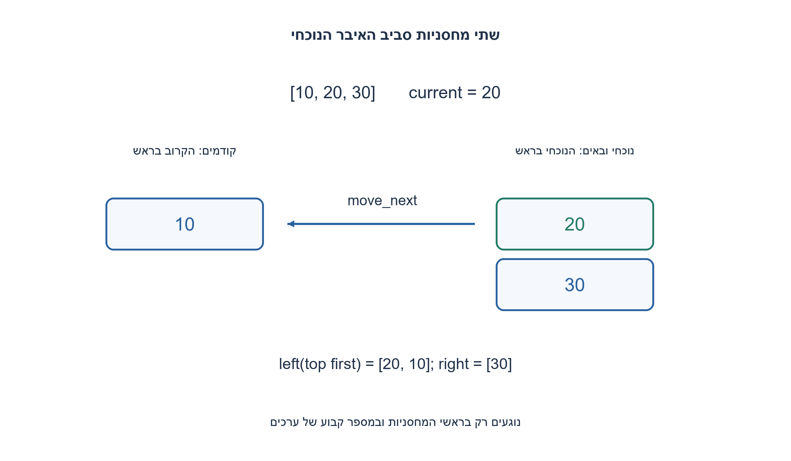
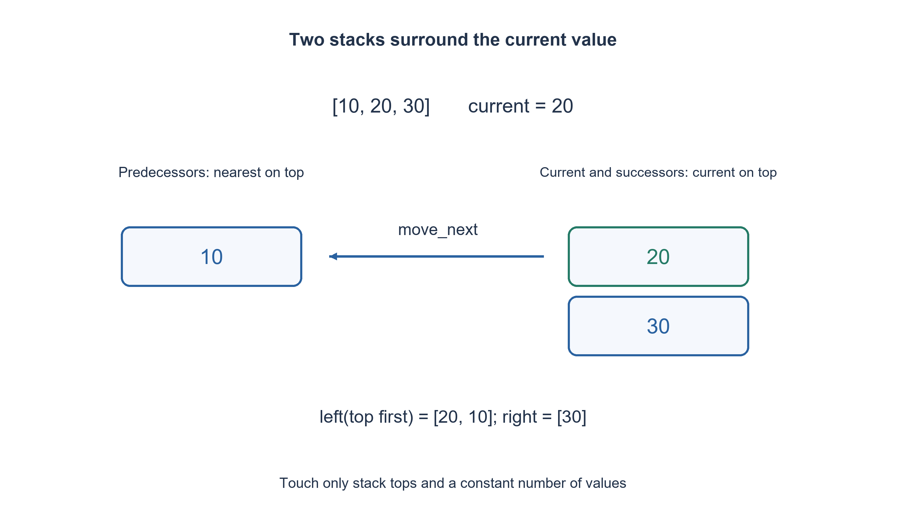

# PREP-304 — רשימה סביב איבר נוכחי באמצעות שתי מחסניות

פתרון מוצע בסיוע AI; ביקורת מקצועית אנושית ממתינה. הקושי אינו מכויל.

## עברית

ממשו רשימה באמצעות שתי מחסניות בלבד, כך שהוספה לפני או אחרי האיבר הנוכחי, קריאת האיבר ושכניו, תנועה לשכן ומחיקת הנוכחי דורשות O(1).

השלמת חוזה: זו רשימת ערכי int עם סמן נוכחי יחיד, לא מבנה שמקבל מצביע שרירותי לצומת. get/prev/next קוראות בלי להזיז; move_prev/move_next מזיזות ומחזירות הצלחה. insert_before/insert_after משאירות את הנוכחי במקומו; בריק האיבר החדש נעשה נוכחי. delete מחזירה את הערך שנמחק, ובוחרת את הבא כנוכחי אם ישנו, אחרת את הקודם, אחרת ריק. קריאה או מחיקה חסרות מעלות IndexError; תנועה מעבר לקצה מחזירה false בלי שינוי. מותר מספר קבוע של משתנים. מניחים פעולות מחסנית יסודיות בזמן קבוע, כולל הקצאת צומת במודל. אין דרישת חיפוש לפי ערך או אינדקס בזמן קבוע.

1. איזה חלק של הרשימה צריך להיות זמין ליד ראש כל מחסנית?
2. שמרו משמאל את הקודמים, הקרוב בראש; מימין את הנוכחי והבאים, כשהנוכחי בראש.
3. תנועה מעבירה איבר בין המחסניות. כדי להכניס אחרי הנוכחי הוציאו אותו זמנית, דחפו חדש והחזירו אותו.

### שתי מחסניות הן שני צדי הסמן
מחסנית left מכילה את האיברים שלפני הנוכחי, כשהקודם המיידי בראש. מחסנית right מכילה את הנוכחי ואחריו את הבאים. הרשימה הלוגית היא היפוך סדר האיברים ב־ left ואחריו right מהראש לתחתית. אם הרשימה אינה ריקה, right אינה ריקה.

למשל ברשימה [10,20,30] עם 20 נוכחי, left מכילה בראש 10 ו־ right מכילה בראש 20 ומתחתיו 30. move_next מעבירה את 20 משמאל ו־ 30 נעשה נוכחי. move_prev מעבירה מראש left אל right. קריאת next מוציאה את הנוכחי זמנית, קוראת את הראש הבא ומחזירה את הנוכחי גם אם הקריאה נכשלת.

### הוספה ומחיקה
insert_before דוחפת ל־ left, בלי לשנות את הנוכחי. insert_after מוציאה זמנית את הנוכחי, דוחפת את החדש ל־ right ומחזירה את הנוכחי מעליו. מחיקה מוציאה מראש right; אם נשאר איבר, הוא הנוכחי החדש. אם right התרוקנה אך left לא, מעבירים את הקודם ל־ right. בריק שתי המחסניות ריקות וההכנסה הראשונה דוחפת ל־ right.

### נכונות ועלות
כל פעולה שומרת את פירוק הרשימה סביב הסמן: תנועה משנה רק את הגבול; הכנסה מוסיפה בצדו המתאים; מחיקה מסירה בדיוק את הנוכחי ובוחרת שכן לפי החוזה. קריאות מחזירות את המצב גם בכשל, ותנועת קצה אינה מאבדת איבר. אין מעבר על הרשימה: לכל פעולה מספר קבוע של פעולות מחסנית, O(1) במקרה הגרוע במודל הפרימיטיבים שנבחר, ו־ O(n) אחסון לערכים. הקצאה ב־ Python או מנהל זיכרון ממשי אינה הבטחה לזמן תגובה קשיח. שתי מחסניות אינן מעניקות מעצמן מחיקה של צומת שרירותי שאינו ליד הסמן; זאת דרישה אחרת.

```python
"""A current-position list represented by two linked stacks."""


class _Node:
    __slots__ = ("next", "value")

    def __init__(self, value, next_node):
        self.value = value
        self.next = next_node


class _Stack:
    def __init__(self):
        self.head = None

    def empty(self):
        return self.head is None

    def push(self, value):
        self.head = _Node(value, self.head)

    def pop(self):
        value = self.top()
        self.head = self.head.next
        return value

    def top(self):
        if self.head is None:
            raise IndexError("no element")
        return self.head.value


class CursorList:
    def __init__(self):
        self.left = _Stack()
        self.right = _Stack()

    def get(self):
        return self.right.top()

    def prev(self):
        return self.left.top()

    def next(self):
        current = self.right.pop()
        try:
            return self.right.top()
        finally:
            self.right.push(current)

    def move_prev(self):
        if self.left.empty():
            return False
        self.right.push(self.left.pop())
        return True

    def move_next(self):
        if self.right.empty():
            return False
        current = self.right.pop()
        if self.right.empty():
            self.right.push(current)
            return False
        self.left.push(current)
        return True

    def insert_before(self, value):
        if type(value) is not int:
            raise TypeError("integer value required")
        (self.right if self.right.empty() else self.left).push(value)

    def insert_after(self, value):
        if type(value) is not int:
            raise TypeError("integer value required")
        if self.right.empty():
            self.right.push(value)
        else:
            current = self.right.pop()
            self.right.push(value)
            self.right.push(current)

    def delete(self):
        value = self.right.pop()
        if self.right.empty() and not self.left.empty():
            self.right.push(self.left.pop())
        return value


def cursor_trace(operations):
    """Test adapter; current-relative operations only, no arbitrary node handles."""
    cursor = CursorList()
    output = []
    allowed = {"get", "prev", "next", "move_prev", "move_next",
               "insert_before", "insert_after", "delete"}
    for operation in operations:
        name, *args = operation
        if name not in allowed or len(args) != int(name.startswith("insert_")):
            raise ValueError("invalid operation")
        try:
            output.append({"ok": True, "value": getattr(cursor, name)(*args)})
        except IndexError:
            output.append({"ok": False, "error": "empty_or_boundary"})
    return output
```




## English

Implement a list using only two stacks so insertion before/after the current element, reading it or its neighbors, moving to a neighbor and deleting current take O(1).

Chosen contract: integer values and one current-position cursor, not arbitrary node handles. get/prev/next read without moving; move_prev/move_next move and return success. Insertions preserve current; inserting into empty makes the new value current. delete returns its removed value and selects the successor if present, otherwise predecessor, otherwise empty. Missing reads/deletion raise IndexError; moving beyond a boundary returns false unchanged. A constant number of scalar temporaries is allowed. Stack primitives, including node allocation in this model, are O(1). No constant-time search by index/value is promised.

1. Which part of the list should be available at each stack top?
2. Keep predecessors on the left, nearest first, and current plus successors on the right, current first.
3. Moving transfers one value between stacks. For insert-after, temporarily pop current, push the new value, then restore current.

### Two stacks are the two sides of the cursor
left holds predecessors with the nearest at its top. right holds current and successors with current on top. The logical list is left in bottom-to-top order followed by right top-to-bottom. Nonempty lists always have a nonempty right stack.

For [10,20,30] with current 20, left has top 10 and right has top 20 above 30. move_next transfers 20 to left, exposing 30. move_prev transfers the left top to right. Reading next temporarily removes current, reads the following top and restores current even when no successor exists.

### Insertion and deletion
insert_before pushes left without moving current. insert_after saves current, pushes the new value right, then pushes current back above it. delete pops right; its next top is the successor. If right becomes empty but left does not, move the predecessor right. Inserting into empty pushes right and establishes current.

### Correctness and cost
Each operation preserves the representation of the two sides: movement changes only the cut, insertion adds at the correct side, and deletion removes exactly current and selects the specified neighbor. Read failure restores state and failed boundary movement loses no value. No operation traverses the list: each uses a bounded number of stack primitives, O(1) worst-case under the explicit primitive/allocation model, with O(n) value storage. Real Python allocation is not a hard real-time guarantee. Two stacks do not magically support deletion by an arbitrary off-cursor node handle; that is a different contract.

```python
"""A current-position list represented by two linked stacks."""


class _Node:
    __slots__ = ("next", "value")

    def __init__(self, value, next_node):
        self.value = value
        self.next = next_node


class _Stack:
    def __init__(self):
        self.head = None

    def empty(self):
        return self.head is None

    def push(self, value):
        self.head = _Node(value, self.head)

    def pop(self):
        value = self.top()
        self.head = self.head.next
        return value

    def top(self):
        if self.head is None:
            raise IndexError("no element")
        return self.head.value


class CursorList:
    def __init__(self):
        self.left = _Stack()
        self.right = _Stack()

    def get(self):
        return self.right.top()

    def prev(self):
        return self.left.top()

    def next(self):
        current = self.right.pop()
        try:
            return self.right.top()
        finally:
            self.right.push(current)

    def move_prev(self):
        if self.left.empty():
            return False
        self.right.push(self.left.pop())
        return True

    def move_next(self):
        if self.right.empty():
            return False
        current = self.right.pop()
        if self.right.empty():
            self.right.push(current)
            return False
        self.left.push(current)
        return True

    def insert_before(self, value):
        if type(value) is not int:
            raise TypeError("integer value required")
        (self.right if self.right.empty() else self.left).push(value)

    def insert_after(self, value):
        if type(value) is not int:
            raise TypeError("integer value required")
        if self.right.empty():
            self.right.push(value)
        else:
            current = self.right.pop()
            self.right.push(value)
            self.right.push(current)

    def delete(self):
        value = self.right.pop()
        if self.right.empty() and not self.left.empty():
            self.right.push(self.left.pop())
        return value


def cursor_trace(operations):
    """Test adapter; current-relative operations only, no arbitrary node handles."""
    cursor = CursorList()
    output = []
    allowed = {"get", "prev", "next", "move_prev", "move_next",
               "insert_before", "insert_after", "delete"}
    for operation in operations:
        name, *args = operation
        if name not in allowed or len(args) != int(name.startswith("insert_")):
            raise ValueError("invalid operation")
        try:
            output.append({"ok": True, "value": getattr(cursor, name)(*args)})
        except IndexError:
            output.append({"ok": False, "error": "empty_or_boundary"})
    return output
```




## חומר משלים / Supporting material

```json
{
  "assumptions": {
    "he": [
      "סמן נוכחי יחיד; אין גישה ישירה לצומת רחוק. שתי מחסניות מקושרות ופעולות יסוד בזמן קבוע."
    ],
    "en": [
      "One current cursor; no off-cursor node access. Two linked stacks with constant-time primitives."
    ]
  },
  "optimality": {
    "he": "O(1) פעולות מחסנית לכל פעולה, O(n) אחסון; אין טענה למינימום זיכרון או להשהיה קשיחה.",
    "en": "O(1) stack primitives per operation and O(n) storage; no minimum-space or hard real-time claim."
  },
  "verification": {
    "he": "5,000 פעולות הושוו לרשימה רגילה וסמן אינדקס. מונה פרימיטיבים וידא לכל היותר שמונה לפעולה.",
    "en": "5,000 operations compared with an ordinary list/index oracle; an instrumented counter bounded each operation by eight primitives."
  },
  "edge_cases": {
    "he": [
      "ריק, איבר יחיד, קצוות, קריאת שכן חסר, מחיקה בקצה וכפילויות."
    ],
    "en": [
      "Empty, singleton, boundaries, absent neighbors, tail deletion and duplicates."
    ]
  },
  "common_mistakes": {
    "he": [
      "לא להפוך את שתי המחסניות בכל תנועה; לא לאבד נוכחי בקריאת next שנכשלה; לא להבטיח חיפוש שרירותי O(1)."
    ],
    "en": [
      "Do not reverse all stacks on movement, lose current on failed next, or promise arbitrary O(1) search."
    ]
  },
  "interview_answer": {
    "he": "שתי המחסניות שומרות את הצדדים סביב הנוכחי, ולכן כל פעולה נוגעת רק בראשיהן.",
    "en": "Two stacks store the sides around current, so every operation touches only their tops."
  },
  "source_ambiguities": {
    "he": "המקור אינו מגדיר סמן, מדיניות קצוות או סוג רשימה. נבחר חוזה של סמן יחיד כדי לממש את האילוץ באופן תקף.",
    "en": "The source omits cursor and boundary policies; a single-cursor contract makes the requirement precise."
  },
  "solution_extensions": {
    "he": [
      {
        "question": "מה קורה אם דורשים גישה לאינדקס i בזמן קבוע?",
        "answer_direction": "שתי מחסניות אינן מספיקות לחוזה זה; צריך אינדוקס נוסף או לשנות את גבולות הזמן.",
        "principle": "הרחבת חוזה באופן מפורש"
      }
    ],
    "en": [
      {
        "question": "What if constant-time access to arbitrary index i is also required?",
        "answer_direction": "Two stacks alone do not provide that contract; add indexing or change the time bounds.",
        "principle": "Make an extension explicit"
      }
    ]
  }
}
```
