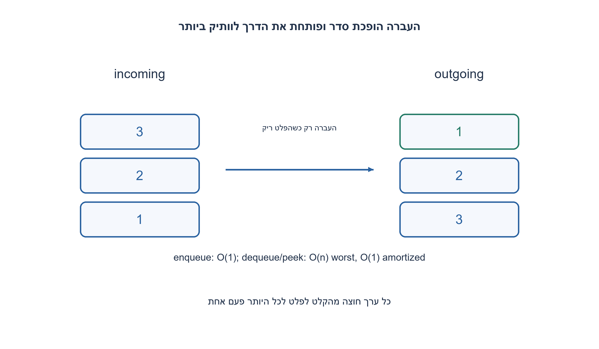
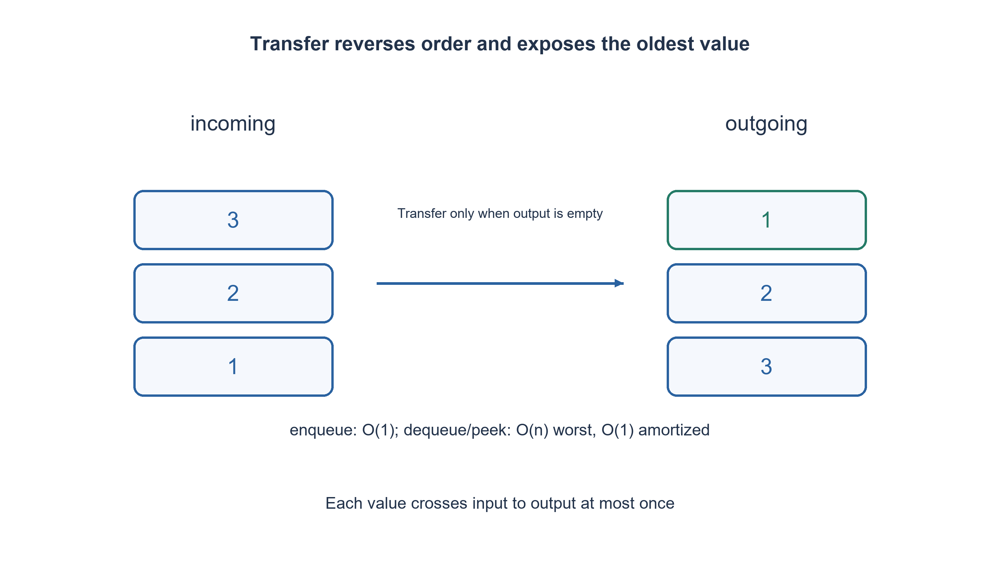

# PREP-305 — תור FIFO באמצעות שתי מחסניות וניתוח אמורטי

פתרון מוצע בסיוע AI; ביקורת מקצועית אנושית ממתינה. הקושי אינו מכויל.

## עברית

ממשו תור באמצעות שתי מחסניות.

השלמת חוזה: ערכי int, תור בלתי חסום במודל ופעולות enqueue, dequeue, peek, is_empty. dequeue מוציאה את הוותיק ביותר ו־ peek קוראת אותו בלי להוציא. בשניהם ריק מעלה IndexError בלי לשנות את התור. השתמשו רק ב־ push/pop/top/empty של שתי מחסניות ובמספר קבוע של משתנים; אין הוצאה מתחתית, אינדוקס או היפוך ספרייה. נתחו במפורש זמן במקרה הגרוע לפעולה וזמן אמורטי ברצף; אין הבטחה שכל dequeue בודדת היא O(1).

1. מה הקשר בין סדר מחסנית לסדר תור?
2. העברה ממחסנית אחת לשנייה הופכת את הסדר. שימרו מחסנית לקלט ומחסנית לפלט.
3. העבירו את כל הקלט לפלט רק כשהפלט ריק. כל ערך מועבר כך לכל היותר פעם אחת.

### הופכים פעם אחת, בזמן שצריך
enqueue דוחפת ל־ incoming. כדי לקרוא או להוציא, משתמשים בראש outgoing. אם outgoing ריקה, מעבירים אליה את כל incoming באמצעות pop ו־ push. ההיפוך מציב את הערך הישן ביותר בראש. אם גם incoming ריקה, התור ריק.

למשל אחרי הכנסת 1,2,3, ההעברה הראשונה מסדרת את outgoing עם 1 בראש. הוצאת 1 ואחריה הכנסת 4 אינה מתירה להעביר את 4 לפני 2 ו־ 3. רק לאחר ריקון outgoing מעבירים את הקלט החדש. זהו התנאי ששומר על סדר FIFO.

### אינווריאנט
התור הלוגי מורכב מ־ outgoing מהראש לתחתית ואחריה incoming מהתחתית לראש. הכנסת ערך מוסיפה אותו בסוף החלק השני. הוצאה מסירה את תחילת החלק הראשון. כשהחלק הראשון ריק, העברה הופכת את החלק השני בלי לשנות את הסדר הלוגי. לכן peek/dequeue בוחרות תמיד בוותיק ביותר. כשל ריק משאיר את שתי המחסניות ריקות.

### למה אמורטי אינו מקרה גרוע
enqueue היא O(1). dequeue או peek עשויות להעביר n ערכים ולכן עולות O(n) באותה קריאה. עם זאת, כל ערך נדחף לקלט פעם אחת, יוצא ממנו פעם אחת, נדחף לפלט פעם אחת ויוצא ממנו לכל היותר פעם אחת: לכל היותר ארבע פעולות push/pop לערך. לכן m פעולות מתחילת תור ריק עולות O(m) יחד, כלומר O(1) אמורטי לפעולה. לפעולות top/empty יש עלות קבועה נוספת. האחסון O(n). הניתוח אינו מצדיק השהיה קבועה במערכת זמן אמת.

```python
"""Two stacks, enqueue O(1), dequeue/peek amortized O(1)."""


class _Node:
    __slots__ = ("next", "value")

    def __init__(self, value, next_node):
        self.value = value
        self.next = next_node


class _Stack:
    def __init__(self):
        self.head = None

    def empty(self):
        return self.head is None

    def push(self, value):
        self.head = _Node(value, self.head)

    def pop(self):
        value = self.top()
        self.head = self.head.next
        return value

    def top(self):
        if self.empty():
            raise IndexError("empty queue")
        return self.head.value


class TwoStackQueue:
    def __init__(self):
        self.incoming = _Stack()
        self.outgoing = _Stack()

    def enqueue(self, value):
        if type(value) is not int:
            raise TypeError("integer value required")
        self.incoming.push(value)

    def _prepare(self):
        if self.outgoing.empty():
            while not self.incoming.empty():
                self.outgoing.push(self.incoming.pop())

    def dequeue(self):
        self._prepare()
        return self.outgoing.pop()

    def peek(self):
        self._prepare()
        return self.outgoing.top()

    def is_empty(self):
        return self.incoming.empty() and self.outgoing.empty()


def queue_trace(operations):
    """Pure transcript adapter; errors do not change the abstract queue."""
    queue = TwoStackQueue()
    output = []
    allowed = {"enqueue", "dequeue", "peek", "is_empty"}
    for operation in operations:
        name, *args = operation
        if name not in allowed or len(args) != int(name == "enqueue"):
            raise ValueError("invalid operation")
        try:
            output.append({"ok": True, "value": getattr(queue, name)(*args)})
        except IndexError:
            output.append({"ok": False, "error": "empty"})
    return output
```




## English

Implement a queue using two stacks.

Chosen contract: integer values, an unbounded abstract FIFO, and enqueue/dequeue/peek/is_empty. dequeue removes the oldest value and peek reads it unchanged. Both raise IndexError on empty without changing the queue. Use only push/pop/top/empty on two stacks and constant scalar temporaries; no bottom removal, indexing or library reversal. Distinguish worst-case time of one operation from amortized time over a sequence; individual dequeue is not promised O(1).

1. How do stack order and queue order differ?
2. Transferring between stacks reverses order. Keep one for input and one for output.
3. Transfer all input only when output is empty. Each value crosses the stacks at most once.

### Reverse once, when needed
Enqueue pushes incoming. Read/remove outgoing top. If outgoing is empty, pop every incoming value and push it outgoing, exposing the oldest value. If both are empty the queue is empty.

After enqueueing 1,2,3, the first transfer exposes 1. Removing 1 and then enqueueing 4 must not put 4 ahead of 2,3. Leave outgoing intact until it empties, then transfer newer input. This condition preserves FIFO ordering.

### Invariant
The logical queue is outgoing top-to-bottom followed by incoming bottom-to-top. Enqueue appends to the latter; dequeue removes the former front. When the first part is empty, transferring reverses physical stack order without changing logical order. Thus peek/dequeue always choose the oldest item. Empty failure changes no abstract state.

### Amortized is not worst-case
Enqueue is O(1). A dequeue or peek that transfers n items takes O(n) in that call. Across a sequence, however, each value is pushed incoming once, popped incoming once, pushed outgoing once and popped outgoing at most once: at most four successful push/pop operations per enqueued value. Therefore m operations starting empty cost O(m), or O(1) amortized each; top/empty checks add constant work. Storage is O(n). This is not a constant-latency real-time implementation.

```python
"""Two stacks, enqueue O(1), dequeue/peek amortized O(1)."""


class _Node:
    __slots__ = ("next", "value")

    def __init__(self, value, next_node):
        self.value = value
        self.next = next_node


class _Stack:
    def __init__(self):
        self.head = None

    def empty(self):
        return self.head is None

    def push(self, value):
        self.head = _Node(value, self.head)

    def pop(self):
        value = self.top()
        self.head = self.head.next
        return value

    def top(self):
        if self.empty():
            raise IndexError("empty queue")
        return self.head.value


class TwoStackQueue:
    def __init__(self):
        self.incoming = _Stack()
        self.outgoing = _Stack()

    def enqueue(self, value):
        if type(value) is not int:
            raise TypeError("integer value required")
        self.incoming.push(value)

    def _prepare(self):
        if self.outgoing.empty():
            while not self.incoming.empty():
                self.outgoing.push(self.incoming.pop())

    def dequeue(self):
        self._prepare()
        return self.outgoing.pop()

    def peek(self):
        self._prepare()
        return self.outgoing.top()

    def is_empty(self):
        return self.incoming.empty() and self.outgoing.empty()


def queue_trace(operations):
    """Pure transcript adapter; errors do not change the abstract queue."""
    queue = TwoStackQueue()
    output = []
    allowed = {"enqueue", "dequeue", "peek", "is_empty"}
    for operation in operations:
        name, *args = operation
        if name not in allowed or len(args) != int(name == "enqueue"):
            raise ValueError("invalid operation")
        try:
            output.append({"ok": True, "value": getattr(queue, name)(*args)})
        except IndexError:
            output.append({"ok": False, "error": "empty"})
    return output
```




## חומר משלים / Supporting material

```json
{
  "assumptions": {
    "he": [
      "שתי מחסניות בלבד, תור ריק בתחילה, ערכי int, שימוש חד־תהליכי."
    ],
    "en": [
      "Exactly two stacks, initially empty, integer values, single-threaded use."
    ]
  },
  "optimality": {
    "he": "enqueue O(1); dequeue/peek O(n) במקרה הגרוע ו־ O(1) אמורטי. O(n) מקום.",
    "en": "enqueue O(1); dequeue/peek O(n) worst-case and O(1) amortized. O(n) storage."
  },
  "verification": {
    "he": "5,000 פעולות הושוו ל־ deque עצמאי; מספר העברות push/pop לא עלה על ארבע לכל הכנסה.",
    "en": "5,000 operations compared with an independent deque; successful push/pop count stayed at most four per enqueue."
  },
  "edge_cases": {
    "he": [
      "ריק, peek חוזר, הכנסה כשהפלט עדיין מלא, כפילויות וערכים שליליים."
    ],
    "en": [
      "Empty, repeated peek, enqueue while output remains, duplicates and negatives."
    ]
  },
  "common_mistakes": {
    "he": [
      "לא להעביר כש־ outgoing אינה ריקה; לא לטעון ש־ dequeue היא O(1) במקרה הגרוע."
    ],
    "en": [
      "Do not transfer into nonempty outgoing or call dequeue worst-case O(1)."
    ]
  },
  "interview_answer": {
    "he": "מכניסים למחסנית אחת, מוציאים מהשנייה ומעבירים רק כשמחסנית הפלט ריקה.",
    "en": "Push one stack, pop the other, and transfer only when output empties."
  },
  "source_ambiguities": {
    "he": "המקור אינו קובע זמני פעולה, שגיאות או קיבולת; נבחרו תור בלתי חסום ואמורטיזציה מפורשת.",
    "en": "The source omits costs/errors/capacity; the unbounded amortized contract is explicit."
  },
  "solution_extensions": {
    "he": [
      {
        "question": "מה לעשות אם חייבים זמן גרוע קבוע לכל dequeue?",
        "answer_direction": "העברה עצלה זו אינה מספיקה; נדרש אלגוריתם פירוק עבודה מדורג או מבנה אחר כגון תור מעגלי.",
        "principle": "הרחבת חוזה באופן מפורש"
      }
    ],
    "en": [
      {
        "question": "What if every dequeue requires a constant worst-case bound?",
        "answer_direction": "This lazy transfer is insufficient; use scheduled incremental work or another structure such as a circular queue.",
        "principle": "Make an extension explicit"
      }
    ]
  }
}
```
