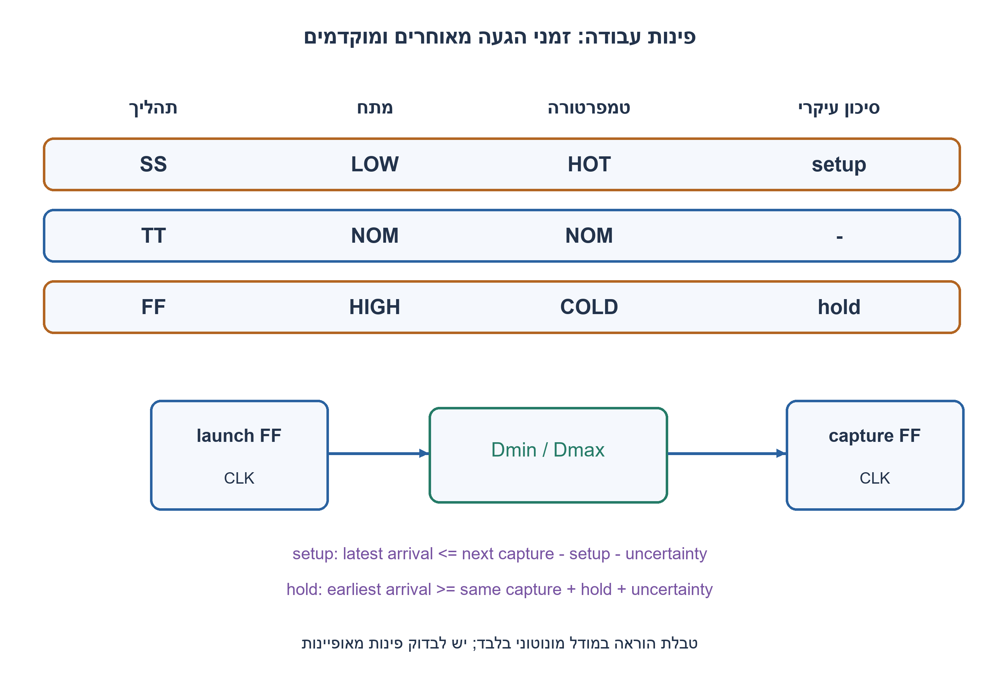
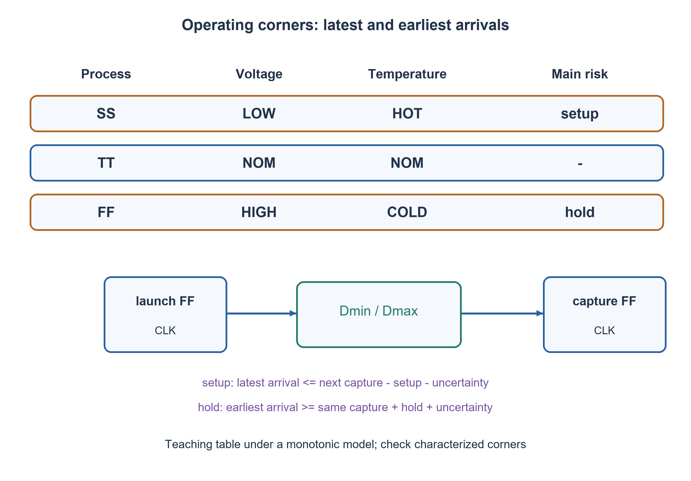

# PREP-306 — פינות PVT: תהליך, מתח, טמפרטורה וסיכוני setup/hold

פתרון מוצע בסיוע AI; ביקורת מקצועית אנושית ממתינה. דירוג הקושי פנימי ואינו מוצג ללומדים.

[צילום מקור פרטי](../sources/2026-11-08-batch20-08.png)

שאלת backend בהכנת צ׳יפ: process variation גורם לשונות בין צ׳יפים באותו wafer ולפינות FF,SS,FS,SF;F מהיר ו־S איטי עבור NMOS ו־PMOS. למלא טבלת PVT: process, voltage, temp ואיזו בעיית setup או hold; בשורות FF ו־SS לציין האם המתח והטמפרטורה גבוהים או נמוכים.

חברות לפי הדיווח בצילום בלבד: Mellanox.

## עברית

הסבירו פינות תהליך FF,SS,FS,SF, ומלאו טבלת PVT לפינות FF ו־SS: האם המתח והטמפרטורה גבוהים או נמוכים, ואיזו בעיית setup או hold מחפשים?

הבהרה שנבחרה: P הוא process, לא processor. נסמן קודם NMOS ואחריו PMOS; F מהיר ו־S איטי. טבלת הפתיחה היא מודל הוראה שבו תאים איטיים יותר במתח נמוך ובטמפרטורה גבוהה, ומהירים יותר במתח גבוה ובטמפרטורה נמוכה. לאחר מילויה הסבירו מדוע אין זה כלל אוניברסלי ואיך נתוני תהליך, היפוך תלות בטמפרטורה, קשתות תאים ומסלול השעון יכולים לשנות את הפינה הקריטית. השתמשו גם במשוואות slack עם skew חיובי כאשר שעון הקליטה מאוחר משעון השיגור.

1. Setup בודק הגעה מאוחרת מדי; hold בודק שינוי מוקדם מדי. איזה קצה של זמני התאים רלוונטי לכל בדיקה?
2. במודל המונוטוני האטה משלבת SS, מתח נמוך וחום; האצה משלבת FF, מתח גבוה וקור.
3. כתבו setup_slack=T+s−Us−setup−CQmax−Dmax ו־hold_slack=CQmin+Dmin−s−Uh−hold. אחר כך בדקו כל פינה מאופיינת, ולא רק את שמותיה.

### מה אומרת פינת תהליך
FF מציין NMOS מהיר ו־PMOS מהיר; SS מציין את שניהם איטיים. FS ו־SF הם שילובים מעורבים, לפי סדר האותיות שהוגדר. הם אינם סוגי מעבד או הבטחה שכל שער יואץ באותו יחס. מעבר עולה ויורד משתמשים ברשתות שונות, והעומס והחיווט משפיעים גם הם.

בטבלת ההוראה המונוטונית: SS, מתח נמוך וטמפרטורה גבוהה הם מועמד לבדיקת setup, משום שהמידע מגיע מאוחר. FF, מתח גבוה וטמפרטורה נמוכה הם מועמד לבדיקת hold, משום שמידע חדש עלול לדרוס מוקדם מדי את המידע הישן. זו דרך לזכור שתי מגמות, לא אישור signoff.

### משווים זמנים באותה מערכת צירים
קובעים שיגור בזמן אפס. הגעה מאוחרת היא CQmax+Dmax, והמועד האחרון הוא T+s−setup−Us. הגעה מוקדמת היא CQmin+Dmin, ואסור להקדים את s+hold+Uh. חיסור נותן את משוואות ה־slack שברמז. skew חיובי עוזר ל־setup אך מקשה על hold באותה מוסכמה; הגדלת T לבדה אינה מתקנת hold.

בדוגמת ההוראה T=1ns, setup=0.08ns, hold=0.06ns ושני ערכי uncertainty הם 0.02ns. ב־SS נבחרו CQmax=0.20,Dmax=0.75,CQmin=0.10,Dmin=0.25ns, ולכן slack_setup=−0.05 ו־slack_hold=0.27ns. ב־FF נבחרו 0.08,0.35,0.03,0.02ns בהתאמה; מתקבלים 0.47 ו־−0.03ns. אלה מספרים שהוספנו ללימוד, לא תוצאות של תהליך ייצור.

### למה עדיין בודקים כמה פינות
בטכנולוגיה מסוימת תיתכן temperature inversion: הקור עלול להאט יותר מהחום בטווח עבודה מסוים. CQ, דרישות setup/hold, השעונים והחיווט אינם משתנים בהכרח יחד, וגם פינה מעורבת יכולה להגביל קשת מסוימת. משתמשים בספריות מאופיינות ובניתוח רב־פינות עם דרישות וחריגות תקפות. 81 חישובי המודל נבדקו מול זמני הגעה מוחלטים; הם מאמתים חשבון ומוסכמות, לא תהליך פיזי. [Altera מתארת תנאי עבודה ופינות לפי רכיב ודרגת מהירות](https://docs.altera.com/r/docs/683243/25.3/quartus-prime-pro-edition-user-guide-timing-analyzer/setting-the-operating-conditions-for-timing-analysis?contentId=M3vmJF_sK4GNgZpdfweEag).

### מודל Python שנבדק

```python
"""Illustrative characterized-delay table, not a PDK or an STA engine."""
from fractions import Fraction as F

# Values are ns. They deliberately follow the stated conventional model.
TEACHING_CORNERS = {
    'SS_lowV_hot': {'cq_max':F('0.20'), 'logic_max':F('0.75'),
                    'cq_min':F('0.10'), 'logic_min':F('0.25')},
    'TT_nominal': {'cq_max':F('0.12'), 'logic_max':F('0.50'),
                   'cq_min':F('0.05'), 'logic_min':F('0.10')},
    'FF_highV_cold': {'cq_max':F('0.08'), 'logic_max':F('0.35'),
                     'cq_min':F('0.03'), 'logic_min':F('0.02')},
}


def slack(corner, period=F(1), skew=F(0), setup=F('0.08'),
          hold=F('0.06'), setup_uncertainty=F('0.02'),
          hold_uncertainty=F('0.02')):
    """Positive skew means capture clock later than launch clock."""
    setup_slack = (period+skew-setup_uncertainty-setup
                   -corner['cq_max']-corner['logic_max'])
    hold_slack = (corner['cq_min']+corner['logic_min']
                  -skew-hold_uncertainty-hold)
    return setup_slack, hold_slack
```




### assumptions

מודל מונוטוני מוצהר וטבלת השהיות מומצאת לצורכי לימוד, עם מוסכמת skew מפורשת.

### optimality

אין מסקנת מינימום או fmax ללא ספרייה; מחשבים max/min slack בכל פינה רלוונטית.

### verification

בדיקות מודלים עצמאיות עברו: 81 חישובי פינות תזמון מול זמני הגעה מוחלטים, 27 דוגמאות RC בסף יחיד ו־27 בקבל מצומד לאדמה, 100 חלונות ADC ו־32 דוגמאות aliasing, ‏23,254 תצפיות גאומטריות בחיישני עץ, זוג מסלולים המדגים חוסר נצפות בעץ קצר, 32 פאזות סינוס וכל 65,536 זוגות min/max. ראיה: checks/batch1108b20-hardware-model-verification.json. בדיקות Python וחישוב מספרי אינן SPICE, נתוני תהליך, STA או מדידת ADC. קוד SystemVerilog נבדק בנפרד, ותנאי הסביבה והיקף ההרצה מתועדים בדוח native של האצווה. סימולציית Icarus 12.0 עברה 66,134 השוואות: 65,536 זוגות min/max, ‏404 דגימות חיישני עץ ו־194 צעדי סינוס. הבתים של הקוד אומתו מול SHA-256, וההרצה החוזרת בוצעה ללא גישת רשת. ראיה: checks/batch1108b20-native-verification.json. זהו כיסוי סופי מוגבל לחוזים המתוארים, ולא הוכחת חומרה פיזית.

### edge_cases

```json
[
  "סקיו חיובי מקשה על hold.",
  "פינות FS/SF עשויות להגביל מעברים שונים.",
  "טמפרטורה אינה תמיד מונוטונית."
]
```

### common_mistakes

```json
[
  "החלפת process ב־processor.",
  "הכרזה על SS חם כפינה הגרועה בכל תהליך.",
  "ניסיון לתקן hold רק בהורדת תדר."
]
```

### interview_answer

Setup בודק זמנים מרביים ו־hold מזעריים; טבלת SS/FF היא קירוב מונוטוני שיש לאמת מול פינות מאופיינות ומסלולי שעון.

### source_ambiguities

המקור משתמש ב־processor עבור process; הוגדרה מוסכמת האותיות והופרדו כלל הוראה ותהליך אמיתי.

### solution_extensions

```json
[
  {
    "question": "מה קורה אם SS בקור איטי יותר?",
    "direction": "מחשבים מחדש slack מהנתונים ולא משנים את הפינה כדי להתאים לכלל זיכרון.",
    "tests": "טבלת נתונים עם Dmax גדול יותר בקור."
  }
]
```

## English

Explain process corners FF,SS,FS,SF. Fill a PVT table for FF and SS: high or low supply and temperature, and the setup or hold risk being sought.

Chosen clarification: P means process, not processor. Put NMOS first and PMOS second; F is fast and S slow. The introductory teaching model assumes slower cells at lower voltage and higher temperature, faster cells at higher voltage and lower temperature. After filling it, explain why this is not universal: process characterization, temperature inversion, cell arcs and clock paths can change the critical corner. Also use slack equations with positive skew meaning that the capture clock arrives later than launch.

1. Setup checks late arrival; hold checks an early change. Which delay bound matters to each?
2. In the monotonic model, SS/low voltage/hot slows cells; FF/high voltage/cold speeds them up.
3. Use setup_slack=T+s−Us−setup−CQmax−Dmax and hold_slack=CQmin+Dmin−s−Uh−hold, then inspect characterized corners rather than relying only on names.

### What a process corner says
FF means fast NMOS and fast PMOS; SS means both slow. FS and SF are mixed combinations under the stated letter order. They are not processor types or a promise that every gate speeds up by the same factor. Rising and falling transitions use different networks; loading and interconnect also matter.

In the introductory monotonic table, SS/low voltage/hot is a setup candidate because data arrives late. FF/high voltage/cold is a hold candidate because new data may overwrite old data too early. This remembers two trends; it is not timing signoff.

### Compare times on one axis
Set launch to time zero. Latest data arrives at CQmax+Dmax and must meet T+s−setup−Us. Earliest new data arrives at CQmin+Dmin and must not precede s+hold+Uh. Their differences give the stated slack equations. Positive skew helps setup but hurts hold under this convention; increasing T alone does not repair hold.

For the teaching example use T=1ns, setup=0.08ns, hold=0.06ns, and both uncertainties0.02ns. SS uses CQmax=0.20,Dmax=0.75,CQmin=0.10,Dmin=0.25ns, giving setup slack−0.05 and hold slack0.27ns. FF uses0.08,0.35,0.03,0.02ns respectively, giving0.47 and−0.03ns. These are chosen educational numbers, not measurements of a fabrication process.

### Why multiple corners still matter
Some technology ranges exhibit temperature inversion, with cold conditions potentially slower than hot ones. CQ, setup/hold requirements, clocks and interconnect need not change together; mixed corners can limit particular arcs. Use characterized libraries and multi-corner analysis with valid constraints/exceptions. Eighty-one model cases compare budgets with absolute arrival times; they verify arithmetic and conventions, not physical process behavior. [Altera describes operating corners as device/speed-grade-specific conditions](https://docs.altera.com/r/docs/683243/25.3/quartus-prime-pro-edition-user-guide-timing-analyzer/setting-the-operating-conditions-for-timing-analysis?contentId=M3vmJF_sK4GNgZpdfweEag).

### Verified Python teaching model

```python
"""Illustrative characterized-delay table, not a PDK or an STA engine."""
from fractions import Fraction as F

# Values are ns. They deliberately follow the stated conventional model.
TEACHING_CORNERS = {
    'SS_lowV_hot': {'cq_max':F('0.20'), 'logic_max':F('0.75'),
                    'cq_min':F('0.10'), 'logic_min':F('0.25')},
    'TT_nominal': {'cq_max':F('0.12'), 'logic_max':F('0.50'),
                   'cq_min':F('0.05'), 'logic_min':F('0.10')},
    'FF_highV_cold': {'cq_max':F('0.08'), 'logic_max':F('0.35'),
                     'cq_min':F('0.03'), 'logic_min':F('0.02')},
}


def slack(corner, period=F(1), skew=F(0), setup=F('0.08'),
          hold=F('0.06'), setup_uncertainty=F('0.02'),
          hold_uncertainty=F('0.02')):
    """Positive skew means capture clock later than launch clock."""
    setup_slack = (period+skew-setup_uncertainty-setup
                   -corner['cq_max']-corner['logic_max'])
    hold_slack = (corner['cq_min']+corner['logic_min']
                  -skew-hold_uncertainty-hold)
    return setup_slack, hold_slack
```




### assumptions

Explicit monotonic model and illustrative delay table with a fixed skew convention.

### optimality

No minimum or fmax claim without a library; compute max/min slack at every relevant corner.

### verification

Independent models passed:81 corner budgets compared with absolute arrival times,27 single-threshold RC and27 ground-coupling cases,100 ADC slots and32 alias examples,23,254 geometric wood observations, one indistinguishable short-wood trajectory pair,32 sine phases and all65,536 min/max pairs. Evidence: checks/batch1108b20-hardware-model-verification.json. Python/numerical checks are not SPICE, process characterization, STA or physical ADC measurements. SystemVerilog is verified separately; execution conditions and coverage are recorded in the batch native report. Icarus12.0 simulation passed66,134 comparisons:65,536 min/max pairs,404 wood-sensor samples and194 sine steps. Source bytes were checked against SHA-256, and the confirmation run had network access denied. Evidence: checks/batch1108b20-native-verification.json. This is finite coverage of the stated contracts, not physical hardware signoff.

### edge_cases

```json
[
  "Positive skew hurts hold.",
  "FS/SF can limit different transitions.",
  "Temperature dependence is not always monotonic."
]
```

### common_mistakes

```json
[
  "Reading process as processor.",
  "Claiming hot SS is worst in every technology.",
  "Trying to repair hold only by reducing frequency."
]
```

### interview_answer

Setup uses maximum delays and hold minimum delays; the SS/FF heuristic must be checked against characterized corners and clock paths.

### source_ambiguities

The source uses processor for process; letter order and the distinction between teaching heuristics and actual characterization are explicit.

### solution_extensions

```json
[
  {
    "question": "What if cold SS is slower?",
    "direction": "Recompute slack from data rather than forcing the corner to match a mnemonic.",
    "tests": "Use a table with greater cold Dmax."
  }
]
```

