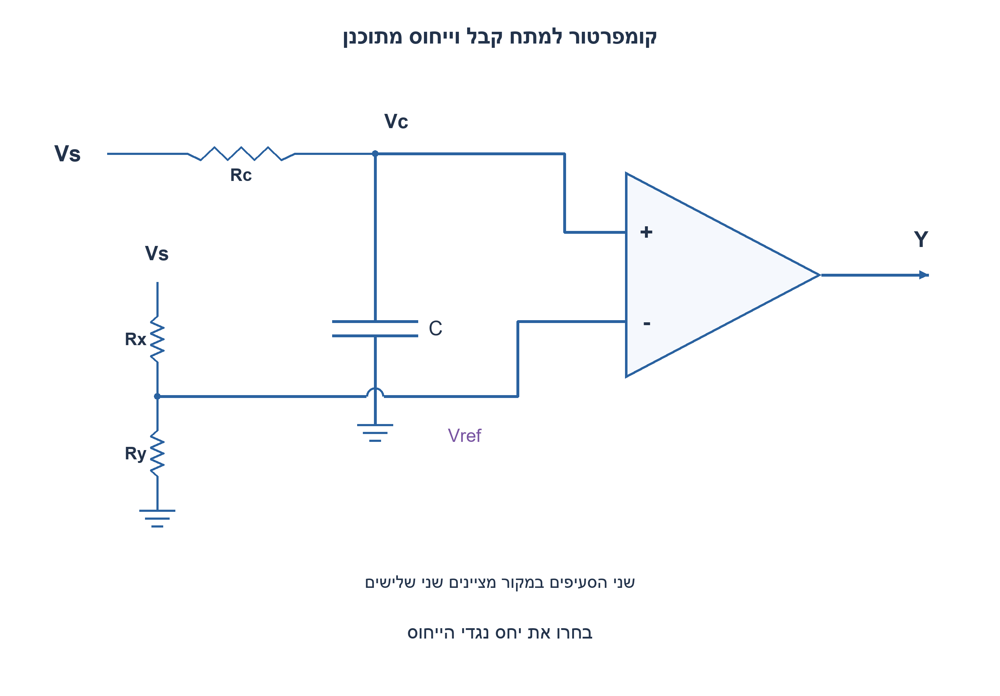
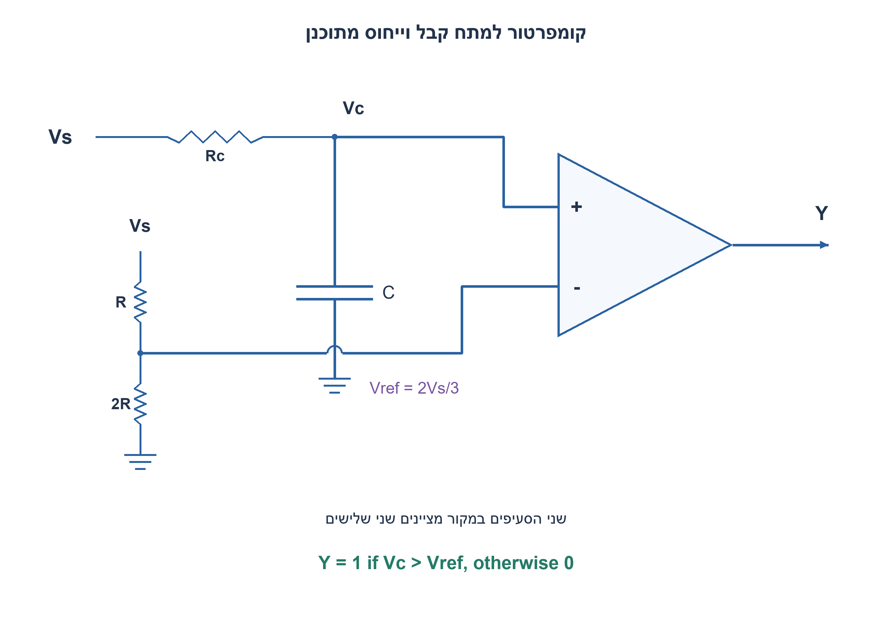
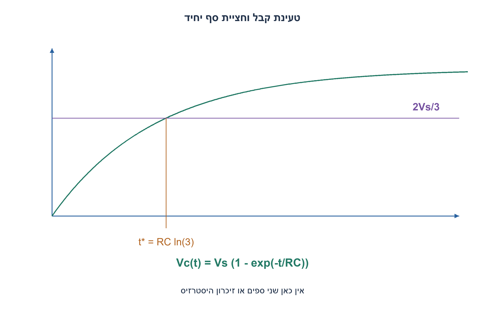
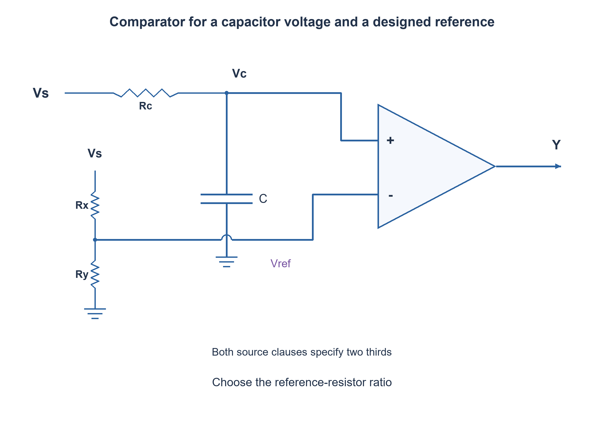
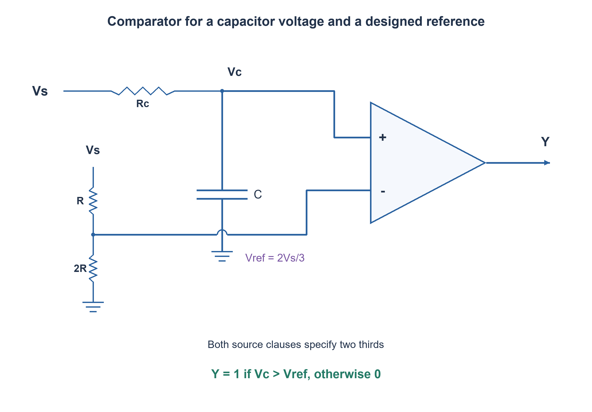
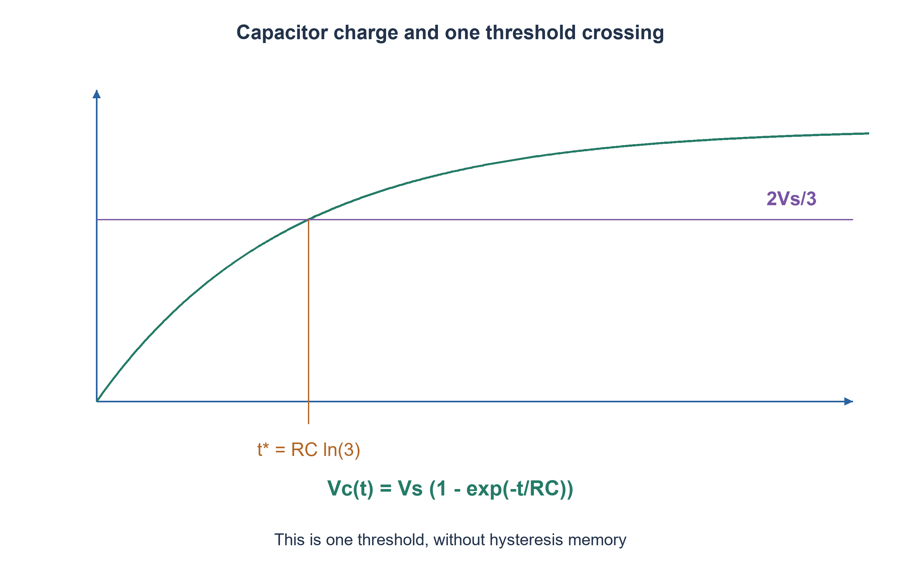

# PREP-307 — קומפרטור למתח קבל בסף שני שלישים מהמקור

פתרון מוצע בסיוע AI; ביקורת מקצועית אנושית ממתינה. דירוג הקושי פנימי ואינו מוצג ללומדים.

[צילום מקור פרטי](../sources/2026-11-08-batch20-09.png)

נתון קומפרטור עם כניסות A,B שמוציא1 אם A>B ואחרת0. במעגל RC טורי עם מקור Vs יש לחברו כך שכאשר מתח הקבל קטן מ־Vs כפול שני שלישים הפלט0 וכאשר הוא גדול מ־Vs כפול שני שלישים הפלט1. ניתן להשתמש בנגדים, קבלים וסלילים ללא הגבלה ובגדלים לבחירה. שני תנאי המקור מתייחסים לאותו סף של שני שלישים.

חברות לפי הדיווח בצילום בלבד: Elbit.

## עברית

קומפרטור אידאלי מחזיר 1 אם A>B ואחרת 0. חברו אותו למתח הקבל במעגל RC טורי המוזן מ־Vs כך שהמוצא יהיה 0 מתחת ל־2Vs/3 ו־1 מעליו. בחרו רשת ייחוס והסבירו את הטעינה ואת זמן מעבר המוצא.

בשני המשפטים בצילום כתוב שני שלישים; זו דרישה לסף יחיד, לא לספי 1/3 ו־2/3. השלמה שנבחרה: Vs>0 הוא מדרגה קבועה, R,C חיוביים, הקבל בתחילה לא טעון, אין זרם בכניסות הקומפרטור, והקבל מחובר בין הצומת Vc לאדמה אחרי נגד הטעינה. מותר נגדים נוספים לייחוס. במודל האידאלי שוויון מחזיר 0; במימוש אמיתי יש לבדוק דיוק, רעש והתנהגות ליד הסף.

1. כדי לשמור קוטביות של 1 מעל הסף, לאיזו כניסה נחבר את Vc?
2. מחלק מתח מהמקור נותן Vref=Vs·Rbottom/(Rtop+Rbottom). בחרו יחס שמייצר שני שלישים.
3. בחרו נגד עליון Rref ותחתון 2Rref; חברו Vc ל־+ ו־Vref ל־−. פתרו 1−exp(−t/RC)=2/3.

### מחלק מתח נפרד לייחוס
חברו את Vc לכניסה הלא־הופכת A ואת Vref להופכת B. נגד Rref מ־Vs אל Vref ונגד 2Rref מ־Vref לאדמה נותנים `Vref=2Vs/3`. מאחר שהקומפרטור אידאלי ואינו צורך זרם, רשת הייחוס אינה מעמיסה את הקבל. למשל 10kΩ מעל20kΩ מתחת מממשים את היחס; הנגדים אינם חייבים להיות שווים לנגד הטעינה.

בטעינת קבל בלתי טעון דרך R ממקור Vs, מתקבל `Vc(t)=Vs(1−exp(−t/RC))`. לפני חציית הסף המוצא0, ואחריה1. משוואת החצייה נותנת `t*=RC ln3`; עבור RC=1ms זה בקירוב1.0986ms. בדיוק בשוויון המודל הבוליאני מחזיר0, בעוד שלאחר כל תוספת זמן חיובית המתח כבר גבוה מהסף. אין להסתמך על דיוק נקודת השוויון ברכיב פיזי.

### מה אין בתרגיל הזה
שני משפטי המקור משתמשים באותו סף. אין חובה להוסיף זיכרון או feedback כדי להחליט בתחום אמצעי; זה אינו Schmitt trigger. אם רוצים חסינות לרעש אפשר להגדיר הרחבה נפרדת עם שני ספים ו־hold ביניהם, אך אסור לייחס את הסף הנמוך הזה לצילום. [TI מסבירה שב־Schmitt אמיתי ספי העלייה והירידה שונים](https://www.ti.com/document-viewer/lit/html/scea046).

בבחירת חומרה אמיתית יש לבדוק תחום מתח כניסה, offset, רעש, זרמי הטיה, זמן תגובה ומוצא open-drain לעומת push-pull. מקור שאינו אידאלי או מחלק ייחוס מועמס יכולים להזיז את הסף; קבל טעון בתחילה יכול להתחיל כשהמוצא כבר1. המודל נבדק ב־27 צירופי מקור, נגד וקבוע זמן, כולל אינטגרציה נפרדת של משוואת הטעינה; זו אינה סימולציית SPICE.

### מודל Python שנבדק

```python
"""Single threshold at TWO thirds in both source clauses; no hysteresis."""
import math
from fractions import Fraction as F


def divider(vs, top_r, bottom_r):
    vs, top_r, bottom_r = map(F, (vs, top_r, bottom_r))
    if vs <= 0 or min(top_r,bottom_r) <= 0:
        raise ValueError('Positive source and resistances required')
    return vs*bottom_r/(top_r+bottom_r)


def capacitor_voltage(vs, tau, time, initial=0):
    if vs <= 0 or tau <= 0 or time < 0:
        raise ValueError('Require Vs>0, tau>0, time>=0')
    return vs+(initial-vs)*math.exp(-time/tau)


def comparator(vcap, reference):
    return int(vcap > reference)  # Ideal source contract: equality returns zero.


def charging_crossing(tau):
    if tau <= 0:
        raise ValueError('Positive time constant required')
    return tau*math.log(3)
```








### assumptions

Vs>0, קבל לא טעון ומקור מדרגה, כניסות קומפרטור ללא זרם. סף יחיד2Vs/3.

### optimality

שני נגדי ייחוס וקומפרטור אחד; אין צורך בתאי זיכרון. עלות הספק/דיוק תלויה בערכים אמיתיים.

### verification

בדיקות מודלים עצמאיות עברו: 81 חישובי פינות תזמון מול זמני הגעה מוחלטים, 27 דוגמאות RC בסף יחיד ו־27 בקבל מצומד לאדמה, 100 חלונות ADC ו־32 דוגמאות aliasing, ‏23,254 תצפיות גאומטריות בחיישני עץ, זוג מסלולים המדגים חוסר נצפות בעץ קצר, 32 פאזות סינוס וכל 65,536 זוגות min/max. ראיה: checks/batch1108b20-hardware-model-verification.json. בדיקות Python וחישוב מספרי אינן SPICE, נתוני תהליך, STA או מדידת ADC. קוד SystemVerilog נבדק בנפרד, ותנאי הסביבה והיקף ההרצה מתועדים בדוח native של האצווה. סימולציית Icarus 12.0 עברה 66,134 השוואות: 65,536 זוגות min/max, ‏404 דגימות חיישני עץ ו־194 צעדי סינוס. הבתים של הקוד אומתו מול SHA-256, וההרצה החוזרת בוצעה ללא גישת רשת. ראיה: checks/batch1108b20-native-verification.json. זהו כיסוי סופי מוגבל לחוזים המתוארים, ולא הוכחת חומרה פיזית.

### edge_cases

```json
[
  "בדיוק בסף0 במודל.",
  "קבל טעון עשוי להתחיל מעל הסף.",
  "Vs=0 מחוץ לחוזה הראשי."
]
```

### common_mistakes

```json
[
  "החלפת אחד משני הספים הכתובים ב־Vs/3.",
  "חיבור הפוך של הקומפרטור.",
  "העמסת הקבל במחלק מיותר."
]
```

### interview_answer

מחלק R מעל2R יוצר שני שלישים; משווה Vc לייחוס, ובטעינה מאפס המעבר ב־RC ln3.

### source_ambiguities

צילום המקור נשמר: שני הספים הכתובים הם שני שלישים. סכמת ה־RC ותנאי ההתחלה הוגדרו כהשלמה.

### solution_extensions

```json
[
  {
    "question": "איך מוסיפים היסטרזיס אם זה נדרש?",
    "direction": "מגדירים סף עולה ויורד שונים ומשוב חיובי או זיכרון; מנתחים חוזה חדש.",
    "tests": "רמפה עולה ויורדת ורעש בין הספים."
  }
]
```

## English

An ideal comparator returns1 when A>B and0 otherwise. Connect it to the capacitor voltage of a series RC driven by Vs so that output is0 below2Vs/3 and1 above it. Choose a reference network and explain capacitor charging and output-transition time.

Both source clauses say two thirds; this is one threshold, not a one-third/two-thirds hysteresis pair. Chosen completion: positive constant step Vs, positive R,C, initially uncharged capacitor, ideal zero-current comparator inputs, and the capacitor connected from Vc to ground after the charging resistor. Additional reference resistors are allowed. Ideal equality returns0; real precision, noise and near-threshold behavior require separate checks.

1. Which comparator input receives Vc if output should rise above the threshold?
2. A source divider gives Vref=Vs·Rbottom/(Rtop+Rbottom). Choose a two-thirds ratio.
3. Use top Rref and bottom2Rref, connect Vc to+ and Vref to−, and solve1−exp(−t/RC)=2/3.

### A separate reference divider
Connect Vc to non-inverting input A and Vref to inverting input B. Put Rref from Vs to Vref and2Rref from Vref to ground, giving `Vref=2Vs/3`. Ideal comparator inputs draw no current, so the reference network does not load the capacitor. For example,10kΩ above20kΩ gives the ratio; these need not equal the charging resistance.

For an initially uncharged capacitor charged through R from Vs, `Vc(t)=Vs(1−exp(−t/RC))`. Output is zero before crossing and one afterward. Solving gives `t*=RC ln3`, approximately1.0986ms for RC=1ms. Ideal equality returns zero, while any positive time increment after the crossing gives voltage above threshold. Physical circuitry should not rely on an exact equality point.

### What this exercise does not require
Both source clauses use the same threshold. There is no required memory or feedback to resolve an intermediate region; this is not a Schmitt trigger. A separate noise-immunity extension may define distinct thresholds and state retention, but its lower threshold must not be attributed to the screenshot. [TI explains that true Schmitt rising and falling thresholds differ](https://www.ti.com/document-viewer/lit/html/scea046).

A real design must check input ranges, offset, noise, bias current, propagation time and open-drain versus push-pull output. A nonideal source or loaded divider shifts the reference; an initially charged capacitor may start with output already high. Twenty-seven source/resistance/time-constant cases include a separate integration of the charging ODE. This is not SPICE verification.

### Verified Python teaching model

```python
"""Single threshold at TWO thirds in both source clauses; no hysteresis."""
import math
from fractions import Fraction as F


def divider(vs, top_r, bottom_r):
    vs, top_r, bottom_r = map(F, (vs, top_r, bottom_r))
    if vs <= 0 or min(top_r,bottom_r) <= 0:
        raise ValueError('Positive source and resistances required')
    return vs*bottom_r/(top_r+bottom_r)


def capacitor_voltage(vs, tau, time, initial=0):
    if vs <= 0 or tau <= 0 or time < 0:
        raise ValueError('Require Vs>0, tau>0, time>=0')
    return vs+(initial-vs)*math.exp(-time/tau)


def comparator(vcap, reference):
    return int(vcap > reference)  # Ideal source contract: equality returns zero.


def charging_crossing(tau):
    if tau <= 0:
        raise ValueError('Positive time constant required')
    return tau*math.log(3)
```








### assumptions

Positive source step, uncharged capacitor, zero comparator input current; one threshold2Vs/3.

### optimality

Two reference resistors and one comparator; no memory required. Real power/accuracy depend on actual values.

### verification

Independent models passed:81 corner budgets compared with absolute arrival times,27 single-threshold RC and27 ground-coupling cases,100 ADC slots and32 alias examples,23,254 geometric wood observations, one indistinguishable short-wood trajectory pair,32 sine phases and all65,536 min/max pairs. Evidence: checks/batch1108b20-hardware-model-verification.json. Python/numerical checks are not SPICE, process characterization, STA or physical ADC measurements. SystemVerilog is verified separately; execution conditions and coverage are recorded in the batch native report. Icarus12.0 simulation passed66,134 comparisons:65,536 min/max pairs,404 wood-sensor samples and194 sine steps. Source bytes were checked against SHA-256, and the confirmation run had network access denied. Evidence: checks/batch1108b20-native-verification.json. This is finite coverage of the stated contracts, not physical hardware signoff.

### edge_cases

```json
[
  "Ideal equality returns zero.",
  "A charged capacitor can start above threshold.",
  "Vs=0 lies outside the primary contract."
]
```

### common_mistakes

```json
[
  "Changing one written threshold to Vs/3.",
  "Reversing comparator polarity.",
  "Loading the capacitor with an unnecessary divider."
]
```

### interview_answer

A top-R/bottom-2R divider creates two thirds; compare Vc to it, crossing at RC ln3 when charging from zero.

### source_ambiguities

The preserved source spells two thirds twice. RC topology and initial state are explicit completions.

### solution_extensions

```json
[
  {
    "question": "How would you add hysteresis if required?",
    "direction": "Define distinct rising/falling thresholds and positive feedback or memory under a new contract.",
    "tests": "Rising/falling ramps and noise between thresholds."
  }
]
```

