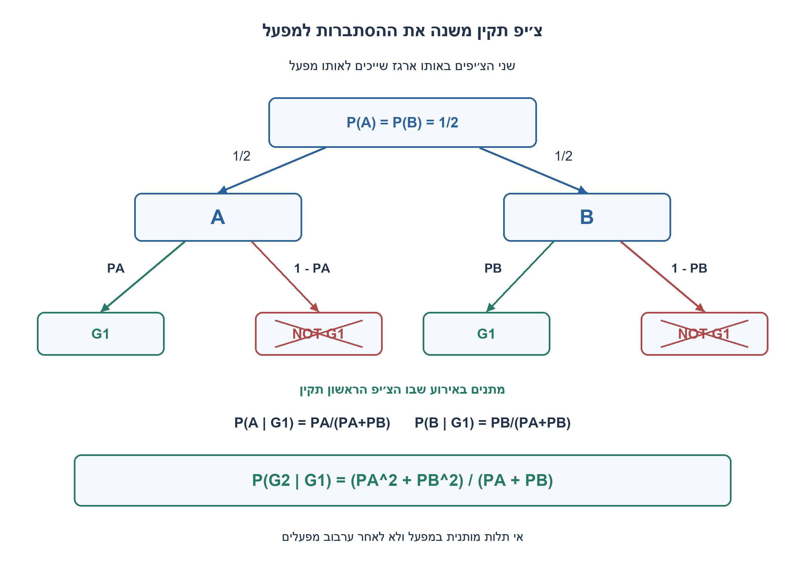
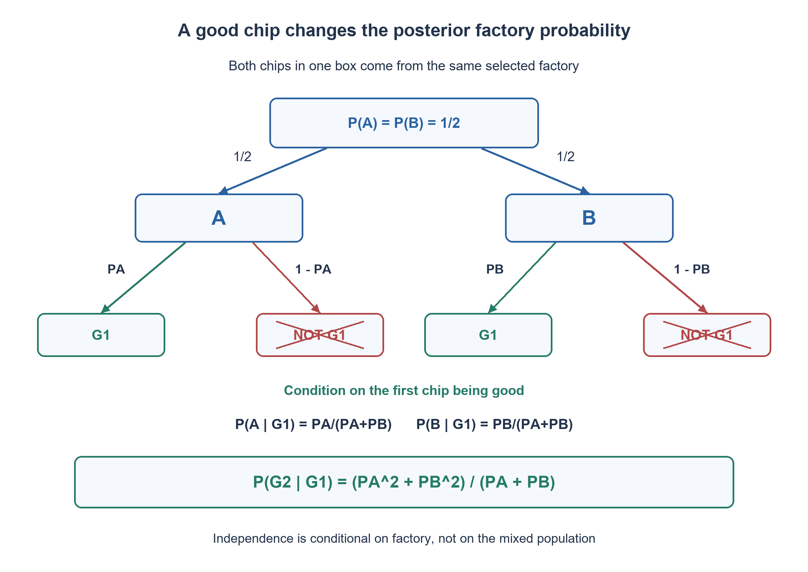

# PREP-308 — ארגז צ׳יפים ממפעל לא ידוע — הסתברות לאחר בדיקה תקינה

פתרון מוצע בסיוע AI; ביקורת מקצועית אנושית ממתינה.

## עברית

חברות A ו־B מייצרות צ׳יפים. כל ארגז מכיל שני צ׳יפים מאותה חברה. לצ׳יפ של A הסתברות PA להיות תקין, ולצ׳יפ של B הסתברות PB להיות תקין. בוחרים ארגז מ־A או מ־B בהסתברות חצי לכל אפשרות, בודקים את הצ׳יפ הראשון ורואים שהוא תקין. מה ההסתברות שגם השני באותו ארגז תקין? הסבירו מדוע הממוצע הרגיל של PA ו־PB אינו מספיק, ותנו גם את ההסתברות שהארגז נבחר מ־A לאחר התוצאה.

הבהרת המודל שנבחר: כאשר ידוע המפעל, שני מצבי התקינות בלתי תלויים ולכל אחד אותה הסתברות PA או PB. שניהם שייכים למפעל המשותף שנבחר; לא מדובר בצ׳יפ אחד מכל מפעל. ההנחה אינה טוענת לאי־תלות לאחר ערבוב הארגזים משני המפעלים. נניח 0≤PA,PB≤1 ו־PA+PB>0, כך שאירוע הבדיקה התקינה בעל הסתברות חיובית. הבדיקה מהימנה ואינה משנה את הצ׳יפ השני.

חשבו גם עבור PA=3/4 ו־PB=1/4, ונמקו את מקרי הקצה. אפשר להשתמש בחשבון שברים מדויק; אין צורך בסימולציה אקראית.

1. מה השתנה אחרי שראינו צ׳יפ תקין: האם עדיין סביר באותה מידה שהארגז הגיע מכל אחד מהמפעלים?
2. קראו לאירוע הראשון התקין G1. חשבו תחילה P(G1) באמצעות חלוקה לשני המפעלים, ואז את P(A|G1). אי־התלות חלה בתוך ענף של מפעל ידוע.
3. ההסתברות לשני צ׳יפים תקינים היא חצי PA² ועוד חצי PB². חלקו אותה בהסתברות לצ׳יפ ראשון תקין, חצי PA ועוד חצי PB. לחלופין שקלו את PA ו־PB במשקלי המפעל המעודכנים.

### מסתכלים מחדש על מקור הארגז
לפני הבדיקה כל מפעל סביר בהסתברות חצי. אחרי שראינו צ׳יפ תקין, מפעל בעל שיעור תקינות גבוה יותר מסביר את התוצאה טוב יותר, ולכן מקבל משקל גדול יותר. הצ׳יפ השני אינו משתפר בעקבות הבדיקה; הידע שלנו על המקור המשותף משתנה.

נסמן G1: הראשון תקין, ו־G2: השני תקין. לפי חוק ההסתברות השלמה:

```text
P(G1) = (PA + PB)/2
P(A and G1) = PA/2
P(A | G1) = PA/(PA+PB)
P(B | G1) = PB/(PA+PB)
```

כאשר ידוע שהארגז מ־A, הצ׳יפ השני תקין בהסתברות PA גם אחרי הידיעה על הראשון, בגלל אי־התלות המותנית. לכן:

```text
P(G2 | G1)
  = P(A | G1)*PA + P(B | G1)*PB
  = (PA^2 + PB^2)/(PA+PB)
```

### דרך נוספת: חיתוך חלקי אירוע התנאי
שני הצ׳יפים שייכים לאותו מפעל, ולכן בתוך ענף A ההסתברות ששניהם תקינים היא PA², ובתוך B היא PB². משקלי המפעלים לפני הבדיקה עדיין חצי:

```text
P(G1 and G2) = (PA^2 + PB^2)/2
P(G2 | G1) = P(G1 and G2)/P(G1)
```

זה מסביר מדוע מופיעים ריבועים ולא המכפלה PA·PB: ארגז עם צ׳יפ אחד מכל חברה היה תרגיל אחר. שתי הדרכים נותנות אותה תוצאה.

### דוגמה ומקרי קצה
עבור PA=3/4 ו־PB=1/4, הבדיקה התקינה מעלה את הסתברות A מחצי ל־3/4. ההסתברות לצ׳יפ שני תקין היא `3/4·3/4 + 1/4·1/4 = 5/8`. הממוצע לפני הידיעה היה רק 1/2.

אם PA=PB=p>0, אין לבדיקה מידע על המפעל והתשובה נשארת p. אם PA=1 ו־PB=0, הראשון התקין מזהה בוודאות ארגז מ־A והשני תקין בהסתברות 1. אם שניהם אפס, האירוע שעליו התבקשנו להתנות אינו יכול לקרות; ההסתברות המותנית אינה מוגדרת ואין להחזיר אפס כאילו זו תשובה רגילה.

### איזו אי־תלות מותרת?
בתוך מפעל ידוע התקינות בלתי תלויה. אחרי ערבוב מפעלים, שני הצ׳יפים חולקים גורם סמוי: המפעל. לכן בדרך כלל הם תלויים בשוליים. בפרט, הפער בין ההסתברות המעודכנת לממוצע הקודם הוא:

```text
(PA^2+PB^2)/(PA+PB) - (PA+PB)/2
  = (PA-PB)^2 / (2*(PA+PB)) >= 0
```

התוצאה לכן אינה קטנה מהממוצע הקודם, ושווה לו רק כאשר שיעורי התקינות שווים. אין להסיק שצ׳יפים במפעל אמיתי בלתי תלויים תמיד; זו הנחת המודל בתרגיל, ולא מסקנה על תהליך ייצור.

### אימות ועלות
הקוד משתמש ב־Fraction ומשיב שבר מדויק. האורקל הנפרד מונה את המפעל ושני מצבי התקינות — שמונה עולמות משוקללים — מסנן את העולמות שבהם הראשון תקין ומנרמל. הוא אינו משתמש בנוסחה המקוצרת כדי להחליט מה התשובה הצפויה. נבדקים רשת שברים, קדימויות מפעל שונות, מקרי קצה והסימטריה בהחלפת שמות החברות. המנייה הסופית תומכת באלגברה, אך אינה מכסה ברציפות כל זוג הסתברויות ממשיות.

במודל שבו פעולה חשבונית על הסתברות עולה יחידה, מספר הפעולות והאחסון קבוע. בחשבון שברים מדויק עלות כפל, חילוק וצמצום תלויה באורך הייצוג של המונים והמכנים; אין טענת זמן קבוע ללא תלות במספר הסיביות. הפונקציה הנוספת בקוד מאפשרת קדימות כללית q, ומסרבת לאירוע תנאי בעל הסתברות אפס.

```python
"""Two chips share a latent factory; independence is conditional on that factory."""
from fractions import Fraction


def probability(value):
    if type(value) not in (int, Fraction):
        raise ValueError("use an exact integer or Fraction probability")
    result = Fraction(value)
    if not 0 <= result <= 1:
        raise ValueError("probability must lie in0..1")
    return result


def posterior_details(pa, pb, prior_a=Fraction(1, 2)):
    """Condition on a good first chip in a box from one selected factory.

    Given that factory, both chip outcomes are independent with rate pa or pb.
    This function does not assume marginal independence after mixing factories.
    """
    pa, pb, prior = map(probability, (pa, pb, prior_a))
    evidence = prior * pa + (1 - prior) * pb
    if evidence == 0:
        raise ValueError("conditioning event has probability zero")
    posterior_a = prior * pa / evidence
    second_good = (prior * pa * pa + (1 - prior) * pb * pb) / evidence
    return {"first_good": evidence, "factory_a": posterior_a,
            "factory_b": 1 - posterior_a, "second_good": second_good}


def posterior_quality(pa, pb):
    """The primary exercise has equal prior probability for the two factories."""
    return posterior_details(pa, pb)["second_good"]
```




## English

Companies A and B manufacture chips. Each box contains two chips from the same company. An A chip is good with probability PA, and a B chip with probability PB. Choose an A or B box with equal prior probability, test its first chip, and observe that it is good. What is the probability that the second chip in that same box is also good? Explain why simply averaging PA and PB is insufficient, and also give the posterior probability that the box came from A.

Chosen model clarification: conditional on the known factory, the two quality outcomes are independent and each has the same good probability PA or PB. Both share the selected factory; the box does not contain one chip from each company. Independence is not asserted after mixing boxes from the two factories. Assume 0≤PA,PB≤1 and PA+PB>0, so the observed event has positive probability. The test is accurate and does not change the second chip.

Also evaluate PA=3/4 and PB=1/4 and explain boundary cases. Exact fractions are allowed; random simulation is unnecessary.

1. After observing a good chip, are both factories still equally likely sources of the box?
2. Call the first-good event G1. First compute P(G1) by conditioning on factory, then P(A|G1). Independence applies inside a known-factory branch.
3. The probability of two good chips is half PA² plus half PB². Divide by the first-good probability, half PA plus half PB. Equivalently weight PA and PB using the updated factory probabilities.

### Update the box's source probability
Before the test, each factory has probability one half. A good chip is more consistent with the factory having the higher good rate, so that source gains posterior weight. Testing the first chip does not improve the second; it changes our knowledge about their shared source.

Write G1 for first chip good and G2 for second chip good. Total probability and Bayes give:

```text
P(G1) = (PA + PB)/2
P(A and G1) = PA/2
P(A | G1) = PA/(PA+PB)
P(B | G1) = PB/(PA+PB)
```

Given factory A, the second-good probability remains PA after learning G1, by conditional independence. Consequently:

```text
P(G2 | G1)
  = P(A | G1)*PA + P(B | G1)*PB
  = (PA^2 + PB^2)/(PA+PB)
```

### A second derivation: joint event divided by evidence
Both chips share a factory. Inside the A branch, two good chips have probability PA²; inside B, PB². The pre-observation factory weights are one half:

```text
P(G1 and G2) = (PA^2 + PB^2)/2
P(G2 | G1) = P(G1 and G2)/P(G1)
```

This explains the squares instead of PA·PB: a box containing one chip from each company would be a different experiment. Both derivations agree.

### Example and boundaries
With PA=3/4 and PB=1/4, a good first chip raises A's probability from one half to three quarters. The second-good probability is `3/4*3/4 + 1/4*1/4 = 5/8`; the prior mean was only one half.

If PA=PB=p>0, the observation conveys no factory information and the answer remains p. If PA=1 and PB=0, the good observation identifies an A box with certainty and the second chip is good with probability one. If both rates are zero, the conditioning event is impossible; the conditional probability is undefined, not an ordinary zero result.

### Which independence is valid?
Within a known factory, quality outcomes are independent. In the mixed population they share a hidden cause, the factory, and are generally marginally dependent. In particular the increase over the prior mean is:

```text
(PA^2+PB^2)/(PA+PB) - (PA+PB)/2
  = (PA-PB)^2 / (2*(PA+PB)) >= 0
```

Thus the predictive result cannot be below the prior mean, with equality only for equal rates. This is a stated exercise model, not an empirical claim that real manufacturing defects are independent.

### Verification and cost
The reference uses Fraction for an exact answer. A separate oracle enumerates the factory and both binary outcomes, producing eight weighted worlds, filters on first-good and normalizes. It does not use the simplified answer formula to construct expected results. Checks cover rational grids, unequal factory priors, boundary cases and symmetry under factory renaming. Finite enumeration complements algebra rather than covering every real-valued rate pair.

Under unit-cost probability arithmetic, the operation and storage counts are constant. Exact rational multiplication, division and reduction depend on numerator/denominator bit lengths; no bit-complexity-independent constant-time claim is made. The additional details function supports a general prior q and rejects zero-probability evidence.

```python
"""Two chips share a latent factory; independence is conditional on that factory."""
from fractions import Fraction


def probability(value):
    if type(value) not in (int, Fraction):
        raise ValueError("use an exact integer or Fraction probability")
    result = Fraction(value)
    if not 0 <= result <= 1:
        raise ValueError("probability must lie in0..1")
    return result


def posterior_details(pa, pb, prior_a=Fraction(1, 2)):
    """Condition on a good first chip in a box from one selected factory.

    Given that factory, both chip outcomes are independent with rate pa or pb.
    This function does not assume marginal independence after mixing factories.
    """
    pa, pb, prior = map(probability, (pa, pb, prior_a))
    evidence = prior * pa + (1 - prior) * pb
    if evidence == 0:
        raise ValueError("conditioning event has probability zero")
    posterior_a = prior * pa / evidence
    second_good = (prior * pa * pa + (1 - prior) * pb * pb) / evidence
    return {"first_good": evidence, "factory_a": posterior_a,
            "factory_b": 1 - posterior_a, "second_good": second_good}


def posterior_quality(pa, pb):
    """The primary exercise has equal prior probability for the two factories."""
    return posterior_details(pa, pb)["second_good"]
```




## חומר משלים / Supporting material

```json
{
  "assumptions": {
    "he": [
      "שני הצ׳יפים באותו ארגז מאותו מפעל; בחירת המפעל בהסתברות חצי; אי־תלות מותנית במפעל ובדיקה מהימנה.",
      "PA ו־PB בתחום 0 עד 1, וסכומם חיובי."
    ],
    "en": [
      "Both chips share a factory, selected with prior one half; independence is conditional on factory and the test is accurate.",
      "PA and PB lie in 0..1 and have a positive sum."
    ]
  },
  "optimality": {
    "he": "נוסחת הסתברות מותנית מדויקת במספר קבוע של פעולות חשבון; בחשבון שברים עלות הפעולות תלויה באורך המספרים.",
    "en": "Exact conditional probability with a constant arithmetic-operation count; rational-operation cost depends on numeric bit lengths."
  },
  "verification": {
    "he": [
      "אורקל שמונה שמונה עולמות לפי מפעל ושני מצבי תקינות, עם משקלי Fraction מדויקים; השוואה לנוסחה ברשת הסתברויות ובקדימויות שונות.",
      "נבדקים אפס ראיות, סימטריה, שיעורי תקינות זהים, תחום התשובה והפער מן הממוצע."
    ],
    "en": [
      "An independent eight-world factory/quality enumerator with exact Fraction weights checks the formula on a rational grid and multiple priors.",
      "Checks include impossible evidence, symmetry, equal rates, output bounds and the increase over the prior mean."
    ]
  },
  "edge_cases": {
    "he": [
      "PA=PB>0 מחזיר את אותו שיעור; PA=1,PB=0 מחזיר 1; PA=PB=0 אינו אירוע תנאי אפשרי."
    ],
    "en": [
      "Equal positive rates return that rate; PA=1,PB=0 returns one; PA=PB=0 makes the conditioning event impossible."
    ]
  },
  "common_mistakes": {
    "he": [
      "להשתמש בממוצע הקודם בלי לעדכן את המפעל; לחשב PA·PB כאילו צ׳יפ אחד מכל חברה; להניח אי־תלות שולית אחרי ערבוב המפעלים.",
      "להחזיר 0 בחלוקה באפס במקום לציין שהראיה בלתי אפשרית."
    ],
    "en": [
      "Keeping the prior mean instead of updating factory probabilities; using PA·PB as if chips came from different factories; assuming marginal independence after mixing.",
      "Returning zero for zero evidence rather than rejecting an undefined conditional probability."
    ]
  },
  "interview_answer": {
    "he": "אני מתנה קודם על המפעל. צ׳יפ ראשון תקין נותן משקלים PA/(PA+PB) ו־PB/(PA+PB); ממוצע משוקלל של PA ו־PB במשקלים האלה נותן (PA²+PB²)/(PA+PB).",
    "en": "Condition on the factory. A good first chip gives posterior weights PA/(PA+PB) and PB/(PA+PB); weighting the two quality rates gives (PA²+PB²)/(PA+PB)."
  },
  "source_ambiguities": {
    "he": [
      "המקור אומר שאין תלות בין הצ׳יפים, אך לשני צ׳יפים בארגז יש מפעל משותף סמוי. נבחרה במפורש אי־תלות כאשר המפעל ידוע; אי־תלות שולית אינה נובעת מכך.",
      "לא צוין הטיפול באירוע בעל הסתברות אפס; הנוסח מגדיר תחום וראיה חיובית."
    ],
    "en": [
      "The source says chips are independent, but a box shares a latent factory. The exercise explicitly chooses independence conditional on that factory, not marginal independence of the mixture.",
      "Zero-probability conditioning was unspecified; the edited contract defines the domain and requires positive evidence."
    ]
  },
  "solution_extensions": {
    "he": [
      {
        "question": "מה ישתנה אם ארגז מגיע מ־A בהסתברות q?",
        "answer_direction": "עדכנו לפי P(A|G1)=qPA/(qPA+(1−q)PB). ההסתברות לשני תקינים חלקי הראשון היא [qPA²+(1−q)PB²]/[qPA+(1−q)PB], אם המכנה חיובי.",
        "principle": "עדכון בייס וחוק ההסתברות השלמה עם קדימות שאינה אחידה."
      }
    ],
    "en": [
      {
        "question": "What changes if an A box has prior probability q?",
        "answer_direction": "Use P(A|G1)=qPA/(qPA+(1−q)PB). The predictive result is [qPA²+(1−q)PB²]/[qPA+(1−q)PB] when the denominator is positive.",
        "principle": "Bayesian updating and total probability with a nonuniform prior."
      }
    ]
  }
}
```
