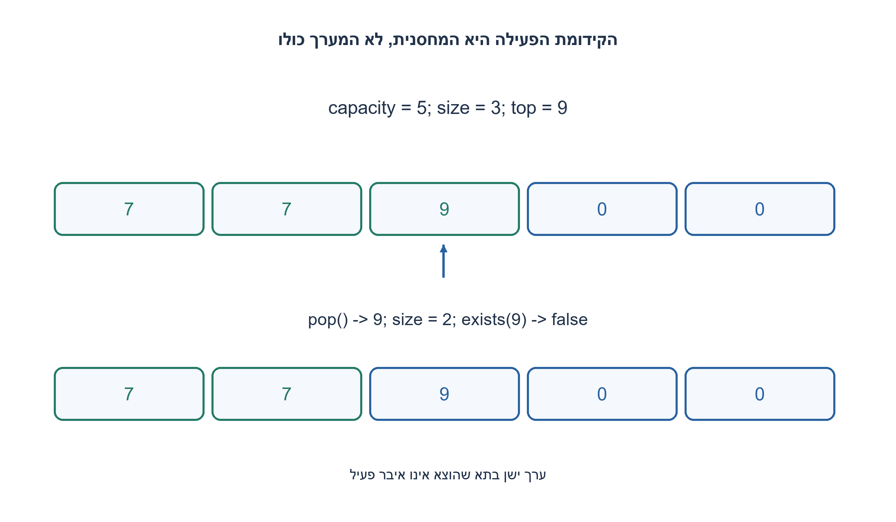
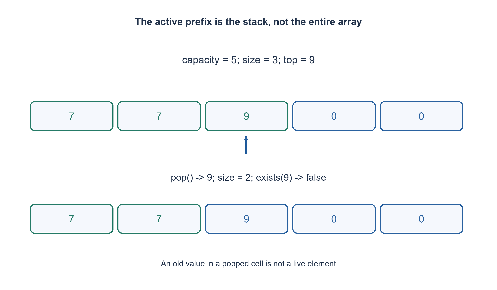

# PREP-309 — מחסנית Java בקיבולת קבועה: בנאי, push, pop וחיפוש

פתרון מוצע בסיוע AI; ביקורת מקצועית אנושית ממתינה. הקושי אינו מכויל.

## עברית

ממשו מחסנית ב־ Java עם constructor, push, pop, isEmpty, exists ו־ isFull.

השלמת חוזה: Java17, ערכי int, קיבולת שלמה capacity≥0 שנקבעת בבנאי ומערך יחיד בקיבולת זו. push מכניסה לראש ומחזירה void; pop מחזירה ומסירה את הראש. push למלא זורקת IllegalStateException, ו־ pop לריק זורקת NoSuchElementException, בלי שינוי. קיבולת שלילית נדחית ב־ IllegalArgumentException. קיבולת אפס מותרת והיא ריקה ומלאה יחד. exists(value) מחפשת רק בין הערכים הפעילים ואינה משנה דבר. כפילויות מותרות; אין שימוש ב־ Stack/Deque למימוש עצמו ואין דרישת בטיחות תהליכונים. נתחו את העלות של כל פעולה.

1. איזה טווח במערך מכיל תמיד את איברי המחסנית החיים?
2. שמרו size כך שהאיברים הפעילים הם data[0..size), והראש ב־ size−1.
3. בדקו גבול לפני שינוי size; exists סורקת רק עד size, גם אם נשאר ערך ישן בתא שהוצא.

### גודל פעיל נפרד מקיבולת
הבנאי יוצר מערך בגודל capacity ומגדיר size=0. האינווריאנט הוא 0≤size≤capacity, והאיברים הפעילים הם בדיוק הקידומת data[0..size). אין צורך להזיז ערכים בכל פעולה.

push בודקת שהמחסנית אינה מלאה, כותבת ב־ data[size] ואז מגדילה את size. pop בודקת שאינה ריקה, מקטינה את size ומחזירה את data[size]. ההקטנה בוחרת את האיבר האחרון שנכנס ולכן LIFO. בדיקה לפני שינוי מבטיחה שכשל לא משחית מצב. isEmpty משווה לאפס ו־ isFull לאורך המערך.

### חיפוש והערכים שאינם פעילים
exists משווה רק בין האיברים באינדקסים שקטנים מ־ size. תא שהוצא יכול להכיל עדיין את המספר הישן, אבל אינו חבר במחסנית. אם דוחפים 7 פעמיים, מוציאים פעם אחת וה־ 7 האחר נשאר, exists(7) עדיין true; אחרי ההוצאה השנייה false. בקיבולת אפס size=capacity=0, כך ששתי בדיקות המצב נכונות ואי אפשר להכניס.

### נכונות ועלות
כל פעולה שומרת את גבולות size ואת סדר הקידומת. push/pop/isEmpty/isFull הן O(1); exists היא O(size) במקרה הגרוע, לא O(1). יצירת מערך Java מאפסת אותו ועולה O(capacity) זמן ואחסון. אין הגדלה דינמית ואין תזוזת איברים. זו מחסנית int ולא גנרית; עבור הפניות לאובייקטים כדאי לאפס את התא שהוצא כדי לא להחזיק אובייקטים חיים שלא לצורך. ריצה מול ArrayDeque בודקת התנהגות; היא אינה טענה שהפתרון משתמש בספרייה זו.

```java
import java.util.NoSuchElementException;

/** Fixed capacity, integer values, single-threaded ownership. */
public final class Prep309FixedIntStack1108b20 {
    private final int[] data;
    private int size;

    public Prep309FixedIntStack1108b20(int capacity) {
        if (capacity < 0) throw new IllegalArgumentException("negative capacity");
        data = new int[capacity];
        size = 0;
    }

    public void push(int value) {
        if (isFull()) throw new IllegalStateException("stack is full");
        data[size++] = value;
    }

    public int pop() {
        if (isEmpty()) throw new NoSuchElementException("stack is empty");
        return data[--size];
    }

    public boolean isEmpty() { return size == 0; }
    public boolean isFull() { return size == data.length; }

    public boolean exists(int value) {
        for (int i = 0; i < size; ++i) {
            if (data[i] == value) return true;
        }
        return false;
    }
}
```




## English

Implement a Java stack with constructor, push, pop, isEmpty, exists and isFull.

Chosen contract: Java17, int values, nonnegative capacity fixed by the constructor and one array of that capacity. push adds at top and returns void; pop removes/returns top. Full push throws IllegalStateException, empty pop throws NoSuchElementException, unchanged. Negative capacity throws IllegalArgumentException. Zero capacity is allowed and both empty and full. exists(value) searches active entries only, without mutation. Duplicates are allowed. Do not implement with library Stack/Deque; thread safety is outside scope. Analyze each operation.

1. Which array range always contains the live stack entries?
2. Keep size so active values occupy data[0..size), with top at size−1.
3. Check bounds before changing size; exists scans only to size even if a popped cell retains an old value.

### Live size is distinct from capacity
The constructor allocates capacity cells and sets size=0. The invariant is 0≤size≤capacity, with live elements exactly in data[0..size). No shifting is needed.

Push checks full before writing data[size] and incrementing size. Pop checks empty before decrementing size and returning data[size]. This selects the most recent insertion, giving LIFO. Checking before mutation keeps failure atomic at the abstract level. isEmpty compares size to zero; isFull compares it with array length.

### Search only live entries
exists checks indices below size. A popped cell may still contain an old integer, but it is no longer a member. Push 7 twice and pop once: exists(7) remains true because one copy survives; after the second pop it is false. At zero capacity, size and capacity are both zero, so empty and full are simultaneously true and every push fails.

### Correctness and cost
Operations preserve the size bounds and the live-prefix ordering. Push/pop/isEmpty/isFull take O(1); exists takes O(size) worst-case, not O(1). Allocating and zero-initializing the Java array takes O(capacity) time and storage. There is no resizing or shifting. This is an int stack; an object-reference version should clear popped cells to avoid retaining unwanted live objects. The independent ArrayDeque checker models behavior and is not used in the implementation.

```java
import java.util.NoSuchElementException;

/** Fixed capacity, integer values, single-threaded ownership. */
public final class Prep309FixedIntStack1108b20 {
    private final int[] data;
    private int size;

    public Prep309FixedIntStack1108b20(int capacity) {
        if (capacity < 0) throw new IllegalArgumentException("negative capacity");
        data = new int[capacity];
        size = 0;
    }

    public void push(int value) {
        if (isFull()) throw new IllegalStateException("stack is full");
        data[size++] = value;
    }

    public int pop() {
        if (isEmpty()) throw new NoSuchElementException("stack is empty");
        return data[--size];
    }

    public boolean isEmpty() { return size == 0; }
    public boolean isFull() { return size == data.length; }

    public boolean exists(int value) {
        for (int i = 0; i < size; ++i) {
            if (data[i] == value) return true;
        }
        return false;
    }
}
```




## חומר משלים / Supporting material

```json
{
  "assumptions": {
    "he": [
      "Java17, קיבולת קבועה לא שלילית, int, גישה סדרתית."
    ],
    "en": [
      "Java17, fixed nonnegative capacity, int values, serialized access."
    ]
  },
  "optimality": {
    "he": "בנאי O(capacity), רוב הפעולות O(1), exists O(size), מקום O(capacity).",
    "en": "Constructor O(capacity), most operations O(1), exists O(size), storage O(capacity)."
  },
  "verification": {
    "he": "קומפילציה והרצה ילידיות ב־ javac/java עברו 12,003 בדיקות מול ArrayDeque, כולל שגיאות וכפילויות. הראיות וטביעות הקוד בדוח הילידי הנפרד.",
    "en": "Actual javac/java compilation and execution passed 12,003 checks against an independent ArrayDeque, including errors and duplicates; source hashes and evidence are in the separate native report."
  },
  "edge_cases": {
    "he": [
      "קיבולת 0 ו־ 1, מילוי מלא, ריק, כפילויות וערך שהוצא אך נשאר בתא."
    ],
    "en": [
      "Capacity0/1, full, empty, duplicates and stale popped cells."
    ]
  },
  "common_mistakes": {
    "he": [
      "לא לשנות size לפני בדיקת גבול; לא לסרוק את הקיבולת כולה ב־ exists; לא לקרוא ל־ exists זמן קבוע."
    ],
    "en": [
      "Do not change size before bounds checks, search the entire capacity, or call exists constant-time."
    ]
  },
  "interview_answer": {
    "he": "הקידומת עד size היא המחסנית הפעילה; push/pop נוגעות רק בקצה הקידומת.",
    "en": "The prefix ending at size is live; push/pop touch only its boundary."
  },
  "source_ambiguities": {
    "he": "המקור מזכיר בנאי שהוצג אך לא מצרף את הקוד שלו; בחרנו בנאי וקיבולת מפורשים, ולא שחזרנו קוד שלא סופק.",
    "en": "The source mentions a shown constructor but supplies no code; capacity and constructor behavior are explicit editorial choices."
  },
  "solution_extensions": {
    "he": [
      {
        "question": "מה משתנה במחסנית גנרית של הפניות?",
        "answer_direction": "צריך להגדיר מדיניות null ושוויון, ולאפס תא שהוצא כדי למנוע החזקת הפניה מיותרת.",
        "principle": "הרחבת חוזה באופן מפורש"
      }
    ],
    "en": [
      {
        "question": "What changes for a generic reference stack?",
        "answer_direction": "Define null/equality policies and clear a popped reference to avoid retention.",
        "principle": "Make an extension explicit"
      }
    ]
  }
}
```
