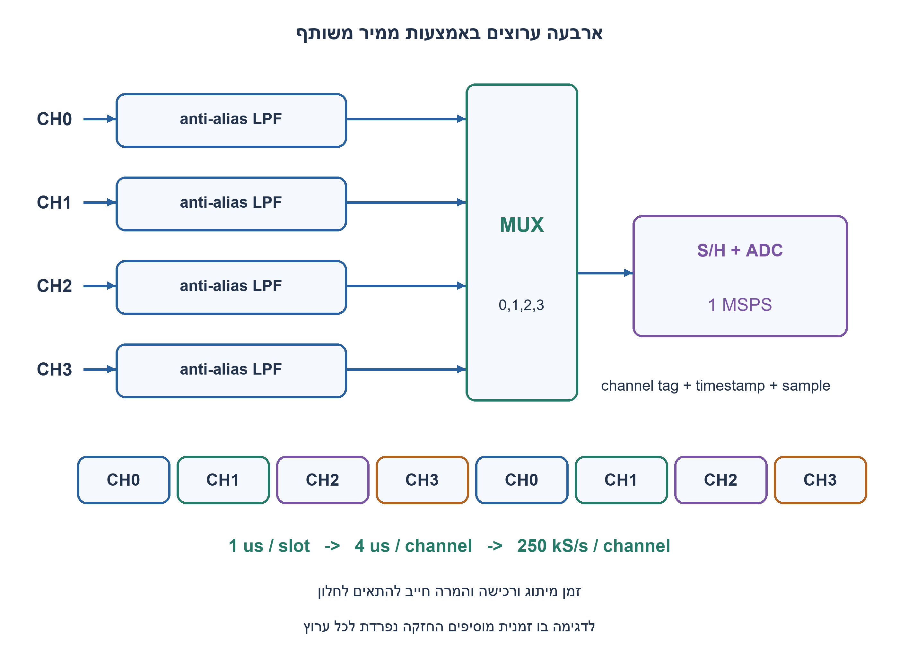
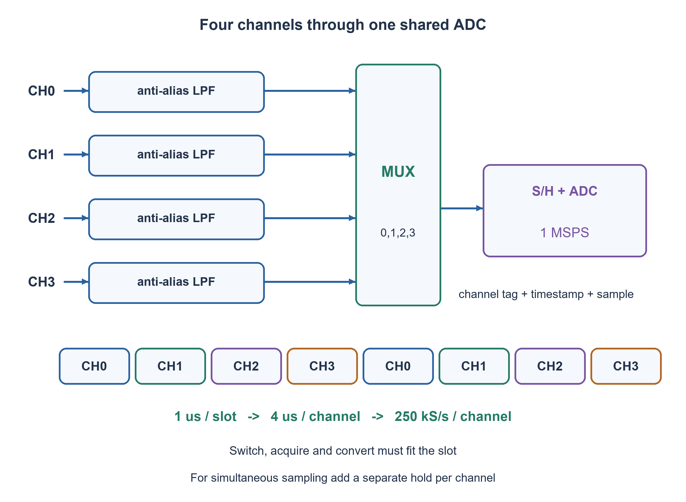

# PREP-310 — ארבעה אותות עד 100kHz באמצעות ADC משותף

פתרון מוצע בסיוע AI; ביקורת מקצועית אנושית ממתינה. דירוג הקושי פנימי ואינו מוצג ללומדים.

[צילום מקור פרטי](../sources/2026-11-08-batch20-17.png)

איך ניתן בממיר אנלוגי לדיגיטלי לשמור4 אותות בתחום0–100kHz כך שלא נאבד מידע מהאותות?

חברות לפי הדיווח בצילום בלבד: SolarEdge.

## עברית

כיצד אפשר לדגום ולשמור ארבעה אותות בתחום 0–100kHz באמצעות ממיר אנלוגי לדיגיטלי בלי לאבד את תוכן התדר הרצוי? הציגו מבנה, קצבי דגימה לכל ערוץ ולממיר, דרישות סינון ותזמון.

השלמה מפורשת: כל ערוץ הוא אות ממשי עצמאי המוגבל ל־100kHz. נשתמש ב־ADC משותף עם multiplexer וסבב ערוצים אחיד; נבחין בין דגימה אידאלית לבין שגיאות כימות ורעש בממיר סופי. בחרו דוגמת קצב כולל 1MSPS, ונמקו מתי נדרשת החזקה בו־זמנית לכל הערוצים. עומק הביטים, טווח המתחים, זמן ההקלטה, הדיוק וה־ADC המסוים לא נמסרו; שמרו אותם כפרמטרים או סמנו במפורש דוגמה.

1. כל ערוץ צריך לעמוד בדרישת הדגימה בעצמו. כמה המרות נדרשות בסבב אחד של ארבעה ערוצים?
2. יותר מ־200kS/s לכל ערוץ דורש יותר מ־800kS/s בסך הכול, לפני בדיקת זמן התייצבות ורכישה.
3. ב־1MSPS כל ערוץ מקבל דגימה כל4µs, כלומר250kS/s. סננו לפני ה־MUX, תייגו ערוצים וזמן, ובדקו שכל פעולה נכנסת לחלון1µs.

### קצב לכל ערוץ, לא רק מספר על הממיר
לרכיב תדר שרירותי עד100kHz אין להסתמך על דגימה בדיוק ב־200kS/s: סינוס ב־100kHz ובפאזה מתאימה יכול להידגם רק באפסים. בוחרים קצב גבוה מפעמיים התדר המרבי, עם מרווח למסנן מעשי. ארבעה ערוצים שכל אחד צריך יותר מ־200kS/s מחייבים קצב כולל גבוה מ־800kS/s. בדוגמת1MSPS, סבב0,1,2,3 נמשך4µs וכל ערוץ מקבל250kS/s; תדר נייקוויסט שלו125kHz, לא500kHz של זרם ההמרות המעורב.

### שרשרת הרכישה
בכל כניסה יש סינון anti-alias המותאם לערוץ, ואחריו MUX, דרייבר/שלב רכישה ו־ADC עם sample-and-hold מתאים. אין להסתפק במסנן יחיד אחרי ה־MUX כדי להסיר alias שכבר נוצר בדגימת כל ערוץ; גם מסנן/דרייבר משותף עלול לשמר מתח מהערוץ הקודם ולהגביל זמן התייצבות. לאחר ההמרה שומרים את מספר הערוץ, ערך הדגימה והזמן או מיקום הסבב.

לכל חלון1µs צריך לבדוק זמן מיתוג, התייצבות, רכישה והמרה לפי פעולת ה־ADC. דוגמה שמרנית ללא חפיפה:0.1µs למיתוג,0.3µs לרכישה ו־0.5µs להמרה מסתכמים ב־0.9µs. אלה תקציבי הוראה, לא מפרט רכיב. בדגם התייצבות מסדר ראשון, שגיאה לאחר זמן t היא ΔV·exp(−t/τ); עבור מדרגת full-scale ודרישה לחצי LSB ב־12 ביט מתקבל t≥τ ln8192≈9.01τ. יש לבדוק גם slew rate, קיבול רכישה, התנגדות מקור ו־kickback אמיתיים.

### שמירה וסימולטניות
בסריקה רגילה הערוצים נדגמים בהפרש1µs. לכל ערוץ יש רשת דגימות אחידה עם היסט ידוע; אין להתייחס לארבע תוצאות כאילו נמדדו באותו רגע. אם הדרישה היא צילום בו־זמני, מוסיפים ארבעה מעגלי track/hold המתוזמנים יחד לפני ה־MUX, או ADC בעל רכישה סימולטנית, ומוודאים שהערכים נשמרים בדיוק הנדרש בזמן ההמרות.

עומק זיכרון תלוי במשך ההקלטה: ללא overhead צריך4·Fs_channel·B·H ביט עבור B ביט לדגימה ו־H שניות. בדוגמת12 ביט ושנייה אחת נדרשים12Mbit, כ־1.5MB באריזה צפופה; בתים מלאים ותגיות מוסיפים נפח. רכישה אינסופית דורשת הזרמה או אחסון גדל.

הבטחת שחזור אידאלי מניחה רוחב פס מוגבל; ADC סופי מוסיף כימות, רעש ו־jitter, ולכן אין הבטחת שימור מדויק של כל אות אנלוגי. [Analog Devices מתארת התייצבות ודרישות קצב ברכישה מרובת ערוצים](https://www.analog.com/en/resources/analog-dialogue/articles/demystifying-data-acquisition-systems.html). בדיקות התזמון והדוגמאות הספקטרליות כאן הן מודלים, לא אימות של לוח ADC.

### מודל Python שנבדק

```python
"""Rate/timestamp/settling model, not an ADC or analog reconstruction simulator."""
from fractions import Fraction as F


def per_channel_rate(adc_rate, channels=4):
    if adc_rate <= 0 or type(channels) is not int or channels <= 0:
        raise ValueError('Positive rate and integer channel count required')
    return F(adc_rate)/channels


def round_robin(adc_rate=1_000_000, slots=16):
    if type(slots) is not int or slots < 0 or adc_rate <= 0:
        raise ValueError('Nonnegative slot count and positive rate required')
    return [(k%4,F(k,adc_rate)) for k in range(slots)]


def slot_fits(switch_s, acquisition_s, conversion_s, adc_rate):
    times=list(map(F,(switch_s,acquisition_s,conversion_s)))
    if min(times)<0 or adc_rate<=0:
        raise ValueError('Nonnegative times and positive rate required')
    return sum(times)<=F(1,adc_rate)


def settling_time(tau, previous_full_scale, allowed_error):
    """Ideal first-order acquisition residual: delta*exp(-t/tau)."""
    import math
    if tau<=0 or not 0 < allowed_error < previous_full_scale:
        raise ValueError('Require tau>0 and 0<error<step')
    return tau*math.log(previous_full_scale/allowed_error)
```




### assumptions

ארבעה ערוצי בסיס ממשיים עד100kHz, סריקה אחידה ו־ADC משותף; דוגמת1MSPS נבחרה במפורש.

### optimality

קצב כולל גבוה מ־800kS/s; בדוגמה250kS/s לכל ערוץ. זיכרון4FsBH ביט לפני overhead.

### verification

בדיקות מודלים עצמאיות עברו: 81 חישובי פינות תזמון מול זמני הגעה מוחלטים, 27 דוגמאות RC בסף יחיד ו־27 בקבל מצומד לאדמה, 100 חלונות ADC ו־32 דוגמאות aliasing, ‏23,254 תצפיות גאומטריות בחיישני עץ, זוג מסלולים המדגים חוסר נצפות בעץ קצר, 32 פאזות סינוס וכל 65,536 זוגות min/max. ראיה: checks/batch1108b20-hardware-model-verification.json. בדיקות Python וחישוב מספרי אינן SPICE, נתוני תהליך, STA או מדידת ADC. קוד SystemVerilog נבדק בנפרד, ותנאי הסביבה והיקף ההרצה מתועדים בדוח native של האצווה. סימולציית Icarus 12.0 עברה 66,134 השוואות: 65,536 זוגות min/max, ‏404 דגימות חיישני עץ ו־194 צעדי סינוס. הבתים של הקוד אומתו מול SHA-256, וההרצה החוזרת בוצעה ללא גישת רשת. ראיה: checks/batch1108b20-native-verification.json. זהו כיסוי סופי מוגבל לחוזים המתוארים, ולא הוכחת חומרה פיזית.

### edge_cases

```json
[
  "200kS/s בדיוק עלול לפספס סינוס בקצה.",
  "ערוצים במתחים שונים יוצרים מדרגת התייצבות.",
  "הקלטה לא חסומה אינה מתאימה לזיכרון קבוע."
]
```

### common_mistakes

```json
[
  "חלוקת קצב הערוצים בלי לבדוק רכישה.",
  "מסנן יחיד אחרי MUX במקום מניעת alias לכל ערוץ.",
  "בלבול בין שמירת רוחב פס לשגיאה אפסית בכימות."
]
```

### interview_answer

בוחר יותר מ־200kS/s לערוץ ומכפיל בארבעה, מסנן כל כניסה, בודק התייצבות ומחזיק בו־זמנית רק אם זו הדרישה.

### source_ambiguities

המקור אינו מגדיר רזולוציה, משך או סימולטניות; נשמרה הפרדה בין דרישות חסרות לבין דוגמת קצב שהוספנו.

### solution_extensions

```json
[
  {
    "question": "איך משתנה התקציב לשמונה ערוצים?",
    "direction": "שמרו קצב לכל ערוץ והכפילו את מספר ההמרות; בדקו מחדש התייצבות וזיכרון.",
    "tests": "סבב תגים באורך8 ומגבלת זמן לחלון."
  }
]
```

## English

How can one ADC sample and store four signals in the0–100kHz band without losing the desired frequency content? Give architecture, per-channel and converter rates, filtering and timing requirements.

Explicit completion: each channel is an independent real signal bandlimited to100kHz. Use one shared ADC, a multiplexer and uniform round-robin scanning; distinguish ideal sampling from finite-resolution quantization and noise. Choose a1MSPS aggregate-rate example and explain when simultaneous per-channel holding is required. Bit depth, voltage range, capture duration, accuracy and a specific ADC are not supplied: keep them parameterized or explicitly label examples.

1. Each channel must satisfy sampling requirements itself. How many conversions form a four-channel scan?
2. More than200kS/s per channel requires more than800kS/s aggregate before checking settling and acquisition.
3. At1MSPS each channel is sampled every4µs, or250kS/s. Filter before the MUX, retain channel/time tags, and fit the operations into a1µs slot.

### Per-channel rate, not just the converter label
Do not rely on exactly200kS/s for arbitrary content through100kHz: a100kHz sine with suitable phase can be sampled only at zeros. Choose a rate above twice the highest frequency, with practical filter margin. Four channels each needing more than200kS/s require more than800kS/s aggregate. At1MSPS, scanning0,1,2,3 takes4µs and each channel receives250kS/s. Its Nyquist frequency is125kHz, not the500kHz Nyquist rate of the mixed conversion stream.

### The acquisition chain
Use suitable per-channel anti-alias filtering, followed by the MUX, driver/acquisition stage and ADC with an appropriate sample-and-hold. A lone post-MUX filter does not replace per-channel alias prevention; a shared filter or driver can also retain the previous channel voltage and limit settling. Retain each sample's channel and timestamp or scan position.

Within each1µs slot check switching, settling, acquisition and conversion under the actual ADC architecture. A conservative nonoverlapping teaching budget of0.1µs switching,0.3µs acquisition and0.5µs conversion totals0.9µs. These are illustrative budgets, not a device specification. For first-order settling, residual error is ΔV·exp(−t/τ); a full-scale step settling to half an LSB at twelve bits needs t≥τ ln8192≈9.01τ. Real slew rate, acquisition capacitance, source resistance and kickback also matter.

### Storage and simultaneity
Ordinary scanning samples channels1µs apart. Each channel has a uniform time grid with a known offset; the four results are not a simultaneous snapshot. If simultaneous capture is required, use four track/holds triggered together before multiplexing, or a simultaneous-acquisition ADC, and check droop/accuracy during sequential conversions.

Storage depends on capture duration. Excluding overhead, four channels need4·Fs_channel·B·H bits for B bits/sample over H seconds. Twelve-bit samples for one second in this example require12Mbit, about1.5MB when tightly packed; byte alignment and tags add overhead. Infinite acquisition needs streaming or growing storage.

Ideal reconstruction assumes bandlimited signals. A finite ADC adds quantization, noise and jitter, so this does not promise exact preservation of arbitrary analog values. [Analog Devices explains settling and rate requirements in multiplexed acquisition](https://www.analog.com/en/resources/analog-dialogue/articles/demystifying-data-acquisition-systems.html). The supplied timing and alias examples are models, not physical ADC-board validation.

### Verified Python teaching model

```python
"""Rate/timestamp/settling model, not an ADC or analog reconstruction simulator."""
from fractions import Fraction as F


def per_channel_rate(adc_rate, channels=4):
    if adc_rate <= 0 or type(channels) is not int or channels <= 0:
        raise ValueError('Positive rate and integer channel count required')
    return F(adc_rate)/channels


def round_robin(adc_rate=1_000_000, slots=16):
    if type(slots) is not int or slots < 0 or adc_rate <= 0:
        raise ValueError('Nonnegative slot count and positive rate required')
    return [(k%4,F(k,adc_rate)) for k in range(slots)]


def slot_fits(switch_s, acquisition_s, conversion_s, adc_rate):
    times=list(map(F,(switch_s,acquisition_s,conversion_s)))
    if min(times)<0 or adc_rate<=0:
        raise ValueError('Nonnegative times and positive rate required')
    return sum(times)<=F(1,adc_rate)


def settling_time(tau, previous_full_scale, allowed_error):
    """Ideal first-order acquisition residual: delta*exp(-t/tau)."""
    import math
    if tau<=0 or not 0 < allowed_error < previous_full_scale:
        raise ValueError('Require tau>0 and 0<error<step')
    return tau*math.log(previous_full_scale/allowed_error)
```




### assumptions

Four real baseband channels through100kHz, uniform shared-ADC scanning;1MSPS is an explicit example.

### optimality

Aggregate rate above800kS/s; example250kS/s per channel. Storage4FsBH bits before overhead.

### verification

Independent models passed:81 corner budgets compared with absolute arrival times,27 single-threshold RC and27 ground-coupling cases,100 ADC slots and32 alias examples,23,254 geometric wood observations, one indistinguishable short-wood trajectory pair,32 sine phases and all65,536 min/max pairs. Evidence: checks/batch1108b20-hardware-model-verification.json. Python/numerical checks are not SPICE, process characterization, STA or physical ADC measurements. SystemVerilog is verified separately; execution conditions and coverage are recorded in the batch native report. Icarus12.0 simulation passed66,134 comparisons:65,536 min/max pairs,404 wood-sensor samples and194 sine steps. Source bytes were checked against SHA-256, and the confirmation run had network access denied. Evidence: checks/batch1108b20-native-verification.json. This is finite coverage of the stated contracts, not physical hardware signoff.

### edge_cases

```json
[
  "Exactly200kS/s can miss a boundary sine.",
  "Different channel voltages create settling steps.",
  "Unbounded capture cannot fit fixed storage."
]
```

### common_mistakes

```json
[
  "Dividing rates without checking acquisition.",
  "Replacing per-channel alias prevention with one post-MUX filter.",
  "Confusing bandwidth preservation with zero quantization error."
]
```

### interview_answer

Choose above200kS/s per channel, multiply by four, filter inputs, check settling and add simultaneous holds only when required.

### source_ambiguities

Resolution, duration and simultaneity are absent; missing requirements are separated from the chosen rate example.

### solution_extensions

```json
[
  {
    "question": "How does the budget change for eight channels?",
    "direction": "Preserve per-channel rate and double conversions; recheck settling and storage.",
    "tests": "Check an eight-tag scan and slot budget."
  }
]
```

