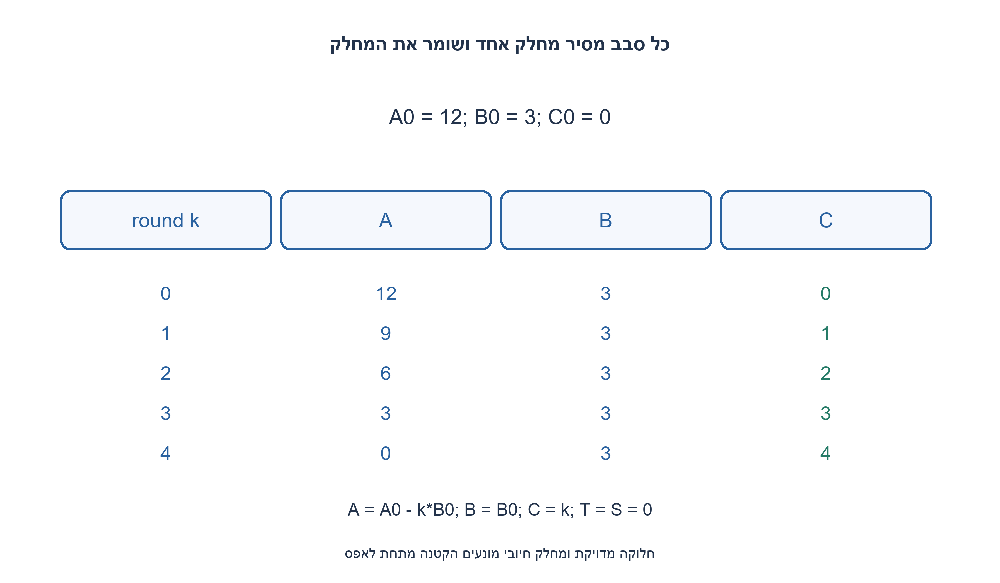
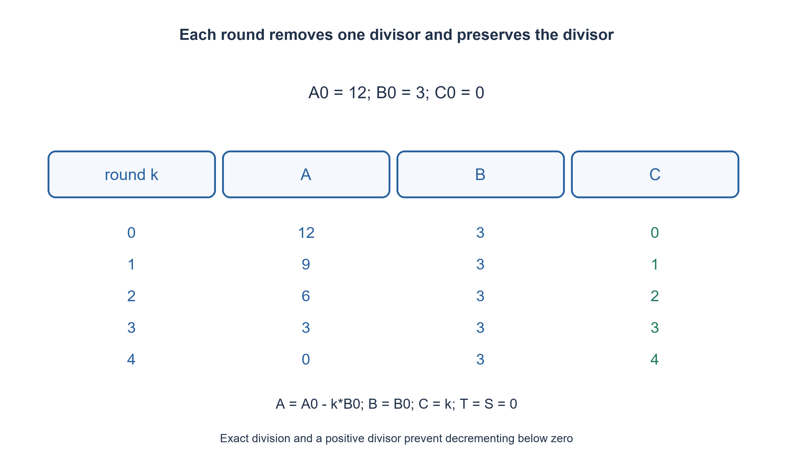

# PREP-311 — חלוקה שלמה מדויקת באמצעות INC, DEC ו־ JNZ בלבד

פתרון מוצע בסיוע AI; ביקורת מקצועית אנושית ממתינה. הקושי אינו מכויל.

## עברית

ממשו חלוקה באסמבלי באמצעות inc, dec, jnz בלבד; מותר להניח שהתוצאה שלמה.

השלמת מודל: A הוא מונה טבעי כולל אפס, B מחלק טבעי חיובי, ומובטח A%B=0. הפלט C=A₀/B₀. האוגרים C, T, S, U מתחילים באפס; A, B מכילים את הקלט. האוגרים טבעיים בלתי חסומים; DEC באפס אסורה. INC R ו־ DEC R משנות ביחידה. JNZ label בודקת רק את תוצאת הפקודה החשבונית שמיד לפניה; אין אוגר מפורש בקפיצה ואין להסתמך על דגל ישן. אין MOV, CMP, JMP, HALT, חיבור או חילוק מוכנים. סיום הוא נפילה מעבר לסוף הרשימה במפרש הלימודי, לא עצירת מעבד פיזי. מותר לצרוך את A, ויש לשמר את B. מספרים שליליים וחילוק באפס מחוץ לחוזה זה; הנחות אלה נוספו במפורש כי המקור אינו מגדירן.

1. כיצד אפשר להחליף חילוק של מכפלה מדויקת בחיסורים חוזרים?
2. בכל סבב חסרו בדיוק B יחידות מ־ A והגדילו את המנה פעם אחת. צריך עזר שמאפשר לשמר את B.
3. העתיקו את B לשני מונים דרך INC/DEC, החזירו אותו מאחד מהם, והשתמשו בשני לספירת החיסור. סדרו JNZ מיד אחרי הקטנת המונה המתאים.

### כל סבב מסיר מחלק אחד
אם A כבר אפס, המנה אפס. בודקים זאת באופן חוקי בעזרת INC A ואז DEC A: A נשמרת, והדגל מתאר את ערכה המקורי. JNZ מיד אחריהן בוחרת כניסה ללולאה. למסלול האפס מגדילים את U מאפס לאחד וקופצים ל־ END באמצעות הדגל שנוצר, בלי להמציא JMP.

כאשר A חיובית, היא כפולה חיובית של B ולכן A≥B. מעבירים את B, יחידה בכל פעם, אל T ואל S. B יורדת לאפס ושני המונים נעשים B₀. מחזירים את B מתוך S, כך ש־ S שוב אפס ו־ T שומר את מספר היחידות שיש לחסר. בלולאת החיסור מקטינים את A ואת T עד ש־ T אפס, ומגדילים את C פעם אחת. בדיקת INC/DEC של A קובעת אם נדרש סבב נוסף.

### אינווריאנט וסיום
בתחילת סבב k מתקיים B=B₀, C=k, T=S=0 ו־ A=A₀−kB₀. כל שלב מעתיק או מחסר כמות מדויקת ושומר טבעיות. ההבטחה לחלוקה מדויקת מבטיחה שלא נכנסים לסבב עם שארית חיובית קטנה מ־ B; לכן אף DEC A אינה נעשית באפס. אחרי q=A₀/B₀ סבבים A אפס ו־ C=q, והלולאה מסתיימת. ללא הבטחת החלוקה המדויקת צריך חוזה אחר לשארית ולמניעת חסר.

### הפקודות הן חלק מהבעיה
JNZ כאן בודקת את תוצאת INC/DEC האחרונה, לא אוגר ששמו נבחר. בכל לולאה ההקטנה הרלוונטית מופיעה מיד לפני הקפיצה; הגדלת C אינה יכולה לשמש בטעות כדגל של A. עבור A₀>0 מתבצעות Θ(A₀+1) פקודות יחידה; אפס מסתיים בזמן קבוע. משתמשים בשישה אוגרים, אך מספר הביטים הנדרש לערכם אינו קבוע עבור מספרים בלתי חסומים. הבדיקה מריצה את הרשימה במפרש שמאשר רק את שלוש הפקודות; זו אינה קומפילציה לארכיטקטורת מעבד אמיתית.

```text
; A>=0, B>0 and A is divisible by B. C,T,S,U start at zero.
; INC/DEC R and flag-based JNZ label only. DEC zero is forbidden.
; JNZ immediately follows arithmetic; END is fall-through completion.
INC A
DEC A
JNZ OUTER
INC U
JNZ END
OUTER:
COPY_B:
INC T
INC S
DEC B
JNZ COPY_B
RESTORE_B:
INC B
DEC S
JNZ RESTORE_B
SUBTRACT:
DEC A
DEC T
JNZ SUBTRACT
INC C
INC A
DEC A
JNZ OUTER
END:
```




## English

Implement exact integer division in assembly using only inc, dec and jnz.

Chosen model: natural numerator A including zero, positive natural divisor B, and promise A%B=0. Output C=A₀/B₀. C, T, S, U initially zero; A, B hold inputs. Registers are unbounded naturals and DEC at zero is forbidden. INC/DEC change one unit. JNZ label tests the immediately preceding arithmetic result; it names no register and may not reuse stale flags. No MOV, CMP, JMP, HALT, built-in add or divide. Completion means falling beyond the educational listing, not stopping a physical CPU. A may be consumed and B must be preserved. Negative inputs and divisor zero are outside this explicitly completed contract.

1. How can repeated subtraction divide an exact multiple?
2. Subtract exactly B units from A each round and increment the quotient once, using scratch to preserve B.
3. Copy B into two counters with unit operations, restore B from one, and use the other to count subtraction. Place JNZ immediately after the relevant counter decrement.

### Remove one divisor per round
Zero numerator gives zero quotient. Test it legally by INC A then DEC A: the value is restored and the latest result describes its original zero/nonzero state. The immediately following JNZ enters the loop. For zero, increment U from zero and branch to END using that nonzero result, without inventing JMP.

For positive A, exact divisibility implies A≥B. Consume B one unit at a time while incrementing both T and S. B becomes zero and both counters become B₀. Restore B from S, leaving S=0 and T equal to the subtraction count. Decrement A and T until T reaches zero, then increment quotient C once. A zero-safe INC/DEC test decides whether another round is needed.

### Invariant and termination
At round k, B=B₀, C=k, T=S=0 and A=A₀−kB₀. Each phase copies or subtracts exactly its count while preserving natural values. Exact divisibility prevents entry with a positive remainder smaller than B, so A is never decremented at zero. After q=A₀/B₀ rounds, A=0 and C=q, proving completion and result. General quotient/remainder division needs an additional contract and underflow prevention.

### Instructions are part of the problem
JNZ uses the most recent INC/DEC result, not a named arbitrary register. Every loop places the relevant decrement immediately before branching; incrementing C must not accidentally provide A’s branch flag. Positive numerators take Θ(A₀+1) unit instructions; zero completes in constant time. Six registers are used, but unbounded values do not have a constant bit footprint. The checker interprets the exact three-opcode listing; it does not claim native assembly compilation for a physical CPU.

```text
; A>=0, B>0 and A is divisible by B. C,T,S,U start at zero.
; INC/DEC R and flag-based JNZ label only. DEC zero is forbidden.
; JNZ immediately follows arithmetic; END is fall-through completion.
INC A
DEC A
JNZ OUTER
INC U
JNZ END
OUTER:
COPY_B:
INC T
INC S
DEC B
JNZ COPY_B
RESTORE_B:
INC B
DEC S
JNZ RESTORE_B
SUBTRACT:
DEC A
DEC T
JNZ SUBTRACT
INC C
INC A
DEC A
JNZ OUTER
END:
```




## חומר משלים / Supporting material

```json
{
  "assumptions": {
    "he": [
      "A≥0, B>0, חלוקה מדויקת, עזר אפס, אוגרים טבעיים וקפיצה לפי הדגל האחרון."
    ],
    "en": [
      "A≥0, B>0, exact divisibility, zero scratch, natural registers and previous-result branches."
    ]
  },
  "optimality": {
    "he": "Θ(A₀+1) פקודות יחידה ושישה אוגרים; אין טענה למינימום פקודות מדויק.",
    "en": "Θ(A₀+1) unit instructions and six registers; no exact instruction-minimum claim."
  },
  "verification": {
    "he": "420 זוגות מונה/מחלק נבדקו ברשימה המדויקת מול מנה חשבונית עצמאית, כולל אפס ושימור המחלק.",
    "en": "420 exact numerator/divisor pairs checked through the listing against arithmetic expectations, including zero and preserved divisor."
  },
  "edge_cases": {
    "he": [
      "מונה אפס, מחלק 1, מנה 1; מחלק אפס, שליליים ושארית אינם קלט חוקי."
    ],
    "en": [
      "Zero numerator, divisor1, quotient1; zero divisor, negatives and nonzero remainder are outside contract."
    ]
  },
  "common_mistakes": {
    "he": [
      "לא לבדוק את דגל INC C במקום את A; לא להפוך JNZ לפקודת קפיצה לפי אוגר; לא לחסר באפס."
    ],
    "en": [
      "Do not branch on INC C instead of A, turn JNZ into named-register branching, or decrement zero."
    ]
  },
  "interview_answer": {
    "he": "סופרים כמה פעמים אפשר להסיר מחלק שלם, ומשחזרים את המחלק בעזרת מוני עזר.",
    "en": "Count complete divisor removals and restore the divisor through scratch counters."
  },
  "source_ambiguities": {
    "he": "המקור אינו מגדיר סימן, אפסים, אתחול עזר או סוג JNZ; נבחר מודל מלא ומפורש שאינו חוזה הקפיצה של PREP-035.",
    "en": "The source omits signs, zero behavior, scratch initialization and JNZ semantics; this explicit model differs from PREP-035’s named-register branch."
  },
  "solution_extensions": {
    "he": [
      {
        "question": "איך תומכים גם בשארית שאינה אפס?",
        "answer_direction": "נדרש מבחן או חיסור ניסיון שניתן לשחזר; צריך למנוע DEC באפס ולשמור את השארית, בלי להוסיף פקודות בשקט.",
        "principle": "הרחבת חוזה באופן מפורש"
      }
    ],
    "en": [
      {
        "question": "How would nonzero remainders be supported?",
        "answer_direction": "Use a safe comparison or reversible trial subtraction; avoid DEC at zero and preserve remainder without silently adding opcodes.",
        "principle": "Make an extension explicit"
      }
    ]
  }
}
```
