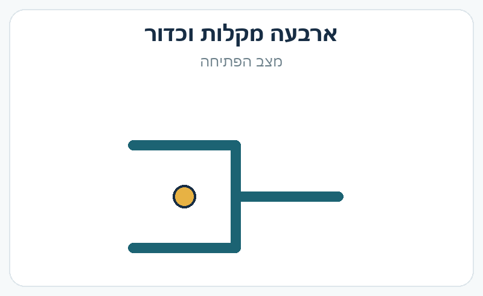
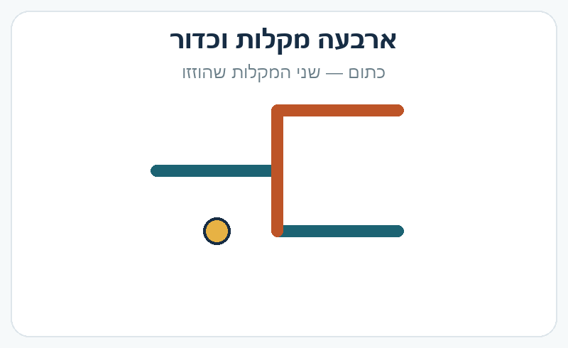
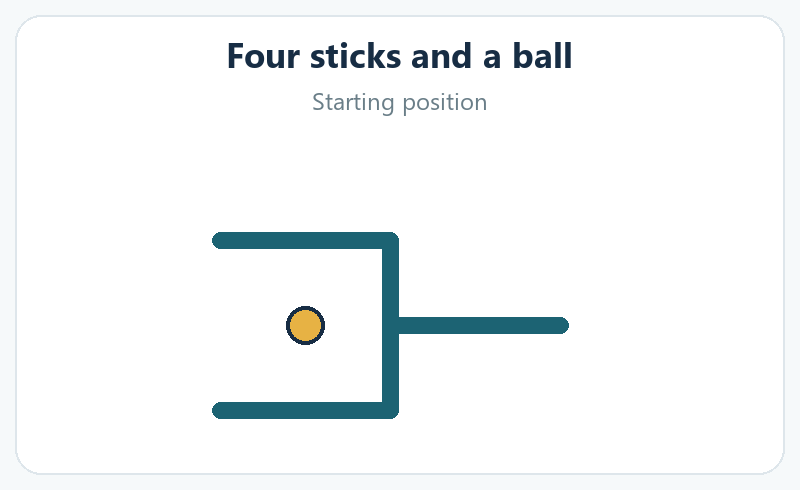

# PREP-312 — להוציא כדור מכף עשויה מארבעה מקלות

פתרון מוצע בסיוע AI. ממתין לביקורת מקצועית אנושית.

[צילום המקור](../sources/2026-11-14-batch30-01.png)

יש 4 מקלות וכדור באמצע כמו בתמונה. יש להזיז רק 2 מקלות בלי לגעת בכדור ככה שהכדור יהיה מחוץ לצורה והצורה תשמר כמו שהייתה. איזה מקלות נזיז ואיך?

## להוציא כדור מכף עשויה מארבעה מקלות

ארבעה מקלות באורך שווה יוצרים כף הפתוחה שמאלה. שתי דפנות אופקיות מחוברות לקצות בסיס אנכי, וידית יוצאת ימינה מאמצעו. הכדור מונח במרכז החלל. הזיזו בדיוק שני מקלות, בלי לגעת בכדור, כך שתתקבל כף חופפת והכדור יהיה מחוצה לה. מותר לשנות את כיוון הפתח.

### רמזים

1. האם כל מקל חייב לשמור על אותו תפקיד?
2. בחרו אחת מדפנות הכף והידית להישאר במקומן.
3. נסו להפוך את הידית הקיימת לדופן ואת הדופן העליונה לידית. היכן צריך להיות אמצע הבסיס החדש?

### פתרון מוצע

השאירו את הדופן העליונה ואת הידית במקומן. החליקו את הבסיס האנכי כלפי מעלה בחצי אורך מקל, לאורך אותו קו. קצהו התחתון נוגע כעת בידית הישנה, ואמצעו נוגע בדופן העליונה הישנה. הרימו את הדופן התחתונה והניחו אותה ימינה מקצהו העליון של הבסיס החדש.

הידית הישנה היא כעת הדופן התחתונה. הדופן העליונה הישנה היא הידית הפונה שמאלה. שתי הדפנות החדשות שוות באורכן, מקבילות ומחוברות לקצות הבסיס, ולכן מתקבלת אותה צורה בפתח ימני. הכדור נשאר משמאל לבסיס, מחוץ לחלל החדש. אפשר להרים את המקל השני מעל המשטח בזמן העברתו.

### הנחות

המקלות ישרים, בעלי אותו אורך, ומותר להרימם ולסובב את צורת הכף.

### מקרה קצה

אפשר גם לשקף את הפתרון כלפי מטה. הכדור צריך להיות בתוך הכף מלכתחילה, עם רווח מהמקלות.

### טעות נפוצה

אם מזיזים רק את שתי הדפנות לצד האחר, הידית הישנה בולטת כעת לתוך חלל הכף.

### סיבוכיות או עלות

שתי הזזות מספיקות ומספרן קבוע בחוזה.

### בדיקות

בדיקת קואורדינטות משווה את אורכי המקלות, נקודות החיבור, חפיפת הצורה, שני המקלות שנשארו ומיקום הכדור.

### תשובה קצרה

אני משאיר דופן אחת ואת הידית. בסיס שמוזז בחצי אורך מאפשר להחליף ביניהן תפקידים ולמקם את הדופן האחרת בצד הנגדי.

### שאלת המשך

האם יש פתרון סימטרי? משאירים את הדופן התחתונה במקום העליונה ומחליקים את הבסיס כלפי מטה.

## Free the ball from a four-stick scoop

Four equal sticks form a left-opening scoop. Two horizontal sides meet the ends of a vertical base. A handle extends right from its midpoint. A ball lies in the middle of the cavity. Move exactly two sticks without touching the ball so that the final scoop is congruent and the ball is outside. The opening may face a different way.

### Hints

1. Must a stick keep its original job?
2. Leave the handle and one side in place.
3. Try using the old handle as a side and the top side as the handle. Where does the midpoint of the new base belong?

### Proposed solution

Leave the upper side and handle in place. Slide the vertical base upward along its own line by half a stick length. Its lower end now touches the old handle, and its midpoint touches the old upper side. Lift the lower side and place it pointing right from the upper end of the shifted base.

The old handle becomes the lower side. The old upper side becomes the left-pointing handle. Both new sides still have equal length, run parallel, and meet the ends of the base, so the scoop has the same shape and now opens right. The ball remains to the left of the base, outside the new cavity. Lift the second stick above the surface during transfer.

### Assumptions

Sticks are straight and equally long. They can be lifted, and the scoop can face another direction.

### Edge case

Reflecting the construction downward also works. The ball initially lies inside with clearance from the sticks.

### Common mistake

Moving both side sticks across the base leaves the original handle projecting into the new cavity.

### Cost

The construction uses the required two moves.

### Verification

A coordinate check measures lengths, connections, congruence, the two stationary segments and the position of the ball.

### Interview answer

I leave a side and the handle stationary. Moving the base half a length lets them trade roles, and I put the remaining side opposite the new lower side.

### Follow-up

Is there a reflected solution? Keep the lower side instead of the upper one and slide the base downward.

[checks/check_nov14_reasoning_software.py](../checks/check_nov14_reasoning_software.py)

[checks/prep-312-1114-verification.json](../checks/prep-312-1114-verification.json)
