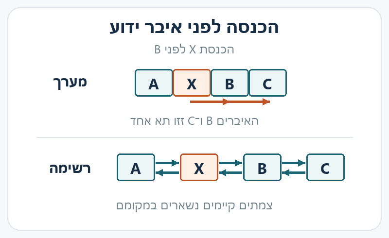
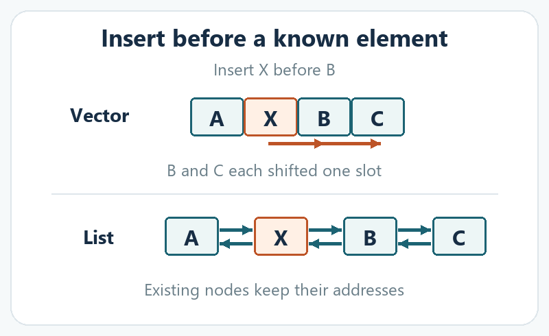

# PREP-313 — הכנסה לרשימה מקושרת לעומת מערך דינמי

פתרון מוצע בסיוע AI. ממתין לביקורת מקצועית אנושית.

[צילום המקור](../sources/2026-11-14-batch30-13.png)

What are the differences between list and dynamic array (vector) functions (insert, append, insert to place)?

## הכנסה לרשימה מקושרת לעומת מערך דינמי

השוו רשימה דו־מקושרת עם ראש וזנב למערך רציף שגדל בהכפלת קיבולת. מה העלות של הוספה לסוף, הכנסה לפני איבר שיש אליו איטרטור והכנסה לפי אינדקס i? התייחסו גם למקרה הגרוע בהוספה לסוף ולתוקף איטרטורים. עלות העתקת איבר והקצאת צומת נחשבות קבועות.

### רמזים

1. הפרידו בין מציאת המקום לבין ההכנסה עצמה.
2. חשבו אילו שכנים או תאי מערך משתנים כאשר מכניסים באמצע.
3. סכמו את מספר ההעתקות במעבר מקיבולת 1 ל־2, ל־4 וכן הלאה.

### פתרון מוצע

ברשימה הזנב מאפשר append בזמן O(1) במקרה הגרוע במודל הנתון. אם יש איטרטור לפניו רוצים להכניס, יוצרים צומת ומחברים אותו בין האיבר לקודמו במספר קבוע של עדכונים. כשמקבלים אינדקס בלבד, יש להגיע אליו תחילה. אפשר להתחיל מהקצה הקרוב, ולכן העלות O(1+min(i,n−i)).

במערך יש גישה ישירה לאינדקס. הכנסה ב־i מזיזה את n−i האיברים שאחריו תא ימינה. אם נשארה קיבולת, העלות Θ(1+n−i). כשהמערך מלא, מקצים מערך חדש ומעבירים את n האיברים, בעלות Θ(n) גם אם מוסיפים בסוף. לאורך רצף של n הוספות לסוף, עלויות ההגדלה הן סכום גאומטרי קטן מ־2n העתקות. לכן append עולה O(1) בממוצע משוערך.

למשל, הכנסת X לפני B ב־[A,B,C] מחייבת להזיז במערך את B ו־C. ברשימה, כתובות B ו־C נשמרות. ברשימת צמתים הכנסה משאירה איטרטורים קיימים תקפים. במודל של C++ vector הקצאה מחדש מבטלת את כולם, וגם ללא הקצאה מחדש איטרטורים מנקודת ההכנסה ועד הסוף מתבטלים.

### הנחות

הקיבולת גדלה גאומטרית; הרשימה דו־מקושרת; האינדקס בתחום 0..n.

### מקרה קצה

הכנסה באינדקס n היא append; ברשימה ריקה מעדכנים גם ראש וגם זנב.

### טעות נפוצה

לייחס O(1) להכנסה לפי אינדקס ברשימה בלי לספור את איתור הצומת, או לתת ל־append במערך חסם קשיח של O(1).

### סיבוכיות או עלות

העלויות תלויות באופן מסירת המקום, בקרבה לקצה ובקיבולת הפנויה.

### בדיקות

בדיקת ספירה מדמה הגדלות והזזות, ומשווה את המערך הסופי והיקף ההעתקות למספר האיברים שהוסטו.

### תשובה קצרה

ברשימה זול לחבר צומת כשכבר הגעתי למקום. במערך זול להגיע למקום, אך הכנסת איבר עשויה להזיז סיומת שלמה.

### שאלת המשך

מתי reserve עוזר? הקצאה מראש מונעת הגדלות עד לקיבולת שנשמרה. הכנסה באמצע עדיין מזיזה את הסיומת.

## Inserting into a linked list versus a vector

Compare a doubly linked list with head and tail pointers with a contiguous vector that doubles its capacity. Give the cost of append, insertion before a known iterator, and insertion at index i. Discuss worst-case append and iterator validity. Treat each element move and each node allocation as constant cost.

### Hints

1. Separate finding the position from inserting there.
2. Which links or array slots change when you insert in the middle?
3. Sum the copies incurred as capacity grows from 1 to 2 to 4 and so on.

### Proposed solution

With a tail pointer, list append takes worst-case O(1) in the stated model. Given an iterator to the successor, allocate a node and splice it between that node and its predecessor with a constant number of link changes. Given only an index, walk to it first. Starting from the nearer end costs O(1+min(i,n−i)) in total.

A vector locates index i directly. Insertion there moves the n−i elements in the suffix one place right. With spare capacity this takes Θ(1+n−i). If the vector is full, moving n elements into a new allocation costs Θ(n), even for an append. Across n appends from empty, copies for geometric growth sum to less than 2n, hence O(1) amortized append.

For example, inserting X before B in [A,B,C] moves B and C in the vector. Their addresses stay fixed in the list. Node-list insertion preserves existing iterators. For C++ vector, reallocation invalidates all iterators. Without reallocation, insertion invalidates iterators at and after the insertion position, including the old end.

### Assumptions

Capacity grows geometrically; the list is doubly linked; 0≤i≤n.

### Edge case

Index n is append. In an empty list both head and tail change.

### Common mistake

Claiming list insertion at an index is O(1) skips the lookup. Vector append has an occasional linear cost.

### Cost

Costs depend on how the position is given, distance to an end, and spare capacity.

### Verification

A counting simulation checks resulting sequences and the number of elements moved during growth and shifts.

### Interview answer

A list cheaply relinks a known position. A vector cheaply locates an index, but insertion may shift the whole suffix.

### Follow-up

When does reserve help? Preallocation prevents growth until the reserved capacity is exhausted. Middle insertions still shift the suffix.

[checks/check_nov14_reasoning_software.py](../checks/check_nov14_reasoning_software.py)

[checks/prep-313-1114-verification.json](../checks/prep-313-1114-verification.json)
