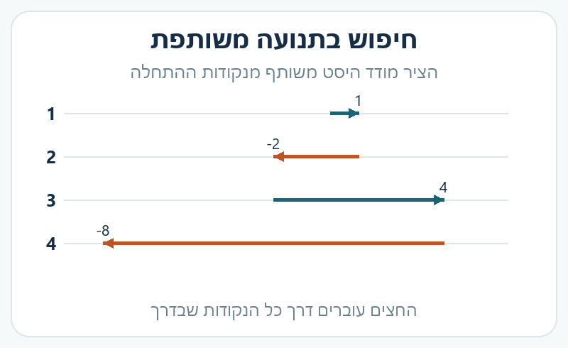
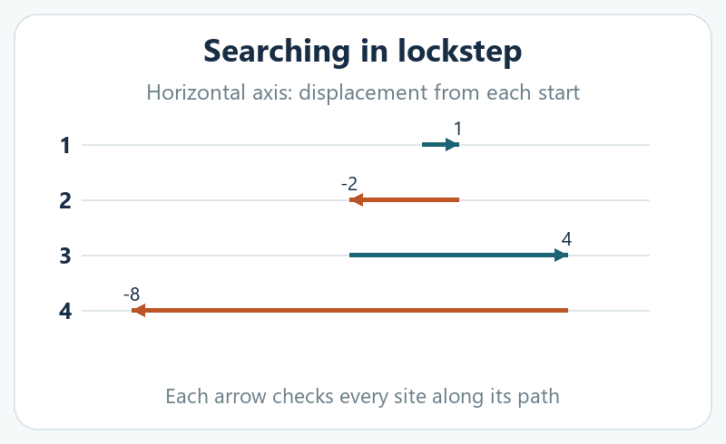

# PREP-315 — שני רובוטים מחפשים חפץ בתנועה משותפת

פתרון מוצע בסיוע AI. ממתין לביקורת מקצועית אנושית.

[צילום המקור](../sources/2026-11-14-batch30-18.png)

שני רובוטים נוחתים על קו ישר עליהם למצוא חפץ שמונח על הקו, הפעולות היחידות שהם יכולים לעשות, זה לנוע שמאלה או ימינה ביחד ולבדוק האם החפץ נמצא במקום בו הם דורכים. מצא אלגוריתם יעיל למציאת החפץ.

## שני רובוטים מחפשים חפץ בתנועה משותפת

שני רובוטים מתחילים בנקודות שלמות על ישר. חפץ קבוע נמצא בנקודה שלמה שאינה ידועה. בכל צעד שניהם זזים יחד יחידה אחת באותו כיוון ובודקים כל אחד את התא שעליו הוא עומד. מותר לבדוק גם לפני הצעד הראשון, ולסיים ברגע שאחד מהם מוצא. אין גבול ידוע למרחק ואין מידע על כיוון המטרה. תכננו אסטרטגיה והעריכו את מספר הצעדים לפי d, המרחק ההתחלתי הקטן יותר מהחפץ.

### רמזים

1. איזו נקודה יכולים שניהם לזכור בלי לדעת את מיקומם המוחלט?
2. ביקור רק בצד אחד של נקודת ההתחלה עלול להחמיץ את החפץ.
3. קבעו יעדי היסט מתחלפים: ‎+1, −2, +4, −8. בדקו בכל תא בדרך.

### פתרון מוצע

בדקו את שני תאי ההתחלה. שמרו היסט משותף x מאפס וקבעו יעד g=1. כל עוד x שונה מ־g, הזיזו את שני הרובוטים יחידה לעבר g, עדכנו x ובדקו את שני התאים. בהגעה ליעד קבעו g=−2g והמשיכו. המרחק בין הרובוטים נשמר, אבל ההיסט של כל אחד עובר בסופו של דבר דרך כל מספר שלם.

בחרו את הרובוט הקרוב בתחילה. כדי שיגיע לחפץ דרוש לו היסט t עם |t|=d. אם d>0, היעד הראשון בצד הנכון שמגיע לפחות ל־d הוא בגודל קטן מ־4d, כי שני יעדים רצופים באותו צד נבדלים בגורם 4 (עבור היעד הראשון בצד זה הגודל לכל היותר 2). עד יעד בגודל M סכום מרחקי ההליכה הוא לכל היותר 3M, מסכום גאומטרי. לכן מספר הצעדים הוא O(d+1). זה סדר הגודל הטוב האפשרי: גם כשיודעים את הכיוון אי אפשר להגיע לחפץ בפחות מ־d צעדים. למשל, חפץ בהיסט ‎−3 יתגלֶה בהליכה מהיעד ‎+4 אל ‎−8 אם הרובוט האחר טרם מצא אותו.

### הנחות

שני הרובוטים זזים יחידה באותו כיוון, יש בדיקה מקומית אמינה וניתן למנות צעדים.

### מקרה קצה

אם d=0 עוצרים בבדיקה הראשונה. הרובוטים יכולים להתחיל באותה נקודה.

### טעות נפוצה

בדיקה רק בקצות המסלולים מדלגת על מטרות. חלוקת הרובוטים לכיוונים מנוגדים מפרה את התנועה המשותפת.

### סיבוכיות או עלות

O(d+1) צעדים ו־O(1) מונים. המונים דורשים O(log(d+2)) ביטים.

### בדיקות

סימולציה על מיקומי התחלה ומטרות משני הצדדים בודקת גילוי, מרחק קבוע בין הרובוטים וחסם צעדים לינארי.

### תשובה קצרה

אני שולח לשניהם את אותה פקודה, מחליף כיוון ומכפיל את יעד ההיסט בכל סבב. בדיקה בכל צעד מבטיחה כיסוי בזמן O(d+1).

### שאלת המשך

מדוע לא להגדיל את היעד בצעד אחד בכל פעם? המסלולים החוזרים נעשים ארוכים בהדרגה וסכומם עד d יכול לגדול ריבועית.

## Two robots searching a line in lockstep

Two robots start on integer sites of a line. A stationary object is at an unknown integer site. At every step both move one unit in the same direction. Each can check its current site after each move and at the start. Stop when either finds the object. Neither its direction nor a distance bound is known. Design a search and bound the steps using d, the smaller initial distance to the object.

### Hints

1. Which coordinate can both robots track without knowing their absolute positions?
2. Searching only one side of the starting point could miss the object.
3. Try alternating displacement goals +1, −2, +4, −8. Check every site along each leg.

### Proposed solution

Check both starting sites. Keep a shared displacement x, initially zero, and a goal g=1. While x differs from g, move both robots one unit toward g, update x and check both sites. On reaching g set g=−2g and continue. The distance between robots stays fixed, while the displacement of each eventually traverses every integer.

Consider the initially nearer robot. It reaches the object at some displacement t with |t|=d. For d>0 the first goal on the correct side reaching at least d has magnitude less than 4d: successive goals on that side quadruple, and the first goal there has magnitude at most 2. Summing the leg lengths geometrically through a goal of magnitude M costs at most 3M steps. Thus the search takes O(d+1) steps. This order is optimal: even with the direction known, neither robot could reach the object in fewer than d moves. For example, an object at displacement −3 is crossed on the +4 to −8 leg, unless the other robot finds it first.

### Assumptions

Identical unit moves, reliable local checks, and the ability to count steps.

### Edge case

If d=0 the initial check succeeds. The robots may start together.

### Common mistake

Checking only the endpoints skips targets. Sending the robots in opposite directions breaks the common-command constraint.

### Cost

O(d+1) moves and O(1) counters, using O(log(d+2)) counter bits.

### Verification

Position simulations on both sides verify detection, preserved separation and a linear step bound.

### Interview answer

I send both robots the same commands, alternating direction and doubling the displacement goal after each leg. Checking every step finds the object in O(d+1) steps.

### Follow-up

Why not increase the goal size by one per leg? The repeated traversals then grow arithmetically; their total through distance d can be quadratic.

[checks/check_nov14_reasoning_software.py](../checks/check_nov14_reasoning_software.py)

[checks/prep-315-1114-verification.json](../checks/prep-315-1114-verification.json)
