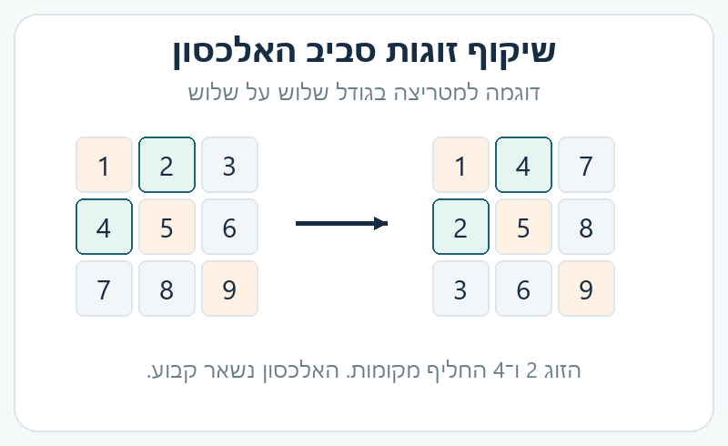
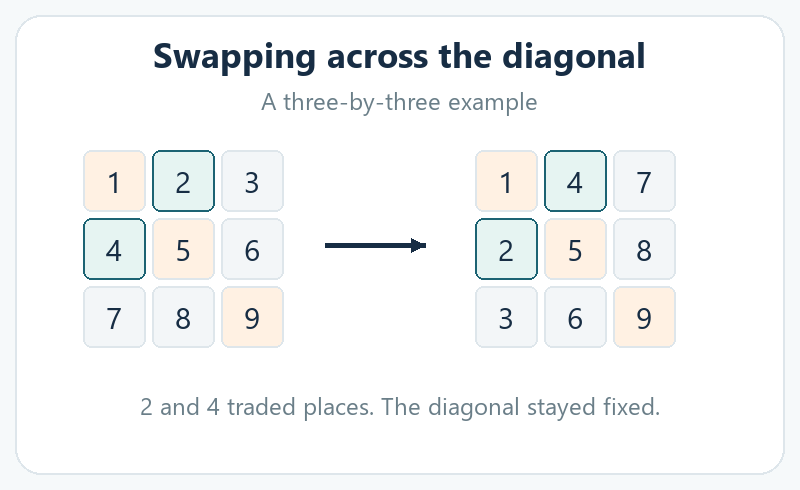

# PREP-318 — שחלוף מטריצה ריבועית במקום

פתרון מוצע בסיוע AI. ממתין לביקורת מקצועית אנושית.

[צילום המקור](../sources/2026-11-14-batch30-26.png)

כתוב פונקציה שמקבלת מטריצה ריבועית של מספרים ואת גודלה של המטריצה, והופכת אותה (Transpose) ללא שימוש נוסף בזיכרון נוסף.

## שחלוף מטריצה ריבועית במקום

שחלפו במקום מטריצה ריבועית בגודל n×n כך שבסוף בתא (i,j) יימצא הערך המקורי של (j,i). השורות ניתנות לשינוי ונפרדות בזיכרון. השתמשו ב־O(1) זיכרון עזר, ללא מטריצת פלט. בגרסת Python כתבו transpose_in_place(matrix), הסיקו n מאורך הרשימה והחזירו את אותה מטריצה לאחר השינוי.

### רמזים

1. אילו תאים אינם משתנים בשחלוף?
2. מה יקרה אם תחליפו כל תא עם השיקוף שלו, כולל שני הכיוונים?
3. לכל i בקרו רק בעמודות j>i והחליפו את שני התאים.

### פתרון מוצע

האלכסון נשאר במקום. לכל זוג אינדקסים שונים יש זוג תאים (i,j) ו־(j,i) שמחליף מקומות. עוברים רק על המשולש העליון, שבו j>i, ומחליפים כל זוג פעם אחת. כל זוג מחוץ לאלכסון מיוצג בדיוק פעם אחת במשולש הזה, וההחלפה אינה נוגעת בזוגות אחרים. כך מתקבל השחלוף כולו.

למשל [[1,2],[3,4]] עוברת ל־[[1,3],[2,4]] בהחלפת 2 ו־3. יש n(n−1)/2 החלפות והן משתמשות במספר קבוע של אינדקסים ובערך זמני. במטריצה צפופה כללית צריך לטפל בכל זוג שיכול להיות שונה, ולכן סדר הזמן הדרוש הוא Θ(n²) עבור n גדול.

```python
def transpose_in_place(matrix):
    """Transpose a square list of distinct mutable rows and return it."""
    size = len(matrix)
    for row in range(size):
        for col in range(row + 1, size):
            matrix[row][col], matrix[col][row] = matrix[col][row], matrix[row][col]
    return matrix
```



### הנחות

מטריצה ריבועית של שורות נפרדות שניתן לשנות; ללא דרישה להעתקת גיבוי.

### מקרה קצה

מטריצה ריקה או בגודל 1×1 נשארת ללא שינוי. מחוץ לחוזה נמצאות מטריצות מלבניות ושורות שהן אותו אובייקט.

### טעות נפוצה

אם עוברים על שני המשולשים, כל זוג מוחלף פעמיים והמטריצה חוזרת למקור.

### סיבוכיות או עלות

n(n−1)/2 החלפות, זמן Θ(n²) וזיכרון עזר O(1).

### בדיקות

השוואה למטריצה חדשה שמחושבת לפי הגדרת השחלוף, בדיקת זהות המטריצה והשורות ושחלוף כפול.

### תשובה קצרה

אני מחליף רק מעל האלכסון, (i,j) עם (j,i). כך כל זוג מטופל פעם אחת בזמן Θ(n²) ובזיכרון עזר קבוע.

### שאלת המשך

מה מתקבל אם משחלפים פעמיים? ההחלפה השנייה מבטלת כל החלפה מהראשונה, ולכן מקבלים בדיוק את המטריצה המקורית.

## Transpose a square matrix in place

Transpose an n×n square matrix in place so that entry (i,j) holds the original value at (j,i). Rows are distinct and mutable. Use O(1) auxiliary storage and no output matrix. In Python implement transpose_in_place(matrix), infer n from its length, and return that same matrix after changing it.

### Hints

1. Which entries are fixed by transposition?
2. What happens if you swap every entry with its reflection in both directions?
3. For row i, visit only columns j>i and exchange the two entries.

### Proposed solution

The diagonal is fixed. Each pair of distinct indices identifies two entries, (i,j) and (j,i), that must trade places. Traverse only the strict upper triangle where j>i. Swap the two entries once. Every off-diagonal pair has exactly one representative in that triangle and no swap touches a different pair, which proves the final matrix is the transpose.

For example [[1,2],[3,4]] becomes [[1,3],[2,4]] by swapping 2 and 3. There are n(n−1)/2 swaps. Only a constant number of indices and temporary values are needed. For a general dense matrix every potentially distinct pair must be handled, so the time order is Θ(n²) for growing n.

```python
def transpose_in_place(matrix):
    """Transpose a square list of distinct mutable rows and return it."""
    size = len(matrix)
    for row in range(size):
        for col in range(row + 1, size):
            matrix[row][col], matrix[col][row] = matrix[col][row], matrix[row][col]
    return matrix
```



### Assumptions

The square matrix consists of distinct writable rows. No backup copy is required.

### Edge case

Empty and 1×1 matrices are unchanged. Rectangular inputs and aliased rows are outside the contract.

### Common mistake

Visiting both triangles swaps every pair twice and restores the original matrix.

### Cost

n(n−1)/2 swaps, Θ(n²) time and O(1) auxiliary storage.

### Verification

Checks compare with an independently allocated transpose, verify outer and row identities, and apply a second transpose.

### Interview answer

I visit only the strict upper triangle and swap (i,j) with (j,i), taking Θ(n²) time and constant auxiliary space.

### Follow-up

What happens after two transposes? Each second swap undoes the corresponding first swap, restoring the original matrix.

[checks/check_nov14_reasoning_software.py](../checks/check_nov14_reasoning_software.py)

[checks/prep-318-1114-verification.json](../checks/prep-318-1114-verification.json)

[solutions/prep_318_square_transpose.py](../solutions/prep_318_square_transpose.py)
