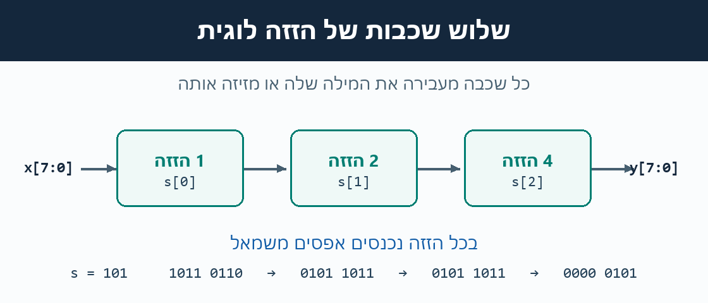
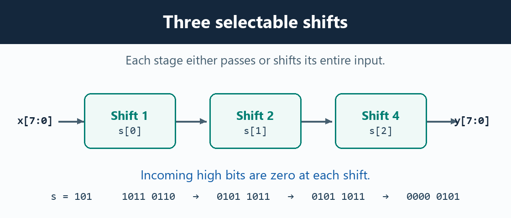

# PREP-320 — מוקסים מהבסיס עד להזזה של שבע עמדות

פתרון מוצע בסיוע AI. נדרש עיון מקצועי.

## מקור

[צילום המקור](../sources/2026-11-14-batch30-06.png)

1. לממש שער XOR מ־MUX והקבועים 0 ו־1. 2. לממש MUX:4->1 באמצעות MUX:2->1. 3. לממש MUX:8->1 באמצעות הרכיבים הקודמים. 4. לממש מכונה המבצעת הזזה של עד 7 ביט בהתאם לקלט של 3 ביט המורה על מספר ההזזות שיש לבצע.

## מוקסים מהבסיס עד להזזה של שבע עמדות

מותר להשתמש במוקסי 2 ל־1, בחיווט ובקבועים 0 ו־1. בנו שער XOR לשני קלטים, מוקס 4 ל־1 בעזרת מוקסי 2 ל־1, ואז מוקס 8 ל־1 בעזרת הרכיבים שבניתם. לבסוף תכננו מעגל צירופי למילה בת שמונה סיביות. קלט s בן שלוש סיביות קובע בכמה עמדות להזיז אותה ימינה, מ־0 עד 7. בהזזה נכנסים אפסים משמאל. ציינו כמה שכבות מוקסים יש בנתיב הארוך בכל בנייה.

### שלושה רמזים

1. מה מחזיר XOR כאשר מקבעים את הקלט הראשון לאפס? ומה קורה כשמקבעים אותו לאחת?
2. בחרו תחילה בתוך זוגות לפי סיבית הבחירה הנמוכה, ואז בין הזוגות לפי הסיבית הבאה.
3. פרקו את מרחק ההזזה לסכום של 1, 2 ו־4. בין שתי שכבות עובר אפיק שלם של שמונה סיביות.

### הצעה לפתרון

נסמן M(s,u,v) מוקס שבוחר u עבור s=0 ו־v עבור s=1. המהפך של b הוא M(b,1,0). לכן XOR(a,b)=M(a,b,M(b,1,0)). יש שני מוקסים, ובעומק המרבי עוברים דרך שניהם.

למוקס 4 ל־1 מזינים את d0,d1 למוקס אחד ואת d2,d3 למוקס שני. סיבית s0 בוחרת בשניהם. מוקס שלישי בוחר בין התוצאות לפי s1. למוקס 8 ל־1 בונים שני מוקסי 4 ל־1 על שתי רביעיות הכניסות ומשתמשים ב־s2 כדי לבחור רביעייה. מתקבלים שלושה מוקסים בשתי שכבות, ואז שבעה מוקסים בשלוש שכבות. המסלול בעץ בוחר בדיוק את d[s].

להזזת המילה נסמן את הקלט לשכבה ב־v. בשכבה j, לכל סיבית פלט i, מוקס בוחר בין v[i] לבין v[i+2ʲ] לפי s[j]. קלט שמספרו גדול מ־7 מחובר לאפס. מעבירים את תוצאות השכבה לשכבה הבאה במקביל, עם מרחקים 1, 2 ו־4 לפי הסדר. כל שכבה מוסיפה להזזה אפס או את מרחקה, ולכן סכום המרחקים הוא בדיוק s. הבנייה כוללת 24 עמדות מוקס ועומק שלוש, ללא אוגרים. לדוגמה, 10110110 בהזזה של 5 עובר הזזה של 1 ושל 4 ומתקבל 00000101.

מודל לוגי בפייתון

```python
"""A combinational model. All data pins and select pins carry one bit."""

def mux(s, d0, d1):
    return (d0, d1)[s]

def xor(a, b):
    return mux(a, b, mux(b, 1, 0))

def mux4(s, data):
    a = mux(s & 1, data[0], data[1])
    b = mux(s & 1, data[2], data[3])
    return mux(s >> 1, a, b)

def mux8(s, data):
    return mux(s >> 2, mux4(s & 3, data[:4]), mux4(s & 3, data[4:]))

def logical_right(word, distance):
    bits = [(word >> i) & 1 for i in range(8)]
    for select_bit, stride in enumerate((1, 2, 4)):
        extended = bits + [0] * stride
        bits = [mux((distance >> select_bit) & 1, bits[i], extended[i + stride])
                for i in range(8)]
    return sum(bit << i for i, bit in enumerate(bits))
```



אפיק בן שמונה סיביות, פלט צירופי, הזזה לוגית ימינה ומילוי באפס.

העלויות מתייחסות לבנייה בעזרת תאי מוקס דו־כניסתיים. לא נדרש מינימום שטח לאחר סינתזה.

בהזזה 0 המילה נשמרת. בהזזה 7 רק סיבית הקלט העליונה עשויה לשרוד.

חיווט מחזורי יחזיר ביטים שנפלו בקצה ויממש רוטציה.

נבדקו 4,164 השוואות במודל פייתון, כולל כל הקלטים והבחירות לארבעת הרכיבים.

XOR בוחר בין b לבין ההשלמה שלו. מוקס גדול נבנה כעץ, והזזה לוגית משתמשת בשלוש שכבות הבוחרות מרחקים 1, 2 ו־4.

איך אפשר לבצע רוטציה באותן שכבות? חברו את קלט המקור לפי אינדקס מודולו שמונה. סיבית שיצאה מאחד הקצוות חוזרת בקצה השני.

## From multiplexers to an eight-bit barrel shifter

Use 2-to-1 multiplexers, wires and the constants 0 and 1. Build a two-input XOR, a 4-to-1 MUX from 2-to-1 cells, and an 8-to-1 MUX from the preceding components. Finally design a combinational logical right shifter for an eight-bit word. A three-bit input s selects a shift of 0 through 7 places, filling high positions with zeros. Give the longest path in MUX levels for each construction.

### Three hints

1. What does XOR do to its second input for each fixed value of its first input?
2. First select within pairs using the low select bit. Then select between pairs using the next bit.
3. Write the distance as a sum of 1, 2 and 4. Each stage passes an entire eight-bit bus to its successor.

### Proposed solution

Let M(s,u,v) select u at s=0 and v at s=1. The complement of b is M(b,1,0). Thus XOR(a,b)=M(a,b,M(b,1,0)), with two cells and at most two MUX levels.

For a 4-to-1 MUX, connect d0,d1 and d2,d3 to two cells controlled by s0. A third cell selects their outputs using s1. For an 8-to-1 MUX, use two such trees for the two groups of four and select the group with s2. The trees use three cells in two levels and seven in three, respectively. Each path ends at precisely the data input indexed by the select bits.

For the shifter let v be the whole input bus to stage j. For each position i choose between v[i] and v[i+2ʲ] using s[j]. Wire an index above 7 to zero. Feed the eight results together to the next stage, using strides 1, 2 and 4 in order. A stage adds either zero or its stride to the cumulative shift, so the final distance is s. This construction uses 24 MUX positions in three levels and no storage. For example, shifting 10110110 by 5 enables strides 1 and 4 and produces 00000101.

Python logic model

```python
"""A combinational model. All data pins and select pins carry one bit."""

def mux(s, d0, d1):
    return (d0, d1)[s]

def xor(a, b):
    return mux(a, b, mux(b, 1, 0))

def mux4(s, data):
    a = mux(s & 1, data[0], data[1])
    b = mux(s & 1, data[2], data[3])
    return mux(s >> 1, a, b)

def mux8(s, data):
    return mux(s >> 2, mux4(s & 3, data[:4]), mux4(s & 3, data[4:]))

def logical_right(word, distance):
    bits = [(word >> i) & 1 for i in range(8)]
    for select_bit, stride in enumerate((1, 2, 4)):
        extended = bits + [0] * stride
        bits = [mux((distance >> select_bit) & 1, bits[i], extended[i + stride])
                for i in range(8)]
    return sum(bit << i for i, bit in enumerate(bits))
```



Eight-bit combinational logical right shift with zero fill.

The counts describe this 2-to-1 MUX construction. Area minimization after synthesis is a separate metric.

Shift zero preserves the input. At distance seven only the top input bit can survive.

Wrapping an out-of-range index would implement rotation.

The Python model passed 4,164 comparisons, covering every input and select setting of all four components.

XOR selects b or its complement. A larger MUX is a tree. A variable logical shift uses three layers selecting strides of 1, 2 and 4.

How can these stages implement rotation? Wrap the source index modulo eight. A bit leaving one end reappears at the other.

[Executable model](../solutions/prep_320_mux_layers.py) · [Verification script](../checks/check_digital_nov14.py) · [Recorded results](../checks/digital-nov14-verification.json)
