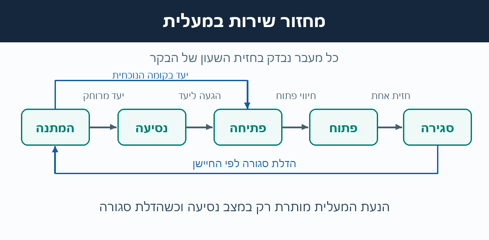
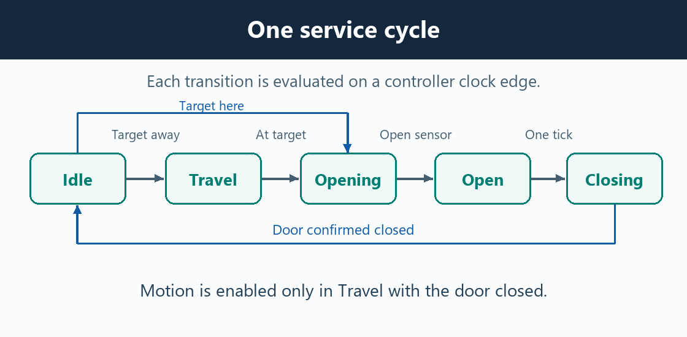

# PREP-321 — בקר מעלית לשלוש קומות עם פתיחת דלתות וסגירתן

פתרון מוצע בסיוע AI. נדרש עיון מקצועי.

## מקור

[צילום המקור](../sources/2026-11-14-batch30-08.png)

בניין עם 3 קומות ומעלית. צריך לתכנן מכונת מצבים למעלית (כך שיש 3 כפתורים בתוך המעלית, כפתור להזמנת מעלית בכל קומה, ולהתחשב גם בפתיחת וסגירת הדלתות של המעלית).

## בקר מעלית לשלוש קומות עם פתיחת דלתות וסגירתן

תכננו בקר סינכרוני למעלית בת שלוש קומות, 0–2. בכל קומה כפתור קריאה, ובתא כפתור לכל יעד. לחיצה מפיקה פולס אחד. לרשותכם מספר הקומה האחרונה שאליה הגיע התא, חיווי הגעה לכל קומה וחיוויי דלת סגורה ופתוחה. תנו מצבים, מעברים ופקודות מנוע ודלת. שמרו בקשות גם בזמן נסיעה ואל תקפחו קומה שממתינה. באיפוס התא בקומה 0 והדלת סגורה. במודל, מספר הקומה מתעדכן בהגעה, הנסיעה יכולה להיעצר בקומה המבוקשת, והדלת נשארת פתוחה למשך מחזור מלא אחד אחרי שהפתיחה הסתיימה.

### שלושה רמזים

1. מה צריך לזכור כאשר כמה כפתורים נלחצים בזמן שהמעלית כבר בתנועה?
2. שמרו ביט בקשה לכל קומה ויעד נעול עד לשירות. הפרידו בין הוראת פתיחה לבין אישור שהדלת פתוחה.
3. הגדירו סדר חיפוש מעגלי אחרי הקומה האחרונה ששירתתם. הפעילו את פקודת הנסיעה רק כשחיווי הדלת הסגורה פעיל.

### הצעה לפתרון

מאחדים את שלוש בקשות התא ושלוש קריאות המסדרון לפי קומה. בכל חזית מעדכנים מסכת pending באמצעות OR, גם בזמן נסיעה או פתיחת הדלת. שומרים target ואת last, הקומה האחרונה ששירתנו. באיפוס last=2 כדי שהסריקה הראשונה תתחיל ב־0.

|מצב|פעולה ותנאי מעבר|
|---|---|
|המתנה|בדלת סגורה ובקיום בקשה, בוחרים בסריקה מעגלית אחרי last ושומרים את היעד שנבחר. יעד נוכחי מעביר לפתיחה. יעד אחר מעביר לנסיעה.|
|נסיעה|כל עוד הדלת סגורה מפעילים מעלה או מטה לפי השוואת היעד לקומה. בהגעה ליעד עוצרים ועוברים לפתיחה.|
|פתיחה|נותנים פקודת פתיחה ומחכים לחיווי פתוח. בחזית האישור מנקים את ביט היעד ומעדכנים last, ועוברים לפתוח.|
|פתוח|ממתינים מחזור מלא ועוברים לסגירה.|
|סגירה|נותנים פקודת סגירה. חוזרים להמתנה רק עם חיווי סגור.|

בקשה לאותה קומה בדיוק בחזית האישור נכללת בשירות הנוכחי. בקשות בקומות אחרות נשארות במסכה. בקשה אחרי האישור נשמרת לסבב הבא. באין תנאי מעבר נשארים במצב. את המנוע עוצרים בכל מצב שאינו נסיעה, כאשר הדלת אינה סגורה או כשהיעד הושג. למשל, מנוחה בקומה 0 ולחיצות ל־0 ול־2 נותנות תחילה שירות מקומי ואז נסיעה ל־2, גם אם בקשה חדשה ל־0 חזרה והופיעה.

בתנאי שהמנוע והדלת משלימים כל פקודה, בקשה קבועה תיבחר לכל המאוחר בתוך שלוש בחירות עוקבות. הסריקה מתחילה אחרי כל קומה ששורתה, ולכן אינה יכולה לדלג על אותה בקשה ולהשלים מעגל. מספיקים שלושה ביטים למסכה ועוד זיכרון קבוע לבקר וליעד. זהו מודל של תזמון לוגי. משטר בלימה, תקלות חיישן, נעילות מכניות וזיהוי חסימה דורשים חוזי חומרה נוספים.

מודל לוגי בפייתון

```python
"""Sampled controller for a three-floor educational model. Floor IDs are 0..2."""

class Elevator:
    def __init__(self):
        self.state = "idle"
        self.pending = 0
        self.target = 0
        self.last = 2

    def motor(self, floor, closed):
        if self.state != "travel" or not closed:
            return 0
        return (self.target > floor) - (self.target < floor)

    def tick(self, floor, closed, opened, cabin=0, hall=0):
        self.pending |= cabin | hall
        if self.state == "idle" and closed and self.pending:
            order = [(self.last + step) % 3 for step in (1, 2, 3)]
            self.target = next(f for f in order if self.pending & (1 << f))
            self.state = "opening" if floor == self.target else "travel"
        elif self.state == "travel" and floor == self.target:
            self.state = "opening"
        elif self.state == "opening" and opened:
            self.pending &= ~(1 << self.target)
            self.last = self.target
            self.state = "open"
        elif self.state == "open":
            self.state = "closing"
        elif self.state == "closing" and closed:
            self.state = "idle"
        return self.state
```



חיוויים מסונכרנים, נסיעה הניתנת לעצירה ביעד ודלת שמשלימה פקודה. הדלת פתוחה מחזור מלא אחרי אישור פתיחה.

חמישה מצבי בקרה, שלוש בקשות נשמרות ומספר קבוע של אוגרים. הבחירה המעגלית מבטיחה שירות בהנחות המודל.

בקשות כפולות לאותה קומה מתלכדות. בקשה בקומה הנוכחית אינה מפעילה מנוע.

מחיקת כל המסכה כשדלת נפתחת תאבד בקשות מקומות אחרות.

מודל פייתון נבדק על 192 צירופי קומה התחלתית ומסכות כפתורים ובתרחיש של לחיצות חוזרות במהלך השירות.

מסכה צוברת בקשות, יעד נעול מונע שינוי תוך נסיעה, וחמשת מצבי הבקר מבדילים בין תנועה, שתי פעולות הדלת ומצבי ההמתנה.

כיצד מאריכים את שהיית הדלת במצב פתוח? מאפסים מונה עם אישור הפתיחה ומחכים למספר מחזורים קבוע לפני סגירה. היעד נשאר נעול ובקשות אחרות ממשיכות להישמר.

## A three-floor elevator controller with door states

Design a synchronous controller for floors 0 through 2. Each floor has a call button, and the car has one destination button per floor. A press produces one pulse. The controller receives the last floor reached, updated on arrival at each floor, plus door-open and door-closed confirmations. Give states, transitions, motor and door commands. Retain requests while moving and ensure that a pending floor gets served. Reset starts the car at floor 0 with closed doors. Assume it can stop on arrival at a target. Keep the door open for one full clock period after it confirms opening.

### Three hints

1. What should survive when several buttons are pressed during travel?
2. Store one pending bit per floor and a target held until service. Sending an open command and receiving confirmation are separate steps.
3. Search cyclically starting after the last served floor. Enable the motor only while the closed-door indication is true.

### Proposed solution

Merge cabin and hall requests by floor. On every edge OR the new requests into a three-bit pending mask, including during motion and door operations. Store a target and the last served floor. Reset last to 2 to begin the first cyclic search at floor 0.

|State|Action and transition|
|---|---|
|Idle|If doors are closed and any request is pending, search cyclically after last and latch the selected target. Go to Opening for the current floor and Travel otherwise.|
|Travel|With closed doors, drive up or down according to the target versus the floor. Stop at the target and enter Opening.|
|Opening|Command the door to open. On open confirmation clear the target bit, set last to the target and enter Open.|
|Open|Dwell for a full clock period and enter Closing.|
|Closing|Command the door to close and return to Idle only on closed confirmation.|

A target-floor request arriving on the confirmation edge is served by this opening. Other floors remain pending. A press after confirmation starts a fresh request. Stay in the same state when its transition condition is false. Disable motion outside Travel, with an unconfirmed door, or on arrival at the target. Starting at 0 with requests for 0 and 2 serves 0 locally and then travels to 2 even if 0 is requested again.

Assuming that motion and door commands eventually complete, a continuously pending floor will be chosen within three successive selections. Scanning starts after each served floor and cannot pass a pending request during a complete turn. Three mask bits and constant-size control registers suffice. This is a scheduling model. Physical braking, sensor faults, door interlocks and obstruction handling require separate hardware contracts.

Python logic model

```python
"""Sampled controller for a three-floor educational model. Floor IDs are 0..2."""

class Elevator:
    def __init__(self):
        self.state = "idle"
        self.pending = 0
        self.target = 0
        self.last = 2

    def motor(self, floor, closed):
        if self.state != "travel" or not closed:
            return 0
        return (self.target > floor) - (self.target < floor)

    def tick(self, floor, closed, opened, cabin=0, hall=0):
        self.pending |= cabin | hall
        if self.state == "idle" and closed and self.pending:
            order = [(self.last + step) % 3 for step in (1, 2, 3)]
            self.target = next(f for f in order if self.pending & (1 << f))
            self.state = "opening" if floor == self.target else "travel"
        elif self.state == "travel" and floor == self.target:
            self.state = "opening"
        elif self.state == "opening" and opened:
            self.pending &= ~(1 << self.target)
            self.last = self.target
            self.state = "open"
        elif self.state == "open":
            self.state = "closing"
        elif self.state == "closing" and closed:
            self.state = "idle"
        return self.state
```



Synchronized indications, stoppable motion at the target, and eventual completion of door and motion commands. Dwell is one full period after confirmation.

Five control states plus a three-bit request mask and fixed-size registers. The cyclic selection rule guarantees eventual service under the stated assumptions.

Repeated calls coalesce by floor. A target on the current floor needs no motion.

Clearing the whole mask when the door opens loses requests at other floors.

The Python model was checked on 192 initial-floor/button-mask combinations and an additional sequence with requests overlapping service.

Latch per-floor requests and keep the selected target stable. Five control states separate idle and travel from the opening, dwell and closing phases.

How could the door dwell longer? Start a counter on open confirmation and wait for a configured number of ticks before closing. Continue recording other requests while holding the target.

[Executable model](../solutions/prep_321_elevator_fsm.py) · [Verification script](../checks/check_digital_nov14.py) · [Recorded results](../checks/digital-nov14-verification.json)
