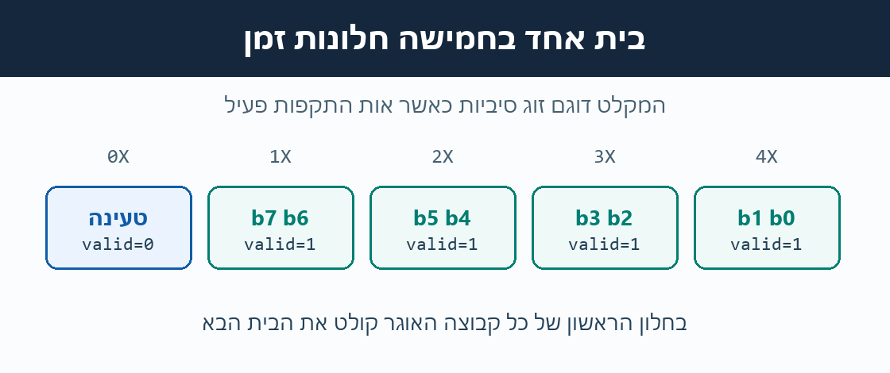
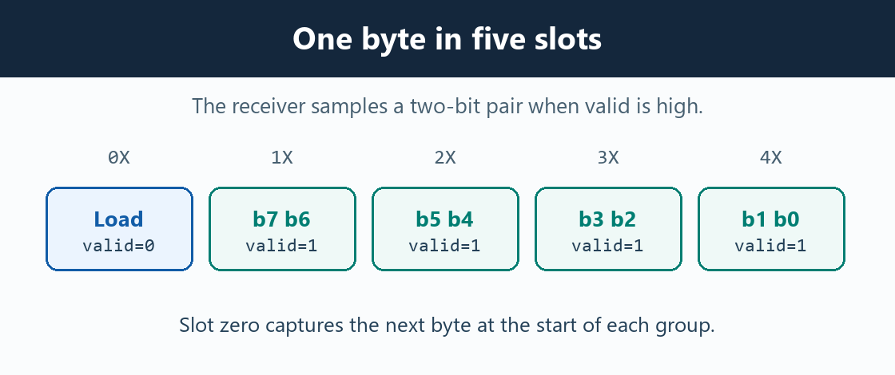

# PREP-322 — העברת זרם בתים למקלט בעל קצב דגימה נתון

פתרון מוצע בסיוע AI. נדרש עיון מקצועי.

## מקור

[צילום המקור](../sources/2026-11-14-batch30-09.png)

נתון רכיב שמקבל זרם מידע (8 סיביות) כל 5X שניות, והמערכת שאליה הוא צריך להעביר את המידע יכולה לקלוט מידע רק בקצב של X שניות. תכנן את הרכיב (רכיבים לוגיים, טרנזיסטורים וכו').

## העברת זרם בתים למקלט בעל קצב דגימה נתון

מקור מוסר בית חדש כל 5X שניות. המקלט יכול לבצע העברה אחת בכל X שניות, אך רוחב המידע שהוא דוגם בכל העברה נתון לבחירתכם. מהו הרוחב השלם המזערי שיספיק לזרם בלתי פוסק של בתים כלשהם? תכננו מתאם המפיק נתונים ואות valid ושומר על סדר הבתים. הניחו שעון משותף שמחזורו X, בית חדש זמין לפני החזית הראשונה בכל קבוצה בת חמישה מחזורים, והמקלט תמיד מוכן. הסבירו מה משתנה אם המקלט דוגם בית שלם או סיבית בודדת.

### שלושה רמזים

1. כמה סיביות חדשות חייבות לעבור בכל קבוצה בת חמישה מחזורים?
2. השוו את קיבולת חמש ההעברות ל־8 ביטים. מאגר זמני עוזר בפרץ קצר בלבד.
3. לאחר טעינת בית בחזית הראשונה נשארות ארבע חזיתות. נסו לשלוח זוג סיביות בכל אחת.

### הצעה לפתרון

נסמן ב־w את מספר סיביות הנתונים בהעברה תקפה. לקו יש לכל היותר 5w מקומות לנתונים בכל 5X שניות. מאחר שבית שרירותי מכיל 8 סיביות בלתי תלויות, בתזמון תקפות קבוע נדרש 5w≥8 ולכן w≥2. בקו חד־סיביתי יתווספו לפחות שלוש סיביות לפיגור בכל חמישה מחזורים. FIFO סופי רק דוחה את הרגע שבו יאבד מידע.

רוחב שתיים גם מספיק. נספור מחזורים מ־0 עד 4. בחלון 0 טוענים את הבית לאוגר שמונה סיביות ו־valid=0. בחלונות 1,2,3,4 היציאה מציגה בהתאמה את זוגות הסיביות [7:6], [5:4], [3:2], [1:0], עם valid=1. מוקס 4 ל־1 ברוחב שתי סיביות בוחר זוג לפי המונה. המקלט דוגם בחזית המיועדת לכל חלון, מצרף את הזוגות לפי סדר וכך משחזר את הבית. אם המונה מתקדם בחזית, מחשבים את הנתונים ואת valid מערך המונה שלפני אותה חזית. בעת מסירת הזוג האחרון האוגר עדיין מחזיק את הבית הקודם.

לדוגמה, 10110001 עובר כ־10,11,00,01. ארבע העברות ממצות בדיוק את כל הסיביות והחזית הבאה מוקדשת לטעינה. בממשק ברוחב בית מספיק valid אחד בכל חמישה מחזורים. בקו של סיבית בודדת נדרשת האטת המקור או הגדלת קצב הדגימה. אם המקלט רשאי לעצור, יש להוסיף חוזה ready ויכולת ויסות או חסם מפורש למשך העצירה.

מודל לוגי בפייתון

```python
"""Two-bit synchronous link. 'tick' returns the word on valid transfer slots."""

class ByteAdapter:
    def __init__(self):
        self.slot = 0
        self.word = 0

    def tick(self, incoming=None):
        if self.slot == 0:
            if incoming is None or not 0 <= incoming <= 255:
                raise ValueError("an 8-bit word is required in slot zero")
            self.word = incoming
            pair = None
        else:
            if incoming is not None:
                raise ValueError("unexpected source word")
            shift = 2 * (4 - self.slot)
            pair = (self.word >> shift) & 3
        self.slot = (self.slot + 1) % 5
        return pair
```



תזמון משותף, זרם בלתי דחיס של בתים שרירותיים, ותבנית valid קבועה שאינה נושאת מידע על ערך הבית.

שתי סיביות להעברה הן רוחב המידע השלם המינימלי, עם קיבולת של חמש העברות לכל בית.

הבית הבא נקלט אחרי מסירת הזוג האחרון. אין צורך להניח שהבתים שונים זה מזה.

השוואת 5X ל־X בלי לציין את רוחב ההעברה אינה קובעת אם הקו עומד בקצב.

מודל המתאם מסר את כל 256 ערכי הבית ברצף. בכל מסגרת אומתו ארבעה זוגות והרכבתם מחדש לבית המקורי.

המקור מייצר שמונה סיביות בחמישה מחזורים. קו בן שתי סיביות מעביר ארבעה זוגות וצורך את החלון החמישי לטעינה.

לכמה זמן יספיק FIFO של B סיביות נוספות בקו חד־סיביתי? בכל קבוצה החוב נטו גדל בשלוש סיביות. בדקו גם את תפוסת השיא בתוך קבוצה כדי לקבוע את רגע הגלישה המדויק.

## Matching an eight-bit source to a receiver's sample rate

A source supplies a new byte every 5X seconds. Its receiver accepts one transfer every X seconds. You may choose how many data bits the receiver samples per transfer. Find the minimum integer width for a continuous stream of arbitrary bytes and design an adapter with data and valid outputs that preserves byte order. Use a common clock of period X. A new byte is stable before the first edge of each group of five and the receiver is always ready. Explain what changes if the receiver accepts a whole byte or just one bit.

### Three hints

1. How many new bits must cross in every group of five slots?
2. Compare the capacity of five transfers with an eight-bit input. A buffer can smooth only a bounded burst.
3. Loading the byte on the first edge leaves four more. Try sending a pair on each.

### Proposed solution

Let w be the number of data bits per valid transfer. Each interval of length 5X offers at most 5w data positions. An arbitrary byte contains eight independent bits. With a fixed valid schedule, 5w≥8 is necessary, so w≥2. A one-bit link falls behind by at least three bits per group. A finite FIFO would eventually fill.

Width two is achievable. Count slots from 0 to 4. In slot 0 load an eight-bit register and set valid=0. In slots 1 through 4 present bit pairs [7:6], [5:4], [3:2], [1:0] with valid=1. A two-bit-wide 4-to-1 MUX selects the pair using the phase counter. The receiver samples on the corresponding edges and concatenates the pairs in order. If the counter advances on an edge, drive valid and data for that edge from the pre-edge count. The register still holds the old byte during its last pair transfer.

For example, 10110001 is sent as 10,11,00,01. The four transfers cover every bit exactly once. The next edge is available for the new byte. An eight-bit receiver needs just one valid transfer every five slots. A fixed one-bit receiver needs a slower source or faster sampling. If the receiver can stall, specify backpressure or an explicit stall bound and size the queue accordingly.

Python logic model

```python
"""Two-bit synchronous link. 'tick' returns the word on valid transfer slots."""

class ByteAdapter:
    def __init__(self):
        self.slot = 0
        self.word = 0

    def tick(self, incoming=None):
        if self.slot == 0:
            if incoming is None or not 0 <= incoming <= 255:
                raise ValueError("an 8-bit word is required in slot zero")
            self.word = incoming
            pair = None
        else:
            if incoming is not None:
                raise ValueError("unexpected source word")
            shift = 2 * (4 - self.slot)
            pair = (self.word >> shift) & 3
        self.slot = (self.slot + 1) % 5
        return pair
```



Common clock, arbitrary incompressible bytes, and a fixed valid schedule carrying no payload information.

Two data bits is the minimum integer width at five transfer opportunities per byte.

The next byte can load immediately after the final pair is accepted. Repeated byte values work normally.

Comparing 5X and X alone ignores the number of bits carried by a transfer.

The Python adapter sent all 256 byte values consecutively. Every frame was reconstructed from its four transmitted pairs.

Eight bits arrive in five slots. Send four ordered pairs on a two-bit link and use the fifth slot for loading.

How long can a B-bit extra FIFO help on a one-bit link? The net backlog grows by three bits per five-slot interval. Account for peak backlog within the interval to locate the exact overflow edge.

[Executable model](../solutions/prep_322_byte_adapter.py) · [Verification script](../checks/check_digital_nov14.py) · [Recorded results](../checks/digital-nov14-verification.json)
