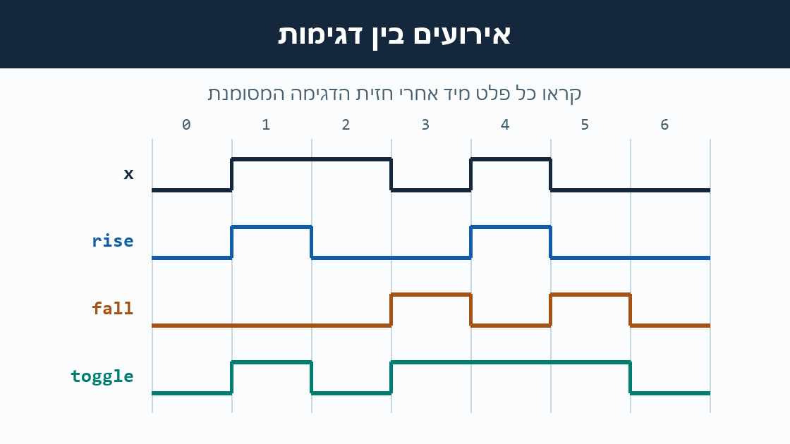
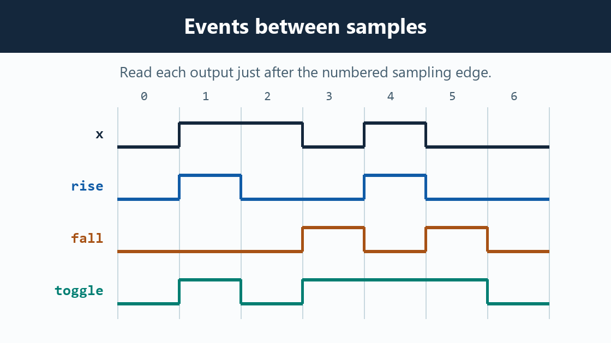

# PREP-323 — גילוי עלייה, ירידה וכל שינוי בין דגימות

פתרון מוצע בסיוע AI. נדרש עיון מקצועי.

## מקור

[צילום המקור](../sources/2026-11-14-batch30-11.png)

קופסא סגורה שיש לה כניסה אחת (אפשר עוד כניסה במידת הצורך) ושלוש יציאות, היציאות הן rise, fall, toggle. כשיש עליה קו rise דולק, כשיש ירידה קו fall דולק וכשיש עליה או ירידה אז קו toggle דולק.

## גילוי עלייה, ירידה וכל שינוי בין דגימות

תכננו רכיב המקבל סיבית x בכל חזית עולה של שעון דגימה ושלושה פלטים רשומים. לאחר החזית rise מציין מעבר מ־0 ל־1, fall מעבר מ־1 ל־0, ו־toggle כל מעבר. כל פלט מתייחס להשוואת הדגימה הנוכחית לקודמת. באיפוס סינכרוני שלושת הפלטים והדגימה הקודמת הם אפס. הקלט סינכרוני ויציב בחלון הדגימה. תנו משוואות והדגימו מה קורה ברצף מתחלף. האם אותו מימוש מספיק אם האות הנמדד הוא שעון בפני עצמו?

### שלושה רמזים

1. איזו פיסת מידע חסרה אם רואים רק את x הנוכחי?
2. בדקו את ארבעת הזוגות האפשריים של prev ו־x.
3. בעת החזית רשמו את שלושת הפלטים מתוך prev הישן ורק אז השתמשו ב־x בתור הדגימה הקודמת לחזית הבאה.

### הצעה לפתרון

שומרים את הסיבית prev. עבור חזית שאינה מאפסת רושמים rise=x∧¬prev,‏ fall=¬x∧prev ו־toggle=x⊕prev, ובאותה חזית מעדכנים prev←x. כל צד ימין משתמש בערכים שהיו יציבים לפני החזית. שלושת אוגרי הפלט מחזיקים תוצאה עד החזית הבאה. אפשר גם לגזור toggle בעזרת OR משני הפלטים הרשומים אם מותר פלט צירופי.

|prev|x|rise|fall|toggle|
|---|---|---|---|---|
|0|0|0|0|0|
|0|1|1|0|1|
|1|0|0|1|1|
|1|1|0|0|0|

הסיבה לנכונות היא ש־prev מכיל בדיוק את הדגימה מהחזית הקודמת. עלייה וירידה מוציאות זו את זו, ולכן ה־OR שלהן שווה ל־XOR בין הדגימות. ברצף 0,1,0,1 מתקבל toggle של 0,1,1,1. רצף ערכים גבוהים ב־toggle מייצג אירוע בכל מחזור, גם בלי מחזור נמוך ביניהם. הדגימה הראשונה אחרי איפוס מושווית ל־0.

כדי למדוד שעון כאות נתונים צריך בסיס זמן אחר. דגימה של אותו שעון רק בחזיתות העלייה שלו אינה מספקת תיעוד של הרמה הנמוכה ביניהן, וחיבורו גם ל־D וגם ל־CLK אינו דגימת נתון סינכרוני תקינה. כדי לזהות כל חזית של שעון אחר יש להבטיח זמן גבוה ונמוך מספיק לדגימה ולהסדיר מעבר תחומי שעון. מסנכרן לבדו אינו מבטיח לכידת פולס קצר.

מודל לוגי בפייתון

```python
"""Registered outputs after the sampling edge, in (rise, fall, toggle) order."""

class EdgeDetector:
    def __init__(self):
        self.prev = 0

    def tick(self, x, reset=False):
        if reset:
            self.prev = 0
            return (0, 0, 0)
        rise = x & (1 - self.prev)
        fall = (1 - x) & self.prev
        self.prev = x
        return (rise, fall, rise | fall)
```



prev=0 באיפוס. x סינכרוני ונדגם בחזית עולה. התוצאות רשומות.

סיבית אחת של היסטוריית קלט מספיקה. שלושה אוגרי פלט מממשים את תזמון היציאות המבוקש.

ערך גבוה ראשון אחרי איפוס מדווח כעלייה. שני שינויים בין חזיתות עלולים להיעלם.

עדכון prev לפני חישוב הפלט בקוד סדרתי משווה את x לעצמו.

מודל פייתון הושווה לטבלת המעברים ב־2,304 תרחישים של שמונה דגימות עם איפוס במיקומים שונים וללא איפוס.

משווים לדגימה הקודמת. כיוון המעבר קובע rise או fall, וההפרש הבוליאני קובע toggle.

כיצד מדכאים דיווח על הדגימה הראשונה? הוסיפו סיבית seen, הפעילו אותה עם הדגימה הראשונה ואפשרו אירוע רק כאשר ערכה הקודם היה אחד. בדקו רצף שמתחיל ב־1 לאחר איפוס.

## Detect rising, falling and either transition between samples

Design a component sampling one synchronous bit x on every rising reference-clock edge. Three registered outputs report the comparison of the current and previous samples. After the edge, rise flags 0 to 1, fall flags 1 to 0, and toggle flags either transition. A synchronous reset clears the previous sample and all three outputs. Give the equations, illustrate alternating input, and explain whether the same circuit can observe a clock as its data input.

### Three hints

1. What information is missing if only the present x is available?
2. Enumerate all four pairs of prev and x.
3. On the sampling edge, compute all outputs from the old prev. Capture x for use as the previous value at the next edge.

### Proposed solution

Store a bit prev. On each non-reset edge register rise=x∧¬prev, fall=¬x∧prev and toggle=x⊕prev; capture prev←x at the same edge. Every right-hand side uses the stable pre-edge values. The three output registers hold the result until the next edge. When a combinational toggle output is acceptable it may be the OR of the two registered directional outputs.

|prev|x|rise|fall|toggle|
|---|---|---|---|---|
|0|0|0|0|0|
|0|1|1|0|1|
|1|0|0|1|1|
|1|1|0|0|0|

The memory bit equals the preceding sample, making these exactly the four possible comparisons. Rise and fall are mutually exclusive, so their OR equals the XOR of the samples. For 0,1,0,1 the toggle sequence is 0,1,1,1. Consecutive high outputs describe one event each cycle without a low gap. The first post-reset sample is compared with zero.

Observing a clock as data requires a separate timebase. Sampling that clock only on its own rising edges supplies no observations of its low intervals; tying D and CLK together does not create a well-timed synchronous data input. To observe every edge of a different clock, ensure sufficient high and low dwell times and handle the clock-domain crossing. A synchronizer alone cannot guarantee capture of a short pulse.

Python logic model

```python
"""Registered outputs after the sampling edge, in (rise, fall, toggle) order."""

class EdgeDetector:
    def __init__(self):
        self.prev = 0

    def tick(self, x, reset=False):
        if reset:
            self.prev = 0
            return (0, 0, 0)
        rise = x & (1 - self.prev)
        fall = (1 - x) & self.prev
        self.prev = x
        return (rise, fall, rise | fall)
```



Reset sets prev to zero. The input is synchronous and the rising-edge results are registered.

One input-history bit suffices. Three output registers implement the specified output timing.

A first high after reset is reported as a rise. Two transitions between sampling edges can disappear.

Writing prev before computing the outputs in sequential software compares x with itself.

The Python model matched a transition oracle across 2,304 eight-sample scenarios with and without reset at different positions.

Compare the input with its previous sample. Transition direction selects rise or fall, and their XOR-of-samples condition gives toggle.

How can the first sample be suppressed? Set a seen bit on the first sample and enable event reporting only if its pre-edge value was one. Test a high first sample after reset.

[Executable model](../solutions/prep_323_sampled_edges.py) · [Verification script](../checks/check_digital_nov14.py) · [Recorded results](../checks/digital-nov14-verification.json)
