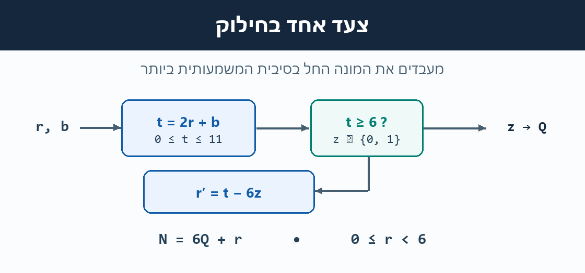

# PREP-324 — חלוקת מילה בינארית בשש במעגל סדרתי

פתרון מוצע בסיוע AI. נדרש עיון מקצועי.

## מקור

[צילום המקור](../sources/2026-11-14-batch30-17.png)

בנה מערכת המקבלת כקלט מספר, ומוציאה את תוצאת חילוק המספר ב־6.

## חלוקת מילה בינארית בשש במעגל סדרתי

תכננו רכיב המקבל בחזית start בית שלם בלתי מסומן N ומחזיר את המנה השלמה בחלוקה ל־6. החזירו גם את השארית כדי שאפשר יהיה לבדוק את התוצאה. מותר להשתמש באוגרים, השוואה לקבוע וחיסור קבוע. עבדו סיבית אחת בכל מחזור, מהסיבית המשמעותית ביותר, וסמנו valid לאחר שמונה מחזורי עיבוד. באיפוס המערכת פנויה. start מתקבל רק כשהמערכת פנויה.

### שלושה רמזים

1. כתבו את הקידומת שכבר קראתם בתור 6Q+r. באיזה תחום נמצאת r?
2. צירוף סיבית b מימין מכפיל את הקידומת בשתיים ומוסיף b.
3. הערך 2r+b לכל היותר 11. השוואה לשש מייצרת סיבית מנה אחת, ובמקרה הצורך מספיק חיסור אחד.

### הצעה לפתרון

טוענים את N לאוגר קלט. בחזית הטעינה מאפסים את אוגר המנה Q ואת אוגר השארית r ומתחילים למנות שמונה סיביות. בכל חזית עיבוד לוקחים את ה־MSB שטרם נקרא ומסמנים אותו b. מחשבים t=2r+b, בוחרים z=1 אם t≥6 ואפס אחרת, ומעדכנים r←t−6z ו־Q←2Q+z. ערכי צד ימין שייכים לחזית שלפני העדכון. מזיזים את אוגר הקלט או מקדמים מונה אינדקס.

אחרי כל קידומת P נשמר P=6Q+r עם 0≤r<6. באיפוס המשוואה נכונה עבור הקידומת הריקה. צירוף b נותן 2P+b=6(2Q)+(2r+b). משום ש־0≤t≤11, חיסור יחיד מחזיר את השארית לתחום 0–5, וסיבית z מציינת בדיוק אם נוספה יחידה למנה החדשה. לכן בתום שמונה החזיתות Q הוא החלק השלם של N/6 והשארית נכונה. לדוגמה 43=6·7+1, ולכן המוצאים הם 7 ו־1.

אוגר השארית דורש שלוש סיביות. t דורש ארבע כדי לייצג 11. המנה המרבית היא 42 עבור 255, ולכן אפשר להסתפק בשש סיביות למנה, או להשתמש בשמונה לשם ממשק אחיד. בחזית העיבוד השמינית מוציאים את הערכים המעודכנים ומפעילים valid למחזור. בין הטעינה לתוצאה עוברים שמונה מחזורי שעון, ומימוש שעובד על מילה אחת בכל פעם אינו מקבל start נוסף בזמן busy.

מודל לוגי בפייתון

```python
"""Cycle-level model for a parallel-byte input and 8 processing clock edges."""

def divide_six(word):
    if not 0 <= word < 256:
        raise ValueError("an unsigned byte is required")
    remainder = 0
    quotient = 0
    for index in range(7, -1, -1):
        trial = 2 * remainder + ((word >> index) & 1)
        bit = int(trial >= 6)
        remainder = trial - 6 * bit
        quotient = (quotient << 1) | bit
    return quotient, remainder
```



קלט שלם בלתי מסומן בן שמונה סיביות. החילוק הוא חילוק שלם ונבחרת חלוקה סדרתית בזמן קבוע.

שמונה מחזורי עיבוד ומחסר קבוע אחד הממוחזר בכל מחזור. עבור מילה בת W סיביות נדרשים W מחזורים.

עבור 0–5 המנה אפס. עבור 255 התוצאה היא מנה 42 ושארית 3.

אוגר בן שלוש סיביות מתאים לשארית התקפה אך צר מכדי לחשב את 2r+b לפני ההשוואה.

כל 256 ערכי הקלט הושוו במודל פייתון למנה ולשארית של divmod.

מכניסים בכל מחזור סיבית לקידומת. אם השארית המורחבת מגיעה לשש מחסרים שש ורושמים אחת במנה.

כיצד מצמצמים את מספר מחזורי העיבוד של אותו בית? אפשר לפרוש כמה צעדי חילוק בסדרה בתוך מחזור אחד. כל צעד נוסף בשרשרת מגדיל את העומק הצירופי.

## Divide an unsigned binary word by six

Design a component that accepts an unsigned byte N in parallel on a start edge and returns the integer quotient on division by six. Also return the remainder for checking. Registers, comparison with a constant and constant subtraction are available. Process one bit per clock from the most significant end and assert valid after eight processing cycles. Reset leaves the unit idle, and start is accepted only while idle.

### Three hints

1. Express the prefix processed so far as 6Q+r. What are the possible remainders?
2. Appending bit b on the right doubles the prefix and adds b.
3. The quantity 2r+b is at most 11. A comparison with six gives a quotient bit and at most one subtraction is needed.

### Proposed solution

Load N into an input register. On the load edge clear the quotient Q and remainder r and start an eight-step counter. For each processing edge take the next unconsumed input bit b from the most significant end. Compute t=2r+b, set z=1 if t≥6 and zero otherwise, and update r←t−6z and Q←2Q+z. The right-hand sides use pre-edge values. Shift the input register or advance its bit index.

For each processed prefix P we maintain P=6Q+r with 0≤r<6. This holds for the empty prefix at reset. Appending b gives 2P+b=6(2Q)+(2r+b). As 0≤t≤11, subtracting six once when required restores the valid remainder range. The bit z records exactly the extra unit in the new quotient. After eight steps Q is the integer quotient and r the remainder. For example, 43=6·7+1, yielding outputs 7 and 1.

The remainder register needs three bits. The trial value t needs four to represent 11. The largest quotient is 42 for input 255, so a six-bit quotient register is enough; an eight-bit result is also straightforward. On processing edge eight publish the updated result and pulse valid. The load-to-result latency is eight clocks. A unit serving one word at a time ignores start while busy.

Python logic model

```python
"""Cycle-level model for a parallel-byte input and 8 processing clock edges."""

def divide_six(word):
    if not 0 <= word < 256:
        raise ValueError("an unsigned byte is required")
    remainder = 0
    quotient = 0
    for index in range(7, -1, -1):
        trial = 2 * remainder + ((word >> index) & 1)
        bit = int(trial >= 6)
        remainder = trial - 6 * bit
        quotient = (quotient << 1) | bit
    return quotient, remainder
```


The operand is an unsigned byte. Return integer quotient and remainder using a fixed-latency serial design.

Eight processing cycles reuse one constant-subtraction datapath. A W-bit input takes W cycles.

Inputs below six give quotient zero. Input 255 gives quotient 42 and remainder 3.

Three bits hold every valid remainder but truncate some trial values before comparison.

All 256 input words matched Python's divmod oracle for both returned values.

Append one input bit per step. Subtract six and append a one to the quotient whenever the expanded remainder reaches six.

How could fewer cycles process the same byte? Unroll several remainder steps combinationally in one cycle. The additional dependent steps increase path depth.

[Executable model](../solutions/prep_324_divide_six.py) · [Verification script](../checks/check_digital_nov14.py) · [Recorded results](../checks/digital-nov14-verification.json)
