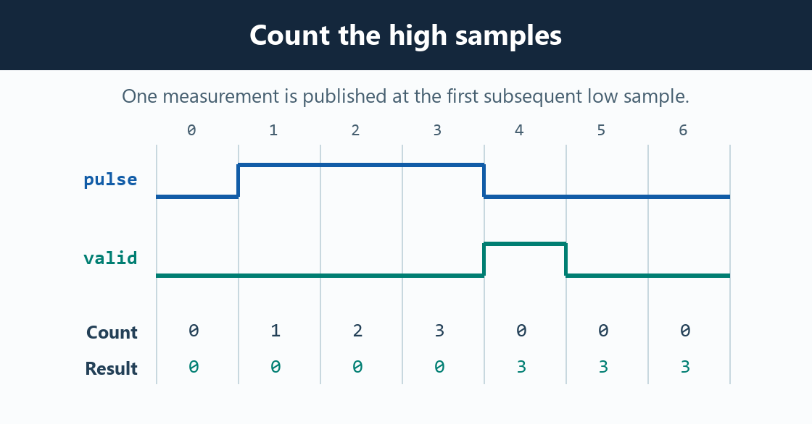

# PREP-325 — מדידת רוחב פולס בעזרת שעון ייחוס

פתרון מוצע בסיוע AI. נדרש עיון מקצועי.

## מקור

[צילום המקור](../sources/2026-11-14-batch30-24.png)

שאלה לוגית של לדעת מה רוחב פולס כשיש כניסת שעון ופולס. איך לדעת מה רוחב הפולס ביציאה.

## מדידת רוחב פולס בעזרת שעון ייחוס

לרכיב יש שעון בעל מחזור T וקלט pulse. מדדו את מספר הדגימות הגבוהות הרצופות של פולס יחיד והחזירו תוצאה בת שמונה סיביות. הציגו אותה עם valid למשך מחזור אחד לאחר הדגימה הנמוכה הראשונה שאחריו. בהמשך שמרו את תוצאת המדידה האחרונה. אם האורך עולה על 255, החזירו 255 וסמנו overflow. האיפוס סינכרוני, ובין פולסים קיימת לפחות דגימה נמוכה אחת. כיצד מתרגמים את התוצאה לזמן, ואיזה מידע על פולס פיזי עלול ללכת לאיבוד?

### שלושה רמזים

1. איזה אירוע מסמן שהספירה הסתיימה ושאפשר לפרסם תוצאה?
2. ספרו כל דגימה גבוהה, כולל הראשונה. בדגימה נמוכה בדקו אם יש ספירה פעילה.
3. מנעו גלישה ל־0. שמרו בנפרד חיווי שאורך הספירה חצה את הקיבולת ותפסו אותו עם התוצאה.

### הצעה לפתרון

נחזיק count, דגל חריגה זמני, אוגר תוצאה ודגל חריגה לתוצאה. באיפוס כולם אפס ו־valid=0. בכל חזית מאפסים את valid כברירת מחדל. אם pulse גבוה, מוסיפים ל־count כל עוד הוא קטן מ־255. אם הוא כבר 255, משאירים אותו שם ומדליקים את דגל החריגה הזמני. אם pulse נמוך ו־count חיובי, מעתיקים את count והדגל לתוצאה, מעלים valid בחזית זו ומאפסים את הספירה ואת הדגל הזמני עבור הפולס הבא. דגימה נמוכה כש־count=0 אינה מפרסמת תוצאה.

האינווריאנט במהלך פולס הוא count=min(k,255), כאשר k הוא מספר הדגימות הגבוהות עד כה. דגל החריגה דולק אם ורק אם k>255. לכן בדיוק 255 דגימות עדיין נותנות 255 ללא חריגה, ואילו הדגימה ה־256 מדליקה אותה. ברצף 0,1,1,1,0 המונה מתקדם 1,2,3. בחזית האחרונה מוצגת התוצאה 3. עבור שעון שמחזורו 10 ננו־שניות זו מדידה של 30 ננו־שניות.

במודל דגימה אידאלי ללא חריגה, kT הוא אומדן של משך פולס רצוף. אם קצות הפולס אינם על חזית דגימה, כל קצה מעוגל לחזית הבאה והפרש שגיאות העיגול קטן מ־T בערך מוחלט. פולס קצר ממחזור יכול לחלוף בין שתי דגימות ולהיעלם. אם הקלט מגיע מתחום שעון אחר, תכנון הסנכרון קובע אילו חזיתות אכן נרשמות. רזולוציית T במודל האידאלי אינה חסם שגיאה מובטח לכל מעבר פיזי אסינכרוני.

מודל לוגי בפייתון

```python
"""Counter result is latched on the first low sample after a run of highs."""

class PulseMeter:
    def __init__(self):
        self.count = 0
        self.clipped = False
        self.result = 0
        self.overflow = False

    def tick(self, high, reset=False):
        if reset:
            self.__init__()
            return False
        if high:
            if self.count == 255:
                self.clipped = True
            else:
                self.count += 1
            return False
        if not self.count:
            return False
        self.result, self.overflow = self.count, self.clipped
        self.count, self.clipped = 0, False
        return True
```


תוצאה בת שמונה סיביות עם רוויה, דגימה נמוכה מפרידה בין פולסים, ו־valid מציין את רגע פרסום התוצאה.

אוגר ספירה אחד ושני דגלי חריגה, עם תוצאת מדידה שמורה. רזולוציית המדידה היא מחזור שעון אחד.

דגימה גבוהה יחידה מחזירה 1. רצף נמוך בלבד אינו מפעיל valid.

התחלת הספירה רק אחרי זיהוי הדגימה הגבוהה הראשונה גורמת לשגיאה של מחזור אחד.

מודל פייתון עבר 261 תרחישים, כולל 255, 256 ו־500 דגימות, מדידה מיד אחרי רוויה ואיפוס בתוך פולס.

סופרים דגימות גבוהות, מפרסמים ומאפסים את המונה בדגימה הנמוכה הבאה, ומכפילים את התוצאה ב־T לקבלת אומדן זמן.

כיצד משפיעה הכפלת תדר שעון הייחוס על המדידה? הצעד בזמן קטן בחצי, אך גם משך הפולס המרבי שאפשר למדוד ללא רוויה קטן בחצי באותו מונה. שקלו להוסיף סיבית למונה כדי לשמר את הטווח.

## Measuring pulse width with a reference clock

A circuit receives a clock with period T and a pulse input. Count the consecutive high samples and report an eight-bit width. Pulse valid for one cycle after the first low sample that follows the high run, then retain the last measurement. If the width exceeds 255, report 255 and set overflow. Reset is synchronous. Consecutive pulses are separated by at least one sampled low. Convert the count to time and explain what may be lost when measuring a physical pulse.

### Three hints

1. Which event proves a measurement is complete and ready to publish?
2. Count each high, including the first. On a low sample, check whether a count is active.
3. Prevent wraparound. Keep a separate flag when the counter capacity is exceeded and latch it with the result.

### Proposed solution

Keep a count, a temporary clipped flag, a result register and a result-overflow flag. Reset clears them and valid. At every edge default valid to zero. On a high sample increment count if it is below 255. At 255 hold it and set clipped when another high sample arrives. On a low with a nonzero count, latch count and clipped into the outputs, pulse valid at this edge and clear both working fields for the next measurement. A low while count is zero publishes nothing.

During a pulse, count=min(k,255) after k consecutive high samples and clipped is set exactly when k>255. Therefore exactly 255 samples give a 255 result without overflow, and sample 256 sets overflow. For 0,1,1,1,0 the count progresses through 1,2,3 and the final edge publishes 3. At T=10 ns that is a measured width of 30 ns.

With ideal sampling and no clipping, kT estimates the duration of a contiguous physical pulse. For endpoints away from sampling edges, both are rounded forward to their next sample. The difference between those rounding errors has magnitude less than T. A pulse shorter than one period can lie completely between edges and be missed. If the input is asynchronous, the synchronization design affects which edges are observed. The ideal one-period resolution is not a universal physical error guarantee.

Python logic model

```python
"""Counter result is latched on the first low sample after a run of highs."""

class PulseMeter:
    def __init__(self):
        self.count = 0
        self.clipped = False
        self.result = 0
        self.overflow = False

    def tick(self, high, reset=False):
        if reset:
            self.__init__()
            return False
        if high:
            if self.count == 255:
                self.clipped = True
            else:
                self.count += 1
            return False
        if not self.count:
            return False
        self.result, self.overflow = self.count, self.clipped
        self.count, self.clipped = 0, False
        return True
```



Eight-bit saturating result, at least one separating low sample and a one-cycle result-valid strobe.

One working counter, temporary and latched overflow status and a retained result. Time resolution is one clock period.

A single sampled high gives one. An all-low stream produces no valid result.

Starting the count one cycle after seeing the first high causes an off-by-one error.

The Python model passed 261 scenarios, including 255, 256 and 500 highs, a new pulse immediately after saturation, and reset during a run.

Count all high samples. Publish and clear on the following low sample. Multiply the unclipped count by T for a time estimate.

What if the reference frequency doubles? The time step halves, as does the maximum unclipped physical duration with the same counter. An additional counter bit can preserve the range.

[Executable model](../solutions/prep_325_pulse_width.py) · [Verification script](../checks/check_digital_nov14.py) · [Recorded results](../checks/digital-nov14-verification.json)
