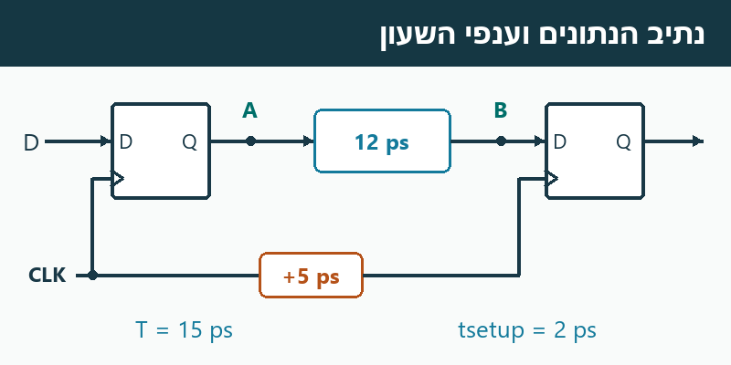
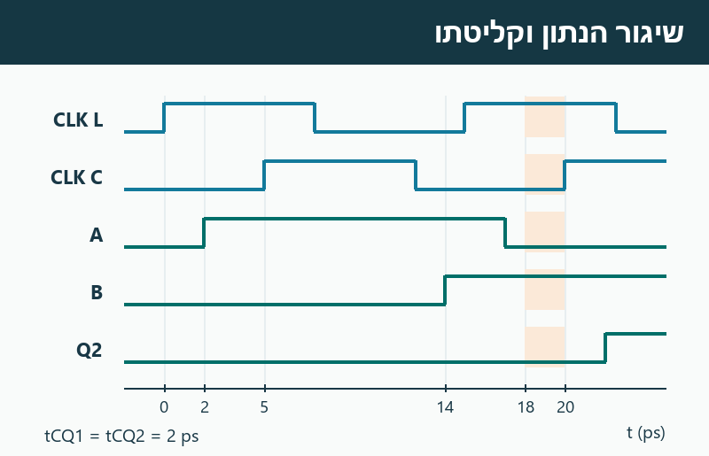
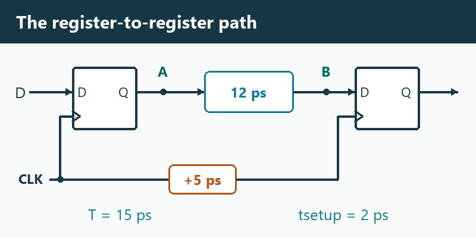
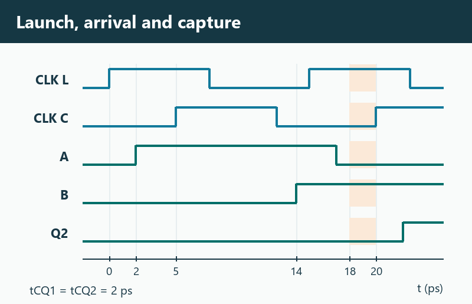

# PREP-326 — בדיקת setup כאשר שעון הקליטה מאחר

פתרון מוצע בסיוע AI. ממתין לביקורת מקצועית.

[צילום המקור](../sources/2026-11-14-batch30-12.png)

נתון המעגל: שני דלגלגים עם נקודה A במוצא הראשון, לוגיקה tCL=12 ps ונקודה B בכניסת השני. ענף שעון השני מעוכב ב־5 ps. T=15 ps ו־tsetup=2 ps. האם יש בעיית Setup במעגל? רשום משוואה כללית. צייר את האותות.

חברה לפי דיווח המקור: Mellanox.

## בדיקת setup כאשר שעון הקליטה מאחר

שני פליפ-פלופים דוגמים בחזית עולה. נקודה A היא מוצא הפליפ-פלופ הראשון. ממנה הנתון עובר דרך לוגיקה בעלת השהיה מרבית של 12 ps עד לנקודה B בכניסת הפליפ-פלופ השני. מחזור השעון הוא 15 ps, שעון הקליטה מתעכב ב־5 ps ודרישת ה־setup היא 2 ps. כתבו את תנאי ה־setup וקבעו באילו ערכי tCQ מרבי הוא מתקיים. שרטטו את שני השעונים ואת האותות A, B ו־Q2 עבור הדוגמה הבאה. המוצאים מתחילים ב־0, הפליפ-פלופ הראשון דוגם 1 בזמן 0 ו־0 בזמן 15 ps. לשני הפליפ-פלופים tCQ של 2 ps, הלוגיקה מעתיקה את הנתון לאחר 12 ps ואין אי־ודאות שעון.

1. סמנו בנפרד מתי הנתון יוצא ומתי הוא חייב להיות יציב.
2. חזית הקליטה המיועדת לנתון ששוגר בזמן אפס שייכת למחזור הבא. מתי היא מגיעה אחרי עיכוב השעון?
3. חשבו את מועד הגעת הנתון ל־B ואת מועד הקליטה בניכוי setup. ההפרש הוא מרווח התזמון.

### תקציב הזמן

החזית בזמן 0 משגרת את הנתון. חזית אותו המחזור מגיעה לפליפ-פלופ השני בזמן 5 ps ודוגמת את הנתון הקודם בהנחה שתנאי ה־hold מתקיים. החזית שאמורה לקלוט את הנתון החדש מגיעה בזמן 20 ps. הנתון חייב להתייצב ב־B עד 18 ps. זמן ההגעה הגרוע הוא tCQ,max + 12 ps. לכן מרווח ה־setup הוא 6 ps פחות tCQ,max. זמן של עד 6 ps עומד בדרישה. ב־6 ps אין רזרבה, ומעליו יש הפרה.

באופן כללי, אם s הוא זמן שעון הקליטה פחות זמן שעון השיגור ו־U הוא אי־הוודאות, התנאי הוא `tCQ,max + dmax + tsetup + U ≤ T + s`.

### עקבת הדוגמה

A עולה ב־2 ps ויורד ב־17 ps. B עולה ב־14 ps ויורד ב־29 ps. בחזית הקליטה ב־5 ps הערך ב־B עדיין 0. בחזית 20 ps הוא 1, ולכן Q2 עולה ב־22 ps. הנתון מגיע 4 ps לפני חלון ה־setup. לשם השוואה, אם tCQ,max היה 7 ps, הנתון היה מגיע ב־19 ps, באיחור של 1 ps. [מדריך התזמון של Intel](https://cdrdv2-public.intel.com/721599/ug-683243-721599.pdf)

### הנחות

נתיב חד־מחזורי, skew חיובי לשעון קליטה מאוחר. בדוגמה B עוקב אחרי A ללא היפוך.

### שיקולי תכנון

התקציב קובע את השהיית clock-to-Q המרבית המותרת עבור הנתיב הנתון.

### אימות

חמש דוגמאות tCQ נבדקו מול מועדי ההגעה והקליטה, כולל שוויון והפרה.

### מקרי קצה

- ב־tCQ,max=6 ps הנתיב עומד בדיוק בדרישה.
- בדיקת hold מצריכה השהיות מינימום ודרישת hold.

### טעויות נפוצות

- בחירת 5 ps כחזית הקליטה המיועדת לנתון החדש.
- הנחה ש־tCQ הוא אפס כאשר נדרשת תשובה כללית.

### תשובה קצרה

B חייב להתייצב עד 18 ps ומגיע בזמן tCQ,max + 12 ps. מותר tCQ,max עד 6 ps.

### שאלת המשך

איך אותו skew משפיע על hold? בדקו את חזית אותו מחזור. בהיעדר אי־ודאות נדרש tCQ,min + dmin ≥ s + thold. השוו את הדדליין בחזית 5 ps להגעת הנתון במסלול המהיר.

## Setup with a delayed capture clock

Two positive-edge registers form a one-cycle path. A is the launching Q output. A combinational path with 12 ps maximum delay drives B at the capturing D input. The period is 15 ps, the capture clock arrives 5 ps later than the launch clock, and setup requires 2 ps. State the setup constraint and determine which maximum clock-to-Q delays meet it. Draw the two clocks and A, B and Q2 for this example. Both outputs start low, and the launch register samples 1 at 0 ps and 0 at 15 ps. Both clock-to-Q delays are 2 ps, the logic copies its input after 12 ps, and clock uncertainty is zero.

1. Mark the launch of the data and the latest time it may settle.
2. The intended capture edge belongs to the next cycle. Where does the extra clock delay place it?
3. Find the data arrival at B, then the capture time minus setup. Their difference gives the margin.

### Time budget

The edge at 0 launches the new value. The same-cycle edge at the second register arrives at 5 ps and samples the previous value if hold is met. The intended edge for the new value arrives at 20 ps. B must settle by 18 ps. Its worst-case arrival is tCQ,max + 12 ps, giving setup slack of 6 ps minus tCQ,max. Values up to 6 ps meet setup. At 6 ps the margin is zero, and above it setup fails.

In general, let s be capture clock arrival minus launch clock arrival, with setup uncertainty U. The condition is `tCQ,max + dmax + tsetup + U ≤ T + s`.

### Example trace

A rises at 2 ps and falls at 17 ps. B rises at 14 ps and falls at 29 ps. B is still low at the 5 ps capture edge. At 20 ps B is high, so Q2 rises at 22 ps. The arrival precedes the setup window by 4 ps. If tCQ,max were 7 ps, B would arrive at 19 ps and miss the deadline by 1 ps. [Intel Timing Analyzer guide](https://cdrdv2-public.intel.com/721599/ug-683243-721599.pdf)

### Assumptions

A one-cycle path with positive skew for a later capture clock. In the example B follows A without inversion.

### Design trade-offs

The budget gives the maximum allowed clock-to-Q delay for this path.

### Verification

Five clock-to-Q values were checked against absolute deadlines, including equality and a failing path.

### Edge cases

- At tCQ,max=6 ps the path meets setup exactly.
- Hold analysis needs minimum delays and the hold specification.

### Common mistakes

- Using 5 ps as the intended capture time for the new value.
- Assuming zero tCQ in the general setup condition.

### Interview answer

B is due at 18 ps and arrives at tCQ,max + 12 ps. The limit is 6 ps.

### Follow-up

How does the same skew affect hold? Check the same-cycle edge. With zero uncertainty require tCQ,min + dmin ≥ s + thold. Compare the deadline at the 5 ps edge with the fastest path.

[Verification script](../checks/check_1114_signal_questions.py)

[Recorded results](../checks/batch1114-signal-model-results.json)

