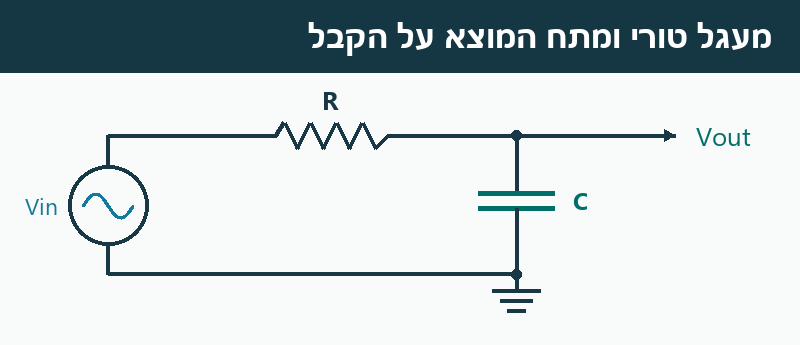
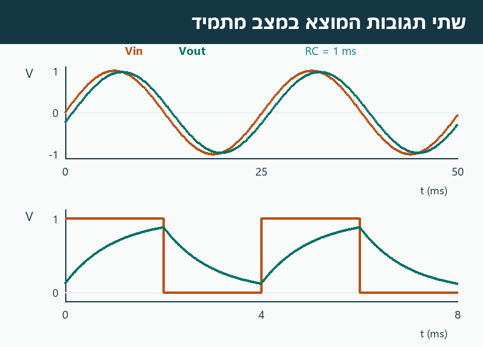
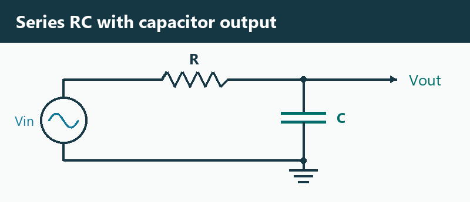
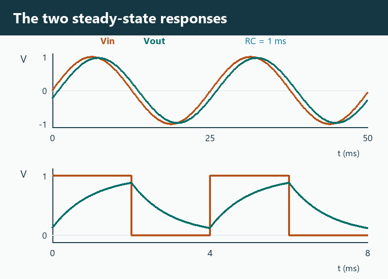

# PREP-327 — תגובת מעגל RC לסינוס ולגל ריבועי

פתרון מוצע בסיוע AI. ממתין לביקורת מקצועית.

[צילום המקור](../sources/2026-11-14-batch30-19.png)

נתון מעגל RC המורכב ממקור מתח sin(250t), נגד ואז קבל בטור. מתח המוצא בין הנגד לקבל. מצא את מתח המוצא כפונקציה של הזמן. החלף את מתח הכניסה בגל ריבועי בעל תדירות של 250 הרץ. מה יהיה מתח המוצא?

חברה לפי דיווח המקור: SolarEdge.

## תגובת מעגל RC לסינוס ולגל ריבועי

נגד R מחבר מקור מתח אידאלי למוצא, וקבל C מחבר את המוצא לאדמה. עבור Vin(t)=sin(250t) וולט, כאשר t נמדד בשניות, מצאו את Vout(t) במצב מתמיד וגם אם המקור מופעל ב־t=0 על קבל פרוק. לאחר מכן מחליפים את הכניסה בגל ריבועי של 250 Hz, בין 0 ל־1 וולט וביחס מחזור 50%. מצאו את המוצא במצב המחזורי ואת ערכי השיא והשפל. שרטטו עבור RC=1 ms.

1. איזה זרם עובר במשותף בנגד ובקבל?
2. לסינוס השתמשו בפונקציית התמסורת בתדר הזוויתי הנתון. הוסיפו תגובה טבעית כדי להתאים את תנאי ההתחלה.
3. בכל חצי מחזור ריבועי המתח מתקרב מעריכית לרמת המקור. ערך הסיום במחצית השנייה חייב להיות ערך ההתחלה בראשונה.

### סינוס

חוק הזרמים נותן `τ dVout/dt + Vout = Vin`, כאשר τ=RC. פונקציית התמסורת היא H(s)=1/(1+sτ). בכניסת הסינוס ω=250 rad/s, כלומר f≈39.79 Hz. נסמן G=1/√(1+(250τ)²) ו־φ=atan(250τ). תגובת המצב המתמיד היא Vss(t)=G sin(250t−φ). עם מתח התחלתי V0 יש להוסיף (V0−Vss(0))exp(−t/τ). בקבל פרוק האיבר הנוסף הוא G sin(φ)exp(−t/τ). ב־τ=1 ms מתקבלים G≈0.970 ו־φ≈14.0°.

### גל ריבועי

כאן התדר הוא 250 Hz, ולכן כל חצי מחזור אורך h=2 ms. הגדירו q=exp(−h/τ). נסמן ב־L את המתח בתחילת החלק הגבוה וב־H את המתח בסופו. תנאי הרציפות נותנים H=1+(L−1)q ואחריו L=Hq. מכאן H=1/(1+q), L=q/(1+q), בוולטים. נסמן ב־u את הזמן מתחילת המחזור הנוכחי. בחלק הגבוה (0≤u<h) המוצא הוא 1+(L−1)exp(−u/τ). בחלק הנמוך (h≤u<2h) המוצא הוא H exp(−(u−h)/τ).

ב־τ=1 ms הערכים הם L≈0.119 V ו־H≈0.881 V. המתח על הקבל רציף גם כאשר הכניסה קופצת. עבור מחזור ההתנעה מקבל פרוק אפשר להציב L=0 בנוסחת החלק הגבוה ומשם לעדכן את ערכי הקצה מחצי מחזור לבא. [מסננים פסיביים, Analog Devices](https://www.analog.com/media/en/training-seminars/design-handbooks/basic-linear-design/chapter8.pdf)

### הנחות

R ו־C חיוביים, הכניסה אידאלית, אין עומס במוצא והמתח נמדד ביחס לאדמה.

### שיקולי תכנון

קבוע הזמן קובע את הפשרה בין מעקב אחר הקלט לבין החלקת המעברים.

### אימות

נבדקו 5,000 צעדי אינטגרציה לתגובה הסינוסית ושלושה קבועי זמן למחזור הריבועי מול חישוב חוזר של הטעינה והפריקה.

### מקרי קצה

- כאשר τ קטן ביחס לחצי המחזור, המוצא מתקרב לרמות הכניסה.
- כאשר τ גדול ביחס למחזור, המוצא במצב מתמיד נע סביב 0.5 V בתנודה קטנה.

### טעויות נפוצות

- המרת 250 rad/s ל־250 Hz.
- הנחה שהקבל נפרק לחלוטין בסוף כל חצי מחזור.

### תשובה קצרה

הסינוס מונחת ומפגר לפי H(jω). בגל הריבועי מתקבל רצף טעינות ופריקות מעריכיות בין q/(1+q) ל־1/(1+q).

### שאלת המשך

מה ישתנה אם הכניסה נעה בין ‎−1 ל־1 וולט? השתמשו בליניאריות. המוצא החדש הוא פעמיים המוצא המחזורי שחישבנו פחות וולט אחד. ודאו שסכום השיא והשפל שווה לאפס.

## An RC circuit driven by a sine or a square wave

A resistor R connects an ideal source to the output, and a capacitor C connects that node to ground. For Vin(t)=sin(250t) volts with t in seconds, determine Vout(t) in steady state and when the source starts at t=0 with the capacitor discharged. Then replace the source with a 250 Hz square wave between 0 and 1 V at 50% duty. Find the periodic output and its extrema. Sketch the responses for RC=1 ms.

1. What current flows through both elements?
2. Evaluate the transfer function at the given angular frequency. Add the natural response to meet an initial condition.
3. Each square-wave half-cycle approaches a constant exponentially. The end of the second half must equal the beginning of the first.

### Sine

Kirchhoff's current law gives `τ dVout/dt + Vout = Vin`, where τ=RC. The transfer function is H(s)=1/(1+sτ). The sine has ω=250 rad/s, or f≈39.79 Hz. Write G=1/√(1+(250τ)²) and φ=atan(250τ). The steady-state result is Vss(t)=G sin(250t−φ). For initial voltage V0 add (V0−Vss(0))exp(−t/τ). For a discharged capacitor that term becomes G sin(φ)exp(−t/τ). At τ=1 ms the gain is about 0.970 and the lag about 14.0°.

### Square wave

Here the frequency is 250 Hz, so each half-cycle lasts h=2 ms. Write q=exp(−h/τ), with L the voltage at the start of a high interval and H at its end. Continuity gives H=1+(L−1)q, then L=Hq. Solving yields H=1/(1+q) and L=q/(1+q) volts. Let u be time since the current period began. In its high half (0≤u<h) the output is 1+(L−1)exp(−u/τ). In its low half (h≤u<2h) it is H exp(−(u−h)/τ).

At τ=1 ms the voltage swings between about 0.119 V and 0.881 V. It remains continuous across each input edge. For a startup cycle from zero, set L=0 in the high-half expression and propagate each half-cycle endpoint to the next. [Analog Devices passive filter reference](https://www.analog.com/media/en/training-seminars/design-handbooks/basic-linear-design/chapter8.pdf)

### Assumptions

R and C are positive, the source is ideal, the output is unloaded and voltages use ground as reference.

### Design trade-offs

The time constant trades input tracking against smoothing.

### Verification

Checked 5,000 numerical integration steps for the sine and propagated square-wave half-cycles independently at three time constants.

### Edge cases

- For τ much shorter than half a period, the output approaches the two input levels.
- For τ much longer than a period, the periodic output has small ripple about 0.5 V.

### Common mistakes

- Treating 250 rad/s as 250 Hz.
- Assuming a complete discharge every half-period.

### Interview answer

The sinusoid attenuates and lags according to H(jω). The square wave produces exponential charge and discharge between q/(1+q) and 1/(1+q).

### Follow-up

What if the square wave swings from −1 to +1 V? By linearity the new periodic output equals twice the previous output minus 1 V. Check that the extrema sum to zero.

[Verification script](../checks/check_1114_signal_questions.py)

[Recorded results](../checks/batch1114-signal-model-results.json)

