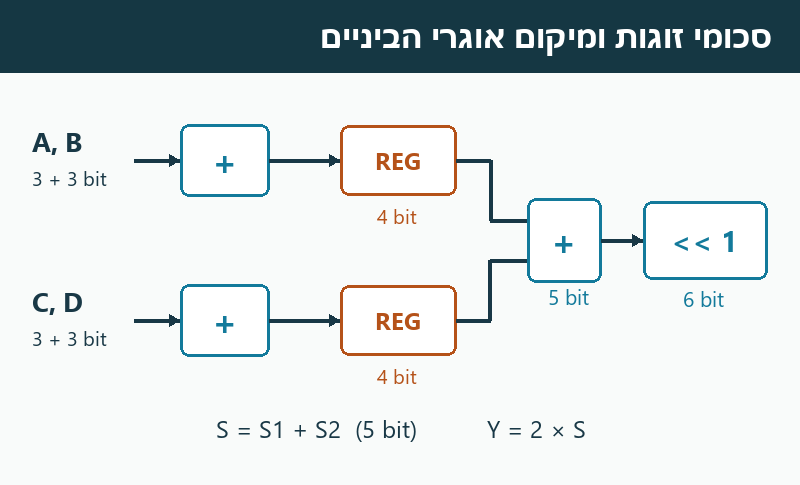
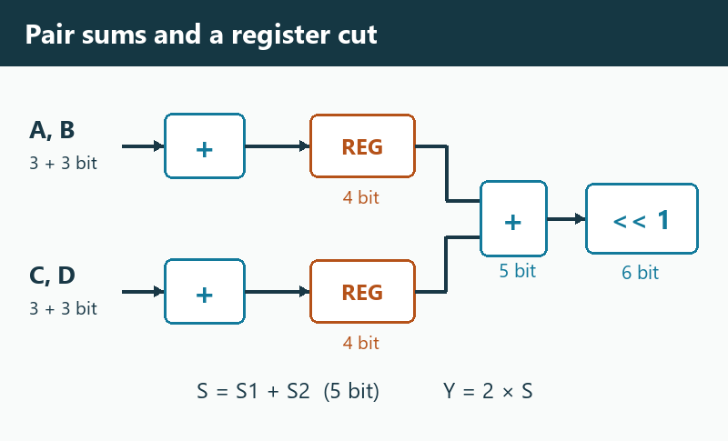

# PREP-328 — עץ מחברים לארבעה קלטים ותזמון הצינור

פתרון מוצע בסיוע AI. ממתין לביקורת מקצועית.

[צילום המקור](../sources/2026-11-14-batch30-20.png)

ממש מעגל המחשב את ערך הביטוי (A+B+C+D)*2. יש מחברים ושערים בסיסיים, גודל כל מספר 3 ביט. נדרש לממש מחבר של 3 ביט, לנתח את השהיות המחבר ולהסביר מהו המסלול הקריטי. חשב תדר שעון מקסימלי כאשר כל מספר מוזן מ־FF, לפי תנאי setup. כיצד skew משפיע על התדר? כיצד משפרים את תדר העבודה ולמה פייפליין עוזר אם חישוב אחד נמשך כמה מחזורים?

חברה לפי דיווח המקור: Marvell.

## עץ מחברים לארבעה קלטים ותזמון הצינור

ארבעה אוגרים מזינים בכל מחזור מספרים ללא סימן בני שלוש סיביות. תכננו מעגל שמחשב Y=2(A+B+C+D) ללא גלישה ומוסר את התוצאה לאוגר מוצא. בנו מחבר של שלוש סיביות משערי XOR, AND ו־OR. מצאו את רוחבי התוצאות, את הנתיב הקריטי ואת תדר השעון המרבי. נתחו גם skew ותוספת אוגרים בין דרגות החיבור. מה משתפר כשמגיע קלט חדש בכל מחזור? במודל התזמון כל שער דו־כניסתי אורך d, לחוטים השהיה אפס, והסיבית הנמוכה בכל מחבר היא חצי־מחבר. חשבו גם עבור d=100 ps, זמן clock-to-Q מרבי של 80 ps ו־setup של 40 ps.

1. מהי התוצאה המרבית בכל זוג ובסכום הכולל?
2. בכל סיבית סמנו מתי אותות ה־generate, ה־propagate והנשא מוכנים. סכומי הזוגות אינם מתייצבים בכל הסיביות בו־זמנית.
3. אחרי חיתוך העץ באוגרים שני קלטי המחבר האחרון מתחילים מאותה חזית. השוו את זמן הדרגה הארוכה ביותר לזמן הנתיב המלא.

### לוגיקה ורוחב

חשבו במקביל S1=A+B ו־S2=C+D. לכל סכום זוגי דרושות 4 סיביות (עד 14). המחבר הבא מחשב סכום בן 5 סיביות (עד 28). חברו 0 מימין לתוצאה הבינארית. מתקבל מוצא בן 6 סיביות, עד 56, ללא שער נוסף. לדוגמה 7,7,0,1 נותנים (14+1)×2=30.

בכל עמודה i חשבו pᵢ=aᵢ XOR bᵢ ו־gᵢ=aᵢ AND bᵢ. בסיבית 0 מתקבלים sum₀=p₀ ו־c₁=g₀. בשאר הסיביות sumᵢ=pᵢ XOR cᵢ ו־cᵢ₊₁=gᵢ OR (pᵢ AND cᵢ). הנשא האחרון הוא הסיבית העליונה. זוהי בנייה של מחבר בן שלוש סיביות באמצעות חצי־מחבר ושני מחברים מלאים. למחבר הסופי דרושות ארבע עמודות.

### מעקב אחרי הנתיב הקריטי

זמן הגעה לשער הוא מועד הקלט המאוחר שלו ועוד d. בקלטים זמינים בזמן אפס, זמני סיביות סכום הזוג מהסיבית הנמוכה לגבוהה הם [1,2,4,5] ביחידות d. למשל c₂ מוכן בזמן 3 ו־c₃ בזמן 5. שני האוטובוסים הללו מזינים את מחבר ארבע הסיביות. זמני המוצא שלו הם [2,4,6,8,9] באותן יחידות. לדוגמה אות propagate של עמודה 2 בדרגה השנייה מגיע בזמן 5, הנשא לעמודה 3 בזמן 7 והנשא האחרון בזמן 9. אורך הנתיב הקריטי במודל הוא 9d. חיבור ההשהיות הגרועות של שני המחברים בנפרד נותן חסם שמרני של 12d כי הוא מתעלם מזמני ההגעה של הסיביות.

### תדר, skew וצינור

עבור skew שמוגדר כזמן שעון הקליטה פחות זמן שעון השיגור, נדרש T ≥ tCQ,max + 9d + tsetup − skew (ללא אי־ודאות). ב־skew אפס מתקבל T≥1.02 ns, כלומר fmax≈980 MHz. skew חיובי מקל על בדיקת setup אבל מקשיח את בדיקת hold. בודקים בנפרד גם את הנתיב הקצר ביותר.

אם מכניסים אוגרים אחרי שני סכומי הזוגות, הדרגה הראשונה מסתיימת אחרי 5d והמחבר הסופי, שקלטיו יוצאים יחד מאוגרים, מסתיים אחרי 7d. לכן בדוגמה T≥0.82 ns, ו־fmax≈1.22 GHz. יש כעת שני מחזורים מחזית השיגור עד חזית הקליטה הסופית. אחרי מילוי הצינור מתקבלת תוצאה בכל 0.82 ns. עבור קלט יחיד ההשהיה מחזית לחזית היא 1.64 ns לעומת 1.02 ns קודם. הרווח הוא בקצב של רצף קלטים עצמאיים.

### הנחות

מספרים ללא סימן, שעון משותף, שערים בהשהיה אחידה ואוגרי כניסה ומוצא. בחישוב המספרי skew אפס.

### שיקולי תכנון

הנתיב הקריטי מחושב למבנה ripple הנתון. תאים ממשיים, חיווט ומבני נשא אחרים עשויים לשנות אותו.

### אימות

כל 4,096 רביעיות הקלט הושוו לאריתמטיקה שלמה. זמני הגעה חושבו ברמת שער וקיבלו עומקים 9, או 5 ו־7 עם אוגרים.

### מקרי קצה

- ארבעה קלטי 7 מחייבים שש סיביות במוצא.
- בצינור עם עצירות יש לשמור את שני סכומי הזוגות של אותה רביעייה יחד.

### טעויות נפוצות

- חיתוך הנשא לפני ההזזה.
- קיצור מחזור השעון בלי לכלול זמני האוגרים.
- הנחה שכל הוספת אוגר מקטינה גם את ההשהיה עבור קלט יחיד.

### תשובה קצרה

שני מחברי זוגות מזינים מחבר ארבע־סיביות. הצמדת אפס מכפילה את הסכום. אוגרי ביניים מפצלים נתיב 9d לשתי דרגות של 5d ו־7d.

### שאלת המשך

כיצד אפשר לצמצם שהיית חיבור בלי להוסיף שלב צינור? השתמשו במדחסי carry-save לצמצום מספר האופרנדים והעבירו נשא לרוחב המילה במחבר האחרון בלבד. חשבו מחדש השהיה לפי מימוש השערים והחיווט שנבחרו.

## Timing and pipelining a four-operand adder tree

Every cycle four registers present unsigned 3-bit operands. Design a circuit that computes Y=2(A+B+C+D) without overflow and delivers it to an output register. Build a 3-bit adder from XOR, AND and OR gates. Find all result widths, the critical path and the maximum clock frequency. Analyze clock skew and adding registers between adder stages. What improves when a new input tuple arrives every cycle? In the delay model each two-input gate takes d, wires have zero delay and each adder uses a half adder at bit zero. Also evaluate d=100 ps, maximum clock-to-Q of 80 ps and setup of 40 ps.

1. What is the maximum possible value after one pair and after both pairs?
2. Mark the arrival times of generate, propagate and carry at each bit. The bits of a pair sum settle at different times.
3. After registering the intermediate sums, both final-adder inputs start from one edge. Compare the slowest stage with the original path.

### Logic and widths

Compute S1=A+B and S2=C+D in parallel. Each pair sum needs 4 bits (up to 14). Their sum needs 5 bits (up to 28). Append a zero at the least significant end. The 6-bit output reaches 56 and the shift needs only wiring. For example 7,7,0,1 gives (14+1)×2=30.

For bit i compute pᵢ=aᵢ XOR bᵢ and gᵢ=aᵢ AND bᵢ. At bit zero, sum₀=p₀ and c₁=g₀. At the remaining bits, sumᵢ=pᵢ XOR cᵢ and cᵢ₊₁=gᵢ OR (pᵢ AND cᵢ). The last carry is the high result bit. A half adder followed by two full adders constructs the 3-bit adder. The final adder has four columns.

### Trace the critical path

A gate output arrives one d after its later input. With inputs ready at zero, the pair result arrives from low bit to high bit at [1,2,4,5] in units of d. For example c₂ arrives at 3 and c₃ at 5. Both such buses feed the 4-bit adder. Its outputs arrive at [2,4,6,8,9]. For example the second-stage bit-2 propagate arrives at 5, the carry into bit 3 at 7 and the final carry at 9. The model's critical path is 9d. Adding standalone worst-case adder delays yields a conservative 12d bound by ignoring the per-bit arrivals.

### Frequency, skew and pipelining

Define skew as capture clock arrival minus launch clock arrival. With zero uncertainty require T ≥ tCQ,max + 9d + tsetup − skew. At zero skew this gives T≥1.02 ns, or fmax≈980 MHz. Positive skew relaxes setup and tightens hold. Check the shortest path separately.

Register both pair sums. The first stage then takes 5d and the final adder, now starting with simultaneous register outputs, takes 7d. In the example T≥0.82 ns and fmax≈1.22 GHz. It takes two cycles from input launch to final capture. Once full, the pipeline delivers one result every 0.82 ns. One isolated tuple has 1.64 ns of edge-to-edge latency, compared with 1.02 ns before. Independent input tuples benefit from the increased throughput.

### Assumptions

Unsigned operands, a common clock, equal gate delays and registered input and output. The numerical example uses zero skew.

### Design trade-offs

The critical path applies to the given ripple implementation. Physical cells, routing and alternative carry structures can change it.

### Verification

All 4,096 operand tuples were checked against integer arithmetic. Gate-level arrival calculations gave depth 9, or 5 and 7 with registers.

### Edge cases

- Four sevens require all six output bits.
- With pipeline stalls, the two pair sums from one tuple must stay aligned.

### Common mistakes

- Discarding carry before shifting.
- Reducing the period without register overhead.
- Assuming that inserting a register reduces single-tuple latency.

### Interview answer

Two pair adders feed a four-column adder. Append zero to double the sum. Intermediate registers split the 9d path into stages of 5d and 7d.

### Follow-up

How could you shorten addition without adding a pipeline stage? Use carry-save compressors to reduce the number of operands and propagate carries across the word only in the last adder. Recompute timing for the chosen cell and wiring model.

[Verification script](../checks/check_1114_signal_questions.py)

[Recorded results](../checks/batch1114-signal-model-results.json)

