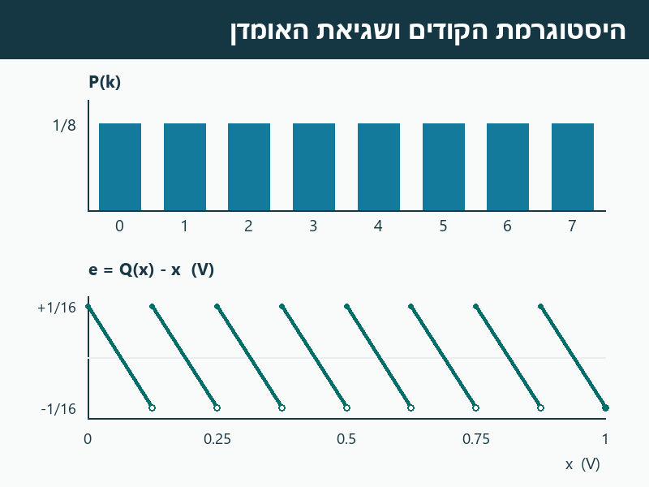
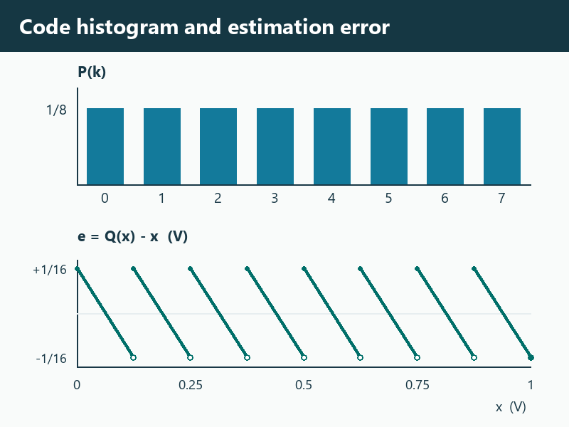

# PREP-329 — כימות בשלוש סיביות ומסנן מעביר נמוכים ב־MATLAB

פתרון מוצע בסיוע AI. ממתין לביקורת מקצועית.

[צילום המקור](../sources/2026-11-14-batch30-29.png)

יש לנו אות חשמלי המיוצג ע״י 3 ביטים בין המתחים 0–1. צייר את היסטוגרמת האות ואת גרף השגיאה המייצג (באמצעות שיטה של אומדן). כתוב קוד עבור מסנן LPF באמצעות MATLAB.

חברה לפי דיווח המקור: Mellanox.

## כימות בשלוש סיביות ומסנן מעביר נמוכים ב־MATLAB

מתח כניסה מתפלג אחיד בתחום 0 עד 1 וולט. ממיר בן 3 סיביות מחלק את התחום לשמונה תאים שווים ומעריך כל דגימה לפי מרכז התא. קבעו את גבולות התאים, שרטטו היסטוגרמה מנורמלת של קודי המוצא ואת השגיאה e=אומדן פחות מתח כניסה כפונקציה של המתח, וחשבו את השגיאה המרבית ואת ממוצע ריבוע השגיאה. לאחר מכן כתבו ב־MATLAB מסנן מעביר נמוכים דיגיטלי מסדר ראשון, עם קצב דגימה 1 kHz ותדר חצי־הספק של 100 Hz. הדגימו את פעולתו על סכום של סינוסים בתדרים 20 ו־300 הרץ.

1. כמה קודים שונים יש בשלוש סיביות ומה אורך הקטע שמגיע לכל קוד?
2. בתוך תא יחיד האומדן קבוע והכניסה גדלה. איזו שגיאה מתקבלת במרכז ובשני הקצוות?
3. למסנן מסדר ראשון אפשר להשתמש בהתמרה ביליניארית עם תיקון תדר, ולממש את המונה והמכנה בעזרת filter.

### מה מייצגת כל עמודה?

שלוש סיביות נותנות שמונה קודים, 0 עד 7. רוחב התא Δ=1/8 V. לקוד k שייך הקטע מ־k/8 כולל ועד (k+1)/8 ללא הקצה הימני. התא האחרון כולל גם את 1 V. לכן k=min(7, floor(8x)) כאשר x נתון בוולטים בתחום המוגדר, והאומדן Q(x)=(k+½)/8. למשל x=0.30 V משויך לקוד 2 ומיוצג על ידי 0.3125 V. כל תא מקבל הסתברות 1/8 בזכות התפלגות הכניסה האחידה. במדגם של N מדידות מצפים ל־N/8 מופעים בכל קוד, עם תנודות מדגמיות.

### שגיאת האומדן

בכל תא e(x)=(k+½)/8−x הוא קטע ישר בשיפוע ‎−1. השגיאה יורדת מ־+1/16 V לעבר ‎−1/16 V, ובגבול הפנימי מתחילה שוב ב־+1/16 V. בנקודת הקצה x=1 V היא ‎−1/16 V. מתקבל גרף שיני מסור. ממוצע השגיאה הוא אפס מסימטריה, והשגיאה הריבועית הממוצעת היא ממוצע u² בתא: האינטגרל מ־‎−Δ/2 עד ‎+Δ/2 חלקי Δ הוא Δ²/12=1/768 V². ההיסטוגרמה תהיה שונה לאות שאינו אחיד.

### מסנן דיגיטלי

נסמן g=tan(π fc/fs). החלפת המשתנה האנלוגי במסנן 1/(1+s/Ωc) בעזרת התמרה ביליניארית עם Ωc=2fs·g נותנת מונה [g,g]/(1+g) ומכנה [1,(g−1)/(g+1)]. ההגבר בתדר אפס הוא 1, בתדר נייקוויסט הוא אפס וב־100 Hz הוא 1/√2. בדוגמה ההגבר בתדר 20 Hz הוא כ־0.982 וב־300 Hz כ־0.230. הדגימה הראשונה של המסנן מחושבת מתנאי התחלה אפסיים.

הקוד משתמש ברשת מתחים דטרמיניסטית לחלק הכימות, כך שמספרי המופעים ניתנים לשחזור בדיוק. בחלק השני נוצר אות זמן עצמאי עבור הדגמת המסנן. [תיעוד MATLAB לפונקציה filter](https://www.mathworks.com/help/matlab/ref/filter.html)

```matlab
% Three-bit midrise quantizer on [0,1] V.
xgrid = ((0:8191) + 0.5)/8192;
code = min(7,floor(8*xgrid));
estimate = (code + 0.5)/8;
errorV = estimate - xgrid;
counts = accumarray(code(:) + 1, 1, [8,1]);
assert(all(counts == 1024));
assert(max(abs(errorV)) <= 1/16);

figure;
subplot(2,1,1);
bar(0:7,counts/numel(code));
xlabel('Code'); ylabel('Probability');
subplot(2,1,2);
plot(xgrid,errorV,'.','MarkerSize',2);
xlabel('Input (V)'); ylabel('Estimate - input (V)');

% Filter a separate sampled test signal. Default filter state is zero.
fs = 1000;
fc = 100;
t = (0:999)/fs;
x = 0.5 + 0.30*sin(2*pi*20*t) + 0.15*sin(2*pi*300*t);
g = tan(pi*fc/fs);
b = [g, g]/(1+g);
a = [1, (g-1)/(g+1)];
y = filter(b,a,x);
figure;
plot(t,x,t,y);
xlim([0 0.1]); xlabel('Time (s)'); ylabel('Voltage (V)');
legend('Input','Filtered');
z = exp(-1i*2*pi*fc/fs);
assert(abs(abs((b(1)+b(2)*z)/(1+a(2)*z)) - 1/sqrt(2)) < 1e-12);
```



### הנחות

המקור אחיד ורציף, האומדן הוא מרכז התא, סף פנימי שייך לתא העליון ו־1 V שייך לקוד 7. תדר חצי־ההספק נמוך ממחצית תדר הדגימה.

### שיקולי תכנון

מרכז כל תא הוא התוחלת המותנית עבור מקור אחיד ולכן ממזער את ממוצע ריבוע השגיאה באותו תא.

### אימות

מודל Python בדק 8,192 דגימות, תשעה גבולות וחמישה תדרים של פונקציית התמסורת. סקריפט MATLAB מכיל בדיקות עצמיות. הבדיקה המספרית בוצעה ב־Python.

### מקרי קצה

- ב־1 V יש לרוות לקוד 7.
- אם הכניסה קבועה במרכז תא יחיד, ההיסטוגרמה כוללת עמודה אחת והשגיאה אפס.

### טעויות נפוצות

- חלוקה ל־7 מרווחים למרות הגדרת שמונה תאים שווים.
- ערבוב היסטוגרמת הקודים עם גרף השגיאה כתלות במתח.
- הצבת תדר ב־Hz במקום תדר מנורמל בחישוב המקדמים.

### תשובה קצרה

שמונה תאים ברוחב 1/8 V נותנים שגיאת שיא של 1/16 V ו־MSE של 1/768 V². למסנן אפשר לבחור IIR מסדר ראשון ולבדוק שב־100 Hz ההספק נחתך לחצי.

### שאלת המשך

מהו האומדן הטוב ביותר בתא אם צפיפות הכניסה משתנה בתוך התא? בחישוב MSE בחרו את התוחלת המותנית של x בתא. היא עלולה לסטות מאמצע התא. חשבו תא עם צפיפות שעולה ליניארית לכיוון הקצה העליון.

## Three-bit quantization error and a MATLAB low-pass filter

An input voltage is uniform from 0 to 1 V. A 3-bit converter partitions the range into eight equal cells and estimates each sample by the cell midpoint. Find the cell boundaries, draw the normalized code histogram and the error e=estimate minus input as a function of voltage, and compute the peak error magnitude and mean squared error. Then implement a first-order digital low-pass filter in MATLAB at a 1 kHz sampling rate and a 100 Hz half-power frequency. Demonstrate it on a sum of 20 and 300 Hz tones.

1. How many codes fit in three bits, and how long is each code interval?
2. Within one cell the estimate stays fixed while the input increases. What happens at the center and the edges?
3. A bilinear transform with frequency prewarping gives a first-order filter. Pass its numerator and denominator to filter.

### What does one histogram bar mean?

Three bits give eight codes numbered 0 through 7, each with cell width Δ=1/8 V. Code k owns the interval from k/8 inclusive to (k+1)/8 exclusive. The last cell includes 1 V. Thus k=min(7, floor(8x)) for x in volts in the stated range, and Q(x)=(k+½)/8. For example x=0.30 V maps to code 2 and the estimate 0.3125 V. Each cell has probability 1/8 because the input is uniform. In N random measurements the expected count in each bin is N/8, with sample fluctuations.

### Estimation error

In one cell e(x)=(k+½)/8−x is a line of slope −1. It falls from +1/16 V toward −1/16 V and resets to +1/16 V at each internal boundary. At x=1 V it equals −1/16 V. The resulting error graph is a sawtooth. Symmetry gives zero mean error. The mean squared error is the average of u² over one cell: integrating from −Δ/2 to +Δ/2 and dividing by Δ gives Δ²/12=1/768 V². A different input distribution changes the code histogram.

### Digital filter

Write g=tan(π fc/fs). Applying a bilinear transform to 1/(1+s/Ωc) with Ωc=2fs·g gives numerator [g,g]/(1+g) and denominator [1,(g−1)/(g+1)]. The gain is 1 at DC, zero at Nyquist and 1/√2 at 100 Hz. For the example the gains at 20 and 300 Hz are about 0.982 and 0.230. The filter starts with zero stored state.

The quantizer demo uses a deterministic voltage grid so its counts are exactly reproducible. The filter demo generates a separate time-domain input. [MATLAB filter documentation](https://www.mathworks.com/help/matlab/ref/filter.html)

```matlab
% Three-bit midrise quantizer on [0,1] V.
xgrid = ((0:8191) + 0.5)/8192;
code = min(7,floor(8*xgrid));
estimate = (code + 0.5)/8;
errorV = estimate - xgrid;
counts = accumarray(code(:) + 1, 1, [8,1]);
assert(all(counts == 1024));
assert(max(abs(errorV)) <= 1/16);

figure;
subplot(2,1,1);
bar(0:7,counts/numel(code));
xlabel('Code'); ylabel('Probability');
subplot(2,1,2);
plot(xgrid,errorV,'.','MarkerSize',2);
xlabel('Input (V)'); ylabel('Estimate - input (V)');

% Filter a separate sampled test signal. Default filter state is zero.
fs = 1000;
fc = 100;
t = (0:999)/fs;
x = 0.5 + 0.30*sin(2*pi*20*t) + 0.15*sin(2*pi*300*t);
g = tan(pi*fc/fs);
b = [g, g]/(1+g);
a = [1, (g-1)/(g+1)];
y = filter(b,a,x);
figure;
plot(t,x,t,y);
xlim([0 0.1]); xlabel('Time (s)'); ylabel('Voltage (V)');
legend('Input','Filtered');
z = exp(-1i*2*pi*fc/fs);
assert(abs(abs((b(1)+b(2)*z)/(1+a(2)*z)) - 1/sqrt(2)) < 1e-12);
```



### Assumptions

The source is continuous and uniform, reconstruction uses midpoints, internal boundaries map upward and 1 V maps to code 7. The half-power frequency lies below Nyquist.

### Design trade-offs

For a uniform source the cell midpoint is its conditional mean and minimizes the mean squared error in that cell.

### Verification

A Python model checked 8,192 samples, nine boundaries and five filter frequencies. The MATLAB script includes self-checks. Numerical verification ran in Python.

### Edge cases

- Clamp 1 V to code 7.
- A constant input at one midpoint occupies a single bin and has zero error.

### Common mistakes

- Dividing by 7 despite the specified eight equal cells.
- Confusing the code histogram with the error versus voltage curve.
- Using frequency in Hz where the coefficient formula needs a normalized frequency.

### Interview answer

Eight 1/8 V cells give a 1/16 V peak error and MSE of 1/768 V². A first-order IIR can be checked for half power at 100 Hz.

### Follow-up

What is the best estimate if the input density varies within a cell? For MSE use the conditional mean of x in that cell. It can differ from the midpoint. Evaluate a cell whose density increases linearly toward its upper end.

[Verification script](../checks/check_1114_signal_questions.py)

[Recorded results](../checks/batch1114-signal-model-results.json)

[MATLAB](../solutions/prep_329_quantizer_lpf.m)

