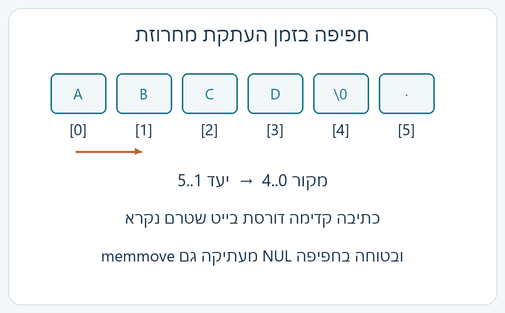
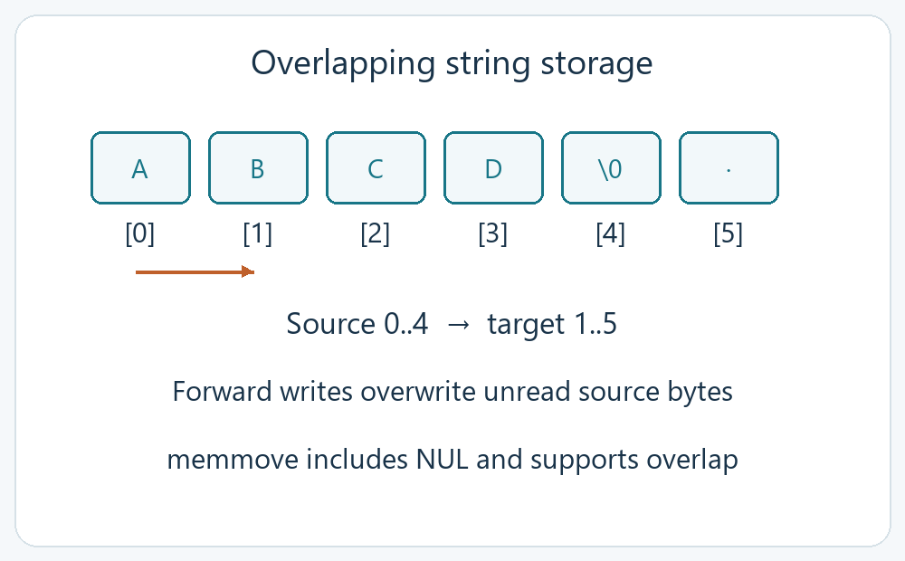

# PREP-332 — העתקת מחרוזת C עם קיבולת, סיום וחפיפה

פתרון מוצע בסיוע AI. ממתין לביקורת מקצועית אנושית.

[צילום המקור](../sources/2026-11-15-batch20-05.png)

העתקת מחרוזת source למחרוזת target ב־C. אילו בעיות עלולות להיווצר? רמזים בדבר סיום מחרוזת ובעיות פוינטרים.

## העתקת מחרוזת C עם קיבולת, סיום וחפיפה

הסבירו את הסיכונים בהעתקת מחרוזת C מ־source אל target, ואז כתבו checked_string_copy(target,target_capacity,source,source_capacity). הקיבולות נמדדות בבתים ומתארות אחסון חי ותקף. יש למצוא NUL בתוך קיבולת המקור, לוודא מקום גם לתו המסיים ולהעתיק את המחרוזת. תמכו גם באחסון חופף. החזירו false עבור NULL, היעדר NUL או קיבולת יעד קטנה מדי, ואל תשנו את היעד בכשל. מצביע שאינו NULL עדיין יכול להיות לא תקף; תקפות ההקצאה היא חובת הקורא.

### רמזים

1. מה מבדיל מערך תווים ממחרוזת C, וכמה בתים נדרשים למחרוזת באורך L?
2. בדקו את תו הסיום ואת קיבולת היעד לפני כתיבה כלשהי.
3. לאחר סריקה מוגבלת לאורך המקור, העבירו length+1 בתים באמצעות memmove כדי לתמוך בחפיפה.

### פתרון מוצע

מחרוזת C מסתיימת בבייט NUL. הקצאת L בתים מספיקה ל־L תווים רק אם אין צורך בסיום; מחרוזת באורך L דורשת L+1. source ו־target צריכים להצביע לאחסון שחי לאורך ההעתקה, והיעד חייב להיות ניתן לכתיבה. מצביע NULL, מצביע משוחרר, מקור שאינו מסתיים ויעד קטן מדי עלולים לגרום לגישה לא חוקית. השמה target=source מעתיקה כתובת בלבד.

המימוש סורק לכל היותר source_capacity בתים בלי לכתוב. אם לא נמצא NUL, נחזיר false. אם length≥target_capacity, חסר מקום לתו הסיום ונחזיר false. אחרת memmove מעתיקה length+1 בתים, כולל NUL, עם המשמעות של העתקה דרך אזור זמני גם כאשר הטווחים חופפים. strcpy ו־memcpy אינן מספקות תמיכה זו בחפיפה. לולאת העתקה קדימה עלולה לדרוס מקור שטרם נקרא.

הבדיקות המקדימות משאירות יעד ללא שינוי בכשל, בתנאי שהחוזה על אחסון תקף מתקיים. הזמן O(L+1) לסריקה ולהעתקה, עם שטח עזר קבוע בממשק. המימוש הפנימי של memmove הוא אחריות הספרייה. אין דרך כללית בפונקציה כזו להוכיח שמצביע שרירותי מצביע להקצאה אמיתית.

```c
/* C11. Capacities describe readable/writable live storage.
   Returns false without changing destination for invalid capacity or missing NUL. */
#include <stdbool.h>
#include <stddef.h>
#include <string.h>

bool checked_string_copy(char *target, size_t target_capacity,
                         const char *source, size_t source_capacity) {
    if (target == NULL || source == NULL) return false;
    size_t length = 0;
    while (length < source_capacity && source[length] != '\0') ++length;
    if (length == source_capacity || length >= target_capacity) return false;
    memmove(target, source, length + 1);
    return true;
}
```



### הנחות

הקיבולות מתארות בתים קריאים/כתיבים של אחסון חי. אורך המחרוזת נקבע ב־NUL הראשון.

### מקרה קצה

מחרוזת ריקה דורשת בייט יעד אחד. source=target תקין אם הקיבולות מספיקות. בדקו חפיפה לשני הכיוונים.

### טעות נפוצה

בדיקת NULL אינה מאמתת lifetime או גודל הקצאה. strncpy אינה מבטיחה NUL אם המקור ארוך מדי.

### סיבוכיות או עלות

O(L+1) זמן. הממשק אינו מקצה זיכרון נוסף.

### בדיקות

קומפלו ובוצעו מקרים של מקור ויעד זהים, חפיפה לשני הצדדים, יעד קצר, מקור ללא NUL ומחרוזת ריקה.

### תשובה קצרה

אאמת מקור מסוים וקיבולת כולל NUL, ואז אשתמש ב־memmove להעתקה שמכבדת חפיפה.

### שאלת המשך

מה משתנה אם אסור להשתמש בספריית ההעתקה? הגדירו מודל אחד של מערך בסיס וקיזוזים תקפים, ואז בחרו כיוון העתקה לפי הטווחים. השוואת סדר של מצביעים מאובייקטים לא קשורים אינה ניידת ב־C.

## C string copying with capacity, termination and overlap

Explain the risks of copying a C string from source into target, then implement checked_string_copy(target,target_capacity,source,source_capacity). Capacities in bytes describe live readable/writable storage. Locate NUL within the source extent, reserve destination space for the terminator, and support overlapping ranges. Return false for NULL, missing NUL or insufficient target capacity, preserving the target on failure. A non-NULL pointer may still be invalid; allocation validity remains the caller's responsibility.

### Hints

1. What makes a character array a C string, and how many bytes hold L characters?
2. Validate termination and destination capacity before the first write.
3. After a bounded scan, memmove length+1 bytes, including NUL, to support overlap.

### Proposed solution

A C string ends in a NUL byte. L characters need L+1 bytes of string storage. Source and target storage must remain alive, and the target must be writable. NULL, dangling pointers, unterminated sources and small destinations can cause invalid access. Assigning target=source copies an address.

Scan at most source_capacity bytes before modifying anything. If no NUL occurs, fail. If length≥target_capacity, the terminator cannot fit, so fail. Otherwise memmove length+1 bytes. Its specified behavior supports overlap as if bytes were copied through temporary storage. strcpy and memcpy do not provide that overlap contract. A forward loop can overwrite unread source bytes.

These checks preserve the destination on validation failure under the valid-storage precondition. Time is O(L+1), with no allocation by this wrapper. memmove's implementation details belong to the standard library. This interface cannot generally prove that an arbitrary pointer identifies a live allocation.

```c
/* C11. Capacities describe readable/writable live storage.
   Returns false without changing destination for invalid capacity or missing NUL. */
#include <stdbool.h>
#include <stddef.h>
#include <string.h>

bool checked_string_copy(char *target, size_t target_capacity,
                         const char *source, size_t source_capacity) {
    if (target == NULL || source == NULL) return false;
    size_t length = 0;
    while (length < source_capacity && source[length] != '\0') ++length;
    if (length == source_capacity || length >= target_capacity) return false;
    memmove(target, source, length + 1);
    return true;
}
```



### Assumptions

Capacities describe valid live storage, and the first NUL determines string length.

### Edge case

An empty string still needs one target byte. Identical pointers are valid with enough capacity. Test both overlap directions.

### Common mistake

A NULL test does not validate lifetime or allocation size. strncpy can leave an overlong result unterminated.

### Cost

O(L+1) time. The wrapper allocates no auxiliary storage.

### Verification

Compiled cases cover identical pointers, both overlap directions, insufficient capacity, unterminated input and the empty string.

### Interview answer

Validate a bounded source and capacity including NUL, then copy with memmove.

### Follow-up

How could a manual overlap-safe loop be specified portably? Use one base array and valid offsets, then choose copy direction by range ordering. Relational comparisons between pointers into unrelated objects are not portable C.

[checks/check_nov15_software.py](../checks/check_nov15_software.py)

[checks/prep-332-1115-verification.json](../checks/prep-332-1115-verification.json)

[solutions/prep_332_checked_string_copy.c](../solutions/prep_332_checked_string_copy.c)
