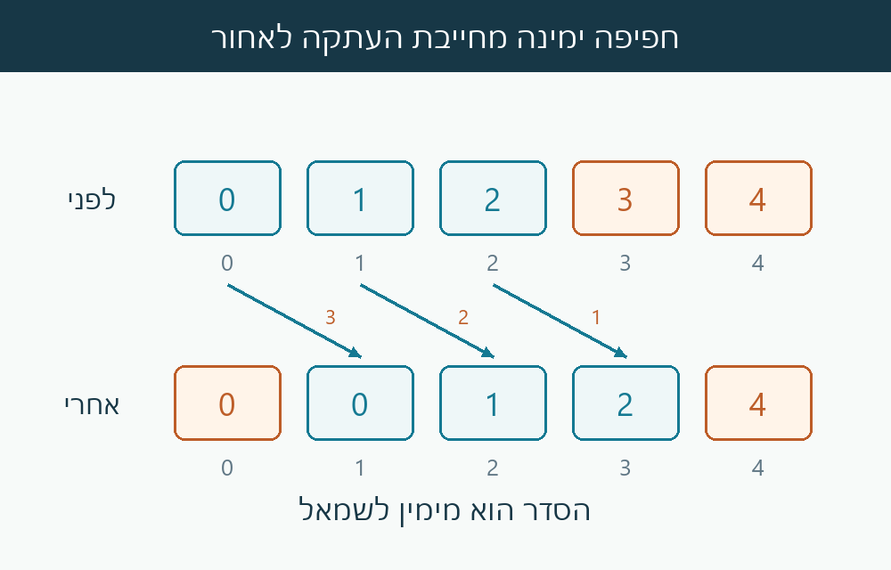
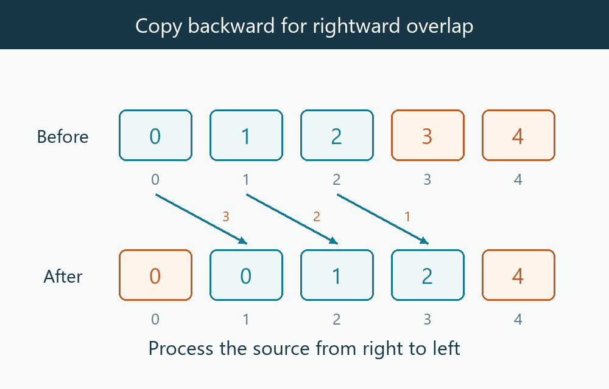

# PREP-332 — העתקה בתוך אותו מערך כשיש חפיפה

[צילום מקור פרטי](../sources/2026-11-18-batch31-05.png)

### הרחבה: העתקה בתוך אותו מערך כשיש חפיפה

ממשו `copy_within(values, source, size, target)`. העתיקו size תאים עוקבים החל מ־source אל target באותו מערך באורך קבוע. התוצאה צריכה להיות כאילו קראתם את כל ערכי המקור לפני כתיבה, גם אם הטווחים חופפים. אל תשתמשו במערך זמני, בפרוסה שמועתקת או בפונקציית העתקה מובנית. לדוגמה העתיקו מהאינדקסים 30–34 ל־200–204. הגדירו טיפול בטווחים לא חוקיים, בגודל אפס ובטווחים זהים, והסבירו את כיוון ההעתקה.

### רמזים

1. מתי כתיבה משמאל לימין תדרוס ערך שעוד לא נקרא?
2. אם היעד מתחיל בתוך המקור מימין, התחילו דווקא מהתא האחרון.
3. בדקו גבולות לפני השינוי. השתמשו בתנאי source < target < source + size כדי לבחור כיוון.

### פתרון להרחבה: העתקה בתוך אותו מערך כשיש חפיפה

אמתו מראש שהגודל אינו שלילי, שכל התחלה בין 0 לאורך המערך וששני הטווחים באורך size נכנסים למערך. כל חריגה מעלה ValueError לפני שינוי. אינדקס ששווה לאורך מותר רק בגודל אפס. גודל אפס או התחלה זהה אינם דורשים כתיבה.

כאשר היעד מתחיל בתוך טווח המקור ומימינו, עברו מההיסט הגדול לקטן. לדוגמה, העתקת [0,1,2] באינדקסים 0–2 אל 1–3 של [0,1,2,3,4] מחזירה [0,0,1,2,4]. אם מתחילים באינדקס 0, ערך ה־1 נדרס לפני שנקרא. בכיוון ההפוך כל כתיבה פוגעת רק בתא מקור בהיסט גדול יותר, שכבר נקרא, או בתא מחוץ למקור.

כאשר היעד מתחיל משמאל למקור, מעבר קדימה מבטיח שכל תא מקור שנדרס כבר נקרא. בטווחים זרים שני הכיוונים בטוחים. ההוכחה נשענת על שמירת כל ערכי המקור שטרם נקראו. הצעד הבא קורא את הערך המקורי וכותב פעם אחת ליעדו, בלי לדרוס מקור עתידי.

זמן הריצה O(size) ונדרשות O(1) מילים נוספות. בפרט אין חיפוש אחר NUL, גם אם ערך במערך הוא אפס. ב־C, אם אותם תאים הם int, יש לוודא תחילה שגודל העתקה בבתים ניתן לייצוג, ואז קריאה ל־memmove היא חלופה כשאין איסור על פונקציה מוכנה.

```python
def copy_within(values, source, size, target):
    """Copy one fixed-size slice with snapshot semantics and constant scratch."""
    length = len(values)
    if size < 0 or not 0 <= source <= length or not 0 <= target <= length:
        raise ValueError('invalid slice')
    if size > length - source or size > length - target:
        raise ValueError('slice exceeds array bounds')
    if size == 0 or target == source:
        return
    backwards = source < target < source + size
    offsets = range(size - 1, -1, -1) if backwards else range(size)
    for offset in offsets:
        values[target + offset] = values[source + offset]


def copied_array(values, source, size, target):
    """Return the JSON-visible array after the requested in-place operation."""
    copy_within(values, source, size, target)
    return values
```



טווחי מקור ויעד הם אינדקסים באותו מערך; size סופר תאים והמערך נשאר באותו אורך.

גודל אפס בקצה, העתקה לעצמו, חפיפה בשני הכיוונים, טווחים זרים ובדיקה שאין שינוי כשקלט לא חוקי.

לולאה קדימה בכל מצב משכפלת לעיתים את התא הראשון על חלק מהטווח במקום להעביר את הערכים המקוריים.

הלולאה נבדקה מול עותק פרוסה עצמאי עבור גדלים ומיקומים חוקיים באופן ממצה על מערכים קצרים, כולל דחיית קלט שגוי לפני שינוי.

העתיקו אחורה אם היעד מתחיל באמצע המקור מימין. בשאר המקרים אפשר קדימה. כך שומרים את הערכים שעוד לא נקראו.

### Follow-up: Overlap-safe copying within one array

Implement `copy_within(values, source, size, target)`. Copy size consecutive cells from source to target in the same fixed-length array. The result must match reading all original source values before writing, even when the ranges overlap. Do not allocate a temporary array, copy a slice or call a built-in copy operation. For example copy indices 30–34 to 200–204. Define behavior for out-of-bounds ranges, zero size and identical ranges, and justify the copy direction.

### Hints

1. When can a left-to-right write overwrite a source value that still needs to be read?
2. When the target starts inside the source on its right, start with the last cell.
3. Validate all bounds before mutation. Choose direction according to source < target < source + size.

### Follow-up solution: Overlap-safe copying within one array

Validate before writing. Require nonnegative size, starts between 0 and array length, and enough cells after each start. Invalid bounds raise ValueError before mutation. A start at the array length is legal only for a zero-length range. Zero size and equal starts require no writes.

If the target starts inside the source on its right, visit offsets in decreasing order. Copying indices 0–2 to 1–3 in [0,1,2,3,4] gives [0,0,1,2,4]. A forward loop overwrites 1 before it can be read. With decreasing offsets, any write overlapping a source position affects a greater offset that has already been read.

If the target begins left of the source, increasing offsets make every overwritten source cell one that has already been read. Either direction works for disjoint ranges. The invariant is that every unread source cell still contains its original value. Each step reads that original value and places it once without destroying a later read.

Time is O(size) and auxiliary storage is O(1) words. Zero in the array has no special meaning. For int cells in C, first ensure the byte count is representable; memmove is an alternative when library copying is allowed.

```python
def copy_within(values, source, size, target):
    """Copy one fixed-size slice with snapshot semantics and constant scratch."""
    length = len(values)
    if size < 0 or not 0 <= source <= length or not 0 <= target <= length:
        raise ValueError('invalid slice')
    if size > length - source or size > length - target:
        raise ValueError('slice exceeds array bounds')
    if size == 0 or target == source:
        return
    backwards = source < target < source + size
    offsets = range(size - 1, -1, -1) if backwards else range(size)
    for offset in offsets:
        values[target + offset] = values[source + offset]


def copied_array(values, source, size, target):
    """Return the JSON-visible array after the requested in-place operation."""
    copy_within(values, source, size, target)
    return values
```



Both ranges use offsets in one fixed-length array, and size counts cells.

Zero size at the end, self-copy, both overlap directions, disjoint ranges and no partial mutation on a bounds error.

An unconditional forward loop can propagate the first source item instead of preserving original source values.

The loop was compared with an independent slice snapshot on exhaustive valid slices over short arrays. Invalid ranges were checked for no mutation.

Copy backward when the target begins inside the source to its right. Otherwise forward is safe. Preserve every source value until its turn to be read.

[solutions/prep_332_copy_overlapping_slice.py](../solutions/prep_332_copy_overlapping_slice.py)

[checks/prep-332-1118-verification.json](../checks/prep-332-1118-verification.json)
