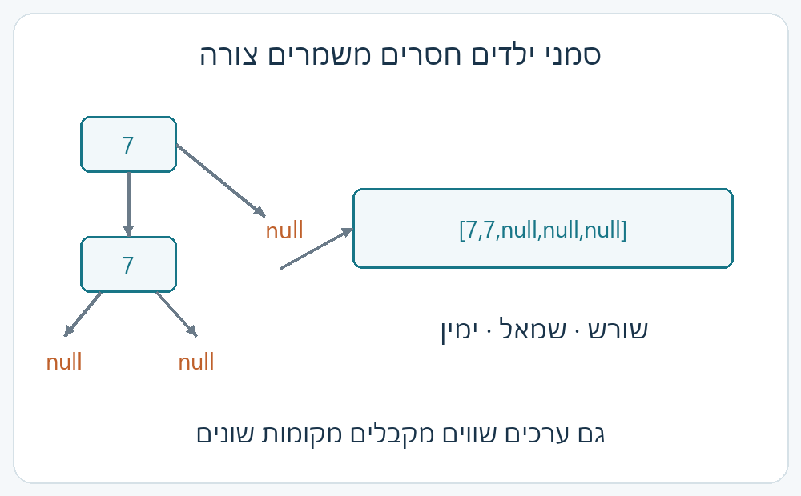
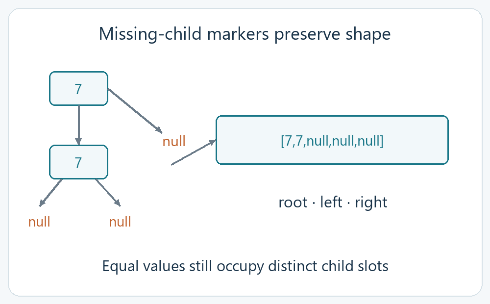

# PREP-333 — קידוד ושחזור עץ בינארי עם ערכים חוזרים

פתרון מוצע בסיוע AI. ממתין לביקורת מקצועית אנושית.

[צילום המקור](../sources/2026-11-15-batch20-08.png)

נתון עץ בינארי שאינו מאוזן ואינו ממוין, ייתכנו ערכים זהים. קודד את העץ לקובץ ופענח אותו חזרה לעץ במחשב אחר.

## קידוד ושחזור עץ בינארי עם ערכים חוזרים

קודדו עץ בינארי סופי לקובץ טקסט ופענחו אותו במחשב אחר, כך שערכי הצמתים ומקומם בעץ ישוחזרו בדיוק. אין סדר חיפוש ואין הבטחת איזון, וערכים יכולים לחזור. בחוזה שנבחר הערכים הם שלמים; null מסמן ילד חסר ואינו ערך של צומת. הגדירו פורמט חד־משמעי, תמכו בעץ ריק ודחו קובץ לא שלם או בעל נתונים עודפים. השתמשו במחסנית מפורשת כדי לתמוך גם בעץ עמוק מאוד.

### רמזים

1. האם רשימת הערכים בסריקת preorder לבדה קובעת היכן היו ילדים חסרים?
2. הוסיפו סמן לכל ילד חסר ושמרו את הסדר שורש, שמאל, ימין.
3. בפענוח החזיקו מחסנית של מיקומי ילדים שטרם מולאו. כל null סוגר מיקום, וכל ערך יוצר צומת ושני מיקומים נוספים.

### פתרון מוצע

נשמור מערך JSON של סמני preorder. לדוגמה עץ עם שורש 7, ילד שמאלי 7 וילד ימני חסר מקודד [7,7,null,null,null]. העץ הימני המקביל מקודד [7,null,7,null,null], ולכן ילדים חסרים מסירים את העמימות גם כשהערכים חוזרים. עץ ריק הוא [null]. אין להסתמך על כתובות זיכרון שעוברות למחשב אחר.

בקידוד נתחיל במחסנית המכילה את השורש. נוציא צומת, נכתוב ערך או null, ונכניס את הילד הימני ואז את השמאלי כדי שהשמאלי יעובד ראשון. בפענוח נתחיל במיקום שורש ריק. לכל token נוציא מיקום ונמלא אותו. אם נוצר צומת, נכניס את מיקומי ימין ואז שמאל. אם אין מיקום פנוי לפני סוף הקלט, יש token עודף. אם נותרו מיקומים בסוף, חסר קלט. נבדוק גם תחביר JSON וטיפוסי ערכים.

באינדוקציה, כל מיקום ילד נפתח וממולא פעם אחת, באותו סדר שבו כתב אותו המקודד. מכאן שהמבנה והערכים משוחזרים ביחידות. לעץ n צמתים יש n+1 ילדים חסרים ולכן 2n+1 סמנים. עלות העבודה Θ(n) ביחידות tokens ושטח O(n) למערך הקלט והפלט, עם מחסנית O(h) מעבר לצמתים. גודל המספרים משפיע על מספר בתי הטקסט. בדיקת round-trip אינה מסתפקת בערכים אלא משווה גם את הצורה.

```python
"""A flat preorder JSON array, with null marking each empty child."""
import json
from dataclasses import dataclass


@dataclass
class Node:
    value: int
    left: object = None
    right: object = None


def serialize(root):
    tokens, pending = [], [root]
    while pending:
        node = pending.pop()
        if node is None:
            tokens.append(None)
        else:
            if type(node.value) is not int:
                raise ValueError("Integer values required")
            tokens.append(node.value)
            pending.extend((node.right, node.left))
    return json.dumps(tokens, separators=(",", ":"))


def deserialize(text):
    tokens = json.loads(text)
    if not isinstance(tokens, list):
        raise ValueError("Token array required")
    root, slots = None, [(None, None)]
    for token in tokens:
        if not slots:
            raise ValueError("Extra token")
        parent, side = slots.pop()
        if token is not None and type(token) is not int:
            raise ValueError("Integer or null required")
        node = None if token is None else Node(token)
        if parent is None:
            root = node
        else:
            setattr(parent, side, node)
        if node is not None:
            slots.extend(((node, "right"), (node, "left")))
    if slots:
        raise ValueError("Incomplete encoding")
    return root


def tree_codec_round_trip(serialized):
    return serialize(deserialize(serialized))
```



### הנחות

הקלט הוא עץ סופי ללא מעגלים או שיתוף צמתים, וערכי הצמתים הם שלמים.

### מקרה קצה

עץ ריק, שרשרת עמוקה, שני ילדים באותו ערך, token מיותר ו־null חסר.

### טעות נפוצה

preorder בלי סמני חסר אינו מספיק. ערכים חוזרים מונעים הסתמכות כללית על התאמה לפי ערך.

### סיבוכיות או עלות

Θ(n) עבודה ו־2n+1 סמנים, לצד גודל הייצוג הטקסטואלי של הערכים.

### בדיקות

נבדקו עצים קטנים מול קידוד רקורסיבי עצמאי, ערכים כפולים, קבצים פגומים ושרשרת של 5000 צמתים.

### תשובה קצרה

אכתוב preorder עם null לכל ילד חסר ואפענח בעזרת מחסנית מיקומים.

### שאלת המשך

האם preorder ו־inorder מספיקים כשיש ערכים חוזרים? בכלליות לא, משום שזהות הערכים אינה מבדילה בין מיקומי צמתים. נדרשים מזהים או מידע מבני נוסף.

## Serialize and rebuild a binary tree with duplicate values

Encode a finite binary tree into a text file and decode it on another computer, preserving both values and shape. The tree is neither sorted nor balanced, and duplicate values are allowed. In the chosen contract node values are integers, and null marks an absent child. Define an unambiguous format, support the empty tree, and reject truncated or surplus tokens. Use explicit stacks to support very deep trees.

### Hints

1. Does a preorder sequence of values identify where missing children were?
2. Write a marker for every missing child while visiting root, left, right.
3. Decode using pending child slots. A null fills one slot; an integer creates a node and opens two child slots.

### Proposed solution

Store a JSON array of preorder tokens. A root 7 with left child 7 and absent right child becomes [7,7,null,null,null]. A root with only a right child becomes [7,null,7,null,null]. Missing-child markers distinguish these shapes even with equal values. The empty tree is [null]. Machine addresses carry no portable tree identity.

Encode by popping a node, writing its value or null, then pushing its right and left children. Decode starting with one root slot. Each token fills the next slot. A new node opens right and left slots, with left processed first. A token arriving without a free slot is surplus. Pending slots after the final token mean truncation. Validate JSON syntax and value types too.

Inductively, every child slot is opened and filled exactly once in the encoder's order, giving a unique reconstructed shape and values. A tree with n nodes has n+1 absent children, so the representation uses 2n+1 tokens. Work is Θ(n) token operations, storage O(n) for serialized data/output, and stack depth O(h) beyond the nodes. Integer text lengths also affect file bytes. The round-trip check compares structure and values.

```python
"""A flat preorder JSON array, with null marking each empty child."""
import json
from dataclasses import dataclass


@dataclass
class Node:
    value: int
    left: object = None
    right: object = None


def serialize(root):
    tokens, pending = [], [root]
    while pending:
        node = pending.pop()
        if node is None:
            tokens.append(None)
        else:
            if type(node.value) is not int:
                raise ValueError("Integer values required")
            tokens.append(node.value)
            pending.extend((node.right, node.left))
    return json.dumps(tokens, separators=(",", ":"))


def deserialize(text):
    tokens = json.loads(text)
    if not isinstance(tokens, list):
        raise ValueError("Token array required")
    root, slots = None, [(None, None)]
    for token in tokens:
        if not slots:
            raise ValueError("Extra token")
        parent, side = slots.pop()
        if token is not None and type(token) is not int:
            raise ValueError("Integer or null required")
        node = None if token is None else Node(token)
        if parent is None:
            root = node
        else:
            setattr(parent, side, node)
        if node is not None:
            slots.extend(((node, "right"), (node, "left")))
    if slots:
        raise ValueError("Incomplete encoding")
    return root


def tree_codec_round_trip(serialized):
    return serialize(deserialize(serialized))
```



### Assumptions

A finite tree with no cycles or shared nodes and integer-valued nodes.

### Edge case

Empty tree, a deep chain, equal child values, extra tokens and a missing null.

### Common mistake

Preorder values without empty markers lose structure. Duplicate values prevent general value-based reconstruction.

### Cost

Θ(n) token work, 2n+1 tokens, plus the textual size of integer values.

### Verification

Small trees were compared with an independent recursive codec. Checks include duplicates, malformed encodings and a 5000-node chain.

### Interview answer

Use preorder plus null child markers, then fill child slots from an explicit stack.

### Follow-up

Do preorder and inorder uniquely identify trees with duplicates? Not generally. Equal values fail to distinguish node positions; add identities or structural information.

[checks/check_nov15_software.py](../checks/check_nov15_software.py)

[checks/prep-333-1115-verification.json](../checks/prep-333-1115-verification.json)

[solutions/prep_333_tree_codec.py](../solutions/prep_333_tree_codec.py)
