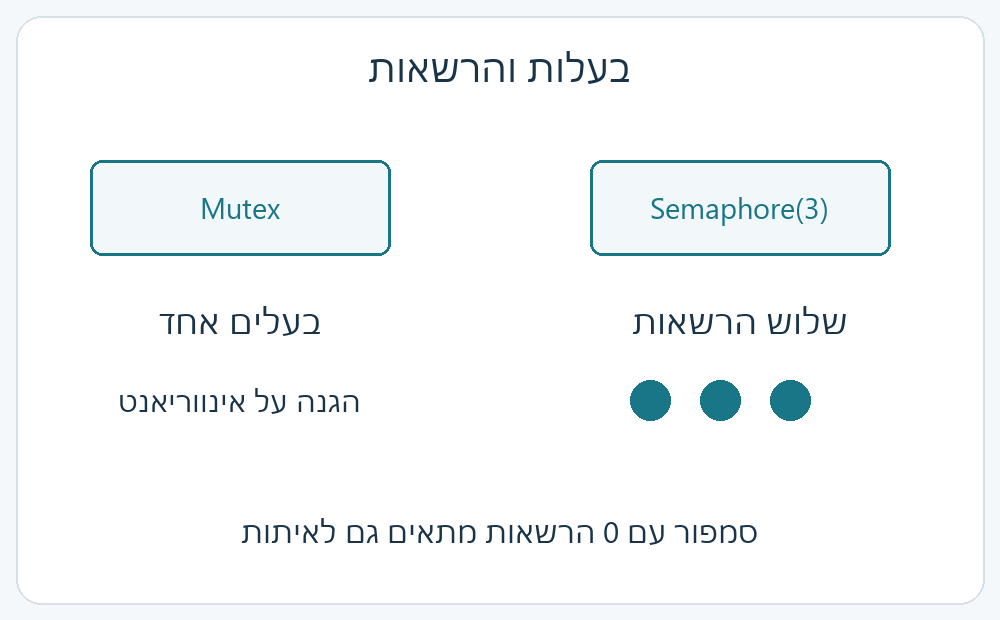
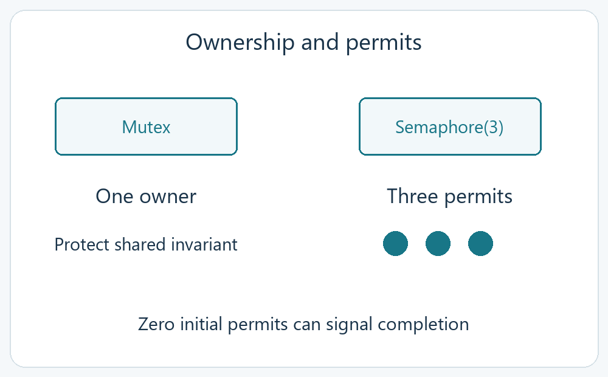

# PREP-334 — Mutex לעומת סמפור סופר

פתרון מוצע בסיוע AI. ממתין לביקורת מקצועית אנושית.

[צילום המקור](../sources/2026-11-15-batch20-09.png)

מה ההבדל בין סמפור ל־mutex?

## Mutex לעומת סמפור סופר

השוו mutex וסמפור סופר בתוכנית מרובת חוטים. הסבירו בעלות, מצב, המתנה ושחרור, ותנו דוגמה להגנה על משתנה משותף, להגבלת גישה למאגר של שלושה משאבים ולאיתות על השלמת עבודה. השוו גם mutex לסמפור בינארי, וציינו מה אפשר להסיק לגבי fairness ו־deadlock.

### רמזים

1. איזה מנגנון מתאר בעלות בלעדית ואיזה מתאר מלאי הרשאות?
2. המתנה בסמפור צורכת הרשאה, ופרסום מוסיף הרשאה. לנעילת mutex יש בעלים.
3. התאימו mutex לאזור קריטי, סמפור מאותחל ל־3 למאגר וסמפור מאותחל ל־0 לאיתות.

### פתרון מוצע

Mutex נותן בעלות על אזור קריטי לחוט אחד. החוט שנעל משחרר לפי חוזה הממשק, ונעילה מגינה על האינווריאנט של המידע המשותף. לדוגמה הפעולה counter++ מורכבת מקריאה, שינוי וכתיבה, ולכן שני חוטים צריכים לבצע אותה תחת אותו mutex או להשתמש באטומיות מתאימה. יש לאתחל את הנעילה לפני שימוש ולהרוס רק אחרי שכל המשתמשים סיימו.

סמפור סופר מחזיק מספר הרשאות לא־שלילי. wait/acquire מחכה להרשאה ומפחית את המספר באופן אטומי; post/release מוסיף הרשאה ועשוי להעיר ממתין. אתחול ל־3 מתאים לשלושה משאבים זהים. כל חוט שקיבל משאב מחזיר הרשאה בסיום גם במסלול כשל. אתחול ל־0 מתאים לאירוע שבו חוט יצרן מפרסם והצרכן ממתין. בדרך כלל אין בעלות של חוט על הסמפור עצמו, ולכן חוט אחר יכול לפרסם.

סמפור בינארי מגביל את מספר ההרשאות ל־0 או 1 ויכול לשמש להדרה בתכנון נכון, אך חוזה הבעלות של mutex, בדיקות שחרור ולעיתים מנגנוני ירושה של עדיפות תלויים בפרימיטיב ובמערכת. FIFO ו־fairness אינם מובטחים רק מהשם. שני המנגנונים יכולים להיתקע עם סדר נעילות סותר או הרשאה שלא הוחזרה. הקוד המצורף מדגים mutex של C11, ותיאור הסמפור הוא חוזה רעיוני הניתן למימוש בממשק של המערכת.

```c
/* C11 threads. A counting semaphore is described separately in the solution. */
#include <threads.h>

static mtx_t lock;
static unsigned counter;

int increment_counter(void *unused) {
    (void)unused;
    if (mtx_lock(&lock) != thrd_success) return -1;
    ++counter;
    if (mtx_unlock(&lock) != thrd_success) return -1;
    return 0;
}

int mutex_demo(void) {
    thrd_t worker;
    if (mtx_init(&lock, mtx_plain) != thrd_success) return -1;
    counter = 0;
    if (thrd_create(&worker, increment_counter, NULL) != thrd_success) {
        mtx_destroy(&lock);
        return -1;
    }
    int result;
    int status = thrd_join(worker, &result);
    if (status != thrd_success) return -1;
    mtx_destroy(&lock);
    return status == thrd_success && result == 0 && counter == 1 ? 0 : -1;
}
```



### הנחות

כל פעולות הפרימיטיב אטומיות לפי ה־API, והנעילה והמשאבים מאותחלים לפני הפעלת החוטים.

### מקרה קצה

פרסום לפני wait יכול להישמר כהרשאה בסמפור. אין לקרוא destroy בזמן שחוטים ממתינים.

### טעות נפוצה

סמפור מאותחל ל־1 אינו יוצר אוטומטית את כללי הבעלות של mutex. sleep אינו פרימיטיב סנכרון.

### סיבוכיות או עלות

זהו ניתוח סמנטי. תזמון, fairness ועלות context switch תלויים בפלטפורמה.

### בדיקות

נבדק מודל הרשאות קטן עבור מכסה ואיתות. קוד mutex נכתב לפי ממשק threads.h של C11 ונבדק בקריאה; סביבת C המקומית אינה מספקת threads.h.

### תשובה קצרה

Mutex מייצג בעלות בלעדית על אזור קריטי; סמפור מייצג הרשאות ולפיכך מתאים גם למכסה ולאיתות.

### שאלת המשך

איך תימנעו מ־deadlock בין שני mutex? קבעו סדר גלובלי לרכישתם או רכשו קבוצת נעילות באמצעות מנגנון מתאים. שחררו בכל מסלול.

## Mutex compared with a counting semaphore

Compare a mutex and a counting semaphore in a multithreaded program. Explain ownership, state, waiting and release. Give examples protecting shared data, limiting access to a pool of three resources, and signaling completion. Also compare a mutex with a binary semaphore and discuss fairness and deadlock.

### Hints

1. Which primitive represents exclusive ownership, and which represents a stock of permits?
2. Semaphore acquisition consumes a permit and release adds one. A mutex lock has an owner.
3. Use a mutex for a critical section, a semaphore initialized to three for a pool, and one initialized to zero for signaling.

### Proposed solution

A mutex gives one thread ownership of a critical section. The acquiring thread releases according to the interface contract. Protect every access relevant to the shared invariant with the same lock. For example counter++ performs read/modify/write and requires synchronization. Initialize a lock before use and destroy it after all users finish.

A counting semaphore maintains nonnegative permits. Atomic wait/acquire waits for and consumes one permit; post/release adds one and may wake a waiter. Three initial permits model a pool of three identical resources. Return the permit on completion and on error paths. Zero initial permits model a producer posting completion for a waiting consumer. Semaphores usually lack thread ownership, so another thread can post.

A binary semaphore bounds the count to zero or one and can provide exclusion in a correct design. Mutex ownership checks and platform features such as priority inheritance follow the particular primitive and API. Neither FIFO ordering nor fairness follows from the primitive's name. Conflicting acquisition order or leaked permits can deadlock either design. The attached C11 source demonstrates a mutex; the semaphore discussion specifies the conceptual contract for a platform API.

```c
/* C11 threads. A counting semaphore is described separately in the solution. */
#include <threads.h>

static mtx_t lock;
static unsigned counter;

int increment_counter(void *unused) {
    (void)unused;
    if (mtx_lock(&lock) != thrd_success) return -1;
    ++counter;
    if (mtx_unlock(&lock) != thrd_success) return -1;
    return 0;
}

int mutex_demo(void) {
    thrd_t worker;
    if (mtx_init(&lock, mtx_plain) != thrd_success) return -1;
    counter = 0;
    if (thrd_create(&worker, increment_counter, NULL) != thrd_success) {
        mtx_destroy(&lock);
        return -1;
    }
    int result;
    int status = thrd_join(worker, &result);
    if (status != thrd_success) return -1;
    mtx_destroy(&lock);
    return status == thrd_success && result == 0 && counter == 1 ? 0 : -1;
}
```



### Assumptions

Primitive operations are atomic under their API, and initialization occurs before workers start.

### Edge case

A post before wait can remain as a stored permit. Do not destroy a primitive while threads are waiting.

### Common mistake

A semaphore initialized to one does not automatically implement mutex ownership rules. Sleeping supplies no synchronization guarantee.

### Cost

A semantic comparison. Scheduling, fairness and context-switch cost depend on the platform.

### Verification

Small permit-state models cover quotas/signaling. The C11 threads.h listing was reviewed as source; the local C toolchain does not provide threads.h.

### Interview answer

A mutex expresses exclusive ownership; a semaphore expresses permits for quotas and signaling.

### Follow-up

How can two-mutex deadlock be prevented? Use a global acquisition order or a suitable multi-lock acquisition mechanism, and release on every path.

[checks/check_nov15_software.py](../checks/check_nov15_software.py)

[checks/prep-334-1115-verification.json](../checks/prep-334-1115-verification.json)

[solutions/prep_334_mutex_semaphore.c](../solutions/prep_334_mutex_semaphore.c)
