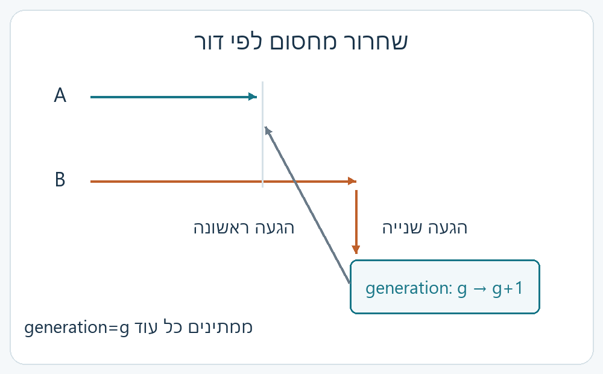
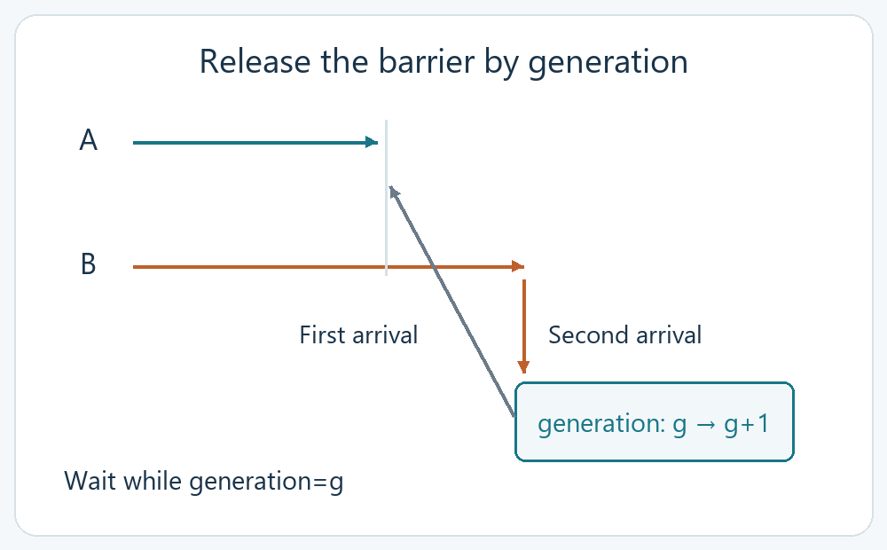

# PREP-337 — מחסום רב־פעמי לשני חוטים ללא חוט נוסף

פתרון מוצע בסיוע AI. ממתין לביקורת מקצועית אנושית.

[צילום המקור](../sources/2026-11-15-batch20-16.png)

שני חוטים רצים במקביל בלולאות זהות. בכל סיבוב חייבים להמתין בנקודה מסוימת עד ששניהם הגיעו, ואז להמשיך. אסור להשתמש בחוט נוסף.

## מחסום רב־פעמי לשני חוטים ללא חוט נוסף

שני חוטי עבודה מבצעים לולאות זהות. בסוף כל סיבוב מגיע כל אחד לנקודת מחסום, ואף אחד אינו רשאי להמשיך מעבר למחסום עד ששניהם הגיעו באותו סבב. ממשו מחסום רב־פעמי ללא חוט שלישי. מותר להשתמש ב־mutex ובמשתנה תנאי. שניהם קוראים wait פעם אחת בסבב ואין ביטול או קריסת עובד בחוזה הראשי. תמכו גם בכך שאחד מגיע מהר מאוד למחסום הבא. הסבירו מדוע צריך לבדוק את תנאי ההמתנה בלולאה.

### רמזים

1. איזה מידע צריך לתאר את ההגעה בסבב הנוכחי וגם להפריד בינו לסבב הבא?
2. מונה הגעות מוגן ב־mutex סופר עד שתיים. מספר דור משתנה כאשר השני מגיע.
3. שמרו את הדור בכניסה. הראשון ממתין כל עוד הדור לא השתנה; השני מאפס את המונה, מקדם דור ומעיר.

### פתרון מוצע

נחזיק arrived ו־generation תחת אותו mutex. חוט שיגיע שומר את generation ומגדיל arrived. הראשון קורא condition.wait בלולאה כל עוד הדור השמור שווה לדור הנוכחי. פעולת wait משחררת את המנעול באופן אטומי עם ההמתנה ורוכשת אותו שוב לפני החזרה. השני מאפס arrived, מגדיל generation ומבצע notify_all. העובדה שהדור השתנה היא אישור ששתי הגעות אותו סבב התרחשו.

הדור מונע ערבוב סבבים. אם השני כבר הגיע למחסום הבא לפני שהראשון התעורר, הוא מגדיל את מונה הדור הבא וממתין. הראשון מזהה שהדור הקודם השתחרר ויוצא; כשיגיע שוב יוכל לשחרר את הסבב החדש. לולאת while נדרשת גם עקב spurious wakeups. הודעה לבדה אינה תנאי, ו־if עלולה לשחרר עובד ללא שתי הגעות.

בטיחות נובעת מכך שדור מתקדם רק במעבר arrived מ־1 ל־2, עם גישה סריאלית תחת המנעול. חיות מניחה ששני העובדים מגיעים בסופו של דבר ושמתזמן הוגן במידה מספקת; אם עובד נתקע לפני המחסום, האחר יחכה. אין צורך בחוט תיאום. בפלטפורמה שתומכת בכך אפשר להשתמש ב־barrier ספרייתי של שתי משתתפים. מודל זה אינו מכתיב סדר בין הפעולות שאחרי השחרור לבין קידומת הסבב הבא, מעבר לגבול שהמחסום מבטיח.

```python
"""Both workers call wait once at the same checkpoint in every loop."""
import threading


class TwoThreadBarrier:
    def __init__(self):
        self.condition = threading.Condition()
        self.arrived = 0
        self.generation = 0

    def wait(self):
        with self.condition:
            generation = self.generation
            self.arrived += 1
            if self.arrived == 2:
                self.arrived = 0
                self.generation += 1
                self.condition.notify_all()
            else:
                while generation == self.generation:
                    self.condition.wait()
```



### הנחות

בדיוק שני עובדים, קריאה אחת בכל סבב, וסנכרון זיכרון לפי חוזה mutex/condition.

### מקרה קצה

עובד מהיר, השכמה מדומה, הרבה סבבים, ושני עובדים שמגיעים כמעט יחד.

### טעות נפוצה

sleep אינו מוכיח ששני החוטים הגיעו. איפוס דגל רגיל ללא דור עלול לאבד שחרור או לערבב סבבים.

### סיבוכיות או עלות

O(1) מצב משותף. עבודת הניהול לכל הגעה קבועה; זמן ההמתנה תלוי בעובד השני ובמתזמן.

### בדיקות

בדיקת שני חוטים עם עיכובים שונים אימתה שאף עובד אינו יוצא מסבב לפני ששתי הגעותיו נרשמו. נבדקו גם דורות רבים.

### תשובה קצרה

אשתמש במונה הגעות ובמספר דור תחת Condition. השני מקדם דור, והראשון ממתין כל עוד דורו לא השתנה.

### שאלת המשך

מה צריך לקרות אם עובד מתבטל לפני המחסום? הוסיפו מצב broken ושגיאה לכל הממתינים או timeout מוגדר. זו הרחבת חוזה ויש להגדיר מדיניות לכל הסבבים.

## A reusable two-thread barrier without a coordinator

Two workers run identical loops. At each round's checkpoint neither may pass until both have arrived in that same round. Implement a reusable barrier without a third thread. A mutex and condition variable are allowed. Each worker calls wait once per round; cancellation and crashes are outside the primary contract. Support a fast worker reaching the next round while its partner is still waking, and explain predicate-loop waiting.

### Hints

1. What state distinguishes arrivals within a round from arrivals in the next round?
2. Protect an arrival count with one mutex and advance a generation when the second worker arrives.
3. Save the entering generation. The first waits while it is unchanged; the second resets the count, advances the generation and notifies.

### Proposed solution

Protect arrived and generation with the same mutex. A worker saves generation and increments arrived. The first waits in a while loop while its saved generation remains current. condition.wait atomically releases the mutex as it waits and reacquires it before returning. The second resets arrived, advances generation and calls notify_all. A changed generation proves both arrivals in that round occurred.

The generation separates rounds. If the second worker reaches the next barrier before the first wakes, it registers an arrival for the new generation and waits. The first sees its earlier generation was released, exits, and can later register the matching next-round arrival. A while predicate is also needed for spurious wakeups. Notification itself is not the state condition; a single if can release a worker without two arrivals.

Safety follows because the generation advances only on the second arrival, with serialized access under the mutex. Liveness assumes both workers eventually arrive and scheduling permits progress. If a worker stalls before the barrier, its partner waits. No coordinator thread is needed. A library barrier configured for two participants is another valid implementation. The barrier does not order all actions after release against every action in the next round beyond its stated checkpoint guarantee.

```python
"""Both workers call wait once at the same checkpoint in every loop."""
import threading


class TwoThreadBarrier:
    def __init__(self):
        self.condition = threading.Condition()
        self.arrived = 0
        self.generation = 0

    def wait(self):
        with self.condition:
            generation = self.generation
            self.arrived += 1
            if self.arrived == 2:
                self.arrived = 0
                self.generation += 1
                self.condition.notify_all()
            else:
                while generation == self.generation:
                    self.condition.wait()
```



### Assumptions

Exactly two workers, one wait per round, with mutex/condition memory-synchronization semantics.

### Edge case

A fast worker, spurious wakeups, many rounds and nearly simultaneous arrivals.

### Common mistake

Sleep does not prove arrivals. Resetting an unversioned flag can lose releases or mix rounds.

### Cost

O(1) shared state and constant bookkeeping per arrival. Wait duration depends on the peer and scheduler.

### Verification

Two workers with differing delays verified no exit before both arrivals in its round, over many generations.

### Interview answer

Use an arrival count and generation under a Condition. The second arrival advances the generation and the first waits while its generation is unchanged.

### Follow-up

How should worker cancellation be handled? Add a broken state and an error for all waiters, or a defined timeout policy covering subsequent rounds.

[checks/check_nov15_software.py](../checks/check_nov15_software.py)

[checks/prep-337-1115-verification.json](../checks/prep-337-1115-verification.json)

[solutions/prep_337_two_thread_reusable_barrier.py](../solutions/prep_337_two_thread_reusable_barrier.py)
