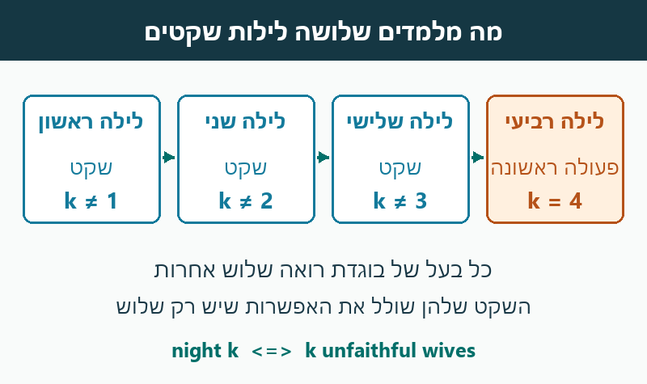
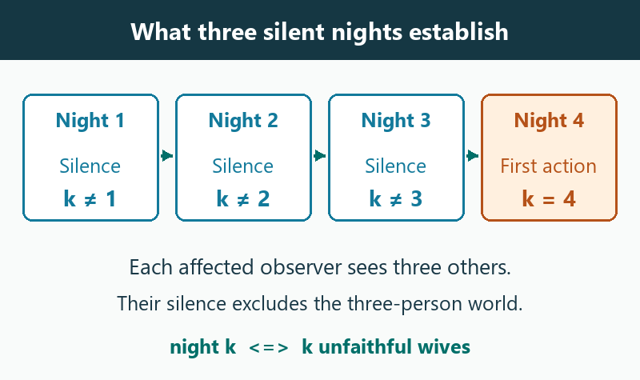

# PREP-343 — נשים בוגדות והמידע שבשלושה לילות שקטים

פתרון מוצע בסיוע AI. ממתין לביקורת מקצועית אנושית.

[צילום המקור](../sources/2026-11-15-batch20-13.png)

יום אחד התגלגלה שמועה לאוזנו של ראש שבט אינדיאני קטן, שיש מספר נשים בוגדות. ראש הכפר כינס את כל הגברים וסיפר להם על כך, והוסיף שכל אחד מהגברים יודע מי כל הנשים הבוגדות מלבד אשתו. ראש השבט קבע שכל מי שמגלה שאשתו בוגדת בו חייב להרוג אותה עם כדור בראש ב־12 בלילה בדיוק. בלילה הראשון לא קרה כלום – רק בלילה הרביעי נשמעו יריות. מיותר לציין שכל האינדיאנים חכמים ביותר. כמה נשים בוגדות היו בכפר?

## נשים בוגדות והמידע שבשלושה לילות שקטים

בכפר יש זוגות נשואים ומספר נשים שבוגדות בבעליהן. כל בעל יודע בדיוק מי מהנשים האחרות בוגדת, אך אינו יודע אם אשתו בוגדת. כולם פועלים בהיגיון מושלם, וכולם יודעים שכך פועלים גם האחרים, בכל רמת ידיעה. ראש הכפר מודיע לכולם יחד שלפחות אישה אחת בוגדת. מהלילה הבא כל בעל שמסיק בוודאות שאשתו בוגדת חייב לפעול בחצות. ההחלטות בכל לילה מתקבלות בו־זמנית, וכולם שומעים אם הייתה פעולה. בלילות הראשון, השני והשלישי לא קרה דבר. הפעולות הראשונות נשמעו בחצות הלילה הרביעי. כמה נשים בוגדות יש בכפר? הסבירו מה מוסיפה ההודעה גם כשכולם כבר ראו נשים בוגדות.

### רמזים

1. נסו קודם כפר שבו אישה בוגדת אחת בלבד. מה יודע בעלה מיד אחרי ההודעה?
2. אם יש שתי נשים בוגדות, מה היה כל אחד משני בעליהן מסיק מכך שלא קרה דבר בלילה הראשון?
3. הוכיחו באינדוקציה שעם k נשים בוגדות ההמתנה נמשכת עד הלילה ה־k. כל לילה שקט שולל את מספר הנשים הבא.

### פתרון מוצע

### מקרה הבסיס

אם יש אישה בוגדת אחת, בעלה אינו רואה אף אישה בוגדת אחרת. ההודעה שלפחות אחת בוגדת מאלצת אותו להסיק שזו אשתו. לכן הוא פועל בלילה הראשון. בעל שאשתו נאמנה רואה אישה בוגדת אחת ולכן אינו יכול להסיק שאשתו בוגדת.

### איך השקט מצטבר

אם יש שתי נשים בוגדות, כל אחד מבעליהן רואה אחת. הוא שוקל אפשרות שזו הבוגדת היחידה, ואז בעלה היה פועל בלילה הראשון. כשאין פעולה, האפשרות הזו נשללת. שניהם מסיקים שאשתם היא הבוגדת הנוספת ופועלים בלילה השני.

באופן כללי, נניח שבמצב של k−1 נשים בוגדות הפעולה הראשונה מתרחשת בלילה ה־k−1. כשיש k, כל בעל של אישה בוגדת רואה k−1 אחרות. אילו אשתו הייתה נאמנה, זה היה בדיוק המצב של k−1, ולכן היה חייב לשמוע פעולה עד אותו לילה. השקט בלילה ה־k−1 שולל זאת, ולכן כל k הבעלים הללו פועלים בלילה ה־k. עד אז אינם בטוחים. בעל של אישה נאמנה רואה k בוגדות, והאירוע בלילה ה־k תואם בדיוק למקרה שבו אשתו נאמנה, ולכן אינו מצטרף.

מכאן שהפעולות הראשונות בלילה הרביעי מעידות על **ארבע נשים בוגדות**. שלושת הלילות השקטים הם מידע ציבורי ששולל ברצף את המקרים של אחת, שתיים ושלוש.

### למה ההודעה משנה

ראייה פרטית של אישה בוגדת אינה מבטיחה את כל שרשרת הידיעות על מה שאחרים יודעים. ההכרזה המשותפת יוצרת ידיעה משותפת שלפחות אחת קיימת. גם אם בהתרחשות בפועל כולם ראו כמה נשים, בהשערות המקוננות שלהם מופיע מקרה הבסיס, שבו ההודעה חיונית. בלי ההכרזה הציבורית או בלי כללי הפעולה וההיגיון המוסכמים אין הצדקה להסיק את המספר מן הלילה בלבד.

### assumptions

[
  "לפחות אישה אחת בוגדת; המידע על האחרות נכון ומלא.",
  "ההודעה, ההיגיון המושלם, חצות וכללי הפעולה הם ידיעה משותפת. אין תקשורת נוספת ואין עיכוב מכוון אחרי הסקה ודאית."
]

### optimality

"ההוכחה היא אינדוקציה במספר הנשים הבוגדות. מספר הלילה מזהה את המספר בדיוק במסגרת המודל."

### verification

[
  "מודל ידיעה סופי בודק את כל 63 המצבים הלא־ריקים של שישה זוגות, ומעדכן את קבוצת המצבים האפשריים לאחר כל לילה שקט."
]

### edge_cases

[
  "בוגדת אחת מובילה לפעולה בלילה הראשון. כפר ללא בוגדות סותר את ההכרזה.",
  "אם אנשים יכולים לפעול באיחור, שתיקה אינה ראיה מספקת והמספר אינו נקבע כך."
]

### common_mistakes

[
  "לחשוב שההכרזה מיותרת משום שכולם רואים לפחות בוגדת אחת.",
  "להסיק שכמות היריות היא מספר הלילה בלי להסביר את האינדוקציה ואת הסימולטניות."
]

### interview_answer

"ארבע. עם k בוגדות כל אחד מבעליהן מחכה לשלול את האפשרות שיש רק k−1; השקט בלילה ה־k−1 גורם לכולם להסיק בו־זמנית ולפעול בלילה ה־k."

### solution_extensions

[
  {
    "question": "מה יקרה אם מודיעים בפומבי שיש לפחות m בוגדות, ובפועל יש k≥m?",
    "answer_direction": "מקרה הבסיס הוא k=m, ולכן הפעולה הראשונה תהיה בלילה k−m+1.",
    "principle": "מיקום מקרה הבסיס באינדוקציה של ידיעה משותפת"
  }
]

### source_ambiguities

[
  "המקור משתמש ביריות לתיאור הפעולות. החידה כאן מגדירה במפורש שלושה לילות שקטים, הכרזה ציבורית והחלטות סימולטניות כדי לאפשר הוכחת ידיעה."
]

## Unfaithful spouses and three silent nights

A village contains married couples and an unknown positive number of unfaithful wives. Every husband knows exactly which other wives are unfaithful, but has no direct information about his own wife. Everyone reasons perfectly, and this is known at every level of knowledge. The chief publicly announces to everyone together that at least one wife is unfaithful. Starting the next night, a husband who has deduced with certainty that his wife is unfaithful must act at midnight. Decisions within a night are simultaneous, and everyone hears whether any action occurred. Nights one, two and three are silent. The first actions occur at midnight on night four. How many unfaithful wives are there? Explain what the public announcement adds even when everyone already sees unfaithful wives.

### Hints

1. Start with exactly one unfaithful wife. What does her husband learn immediately from the announcement?
2. With exactly two, what would each affected husband infer from silence on the first night?
3. Prove inductively that k unfaithful wives cause the first action on night k. Each silent night excludes another smaller count.

### Proposed solution

### Base case

With one unfaithful wife, her husband sees none among the others. The public statement that at least one exists forces him to identify his own wife, so he acts on night one. A husband with a faithful wife sees one unfaithful wife and cannot infer that his own wife is also unfaithful.

### Accumulating public silence

With two unfaithful wives, each affected husband sees one. He considers a world in which that is the only unfaithful wife; her husband would then act on night one. Silence excludes that world. Both infer that their own wife is the additional unfaithful wife and act on night two.

For induction, suppose k−1 unfaithful wives cause the first action on night k−1. With k, every affected husband sees k−1 others. If his wife were faithful, this would be precisely the k−1 case, so he would hear an action by that night. Silence on night k−1 excludes this possibility. All k affected husbands therefore act simultaneously on night k. Before then they remain uncertain. A husband whose wife is faithful sees k unfaithful wives; the action on night k agrees with that possibility and gives him no reason to act.

The first actions on night four therefore imply **four unfaithful wives**. The three silent nights publicly exclude counts of one, two and three in succession.

### Why announce an apparently familiar fact?

Seeing another unfaithful wife privately does not supply every level of knowledge about what others know. The shared announcement makes the existence of at least one unfaithful wife common knowledge. Even if everyone in the actual world sees several, the nested hypothetical worlds reach the base case where that announcement matters. Without the public announcement or the shared reasoning and action rules, the first night alone does not establish the count.

### assumptions

[
  "There is at least one unfaithful wife, and information about all other wives is accurate and complete.",
  "Perfect reasoning, simultaneous midnights, the public announcement and the rule to act immediately after certain deduction are common knowledge. There is no other communication."
]

### optimality

"An induction on the number of unfaithful wives proves that the first action night identifies that count under this model."

### verification

[
  "A finite epistemic model checks all 63 nonempty worlds of six couples, updating possible worlds after each silent night."
]

### edge_cases

[
  "One unfaithful wife causes action on night one. Zero contradicts the announcement.",
  "If people may delay an action arbitrarily, silence no longer justifies the deduction."
]

### common_mistakes

[
  "Treating the announcement as redundant just because everyone sees at least one unfaithful wife.",
  "Equating the night number with the count without proving the induction and simultaneous decisions."
]

### interview_answer

"Four. With k unfaithful wives, each affected husband must exclude a world with only k−1; silence on night k−1 lets all of them deduce the answer and act on night k."

### solution_extensions

[
  {
    "question": "What if the public announcement guarantees at least m unfaithful wives and there are actually k≥m?",
    "answer_direction": "The base case moves to k=m, so the first action occurs on night k−m+1.",
    "principle": "Changing the induction base for common knowledge"
  }
]

### source_ambiguities

[
  "The source describes the actions as shots. This edition explicitly states three silent nights, a public announcement and simultaneous decisions so that the knowledge argument is well defined."
]

[בדיקות](../checks/check_nov15_reasoning.py)

[תוצאות](../checks/batch1115-reasoning-verification.json)
