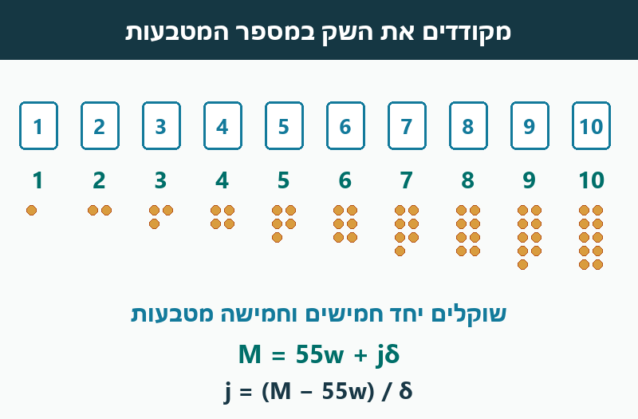
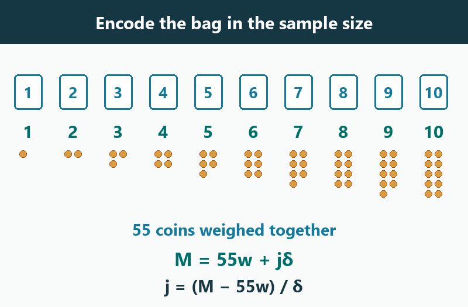

# PREP-344 — עשרה שקים ושקילה אחת שמזהה את השק החריג

פתרון מוצע בסיוע AI. ממתין לביקורת מקצועית אנושית.

[צילום המקור](../sources/2026-11-15-batch20-15.png)

יש 10 שקים עם 10 מטבעות בכל שק, כאשר ב־9 מהשקים כל המטבעות זהים במשקל ידוע ובשק אחד יש 10 מטבעות במשקל שונה, ידוע גם הוא. לא ניתן לזהות את השק השונה לפי מראה חיצוני אלא רק לפי שקילה. לרשותך שקילה אחת בלבד, עליך למצוא איזה שק הוא השונה.

## עשרה שקים ושקילה אחת שמזהה את השק החריג

יש עשרה שקים ובכל שק עשרה מטבעות. בתשעה שקים כל מטבע שוקל w גרם, ובשק אחד כל מטבע שוקל w+δ גרם. הערכים w ו־δ ידועים, δ≠0 וכל המשקלים חיוביים. אין הבדל חיצוני בין המטבעות. לרשותכם משקל דיגיטלי מדויק המפיק קריאת מסה אחת; מותר לשקול יחד מטבעות מכמה שקים. איך תזהו את השק החריג בשקילה אחת? התייחסו גם למקרה שהמטבעות החריגים קלים יותר.

### רמזים

1. אם תבחרו אותו מספר מטבעות מכל שק, האם הקריאה תוכל לגלות מאיזה שק הגיעה הסטייה?
2. תנו לכל שק תרומה שונה לסטייה הכוללת.
3. קחו i מטבעות משק מספר i. השוו את המסה שנמדדה למסה שהייתה מתקבלת אילו כל המטבעות היו רגילים.

### פתרון מוצע

מספרו את השקים מ־1 עד 10. קחו מטבע אחד משק 1, שניים משק 2, וכן הלאה עד עשרה משק 10, ושקלו את כולם יחד. נלקחו בסך הכול 1+2+⋯+10=55 מטבעות.

אילו כולם שקלו w, המסה הייתה 55w. אם השק החריג הוא j, בדיוק j מהמטבעות שנשקלו שונים מהמשקל הרגיל, ולכן הקריאה M מקיימת M=55w+jδ. מכאן

`j=(M−55w)/δ`

הקריאה מזהה מספר שלם יחיד בין 1 ל־10 כי δ ידוע ושונה מאפס. לדוגמה, אם w=10 גרם ו־δ=−1 גרם, קריאה של 543 גרם נותנת j=(543−550)/(−1)=7. מטבעות קלים יותר נותנים סטייה שלילית, שגם אותה הנוסחה מפענחת.

הנכונות נובעת מכך שמספר המטבעות מכל שק הוא מקדם ייחודי של אותה סטיית משקל ידועה. יש עשרה ערכי מסה אפשריים שונים, אחד לכל שק. בשקילה אפס אין תצפית שמבחינה בין השקים, ולכן שקילה אחת היא הכמות המזערית במודל. 55 אינו מספר המטבעות המזערי. אפשר להשתמש גם במקדמים 0 עד 9, לקחת בסך הכול 45 מטבעות ולזהות את שק 1 אם אין סטייה מן הבסיס.

### assumptions

[
  "בדיוק שק אחד חריג, וכל עשרת מטבעותיו בעלי אותה סטיית משקל ידועה δ.",
  "הכלי הוא משקל דיגיטלי מדויק בעל קיבולת מספקת. מאפסים את משקל המכל. δ יכול להיות שלילי כל עוד w+δ>0."
]

### optimality

"שקילה אחת הכרחית ומספיקה. הכנת הדגימה דורשת 55 מטבעות לפי הבחירה 1–10; בחירה 0–9 מצמצמת ל־45."

### verification

[
  "חישוב מדויק בודק כל אחד מעשרת השקים עבור סטיות חיוביות ושליליות שונות, וגם את גרסת 0–9."
]

### edge_cases

[
  "אם δ=0 אי אפשר לזהות חריגה במשקל.",
  "עם שגיאת מדידה בעלת חסם ε, מרווח של |δ| בין קריאות סמוכות מספיק לפענוח חד־ערכי רק אם ε<|δ|/2.",
  "אם גם גודל הסטייה אינו ידוע, הקריאה לבדה עלולה להתאים ליותר משק אחד."
]

### common_mistakes

[
  "לקחת אותו מספר מטבעות מכל שק ולצפות לזהות את המקור.",
  "להשתמש במאזני כפות שמחזירים רק קל/שווה/כבד כאילו הם מחזירים מסה.",
  "להשמיט את סימן δ כשמטבעות השק החריג קלים יותר."
]

### interview_answer

"אקח i מטבעות משק i ואשקול 55 מטבעות יחד. אפחית 55w ואחלק בסטיית המטבע הידועה δ. המנה היא מספר השק החריג."

### solution_extensions

[
  {
    "question": "איך משתמשים במספר המטבעות הקטן ביותר בשקילה אחת, כשהבחירה מכל שק קבועה מראש?",
    "answer_direction": "בחרו עשרה מקדמים שלמים לא־שליליים שונים, 0 עד 9. סכומם 45, וזה המינימום לעשרה מקדמים כאלה. שק 1 מיוצג בקריאת הבסיס.",
    "principle": "קידוד חד־חד־ערכי ומזעור סכום המקדמים"
  }
]

### source_ambiguities

[
  "המקור אינו מציין את סוג כלי השקילה. נבחר משקל דיגיטלי שמחזיר מסה מדויקת, והפער הידוע בין המשקלים מסומן δ."
]

## Ten coin bags and one informative weighing

Ten bags contain ten coins each. In nine bags every coin weighs w grams. In exactly one bag every coin weighs w+δ grams. Both w and δ are known, δ≠0, and all masses are positive. The coins look identical. You may take one exact reading from a digital scale and may weigh a combined sample from several bags. How can one weighing identify the unusual bag? Include the case of lighter unusual coins.

### Hints

1. If you take the same number of coins from every bag, can the reading identify which bag caused the difference?
2. Give each bag a different contribution to the total mass deviation.
3. Take i coins from bag i, then compare the reading with the mass that an all-normal sample would have.

### Proposed solution

Number the bags 1 through 10. Take one coin from bag 1, two from bag 2, and so on through ten from bag 10. Weigh them together. The sample contains 1+2+⋯+10=55 coins.

An all-normal sample would weigh 55w. If bag j is unusual, exactly j selected coins differ from the normal mass, so the reading is M=55w+jδ. Therefore

`j=(M−55w)/δ`

Because δ is known and nonzero, each possible bag gives a different mass and the formula recovers one integer from 1 to 10. For example, w=10 g and δ=−1 g with a 543 g reading gives j=(543−550)/(−1)=7. Lighter coins create a negative deviation and the same formula handles its sign.

Correctness follows because each bag has its own sample count multiplying the same known deviation. There are ten distinct candidate readings. Without any weighing there is no observation to distinguish the bags, so one is the minimum number of readings under this model. The 55-coin sample is not the smallest sample. Counts 0 through 9 use only 45 coins; a reading equal to the normal baseline then identifies bag 1.

### assumptions

[
  "Exactly one bag is unusual and all its coins have the same known deviation δ.",
  "An exact digital scale has enough capacity, its container is tared, and negative δ is allowed while w+δ remains positive."
]

### optimality

"One weighing is necessary and sufficient. Counts 1–10 use 55 coins; counts 0–9 use only 45."

### verification

[
  "Exact arithmetic checks all ten possible bags for several positive and negative deviations and for both sample-count schemes."
]

### edge_cases

[
  "If δ=0 the bag cannot be distinguished by mass.",
  "With absolute measurement error at most ε, adjacent readings separated by |δ| are unambiguous only when ε<|δ|/2.",
  "An unknown deviation magnitude may make one reading compatible with several bags."
]

### common_mistakes

[
  "Selecting equal counts from every bag and expecting the reading to identify a source.",
  "Confusing an exact digital scale with a balance that returns only lighter, equal or heavier.",
  "Dropping the sign of δ for lighter unusual coins."
]

### interview_answer

"Take i coins from bag i and weigh all 55 together. Subtract 55w and divide by the known per-coin deviation δ. The quotient identifies the unusual bag."

### solution_extensions

[
  {
    "question": "How can a fixed sampling plan minimize the total number of selected coins?",
    "answer_direction": "Choose ten distinct nonnegative integer counts 0 through 9. Their sum is 45, the minimum for ten such counts. The baseline reading represents bag 1.",
    "principle": "Injective encoding with minimum total coefficients"
  }
]

### source_ambiguities

[
  "The source leaves the scale type unspecified. This edition uses an exact digital scale and denotes the known signed mass difference by δ."
]

[בדיקות](../checks/check_nov15_reasoning.py)

[תוצאות](../checks/batch1115-reasoning-verification.json)
