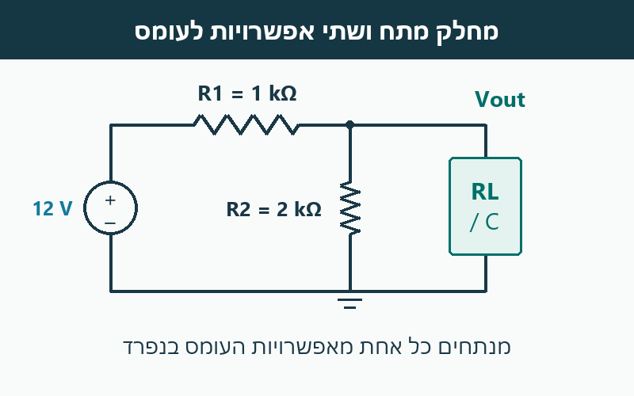
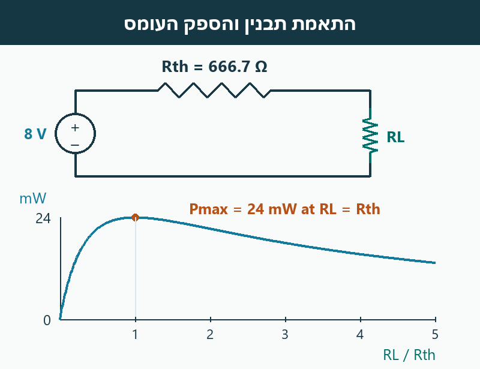
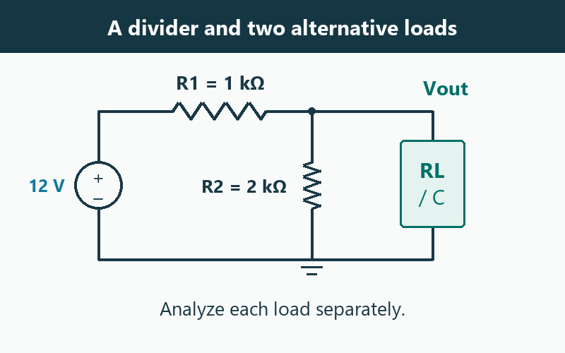
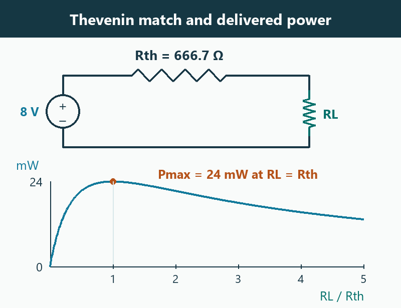

# PREP-345 — הספק מרבי במוצא מחלק מתח בעל שני נגדים

פתרון מוצע בסיוע AI. ממתין לביקורת מקצועית אנושית.

[צילום המקור](../sources/2026-11-15-batch20-19.png)

שאלה על מעגל פשוט של שני נגדים ומקור מתח, להסביר מה צריך להיות גודל קבל המוצא כדי לקבל הספק מקסימאלי

## הספק מרבי במוצא מחלק מתח בעל שני נגדים

מקור מתח ישר אידאלי Vs=12 V מחובר לנגד R1=1 kΩ. בקצהו השני נמצאת נקודת Vout, וממנה נגד R2=2 kΩ לאדמה. מחברים רכיב עומס נוסף בין Vout לאדמה. א. אם העומס הוא נגד RL>0, מה ערכו לקבלת הספק מרבי בנגד העומס, ומהו ההספק? הוכיחו והתייחסו גם לנצילות. ב. אם העומס הוא קבל אידאלי C>0, כפי שאפשר לקרוא בנוסח המקור, האם יש קיבול שמפיק הספק ממוצע מרבי במצב מתמיד? תארו את טעינתו מקבל פרוק ואת האנרגיה שיאגור. אין התנגדות פנימית, דליפה או הפסדי קבל נוספים.

### רמזים

1. מהם מתח המוצא ללא עומס וההתנגדות שרואים מהמוצא כאשר מכבים את המקור האידאלי?
2. החליפו את כל הרשת שמזינה את העומס במקור תבנין בטור להתנגדות. כתבו את הספק הנגד בעזרת RL.
3. בדקו את הסימן של הנגזרת של RL/(Rth+RL)². עבור קבל השתמשו בכך שהספק הוא קצב השינוי של האנרגיה האגורה.

### פתרון מוצע

### רשת תבנין

המתח ללא עומס הוא `Vth=Vs·R2/(R1+R2)=8 V`. בחישוב התנגדות תבנין מאפסים את מקור המתח האידאלי ומחליפים אותו בקצר, לכן `Rth=R1∥R2=2000/3 Ω≈666.7 Ω`. כל עומס המחובר למוצא רואה את הרשת הזו.

### נגד עומס

הזרם הוא `I=Vth/(Rth+RL)`, ולכן `PL=Vth²·RL/(Rth+RL)²`. הנגזרת לפי RL היא `Vth²(Rth−RL)/(Rth+RL)³`. היא חיובית מתחת ל־Rth ושלילית מעליו. כמו כן ההספק שואף לאפס כש־RL שואף לאפס או לאינסוף. מכאן שהמקסימום היחיד הוא ב־**RL=Rth≈666.7 Ω**.

ההספק המרבי הוא `Pmax=Vth²/(4Rth)=0.024 W=24 mW`. מתח העומס הוא 4 V וזרמו 6 mA. ברשת המקורית R1 מוליך 8 mA וצורך 64 mW, ו־R2 מוליך 2 mA וצורך 8 mW. המקור מספק 96 mW ולכן הנצילות הכוללת אל RL היא 24/96=25%.

במודל תבנין העומס וההתנגדות הטורית מפזרים אותה כמות הספק בנקודת ההתאמה, ולכן נצילות מודל המקור־הטורי היא 50%. זו אינה נצילות המקור הפיזי במחלק המתח, שבו R2 מושך זרם גם ללא עומס. התאמת הספק ונצילות מרבית הן מטרות שונות.

### אם העומס הוא קבל אידאלי

בקלט ישר ובמצב מתמיד הקבל טעון ל־8 V ואינו מוליך זרם. לכן ההספק שהוא מקבל במצב זה הוא אפס לכל C חיובי. אין ערך קיבול ייחודי שמפיק הספק ממוצע מרבי. קבל אידאלי אוגר אנרגיה; הוא אינו מפזר הספק ממוצע מחזורי כי האנרגיה שלו חוזרת לאותו ערך בכל מחזור.

בטעינה מקבל פרוק, `τ=Rth·C`, `vC(t)=Vth(1−e^(−t/τ))` ו־`iC(t)=(Vth/Rth)e^(−t/τ)`. לכן `pC(t)=(Vth²/Rth)e^(−t/τ)(1−e^(−t/τ))`. שיא הספק הטעינה הוא 24 mW, בזמן `t=τ ln(2)`, לכל C חיובי. הקיבול משנה את זמן ההגעה לשיא ואת האנרגיה הסופית `EC=½CVth²=32C J` כאשר C בפאראד. בלי אילוץ נוסף, כגון חלון טעינה או מגבלת קיבול, אין כאן בחירה יחידה של C למקסום הספק מתמיד.

### assumptions

[
  "מקור ישר אידאלי, נגדים חיוביים ורכיב עומס המחובר במקביל ל־R2.",
  "לנגד העומס אין אילוץ נוסף; הקבל אידאלי ופרוק בתחילת ניסוי הטעינה."
]

### optimality

"הנגזרת מוכיחה מקסימום גלובלי יחיד לנגד עומס. לקבל אידאלי אין פיזור הספק ממוצע במצב מתמיד; קבוע הזמן והאנרגיה תלויים בקיבול."

### verification

[
  "נבדקו חישובי תבנין באמצעות פתרון צומתי בלתי תלוי, סריקת עומסים משני צדי ההתאמה ושימור הספק.",
  "אינטגרציה נומרית של הספק הקבל נבדקה מול ½CV² בשלושה קיבולים."
]

### edge_cases

[
  "RL→0 או RL→∞ נותנים הספק עומס ששואף לאפס.",
  "Vs=0 נותן אפס הספק לכל עומס.",
  "במקור חילופין ועומס כללי מרוכב נדרשת בעיית התאמת עכבות ותדר מוגדרים; הנתונים הישרים כאן אינם מגדירים אותה."
]

### common_mistakes

[
  "לבחור RL=R1 או RL=R2 בלי לחשב את ההתנגדות שרואים במוצא.",
  "להשאיר מקור מתח אידאלי פעיל בזמן חישוב Rth.",
  "לטעון לנצילות כוללת של 50% במחלק המתח.",
  "להציג קבל כאילו הוא נגד שמפזר הספק מתמיד."
]

### interview_answer

"לנגד עומס מחשבים תבנין ומקבלים RL=R1∥R2. כאן RL≈666.7 Ω וההספק 24 mW. קבל אידאלי במצב ישר מתמיד אינו צורך הספק; C משנה את הטעינה ואת האנרגיה."

### solution_extensions

[
  {
    "question": "מה משתנה אם מקור המתח עצמו כולל התנגדות טורית Rs?",
    "answer_direction": "חשבו Vth=Vs·R2/(Rs+R1+R2) ו־Rth=(Rs+R1)∥R2, והתאימו אל Rth החדש.",
    "principle": "חישוב התנגדות המקור המלאה לפני התאמת העומס"
  }
]

### source_ambiguities

[
  "המקור אומר 'קבל המוצא' ואינו מציג שרטוט, ערכי רכיבים, צורת מקור או הגדרה של ההספק. נבחר מחלק מתח ישר מפורש עם 12 וולט ונגדים של 1 ושל 2 קילו־אוהם. התרגיל בוחן בנפרד נגד עומס וקבל אידאלי ושומר את אי־הבהירות המקורית."
]

## Maximum load power from a two-resistor divider

An ideal DC source Vs=12 V feeds R1=1 kΩ. Its other end is the Vout node, with R2=2 kΩ from that node to ground. An additional load connects between Vout and ground. A. For a resistor RL>0, find the load resistance that maximizes its power and compute that power. Prove the result and discuss efficiency. B. If the load is an ideal capacitor C>0, as the source wording can be read, does a capacitance maximize average steady-state power? Describe charging from zero and the final stored energy. The source is ideal and the capacitor has no leakage or additional losses.

### Hints

1. Find the open-circuit output voltage and the resistance seen from the output when the ideal voltage source is deactivated.
2. Replace the supplying network by a Thevenin voltage source in series with its resistance, then express resistor-load power as a function of RL.
3. Determine the derivative sign of RL/(Rth+RL)². For the capacitor, power is the rate of change of stored energy.

### Proposed solution

### Thevenin network

The open-circuit voltage is `Vth=Vs·R2/(R1+R2)=8 V`. To find the Thevenin resistance, set the ideal voltage source to zero, replacing it with a short. Then `Rth=R1∥R2=2000/3 Ω≈666.7 Ω`. Any load connected at the output sees this equivalent network.

### Resistive load

The current is `I=Vth/(Rth+RL)`, so `PL=Vth²·RL/(Rth+RL)²`. Differentiating gives `Vth²(Rth−RL)/(Rth+RL)³`, positive below Rth and negative above it. Power also tends to zero as RL tends to zero or infinity. Thus the unique global maximum occurs at **RL=Rth≈666.7 Ω**.

The maximum power is `Pmax=Vth²/(4Rth)=0.024 W=24 mW`. Load voltage is 4 V and load current is 6 mA. In the original network R1 carries 8 mA and dissipates 64 mW; R2 carries 2 mA and dissipates 8 mW. The physical source supplies 96 mW, giving an overall load efficiency of 24/96=25%.

In the Thevenin source-plus-series-resistance model, the matched load and series resistance dissipate equal power, giving a 50% model efficiency. That is not the efficiency of the physical divider, whose R2 draws current even without the external load. Maximum delivered power and maximum efficiency are different objectives.

### Ideal capacitor load

Under DC steady state, the capacitor reaches 8 V and carries zero current. Its steady-state input power is therefore zero for every positive C; there is no unique capacitance maximizing that quantity. An ideal capacitor stores energy. Its average power over a periodic steady-state cycle is zero because it ends each cycle with its initial energy.

During charging from zero, `τ=Rth·C`, `vC(t)=Vth(1−e^(−t/τ))` and `iC(t)=(Vth/Rth)e^(−t/τ)`. Therefore `pC(t)=(Vth²/Rth)e^(−t/τ)(1−e^(−t/τ))`. Its peak charging power is 24 mW at `t=τ ln(2)` for every positive C. Capacitance changes the time to this peak and final energy, `EC=½CVth²=32C J` when C is in farads. An additional constraint such as a charging window or capacitance limit is needed for a unique capacitance selection.

### assumptions

[
  "The source is ideal DC, both resistors are positive, and the extra load is connected in parallel with R2.",
  "There is no further resistor-load constraint. The ideal capacitor begins discharged for the charging experiment."
]

### optimality

"The derivative proves a unique global maximum for a resistive load. An ideal capacitor dissipates zero steady-state average power; capacitance determines its time scale and stored energy."

### verification

[
  "An independent nodal solution checks the Thevenin calculation, load sweeps on both sides of the optimum, and power balance.",
  "Numerical integration of capacitor input power checks ½CV² for three capacitances."
]

### edge_cases

[
  "RL approaching zero or infinity makes load power approach zero.",
  "Vs=0 gives zero power for every load.",
  "AC matching of a general complex load requires a specified frequency and impedance problem beyond this DC contract."
]

### common_mistakes

[
  "Choosing RL=R1 or RL=R2 without finding the resistance seen from the output.",
  "Leaving the ideal voltage source active while finding Rth.",
  "Claiming that the physical divider has 50% overall efficiency.",
  "Treating a capacitor as a resistor dissipating steady power."
]

### interview_answer

"For a resistor, compute the Thevenin network and choose RL=R1∥R2. Here RL≈666.7 Ω delivers 24 mW. An ideal capacitor takes no DC steady-state power; C determines charging time and stored energy."

### solution_extensions

[
  {
    "question": "What changes if the voltage source has a series resistance Rs?",
    "answer_direction": "Use Vth=Vs·R2/(Rs+R1+R2) and Rth=(Rs+R1)∥R2, then match the load to the new Rth.",
    "principle": "Include the complete source resistance before matching"
  }
]

### source_ambiguities

[
  "The source says 'output capacitor' and provides no schematic, values, waveform or power definition. This edition chooses an explicit 12 V DC divider with 1 kΩ and 2 kΩ resistors and separately analyzes a resistive load and an ideal capacitor."
]

[בדיקות](../checks/check_nov15_reasoning.py)

[תוצאות](../checks/batch1115-reasoning-verification.json)
