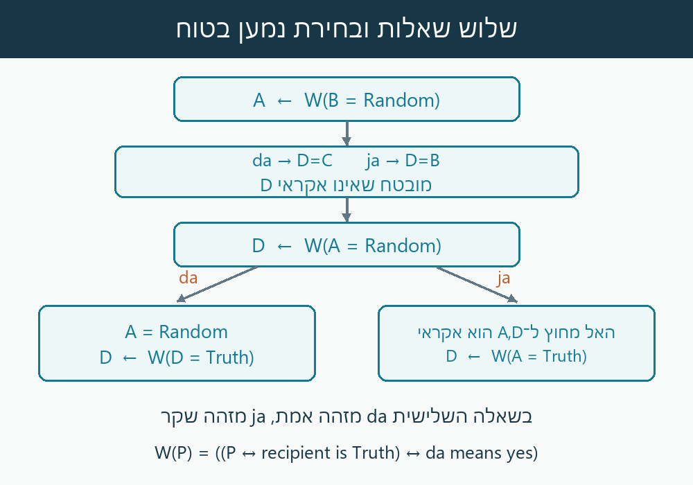
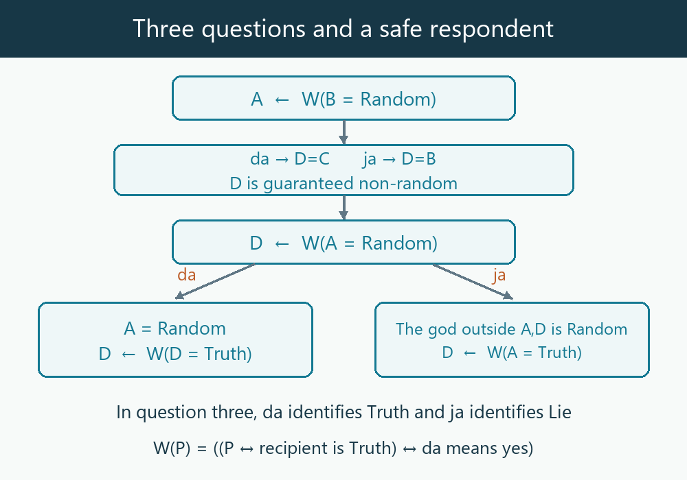

# PREP-346 — שלושה אלים ושפה לא ידועה בשלוש שאלות

פתרון מוצע בסיוע AI. ממתין לביקורת מקצועית אנושית.

[צילום המקור](../sources/2026-11-15-batch20b-01.png)

שלושה אלים A,B,C הם דובר אמת, שקרן ואקראי בסדר לא ידוע. עונים da/ja במשמעות לא ידועה. זהו את כולם בשלוש שאלות כן/לא.

## שלושה אלים ושפה לא ידועה בשלוש שאלות

A,B,C הם דובר אמת, שקרן ואקראי בסדר לא ידוע. כל תשובה היא da או ja, ואינכם יודעים איזו מילה פירושה כן. משמעות המילים קבועה ומשותפת. דובר האמת עונה נכון ושקרן עונה הפוך. אקראי רשאי להחזיר כל אחת משתי המילים בכל שאלה. מותר לשאול בסך הכול שלוש שאלות כן/לא, לבחור בכל פעם נמען ולהשתמש בתשובות הקודמות. תכננו אסטרטגיה שמזהה בוודאות את כל התפקידים. כל שאלה צריכה להיות טענה בעלת ערך אמת מוגדר.

### רמזים

1. קודם נסו לשאול נמען שאינו אקראי שאלה שהתשובה המילולית שלה תהיה תלויה רק בטענה שמעניינת אתכם.
2. אם מנטרלים שקר ושפה, שאלה ראשונה ל־A על היות B אקראי יכולה לבחור בין B ל־C מישהו שמובטח שאינו אקראי, גם אם A עצמו אקראי.
3. כעטיפה השתמשו בטענה (P אם ורק אם אתה דובר האמת) אם ורק אם da פירושו כן. מנמען אמין התשובה da שקולה ל־P. שאלו תחילה על B, אחר כך את הנמען הבטוח על A, ולבסוף הפרידו אמת משקר.

### פתרון מוצע

### עטיפה בעלת ערך אמת מוגדר
נסמן W(P) את השאלה האם הטענה הבאה נכונה.

`((P ↔ אתה דובר האמת) ↔ da פירושו כן)`

הסוגריים הם חלק מההגדרה. אין כאן שאלה על תשובתו העתידית של אקראי. עבור אמת ושקר שתי ההיפוכים האפשריים, של השקר ושל משמעות המילה, מתבטלים. לכן הנמען מחזיר da בדיוק כאשר P נכונה. אפשר לוודא זאת בארבעת צירופי אמת/שקר ומשמעות da. עבור אקראי אין מסקנה מן התשובה.

### שלוש השאלות
1. שאלו את A את W(B הוא אקראי). אם התשובה da בחרו D=C, אחרת D=B. אם A אינו אקראי, התשובה מזהה איזו בחירה בטוחה. אם A אקראי, גם B וגם C אינם אקראיים. לכן D בטוח בכל מקרה.
2. שאלו את D את W(A הוא אקראי). כעת אפשר לפרש את התשובה בוודאות.
3. אם בשאלה השנייה התקבל da, A הוא אקראי. שאלו את D את W(אתה דובר האמת). da מזהה את D כאמת ו־ja כשקרן, והאל האחר הוא התפקיד המשלים. אם בשאלה השנייה התקבל ja, A אינו אקראי והאל שנותר מחוץ ל־A,D הוא אקראי. שאלו את D את W(A הוא דובר האמת). da מזהה את A כאמת ו־ja כשקרן, ו־D משלים אותו.

הדרך מכסה כל תשובה אפשרית של האקראי ומשתמשת בדיוק בשלוש שאלות. שתי שאלות נותנות לכל היותר ארבעה תמלילים בינאריים, ואילו קיימות שש השמות שונות של תפקידים. גם עם בחירת נמענים מותנית התשובות הן שני ביטים בלבד. לכן שלוש שאלות הן המינימום במודל זה.

```python
"""Finite verifier for a three-question strategy, not a learner execution profile."""
from itertools import permutations, product


def verify_strategy():
    transcripts = 0
    for roles in permutations(("Truth", "Lie", "Random")):
        for da_means_yes, coins in product((False, True), product((False, True), repeat=3)):
            used = 0

            def ask(person, proposition):
                nonlocal used
                # Ask: (P iff you are Truth) iff da means yes.
                statement = (proposition == (roles[person] == "Truth")) == da_means_yes
                if roles[person] == "Random":
                    da = coins[used]
                else:
                    yes = statement if roles[person] == "Truth" else not statement
                    da = yes == da_means_yes
                used += 1
                return da

            first = ask(0, roles[1] == "Random")
            reliable = 2 if first else 1
            assert roles[reliable] != "Random"
            if ask(reliable, roles[0] == "Random"):
                reliable_type = "Truth" if ask(reliable, roles[reliable] == "Truth") else "Lie"
                answer = [None, None, None]
                answer[0] = "Random"
                answer[reliable] = reliable_type
                answer[3 - reliable] = "Lie" if reliable_type == "Truth" else "Truth"
            else:
                a_type = "Truth" if ask(reliable, roles[0] == "Truth") else "Lie"
                answer = [a_type, None, None]
                answer[reliable] = "Lie" if a_type == "Truth" else "Truth"
                answer[3 - reliable] = "Random"
            assert tuple(answer) == roles and used == 3
            transcripts += 1
    return transcripts
```



### הנחות

לשאלה משמעות לוגית קבועה. כל אל מבין את שמות התפקידים ואת הטענות על משמעות המילה שלו.

### מקרה קצה

האקראי יכול להשיב אותה מילה בכל פעם. אין להניח שהוא חייב לגוון או לחלק תשובות חצי־חצי.

### טעות נפוצה

פירוש da ככן לפני שנבחר נמען בטוח. גם ספירת תשובות אמת בשאלות ישירות אינה מנטרלת את השפה.

### סיבוכיות או עלות

שלוש שאלות. חסם המידע של שש השמות מונע פתרון בשתי שאלות במודל הבינארי.

### בדיקות

נבדקו 96 עולמות ותמלילי בחירות אקראיות, יחד עם שמונה שורות האימות של העטיפה. ההוכחה אינה תלויה בסימולציה.

### תשובה קצרה

שואלים את A עטיפה על B כדי לבחור נמען שאינו אקראי, שואלים אותו על A ואז מפרידים בין אמת לשקר. העטיפה מבטלת את שתי אי־הוודאויות הלשוניות.

### שאלת המשך

מה יקרה אם כל אל ישתמש במילון אחר? ההוכחה משתמשת במילון של הנמען עצמו בכל עטיפה. צריך להגדיר את השאלה ביחס למילון שלו ולהבטיח שהטענה מובנת; אין להסיק ישירות מידע על שפת אל אחר.

## Three gods and an unknown vocabulary in three questions

A,B,C are Truth, Lie and Random in an unknown order. Each answer is da or ja, whose fixed shared meaning is unknown. Truth answers correctly and Lie reverses truth. Random may return either word on every question. Ask at most three yes/no questions, adapting both the recipient and the question after each answer. Identify all three roles with certainty. Every question must express a proposition with a defined truth value.

### Hints

1. First build a question for a non-random respondent whose spoken answer depends only on the proposition you need.
2. After neutralizing deception and vocabulary, asking A whether B is Random can select a guaranteed non-random respondent from B and C, even when A is Random.
3. Use the proposition (P iff you are Truth) iff da means yes. A non-random respondent says da exactly when P holds. First ask about B, then ask the safe recipient about A, and finally distinguish Truth from Lie.

### Proposed solution

### A wrapper with a defined truth value
Write W(P) for asking whether this proposition is true.

`((P ↔ you are Truth) ↔ da means yes)`

The parentheses fix the meaning. This proposition does not refer to Random's hypothetical future answer. For Truth or Lie, the deception reversal and word-meaning reversal cancel. The spoken answer is da exactly when P holds. Check the four combinations of the non-random role and da's meaning. A Random response carries no such guarantee.

### The three questions
1. Ask A W(B is Random). If the answer is da, choose D=C; otherwise choose D=B. If A is non-random this selects the safe choice according to B's role. If A is Random both B and C are safe. D is therefore non-random on every branch.
2. Ask D W(A is Random). Its answer now has the guaranteed interpretation.
3. If question two returned da, A is Random. Ask D W(you are Truth). The answer da identifies D as Truth, and ja identifies D as Lie. The other god has the remaining role. If question two returned ja, A is non-random and the god outside A,D is Random. Ask D W(A is Truth). The answer identifies A as Truth or Lie, and D has the opposite non-random role.

Every possible choice by Random is covered, using exactly three questions. Two binary answers produce at most four transcripts while there are six role assignments. Adapting recipients does not create further answer bits. Thus three is minimal in this binary-answer model.

```python
"""Finite verifier for a three-question strategy, not a learner execution profile."""
from itertools import permutations, product


def verify_strategy():
    transcripts = 0
    for roles in permutations(("Truth", "Lie", "Random")):
        for da_means_yes, coins in product((False, True), product((False, True), repeat=3)):
            used = 0

            def ask(person, proposition):
                nonlocal used
                # Ask: (P iff you are Truth) iff da means yes.
                statement = (proposition == (roles[person] == "Truth")) == da_means_yes
                if roles[person] == "Random":
                    da = coins[used]
                else:
                    yes = statement if roles[person] == "Truth" else not statement
                    da = yes == da_means_yes
                used += 1
                return da

            first = ask(0, roles[1] == "Random")
            reliable = 2 if first else 1
            assert roles[reliable] != "Random"
            if ask(reliable, roles[0] == "Random"):
                reliable_type = "Truth" if ask(reliable, roles[reliable] == "Truth") else "Lie"
                answer = [None, None, None]
                answer[0] = "Random"
                answer[reliable] = reliable_type
                answer[3 - reliable] = "Lie" if reliable_type == "Truth" else "Truth"
            else:
                a_type = "Truth" if ask(reliable, roles[0] == "Truth") else "Lie"
                answer = [a_type, None, None]
                answer[reliable] = "Lie" if a_type == "Truth" else "Truth"
                answer[3 - reliable] = "Random"
            assert tuple(answer) == roles and used == 3
            transcripts += 1
    return transcripts
```



### Assumptions

Every god understands its role and the propositions about the meaning of its own words; all questions have fixed Boolean meanings.

### Edge case

Random may repeat the same word every time. No frequency or alternation assumption is available.

### Common mistake

Treating da as yes before selecting a safe respondent. Direct questions also leave the unknown vocabulary unresolved.

### Cost

Three questions. Six possible assignments cannot be separated by only two binary answers.

### Verification

Checked 96 worlds and Random-choice transcripts, plus the eight wrapper rows. The proof does not depend on the finite simulation.

### Interview answer

Use one wrapped question to select a non-random god, ask that god about A, then distinguish the two non-random roles. The wrapper cancels deception and vocabulary uncertainty.

### Follow-up

What changes if every god uses a different vocabulary? The wrapper must refer to the recipient's own vocabulary and remain understandable. Its answer does not directly establish another god's word meanings.

[checks/check_nov15b_software.py](../checks/check_nov15b_software.py)

[checks/prep-346-1115b-verification.json](../checks/prep-346-1115b-verification.json)

[solutions/prep_346_three_gods_strategy.py](../solutions/prep_346_three_gods_strategy.py)
