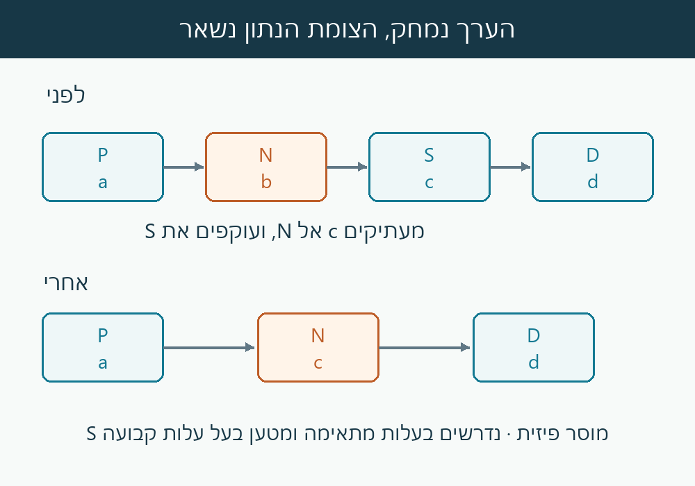
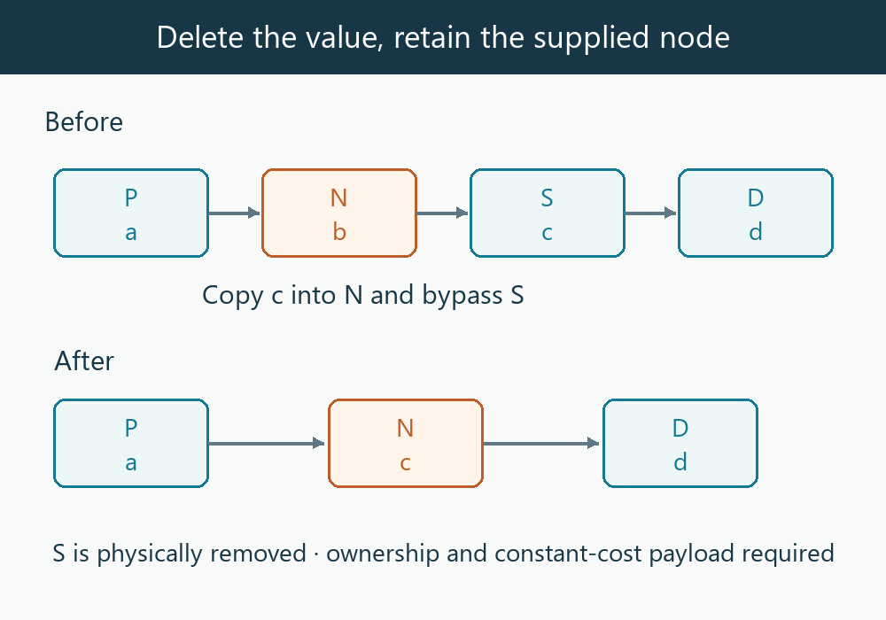

# PREP-348 — מחיקת איבר פנימי כשידוע רק מצביע אליו

פתרון מוצע בסיוע AI. ממתין לביקורת מקצועית אנושית.

[צילום המקור](../sources/2026-11-15-batch20b-18.png)

בהינתן רשימה חד־כיוונית ומצביע לאיבר פנימי, שאינו ראשון או אחרון, יש למחוק אותו ב־O(1).

## מחיקת איבר פנימי כשידוע רק מצביע אליו

נתונה רשימה חד־כיוונית סופית ללא מעגלים, ובה צמתים עם ערך int ושדה next. קיים מצביע לצומת פנימי שאינו הראשון או האחרון, ללא גישה לצומת הקודם. הסירו מרצף הערכים את האיבר שבמיקום הנתון ב־O(1) זמן וזיכרון נוסף. מותר להעתיק ערך בין צמתים. בדוגמת C הצמתים מוקצים בערימה, היורש בבעלות בלעדית של הרשימה ואין מצביעים חיצוניים שצריכים להמשיך להצביע אליו. הסבירו איזה צומת פיזי משתחרר ומה משתנה אם חייבים למחוק דווקא את האובייקט הנתון בזיכרון.

### רמזים

1. המצביע לקודם חסר, אך אפשר לקרוא את היורש של הצומת הנתון.
2. אפשר להעביר את ערך היורש אל הצומת הנתון ואז לעקוף את היורש.
3. שמרו את node.next, העתיקו את ערכו, כוונו את node.next אל היורש שלו ושחררו את היורש שנשמר. הבדילו בין ערך שנמחק לבין זהות האובייקט שהוסר.

### פתרון מוצע

נניח שקודם רצף הרשימה הוא `... → P(a) → N(b) → S(c) → ...`, ונתון N. שומרים את S, מעתיקים את c אל N ומכוונים N.next אל S.next. רצף הערכים נהיה `... → a → c → ...`, בדיוק הרצף שמתקבל מהסרת b. בדוגמת C משחררים את S לאחר שמירת הקישור הדרוש.

ניגשים למספר קבוע של שדות ומעתיקים int אחד, ולכן העלות O(1). אין צורך לחפש את תחילת הרשימה או את הצומת הקודם. גם כאשר b=c הפעולה מקטינה את אורך הרשימה, למרות שצבע או תוכן הערך עשויים להיראות זהים.

הצומת N עצמו נשאר והמטען שלו משתנה. אם הדרישה היא לשמר זהות של כל יתר הצמתים ולשחרר פיזית דווקא את N, צריך לעדכן את הקישור של הקודם. גישה ל־N בלבד אינה נותנת גישה לקודם ברשימה חד־כיוונית. בדרך כלל נחוץ חיפוש מהראש בזמן O(n), מצביע לקודם או שינוי מבנה הנתונים.

הצומת האחרון אינו מתאים לשיטה, משום שאין ערך יורש להעתקה. מטען גדול או בעל בעלות מורכבת עלול להפוך את ההעתקה ליקרה או למסוכנת. במודל Python מסירים את קישור הרשימה אל היורש; איסוף הזיכרון בפועל תלוי בבעלות ובהפניות. מתאם הבדיקה שמקבל מערך ואינדקס בונה את הרשימה וסורק לתוצאה, ולכן המתאם עצמו O(n); פעולת delete_given היא זו שנדרשת להיות O(1).

```python
"""Logical value deletion with an owned successor and constant-size payload."""


class Node:
    def __init__(self, value, following=None):
        self.value = value
        self.next = following


def delete_given(node):
    if node is None or node.next is None:
        raise ValueError("a valid non-tail node is required")
    successor = node.next
    node.value = successor.value
    node.next = successor.next


def delete_interior_result(values, index):
    """JSON test adapter. The supplied node is strictly inside an acyclic list."""
    if type(index) is not int or not 0 < index < len(values) - 1:
        raise ValueError("index must be strictly between head and tail")
    head = None
    for value in reversed(values):
        head = Node(value, head)
    target = head
    for _ in range(index):
        target = target.next
    delete_given(target)
    result = []
    current = head
    while current is not None:
        result.append(current.value)
        current = current.next
    return result
```



### הנחות

המחיקה מוגדרת לפי רצף הערכים ומותר לשנות את מטען הצומת שסופק. אין מעגלים ויש יורש חי בבעלות מתאימה.

### מקרה קצה

אורך מינימלי שלוש ונתון הצומת האמצעי. ערכים כפולים תקינים. קריאה על tail או None נדחית.

### טעות נפוצה

שחרור node בלי לעדכן את הקודם משאיר קישור תלוי. טענה שהשיטה שומרת את זהות היורש שגויה.

### סיבוכיות או עלות

O(1) לפעולת הצומת עם מטען int ובעלות מתאימה. מתאם JSON ובניית רשימה אינם חלק מחסם זה.

### בדיקות

נבדקו תוצאות מול מחיקת מיקום באורקל, זהות הצומת שסופק, עקיפת היורש, ערכים כפולים ומקרי tail. C הורץ על צמתים שהוקצו בערימה.

### תשובה קצרה

מעתיקים את ערך היורש ומדלגים עליו. נמחק הערך שבמיקום המבוקש, אבל פיזית מוסר היורש, ולכן צריך להגדיר בעלות וזהות צמתים.

### שאלת המשך

מה נדרש כדי למחוק tail באותה עלות? ברשימה כפולה או כשמסופק גם מצביע לקודם אפשר לעדכן את הקישור הנכנס. מצביע tail לבדו אינו מספיק ברשימה חד־כיוונית.

## Delete an interior list item given only its node

A finite acyclic singly linked list has an int value and next field in each node. You have a pointer to an interior node, neither head nor tail, and no pointer to its predecessor. Remove that position's logical value in O(1) time and auxiliary storage. Copying a value between nodes is allowed. In the C example nodes are heap-allocated, the list exclusively owns the successor, and no external aliases must remain valid for it. Explain which physical node is freed and what changes if the supplied node object itself must be removed.

### Hints

1. The predecessor pointer is unavailable, but the supplied node exposes its successor.
2. Move the successor's value into the supplied node and bypass the successor.
3. Save node.next, copy its value, set node.next to the saved successor's next link, and release that successor. Distinguish the deleted logical value from the freed object's identity.

### Proposed solution

Suppose the sequence is `... → P(a) → N(b) → S(c) → ...`, and N is given. Save S, copy c into N and set N.next to S.next. The resulting value sequence is `... → a → c → ...`, exactly what deleting b requires. In C, release S after preserving its outgoing link.

Only a constant number of fields and one int payload are accessed, so the operation costs O(1). No search for the head or predecessor is needed. Even if b=c, the list still loses one node.

N stays allocated with a changed payload. If every surviving node identity must be preserved and N itself must be freed, the predecessor's incoming link must be updated. Access to N alone does not reveal that predecessor in a singly linked list. Normally this requires an O(n) head search, an additional predecessor pointer or a different representation.

The tail cannot use this trick because it has no successor value to copy. Large or owning payloads may make copying expensive or unsafe. Python detaches the successor from the list; actual collection depends on remaining references. The JSON adapter builds and serializes a list in O(n), while delete_given is the operation required to run in O(1).

```python
"""Logical value deletion with an owned successor and constant-size payload."""


class Node:
    def __init__(self, value, following=None):
        self.value = value
        self.next = following


def delete_given(node):
    if node is None or node.next is None:
        raise ValueError("a valid non-tail node is required")
    successor = node.next
    node.value = successor.value
    node.next = successor.next


def delete_interior_result(values, index):
    """JSON test adapter. The supplied node is strictly inside an acyclic list."""
    if type(index) is not int or not 0 < index < len(values) - 1:
        raise ValueError("index must be strictly between head and tail")
    head = None
    for value in reversed(values):
        head = Node(value, head)
    target = head
    for _ in range(index):
        target = target.next
    delete_given(target)
    result = []
    current = head
    while current is not None:
        result.append(current.value)
        current = current.next
    return result
```



### Assumptions

Deletion is defined by the value sequence, the supplied payload may change, the list is acyclic and a live successor is owned appropriately.

### Edge case

The smallest supplied list has three nodes with the middle node targeted. Duplicate values are valid. Reject tail and None calls.

### Common mistake

Freeing node without changing its predecessor leaves a dangling link. The trick also does not preserve the successor object's identity.

### Cost

O(1) for the node operation with int payloads and suitable ownership. JSON adaptation and list construction lie outside that bound.

### Verification

Compared outputs against a positional-deletion oracle, checked supplied-node identity and successor bypass, duplicates and tail rejection. C ran using heap-allocated nodes.

### Interview answer

Copy the successor's value and bypass it. This deletes the target position's value while physically removing the successor, so ownership and identity conditions matter.

### Follow-up

How could tail deletion have the same cost? A doubly linked list or an explicitly supplied predecessor allows updating the incoming link. A tail pointer alone is insufficient in a singly linked list.

[checks/check_nov15b_software.py](../checks/check_nov15b_software.py)

[checks/prep-348-1115b-verification.json](../checks/prep-348-1115b-verification.json)

[solutions/prep_348_delete_interior_node.py](../solutions/prep_348_delete_interior_node.py)


```c
/* C11. node and its successor are live heap-owned nodes. No aliases to removed node.
   The copied payload is int, so value assignment has constant cost. */
#include <stdbool.h>
#include <stdlib.h>

struct Node {
    int value;
    struct Node *next;
};

bool delete_given(struct Node *node) {
    if (node == NULL || node->next == NULL) return false;
    struct Node *removed = node->next;
    node->value = removed->value;
    node->next = removed->next;
    free(removed);
    return true;
}
```

[מימוש C](../solutions/prep_348_delete_interior_node.c)

[בדיקת C](../checks/nov15b-software-native-verification.json)
