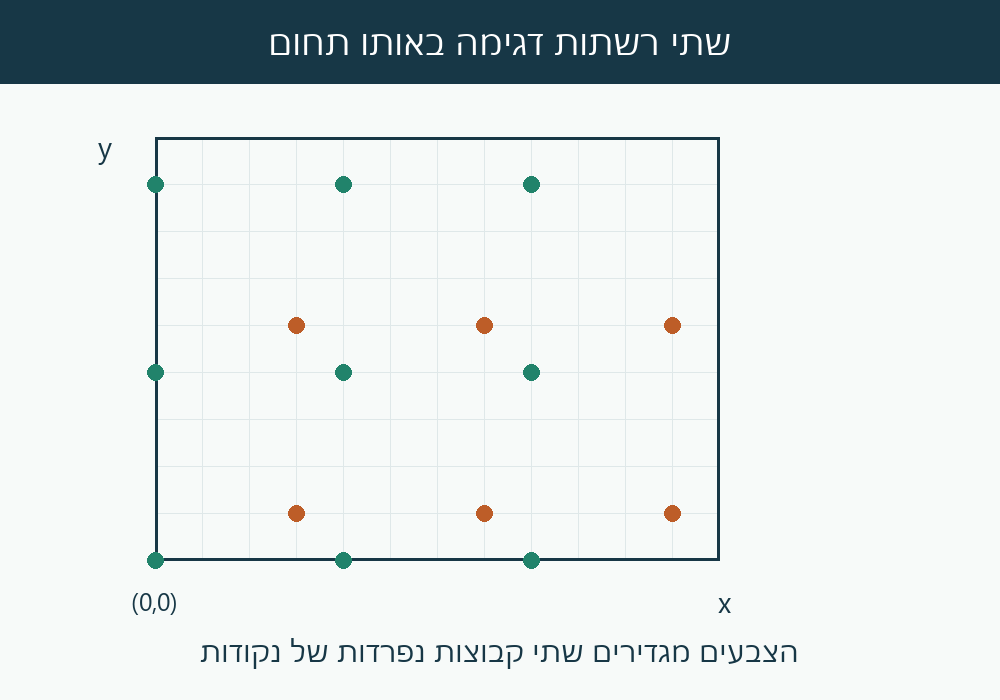
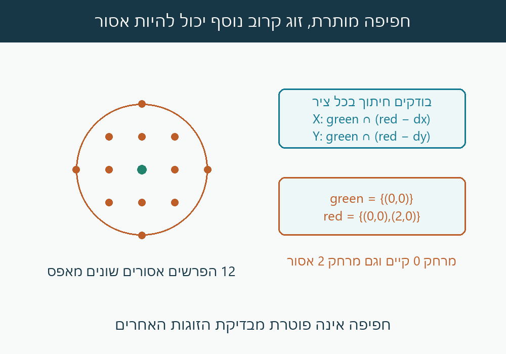
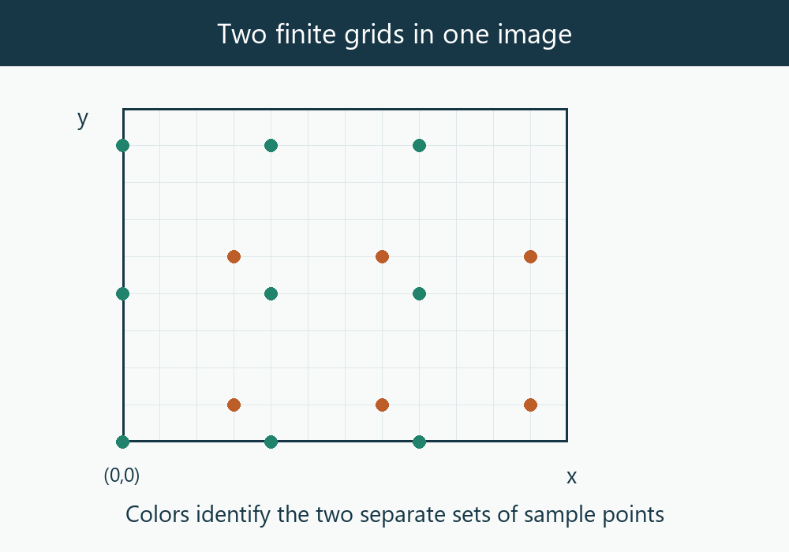
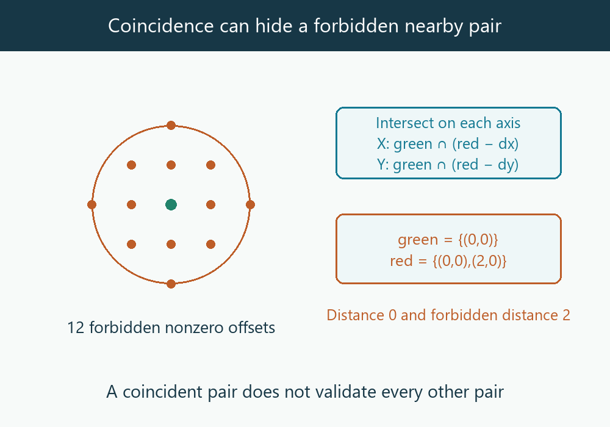

# PREP-353 — בדיקת רשתות דגימה סופיות בשני צבעים

פתרון מוצע בסיוע AI. ממתין לביקורת מקצועית אנושית.

[צילום המקור](../sources/2026-11-15-batch10c-05.png)

פרמטרי תמונה וגריד נקודות, בדיקת תחום וריווח, ובהמשך שני גרידים בצבעים שונים עם מרחק גדול מ-2 או אפס.

## בדיקת רשתות דגימה סופיות בשני צבעים

נתונים width,height ושישה פרמטרים של גריד G=[xstart,ystart,xgap,ygap,xnumdots,ynumdots]. נקודותיו הן (xstart+i*xgap,ystart+j*ygap) לכל 0≤i<xnumdots ו־0≤j<ynumdots.

השלמת החוזה: כל הפרמטרים שלמים, ואיברי bool אינם מספרים בחוזה Python זה. רוחב וגובה חיוביים. תחום הפיקסלים הוא 0≤x<width ו־0≤y<height. שתי כמויות הנקודות ושני הרווחים חייבים להיות חיוביים.

א. כתבו grid_valid(width,height,grid) המחזירה bool לבדיקת גריד יחיד.
ב. נתונים גריד ירוק וגריד אדום באותו תחום. כתבו colored_grids_valid(width,height,green,red). היא מחזירה True בדיוק כאשר שני הגרידים תקינים וכל זוג נקודות מצבעים שונים מקיים מרחק אוקלידי גדול ממש מ־2 או מרחק אפס. חפיפה מדויקת מותרת. אין דרישת מרחק נוספת בתוך אותו צבע. הכמויות והמידות עשויות להיות גדולות, ולכן יש להימנע מיצירת כל הנקודות.



### רמזים

1. מהן הקואורדינטות הקטנה והגדולה בכל ציר, כאשר הרווח חיובי?
2. בקואורדינטות שלמות יש רק מעט הפרשים שונים מאפס שהמרחק שלהם לכל היותר 2. חפשו הפרש כזה בין הגרידים.
3. לכל אחד מ־12 ההפרשים האסורים בדקו חיתוך של שתי סדרות חשבוניות סופיות בציר X ובציר Y. השתמשו ב־gcd ובפתרון קונגרואנציות בתוך טווח משותף.

### פתרון מוצע

### תחום תקין ללא יצירת נקודות
לגריד לא ריק עם רווחים חיוביים, הקצוות הם xstart ו־xstart+(xnumdots−1)*xgap, ובהתאמה בציר Y. לכן מספיק לבדוק את סוגי הפרמטרים, את חיוביות הכמויות והרווחים ואת ארבעת הקצוות. למשל width=5 מאפשר את X=4 ואת X=0, אך אינו מאפשר X=5.

### מדוע המרחק המינימלי לבדו אינו מספיק
גריד ירוק יחיד ב־(0,0) וגריד אדום הכולל (0,0),(2,0) חולקים נקודה, ולכן המרחק המינימלי אפס. הזוג השני עדיין אסור. בודקים קיום של הפרש אסור, ולא רק את הזוג הקרוב ביותר.

במרחק אוקלידי שלם לכל היותר 2, ההפרשים השונים מאפס הם (±1,0),(±2,0),(0,±1),(0,±2),(±1,±1). יש 12 אפשרויות. עבור הפרש (ox,oy), זוג מתאים קיים בדיוק כאשר קיימת נקודת X משותפת לסדרת הירוק ולסדרת האדום לאחר הזזה ב־−ox, ובמקביל קיים חיתוך דומה בציר Y עם −oy. הקרטזיות של כל גריד מאפשרת לבחור את שני האינדקסים באופן בלתי תלוי.

### חיתוך סדרות סופיות
בסדרות a+i*d ו־b+j*e, נגדיר g=gcd(d,e). אין פתרון כאשר g אינו מחלק את b−a. אחרת פותרים d*i ≡ b−a (mod e), לאחר חלוקה ב־g. ההופכי של d/g קיים מודולו e/g. מתקבלת נקודה משותפת ראשונה במחלקת שאריות, והמחזור הוא lcm(d,e). מקדמים אותה אל תחילת הטווח המשותף ובודקים שהיא אינה מעבר לקצהו. כל הכמויות מחושבות בשלמים מדויקים.

גרידים יחידים החופפים ב־(0,0) תקינים. הפרש (1,1) אסור כי ריבוע המרחק הוא 2. הפרש (2,1) מותר כי ריבועו 5. זוג במרחק בדיוק 2 אסור. האלגוריתם מחזיר False אם אחד הגרידים אינו תקין, או אם אחת מ־12 הבדיקות מוצאת זוג אסור.

### נכונות ועלות
כל זוג אסור יוצר אחד מ־12 ההפרשים ולכן מתגלה. כל חיתוך בשני הצירים בונה זוג נקודות ממשי בעל ההפרש הנתון, ולכן אין דחיית שווא. בדיקת גריד משתמשת במספר קבוע של פעולות. בדיקת שני צבעים מבצעת מספר קבוע של gcd והופכים מודולריים, ללא תלות במספר הנקודות; סיבוכיות הביטים תלויה בגודל השלמים. הזיכרון מכיל מספר קבוע של שלמים. במימוש בעל מספר ביטים קבוע יש לבדוק גלישה במכפלה ובחיבור של קצוות, ולא להסתמך על עטיפה.

```python
"""Integer pixel coordinates, positive spacings, finite Cartesian grids."""
from math import gcd


def grid_valid(width, height, grid):
    values = [width, height, *grid] if isinstance(grid, (list, tuple)) else []
    if len(values) != 8 or any(type(value) is not int for value in values):
        return False
    x, y, dx, dy, nx, ny = grid
    return (width > 0 and height > 0 and dx > 0 and dy > 0
            and nx > 0 and ny > 0 and x >= 0 and y >= 0
            and x + (nx - 1) * dx < width
            and y + (ny - 1) * dy < height)


def progression_intersects(a, step_a, count_a, b, step_b, count_b):
    """The arguments describe two nonempty finite increasing progressions."""
    low = max(a, b)
    high = min(a + step_a * (count_a - 1), b + step_b * (count_b - 1))
    common = gcd(step_a, step_b)
    if low > high or (b - a) % common:
        return False
    modulus = step_b // common
    index = 0 if modulus == 1 else (
        (b - a) // common * pow(step_a // common, -1, modulus)
    ) % modulus
    first = a + index * step_a
    period = step_a * modulus
    if first < low:
        first += ((low - first + period - 1) // period) * period
    return first <= high


def colored_grids_valid(width, height, green, red):
    if not grid_valid(width, height, green) or not grid_valid(width, height, red):
        return False
    gx, gy, gdx, gdy, gnx, gny = green
    rx, ry, rdx, rdy, rnx, rny = red
    for ox in range(-2, 3):
        for oy in range(-2, 3):
            if not 0 < ox * ox + oy * oy <= 4:
                continue
            if (progression_intersects(gx, gdx, gnx, rx - ox, rdx, rnx)
                    and progression_intersects(gy, gdy, gny, ry - oy, rdy, rny)):
                return False
    return True
```



### הנחות

תחום פיקסלים חצי-פתוח, קלט שלם, רווחים חיוביים ומרחק אוקלידי בין צבעים בלבד.

### מקרה קצה

גריד יחיד, רווח חיובי עם כמות אחת, קצה width−1, קצה width שאסור, חפיפה מלאה, חפיפה המלווה בזוג קרוב, הפרש אלכסוני ומספרי נקודות עצומים.

### טעות נפוצה

בדיקת מרחק מינימלי אפס אינה מאשרת את יתר הזוגות. גם תנאי >2 שונה מתנאי ≥2. אין צורך להשוות נקודות מאותו צבע בתנאי ב.

### סיבוכיות או עלות

מספר קבוע של חישובי gcd והופכים מודולריים; העלות תלויה במספר הביטים של הפרמטרים. · מספר קבוע של שלמים מדויקים.

### בדיקות

הבדיקות משוות את חיתוך הסדרות ואת שתי הרשתות לאורקל שמייצר נקודות קטנות במפורש, ובודקות גם כמויות ענק ללא הקצאת נקודות.

### תשובה קצרה

בודקים קצוות של כל גריד ואז שוללים את 12 הפרשי הפיקסלים האסורים באמצעות חיתוך סדרות חשבוניות סופיות.

### שאלת המשך

מה ישתנה עבור רדיוס איסור שלם r? מונים את כל הפרשי הסריג שעבורם 0<dx²+dy²≤r² ומפעילים אותו מבחן חיתוך; מספר ההפרשים הוא O(r²).

## Validate finite sampling grids in two colors

Given width,height and grid G=[xstart,ystart,xgap,ygap,xnumdots,ynumdots], its points are (xstart+i*xgap,ystart+j*ygap) for 0≤i<xnumdots and 0≤j<ynumdots.

Chosen contract: all parameters are integers; bool is excluded in this Python contract. Width and height are positive. Pixel coordinates satisfy 0≤x<width and 0≤y<height. Both counts and spacings are positive.

A. Implement grid_valid(width,height,grid), returning bool.
B. Given green and red grids in the same image, implement colored_grids_valid(width,height,green,red). Return True exactly when both grids are valid and every cross-color pair has Euclidean distance strictly greater than 2 or exactly zero. Exact coincidence is allowed. No extra distance restriction applies within one color. Dimensions and counts may be very large, so avoid materializing all points.



### Hints

1. With positive spacing, which points give the smallest and largest coordinate on each axis?
2. Only a few nonzero integer displacements have Euclidean length at most 2. Search for any such displacement between the grids.
3. For each of the twelve forbidden displacements, test intersection of two finite arithmetic progressions on each axis. Use gcd and congruences inside the shared interval.

### Proposed solution

### Validate the range without generating points
For a nonempty grid with positive spacing, the X endpoints are xstart and xstart+(xnumdots−1)*xgap, and similarly for Y. Validate types, positive counts/spacings and those four endpoints. Width 5 permits X=0 and X=4, while X=5 is outside.

### Why the minimum distance alone fails
Let green contain only (0,0), and red contain (0,0),(2,0). Their minimum distance is zero, but the second pair is forbidden. Search for a forbidden displacement.

The nonzero integer displacements of length at most 2 are (±1,0),(±2,0),(0,±1),(0,±2),(±1,±1), twelve possibilities. For displacement (ox,oy), a matching pair exists exactly when the green X progression intersects the red X progression shifted by −ox, and the analogous Y progressions intersect after shifting by −oy. Each grid is a Cartesian product, so the two axis choices are independent.

### Intersect finite progressions
For a+i*d and b+j*e, set g=gcd(d,e). No solution exists if g does not divide b−a. Otherwise solve d*i ≡ b−a (mod e) after division by g. The inverse of d/g exists modulo e/g. Common points repeat every lcm(d,e). Advance one representative to the shared interval lower endpoint and test against its upper endpoint. All calculations use exact integers.

Coincident singletons at (0,0) are valid. Displacement (1,1) is forbidden because its squared length is 2. Displacement (2,1) is permitted because its squared length is 5. Distance exactly 2 is forbidden. Return False for an invalid grid or any detected forbidden displacement.

### Correctness and cost
Every forbidden pair produces one of the twelve displacements and is detected. Every pair of axis intersections constructs actual grid points with that displacement, so no valid pair is rejected. A single-grid check uses constant arithmetic work. The two-color check uses a constant number of gcd/modular-inverse operations, independent of point counts; bit cost depends on integer size. Space is a constant number of integers. Fixed-width implementations need checked endpoint multiplication/addition.

```python
"""Integer pixel coordinates, positive spacings, finite Cartesian grids."""
from math import gcd


def grid_valid(width, height, grid):
    values = [width, height, *grid] if isinstance(grid, (list, tuple)) else []
    if len(values) != 8 or any(type(value) is not int for value in values):
        return False
    x, y, dx, dy, nx, ny = grid
    return (width > 0 and height > 0 and dx > 0 and dy > 0
            and nx > 0 and ny > 0 and x >= 0 and y >= 0
            and x + (nx - 1) * dx < width
            and y + (ny - 1) * dy < height)


def progression_intersects(a, step_a, count_a, b, step_b, count_b):
    """The arguments describe two nonempty finite increasing progressions."""
    low = max(a, b)
    high = min(a + step_a * (count_a - 1), b + step_b * (count_b - 1))
    common = gcd(step_a, step_b)
    if low > high or (b - a) % common:
        return False
    modulus = step_b // common
    index = 0 if modulus == 1 else (
        (b - a) // common * pow(step_a // common, -1, modulus)
    ) % modulus
    first = a + index * step_a
    period = step_a * modulus
    if first < low:
        first += ((low - first + period - 1) // period) * period
    return first <= high


def colored_grids_valid(width, height, green, red):
    if not grid_valid(width, height, green) or not grid_valid(width, height, red):
        return False
    gx, gy, gdx, gdy, gnx, gny = green
    rx, ry, rdx, rdy, rnx, rny = red
    for ox in range(-2, 3):
        for oy in range(-2, 3):
            if not 0 < ox * ox + oy * oy <= 4:
                continue
            if (progression_intersects(gx, gdx, gnx, rx - ox, rdx, rnx)
                    and progression_intersects(gy, gdy, gny, ry - oy, rdy, rny)):
                return False
    return True
```



### Assumptions

Half-open pixel bounds, integer parameters, positive spacings and cross-color Euclidean distance.

### Edge case

Singleton grids, positive spacing with count one, the width−1 boundary, the invalid width boundary, coincidence plus a nearby forbidden pair, diagonal offsets and huge point counts.

### Common mistake

A minimum distance of zero says nothing about other pairs. Strictly greater than 2 differs from at least 2. Part B imposes its extra condition only across colors.

### Cost

A constant number of gcd and modular-inverse calculations; bit cost depends on parameter size. · A constant number of exact integers.

### Verification

Checks compare progression and colored-grid decisions with explicitly generated small point sets, then exercise enormous counts without point allocation.

### Interview answer

Validate endpoints, then exclude the twelve forbidden pixel displacements using exact finite-progression intersection.

### Follow-up

How does an integer forbidden radius r change the approach? Enumerate all offsets with 0<dx²+dy²≤r² and reuse the same intersection test; there are O(r²) offsets.

[checks/check_images1115c.py](../checks/check_images1115c.py)

[checks/prep-353-1115c-verification.json](../checks/prep-353-1115c-verification.json)

[solutions/prep_353_sampling_grids.py](../solutions/prep_353_sampling_grids.py)
