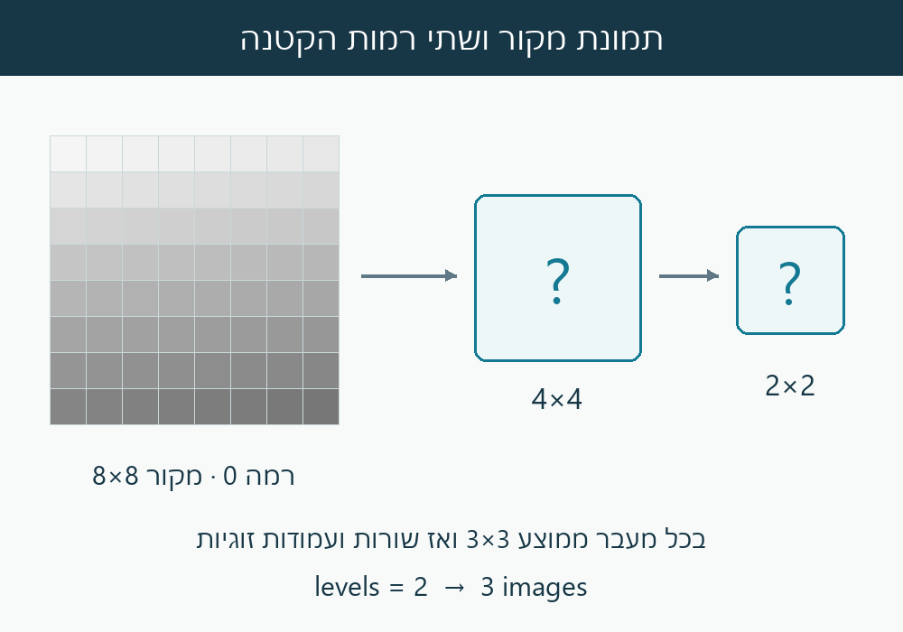
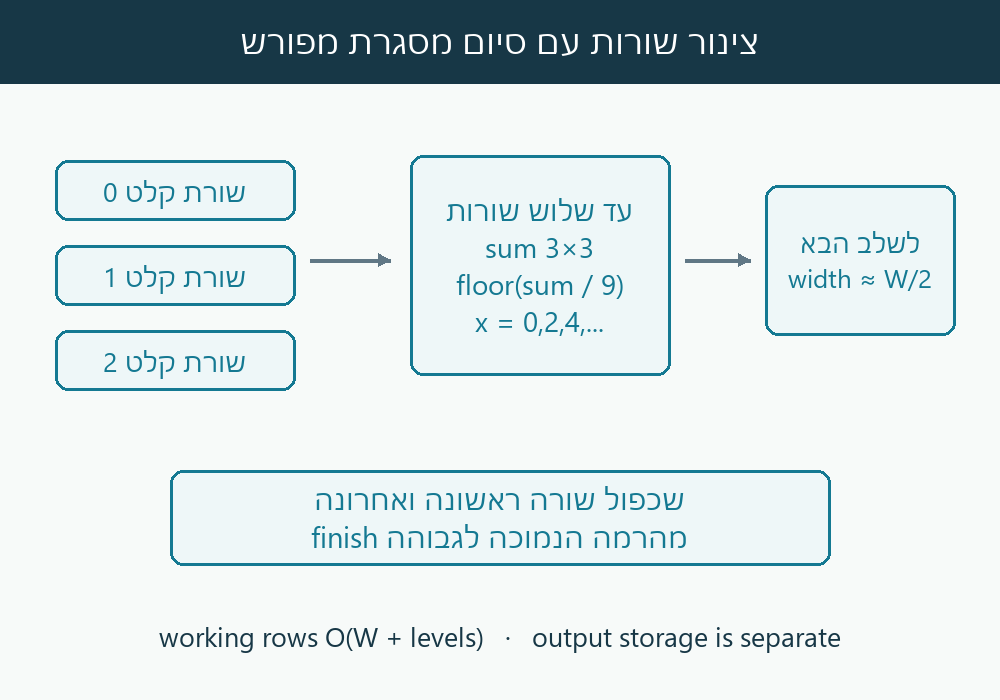
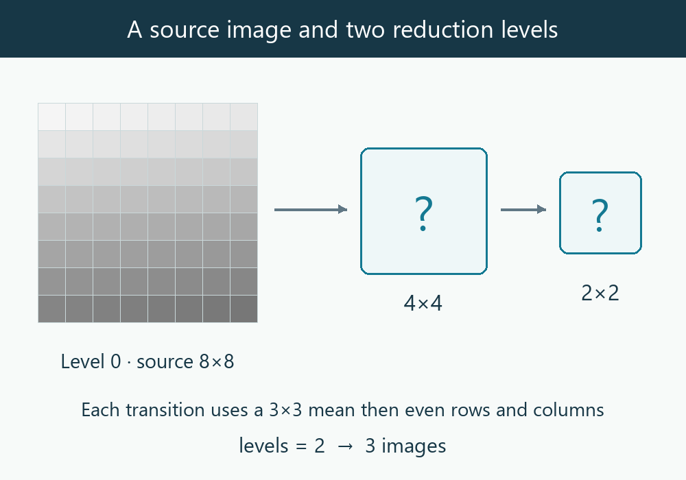
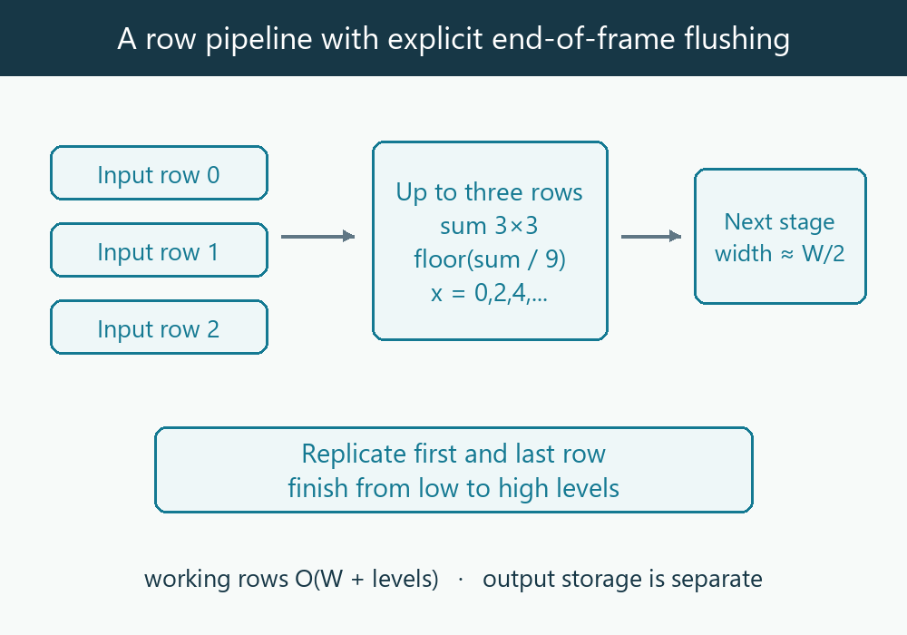

# PREP-354 — פירמידת תמונות עם טשטוש ודגימה ועיבוד שורות

פתרון מוצע בסיוע AI. ממתין לביקורת מקצועית אנושית.

[צילום המקור](../sources/2026-11-15-batch10c-06.png)

תמונה כמטריצה ו-levels; בכל רמה טשטוש בממוצע של תשעה פיקסלים ואז דגימה פי שניים בשני הצירים, עם אופטימיזציה ועיבוד שורות זורם.

## פירמידת תמונות עם טשטוש ודגימה ועיבוד שורות

ממשו image_pyramid(image,levels). התמונה היא מטריצה מלבנית לא ריקה של שלמים 0..255, ו־levels הוא מספר שלם לא שלילי. החזירו levels+1 תמונות, כאשר תמונה 0 היא עותק של המקור.

בכל רמה מחשבים תחילה לכל פיקסל ממוצע של עצמו ושמונת שכניו, ואז שומרים כל שורה וכל עמודה שנייה החל מאינדקס 0. השלמות שנבחרו: מעבר מחוץ לתמונה משכפל את פיקסל השפה הקרוב; סכום תשעת הערכים מחולק ב־9 עם רצפה אחת; מידות הרמה הבאה הן ceil(height/2)×ceil(width/2). אין עיגול ביניים בין סכומי שורות.

הציגו דרך לייעל את החישוב, וממשו stream_pyramid(rows,levels,emit) המקבלת את שורות המקור בזו אחר זו וקוראת emit(level,row) לכל שורת פלט. סדר השורות בכל רמה נשמר, אך רמות עשויות להתערבב. אין לשמור את כל המקור במנוע הזרימה. אפשר להחזיר מערכי תמונות במתאם איסוף נפרד. לדוגמה 8×8 ו־levels=2 מפיקים 8×8,4×4,2×2.



### רמזים

1. הגדירו בדיוק איזה פיקסל נשמר אחרי הקטנה ומה קורה לשכן שמחוץ לשפה.
2. רק רבע בקירוב ממיקומי התמונה המסוננת נשמרים. האם חייבים לחשב ולשמור את יתר המיקומים?
3. שורת פלט זקוקה לשלוש שורות קלט סמוכות. החזיקו עד שלוש בכל שלב, העבירו כל שורת פלט לשלב הבא וטפלו במפורש בשורה הראשונה ובסיום המסגרת.

### פתרון מוצע

### חישוב שמכבד את אותו חוזה
לרמה חדשה, עבור כל מרכז זוגי (y,x) מחשבים את תשעת הדגימות עם הצמדת הקואורדינטות לשפה, מסכמים ומחלקים ב־9 ברצפה. אין צורך לבנות תמונת blur מלאה ואז למחוק שלושה רבעים ממנה. לדוגמה מטריצת 2×2 שערכיה [[0,9],[18,27]] מפיקה פיקסל יחיד שערכו 9. מטריצה קבועה נשארת קבועה גם בשפות.

מסנן ממוצע 3×3 ניתן להפרדה לסכומי שלשות אופקיים ואז סכומי שלוש שורות. יש לשמור סכומים ולא ממוצעים מעוגלים, ולחלק פעם אחת ב־9. חלון מחליק יכול לעדכן סכום על ידי הוספה והסרה. אלו שיפורי קבועים; צריך עדיין לקרוא את קלט המקור כאשר הוא מגיע בזרם.

### מנוע שורות רב-רמתי
כל ReductionStage שומר עד שלוש שורות ורושם כמה שורות התקבלו. כאשר מגיעה שורה באינדקס אי-זוגי i, ניתן להפיק את המרכז הזוגי i−1. עבור המרכז 0 משכפלים את השורה הראשונה כלפי מעלה. אם מספר השורות בסוף אי-זוגי, המרכז האחרון מחכה לשכן תחתון חסר; finish משכפל את השורה האחרונה ומפיק אותו. בגובה 1 אותה שורה משמשת שלוש פעמים.

כל שורת רמה נמסרת לצרכן ומוזנת לשלב הבא. בסיום המקור מסיימים את השלבים מן הרמה הנמוכה לגבוהה, כך ששורת השפה שהופקה נעשית קלט רגיל של השלב הבא לפני סיומו. המימוש מפיץ שורות בלולאה, ללא תלות בעומק רקורסיה של Python. עותקי שורות המועברים ל־emit מגנים על מאגרי העבודה משינוי אצל הצרכן.

### נכונות, השהיה וזיכרון
בעת הפקת מרכז, שלוש שורותיו זהות לשלוש השורות ששיטת המטריצה הייתה בוחרת, כולל שכפול השפות. בדיקת האינדקס הזוגי והסכום זהים, ולכן מתקבלת אותה שורת פלט. אינדוקציה על הרמות מוכיחה שכל הפירמידה זהה. שורת הפלט הראשונה דורשת עד שתי שורות קלט; שורת תחתית עשויה להמתין לסיום המסגרת.

עלות כל רמה יחסית לשטח הרמה הקודמת, והשטחים קטנים בקירוב פי ארבעה. העלות הכוללת O(HW+levels), לרבות קריאת המקור ורמות 1×1 חוזרות. שמירת כל התוצאות דורשת O(HW+levels) ערכים. מנוע הזרימה לבדו מחזיק O(W+levels) ערכי שורות, נוסף לזיכרון שהצרכן בוחר לשמור. collect_stream_pyramid אוסף תוצאות לצורך API ובדיקה, ולכן זיכרון הפלט שלו נשאר בגודל הפירמידה. אסור לטעון שהמתאם השומר את כל הרמות צורך רק זיכרון שורות.

```python
"""Integer grayscale, edge replication, floor only after the complete 3x3 sum."""


def validate_levels(levels):
    if type(levels) is not int or levels < 0:
        raise ValueError("levels must be a nonnegative integer")


def checked_rows(rows):
    width = None
    found = False
    for row in rows:
        row = list(row)
        if width is None:
            width = len(row)
        if not width or len(row) != width:
            raise ValueError("nonempty rectangular image required")
        if any(type(value) is not int or not 0 <= value <= 255 for value in row):
            raise ValueError("pixels must be integers in 0..255")
        found = True
        yield row
    if not found:
        raise ValueError("nonempty image required")


def reduced_row(top, middle, bottom):
    width = len(middle)
    result = []
    for x in range(0, width, 2):
        left, right = max(0, x - 1), min(width - 1, x + 1)
        total = sum(row[left] + row[x] + row[right]
                    for row in (top, middle, bottom))
        result.append(total // 9)
    return result


def image_pyramid(image, levels):
    validate_levels(levels)
    current = list(checked_rows(image))
    result = [current]
    for _ in range(levels):
        height = len(current)
        current = [reduced_row(current[max(0, y - 1)], current[y],
                               current[min(height - 1, y + 1)])
                   for y in range(0, height, 2)]
        result.append(current)
    return result


class ReductionStage:
    def __init__(self):
        self.rows = []
        self.count = 0

    def push(self, row):
        self.rows.append(row)
        if len(self.rows) > 3:
            del self.rows[0]
        index = self.count
        self.count += 1
        if index % 2 == 1:
            top = self.rows[-3] if len(self.rows) == 3 else self.rows[0]
            return reduced_row(top, self.rows[-2], self.rows[-1])
        return None

    def finish(self):
        if self.count % 2:
            top = self.rows[-2] if len(self.rows) >= 2 else self.rows[-1]
            return reduced_row(top, self.rows[-1], self.rows[-1])
        return None


def stream_pyramid(rows, levels, emit):
    """emit(level, row) consumes a row immediately; this function stores no frames."""
    validate_levels(levels)
    stages = [ReductionStage() for _ in range(levels)]

    def deliver(level, row):
        # A loop propagates a row through levels without recursion-depth limits.
        while row is not None:
            emit(level, row.copy())
            if level == levels:
                return
            row = stages[level].push(row)
            level += 1

    for row in checked_rows(rows):
        deliver(0, row)
    for level, stage in enumerate(stages):
        row = stage.finish()
        if row is not None:
            deliver(level + 1, row)


def collect_stream_pyramid(rows, levels):
    validate_levels(levels)
    result = [[] for _ in range(levels + 1)]
    stream_pyramid(rows, levels, lambda level, row: result[level].append(row))
    return result
```



### הנחות

שכפול שפות, רצפה אחרי הסכום המלא, מופע דגימה (0,0), מידות מעוגלות כלפי מעלה ופלט הכולל את המקור.

### מקרה קצה

levels=0, תמונת 1×1, שורה יחידה, עמודה יחידה, מידות אי-זוגיות, עיגול בתשיעיות, מסגרת קבועה, צרכן המשנה את עותק השורה.

### טעות נפוצה

עיגול אחרי כל מסנן חד-ממדי משנה תוצאות. שכחת finish מאבדת מרכז תחתון במידות אי-זוגיות. איסוף כל הפלט אינו מנוע בעל זיכרון עבודה שורתי בלבד.

### סיבוכיות או עלות

O(HW+levels) כולל קריאת המקור ורמות בגודל 1×1. · פלט מלא O(HW+levels); מנוע זרימה O(W+levels) נוסף לפלט של הצרכן.

### בדיקות

אורקל עצמאי מחשב blur מלא ואחריו subsample. המימוש המאוחד וצינור השורות מושווים אליו על מידות זוגיות ואי-זוגיות, רמות שונות ותמונות קבועות.

### תשובה קצרה

מחשבים רק מרכזים שיישמרו, מסכמים תשעה ערכים ומעגלים פעם אחת. בזרם מחזיקים שלוש שורות לכל רמה ומבצעים סיום שפה מלמטה למעלה.

### שאלת המשך

מה משתנה כאשר המצלמה מוסרת שורות במאגר מתחלף שהיא משתמשת בו שוב? יש להעתיק שורה נכנסת לפני שהיצרן משתמש במאגר מחדש, או להגדיר העברת בעלות ברורה.

## Blur, subsample and stream an image pyramid

Implement image_pyramid(image,levels). The image is a nonempty rectangular matrix of integer pixels in 0..255; levels is a nonnegative integer. Return levels+1 images, with a copy of the original at level zero.

Each next level first averages every pixel with its eight neighbors, then retains every second row and column beginning at index zero. Chosen completions: out-of-frame samples replicate the nearest edge pixel; divide the complete nine-pixel sum by 9 using one floor operation; next dimensions are ceil(height/2)×ceil(width/2). Do not round intermediate row sums.

Explain an optimization and implement stream_pyramid(rows,levels,emit), consuming source rows once and calling emit(level,row) for every output row. Preserve row order within each level; events from different levels may interleave. The streaming engine must not retain the source frame. A separate collecting adapter may return all image arrays. An 8×8 image with levels=2 produces 8×8,4×4,2×2.



### Hints

1. Define exactly which filtered pixels survive subsampling and how missing edge neighbors are supplied.
2. Only about a quarter of the filtered positions survive. Must the other filtered positions be computed or stored?
3. An output row needs three neighboring input rows. Keep up to three per stage, forward emitted rows to the next stage, and handle top and end-of-frame replication explicitly.

### Proposed solution

### Compute the same contract with less intermediate storage
For each even center (y,x), clamp its nine sample coordinates to the frame, sum and floor-divide by 9. A full blur frame is unnecessary. For example [[0,9],[18,27]] reduces to the single pixel 9. Constant frames remain constant at edges as well.

A 3×3 box filter is separable into horizontal triples followed by vertical triples. Retain sums and divide only once by 9; rounding each pass changes results. Sliding sums can add/remove values instead of rebuilding each window. These improve constants. A row stream still needs its source pixels read.

### A pipeline of row stages
Each ReductionStage retains up to three rows and a count. Arrival of odd row i completes even center i−1. At center zero, replicate the first row upwards. If the final height is odd, its last even center awaits a missing lower neighbor; finish replicates the bottom row and emits it. For height one, the same row supplies all three vertical positions.

Emit every level row to the consumer and feed it to the next stage. Flush stages from low to high after source exhaustion, allowing a newly emitted boundary row to reach the next stage before that stage is finished. Iterative row propagation avoids Python recursion-depth limits. Consumer callbacks receive row copies so they cannot mutate the stage buffers.

### Correctness, latency and memory
When a center is emitted, its three input rows match the matrix algorithm, including both replicated edges. The even-index choice and arithmetic also match. Induction through the stages proves equal pyramids. The first reduced row needs at most two source rows; a bottom row may wait for end-of-frame.

Per-level work is proportional to the preceding image area, which decreases by roughly four. Total time is O(HW+levels), including source reading and repeated 1×1 levels. Retaining all output requires O(HW+levels) values. The streaming engine holds O(W+levels) row values, in addition to whatever output the consumer stores. collect_stream_pyramid materializes the pyramid for API/testing, so its output memory is still the full pyramid size.

```python
"""Integer grayscale, edge replication, floor only after the complete 3x3 sum."""


def validate_levels(levels):
    if type(levels) is not int or levels < 0:
        raise ValueError("levels must be a nonnegative integer")


def checked_rows(rows):
    width = None
    found = False
    for row in rows:
        row = list(row)
        if width is None:
            width = len(row)
        if not width or len(row) != width:
            raise ValueError("nonempty rectangular image required")
        if any(type(value) is not int or not 0 <= value <= 255 for value in row):
            raise ValueError("pixels must be integers in 0..255")
        found = True
        yield row
    if not found:
        raise ValueError("nonempty image required")


def reduced_row(top, middle, bottom):
    width = len(middle)
    result = []
    for x in range(0, width, 2):
        left, right = max(0, x - 1), min(width - 1, x + 1)
        total = sum(row[left] + row[x] + row[right]
                    for row in (top, middle, bottom))
        result.append(total // 9)
    return result


def image_pyramid(image, levels):
    validate_levels(levels)
    current = list(checked_rows(image))
    result = [current]
    for _ in range(levels):
        height = len(current)
        current = [reduced_row(current[max(0, y - 1)], current[y],
                               current[min(height - 1, y + 1)])
                   for y in range(0, height, 2)]
        result.append(current)
    return result


class ReductionStage:
    def __init__(self):
        self.rows = []
        self.count = 0

    def push(self, row):
        self.rows.append(row)
        if len(self.rows) > 3:
            del self.rows[0]
        index = self.count
        self.count += 1
        if index % 2 == 1:
            top = self.rows[-3] if len(self.rows) == 3 else self.rows[0]
            return reduced_row(top, self.rows[-2], self.rows[-1])
        return None

    def finish(self):
        if self.count % 2:
            top = self.rows[-2] if len(self.rows) >= 2 else self.rows[-1]
            return reduced_row(top, self.rows[-1], self.rows[-1])
        return None


def stream_pyramid(rows, levels, emit):
    """emit(level, row) consumes a row immediately; this function stores no frames."""
    validate_levels(levels)
    stages = [ReductionStage() for _ in range(levels)]

    def deliver(level, row):
        # A loop propagates a row through levels without recursion-depth limits.
        while row is not None:
            emit(level, row.copy())
            if level == levels:
                return
            row = stages[level].push(row)
            level += 1

    for row in checked_rows(rows):
        deliver(0, row)
    for level, stage in enumerate(stages):
        row = stage.finish()
        if row is not None:
            deliver(level + 1, row)


def collect_stream_pyramid(rows, levels):
    validate_levels(levels)
    result = [[] for _ in range(levels + 1)]
    stream_pyramid(rows, levels, lambda level, row: result[level].append(row))
    return result
```



### Assumptions

Edge replication, one final floor division, subsampling phase (0,0), ceiling dimensions and inclusion of level zero.

### Edge case

Zero levels, 1×1, a single row or column, odd dimensions, ninths and floor rounding, a constant frame, and a callback mutating its row copy.

### Common mistake

Rounding after each separable pass changes results. Omitting finish loses the final even center for odd heights. Collecting all outputs still consumes output-sized memory.

### Cost

O(HW+levels), including reading the source and repeated 1×1 levels. · Full output O(HW+levels); streaming engine O(W+levels) beyond consumer output.

### Verification

An independent oracle builds the complete blur frame and then subsamples it. Fused and streaming implementations are compared with it across even/odd dimensions, level counts and constant images.

### Interview answer

Compute only retained centers and round once. The streaming pipeline keeps three rows per level and flushes boundary rows from low to high.

### Follow-up

What if a camera reuses its input row buffer? Copy incoming rows before producer reuse, or define explicit ownership transfer.

[checks/check_images1115c.py](../checks/check_images1115c.py)

[checks/prep-354-1115c-verification.json](../checks/prep-354-1115c-verification.json)

[solutions/prep_354_image_pyramid.py](../solutions/prep_354_image_pyramid.py)
