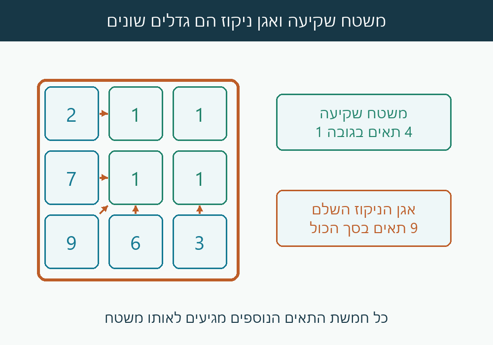
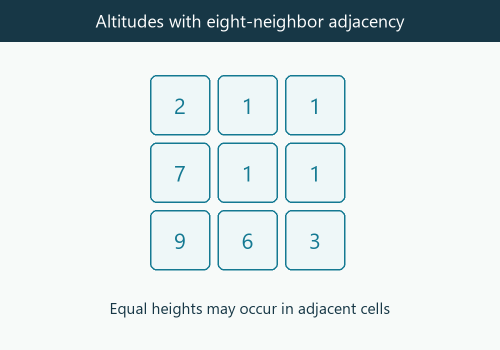
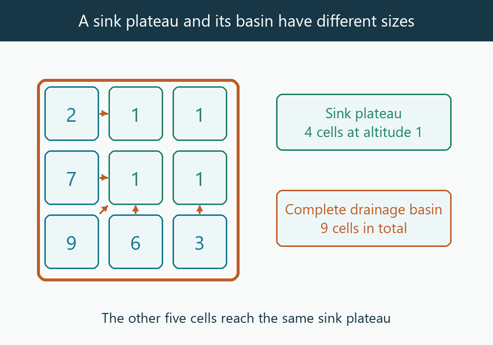

# PREP-355 — אגני ניקוז בשמונה שכנים עם משטחי גובה שווה

פתרון מוצע בסיוע AI. ממתין לביקורת מקצועית אנושית.

[צילום המקור](../sources/2026-11-15-batch10c-10.png)

Eight-neighbor rainfall drainage over a two-dimensional altitude array, assigning cells to a shared sink basin; the source examples contain equal heights.

## אגני ניקוז בשמונה שכנים עם משטחי גובה שווה

נתונה מטריצה מלבנית לא ריקה של גבהים שלמים. שכנים הם כל שמונת התאים שבמרחק שורה ועמודה לכל היותר 1, בתוך המטריצה. מצאו את אגני הניקוז והחזירו באמצעות basin_sizes(heights) את גדליהם בסדר לא עולה. כל תא נספר פעם אחת.

במודל הזה כל רכיב קשיר בשמונה שכנים שגובהו קבוע הוא משטח אחד. אם יש לו שכן גבול נמוך ממש, כל המשטח זורם אל השכן המזערי לפי (גובה,שורה,עמודה). אם אין שכן נמוך, המשטח הוא אגן שקיעה. אגן ניקוז כולל את משטח השקיעה ואת כל התאים שמגיעים אליו דרך שרשרת זרימות. מחוץ למטריצה אין תאים.

לדוגמה [[2,1,1],[7,1,1],[9,6,3]] מחזירה [9]. ארבעת תאי הגובה 1 הם משטח שקיעה אחד, ושאר חמשת התאים מתנקזים אליו. המטריצה [[0,9,1]] מחזירה [2,1].


### רמזים

1. מה יכול לקרות אם מאשרים לתא לזרום לשכן באותו גובה בלי כלל נוסף?
2. אחדו תאים שווי גובה לרכיבים קשירים. לכל רכיב בחרו יציאה נמוכה אחת או סמנו שהוא שקיעה.
3. בגרף הרכיבים כל קשת מורידה גובה ממש. מצאו את יעד השקיעה של כל רכיב עם דחיסת מסלולים, ואז סכמו את מספר התאים לפי היעד.

### פתרון מוצע

### פותרים את עמימות המשטחים
בחירת שכן באותו גובה עלולה ליצור מחזור. הגדרת משטח שלם כאובייקט אחד נותנת כללי זרימה סופיים לכל הקלטים, כולל מטריצה שטוחה. התא היחיד, המשטח השטוח והרכיבים הנוגעים באלכסון מטופלים באותו אופן. קואורדינטות הגבול חותכות את שכונת שמונת התאים.

### שלבי האלגוריתם
1. מאחדים תאים שווי גובה סמוכים באמצעות union-find. ארבעה כיווני מבט לאחור מספיקים לביקור בכל קשר בלתי מכוון פעם אחת.
2. לכל רכיב סורקים את שכני הגבול הנמוכים ממש. בוחרים מועמד בעל השלשה הקטנה ביותר (גובה,שורה,עמודה). רכיב בלי מועמד הוא שקיעה.
3. עוברים לאורך מצביעי היציאה של הרכיבים. מסלול המגיע לשקיעה או ליעד שכבר חושב מקבל את אותו יעד לכל אורכו.
4. משייכים כל תא ליעד ומונים. המימוש כולל drainage_labels לציור תוויות, ו־basin_sizes מחזירה רק גדלים ממוינים. המספור הפנימי של תוויות נקבע לפי התא הראשון של משטח השקיעה בסריקת שורות; גודל האגן אינו תלוי במספור.

### מדוע התהליך מסתיים
כל קשת יוצאת מרכיב בגובה h אל רכיב נמוך ממנו ממש. לכן אין מחזור בגרף הזרימות הסופי. לכל רכיב יש לכל היותר יציאה אחת, ולכן יש לו יעד שקיעה יחיד. כל תא שייך לרכיב אחד וליעד אחד, וסכום גדלי האגנים הוא בדיוק מספר תאי המטריצה.

בדוגמה [[0,9,1]], התא האמצעי בוחר 0 כי הוא השכן הנמוך ביותר, ולכן הגדלים [2,1]. במקרה [[0,9,0]] השוויון בין יעדי הגבול נשבר לפי מיקום, ולכן התא האמצעי זורם לתא השמאלי. במטריצה שטוחה של שישה תאים מתקבל [6].

### עלות
עבור N תאים ו־B אגנים, איחוד השכנים הוא O(N α(N)) עם איחוד לפי דרגה ודחיסת מסלולים. בחירת היציאות והליכה דחוסה ליעדים מוסיפות זמן ליניארי. מיון גדלי האגנים עולה O(B log B), והזיכרון O(N). אם אין צורך בסדר הגדלים, אפשר להחזירם בלי עלות המיון. המודל אינו סימולציה של זרימת מים פיזית; הוא מגדיר חלוקה דטרמיניסטית בהתאם לכללי התרגיל.

```python
"""Eight-neighbor plateau drainage with deterministic lower-boundary outlets."""
from collections import Counter


def drainage_labels(heights):
    if (not isinstance(heights, list) or not heights
            or not isinstance(heights[0], list) or not heights[0]):
        raise ValueError("nonempty rectangular integer matrix required")
    rows, columns = len(heights), len(heights[0])
    if any(not isinstance(row, list) or len(row) != columns
           or any(type(value) is not int for value in row) for row in heights):
        raise ValueError("nonempty rectangular integer matrix required")
    size = rows * columns
    parent = list(range(size))
    rank = [0] * size

    def find(cell):
        while parent[cell] != cell:
            parent[cell] = parent[parent[cell]]
            cell = parent[cell]
        return cell

    def unite(a, b):
        a, b = find(a), find(b)
        if a == b:
            return
        if rank[a] < rank[b]:
            a, b = b, a
        parent[b] = a
        if rank[a] == rank[b]:
            rank[a] += 1

    for y in range(rows):
        for x in range(columns):
            for dy, dx in ((-1, -1), (-1, 0), (-1, 1), (0, -1)):
                yy, xx = y + dy, x + dx
                if (0 <= yy < rows and 0 <= xx < columns
                        and heights[yy][xx] == heights[y][x]):
                    unite(y * columns + x, yy * columns + xx)
    roots = [find(cell) for cell in range(size)]
    outlets = {}
    for y in range(rows):
        for x in range(columns):
            root = roots[y * columns + x]
            for dy in (-1, 0, 1):
                for dx in (-1, 0, 1):
                    yy, xx = y + dy, x + dx
                    if (0 <= yy < rows and 0 <= xx < columns
                            and heights[yy][xx] < heights[y][x]):
                        candidate = (heights[yy][xx], yy, xx)
                        if root not in outlets or candidate < outlets[root]:
                            outlets[root] = candidate
    flow = {root: roots[y * columns + x]
            for root, (_, y, x) in outlets.items()}
    sinks = {}
    for root in set(roots):
        path = []
        current = root
        while current not in sinks and current in flow:
            path.append(current)
            current = flow[current]
        destination = sinks.get(current, current)
        sinks[current] = destination
        for member in path:
            sinks[member] = destination
    # Label sinks by the first cell of their own plateau in row-major order.
    labels_for_sink = {}
    for cell, root in enumerate(roots):
        if sinks[root] == root and root not in labels_for_sink:
            labels_for_sink[root] = len(labels_for_sink)
    labels = [[labels_for_sink[sinks[roots[y * columns + x]]]
               for x in range(columns)] for y in range(rows)]
    counts = Counter(value for row in labels for value in row)
    sizes = [counts[label] for label in range(len(labels_for_sink))]
    return labels, sizes


def basin_sizes(heights):
    _, sizes = drainage_labels(heights)
    return sorted(sizes, reverse=True)
```



### הנחות

משטחי גובה שווה קשירים בשמונה שכנים, יציאה נמוכה לפי גובה ואז מיקום, וללא תאים חיצוניים.

### מקרה קצה

תא אחד, מטריצה שטוחה, מגע אלכסוני בלבד, שתי שקיעות שוות גובה, שבירת שוויון בין שכנים, גבהים שליליים ושורה או עמודה יחידה.

### טעות נפוצה

זרימה לשכן שווה ללא טיפול ברכיב עלולה להיתקע במחזור. צמצום לשכנות ארבעה כיוונים משנה את המשטחים. גודל השקיעה אינו בהכרח גודל כל האגן.

### סיבוכיות או עלות

O(N α(N)+B log B) עבור N תאים ו־B אגנים. · O(N).

### בדיקות

אורקל עצמאי משתמש בחיפוש ברוחב לרכיבי הגובה ובהליכה פשוטה לכל תא, ללא union-find. הוא משווה גדלים ותוויות שיוך על תחומים קטנים ודוגמאות שפה.

### תשובה קצרה

מאחדים משטחים שווי גובה, בוחרים לכל משטח יציאה נמוכה דטרמיניסטית, מוצאים יעד שקיעה לכל רכיב ומונים את התאים לפי היעד.

### שאלת המשך

איך תייצגו מצב שבו מים ממשטח מתפצלים לכמה מוצאים? גרף עם כמה קשתות ושיעורי זרימה דורש מודל שונה של חלוקת מסה; כבר אין שיוך יחיד של תא לאגן בלי כלל נוסף.

## Eight-neighbor drainage basins with equal-height plateaus

Given a nonempty rectangular matrix of integer altitudes, use all eight in-bounds neighbors around each cell. Implement basin_sizes(heights), returning basin cell counts in nonincreasing order. Count every cell exactly once.

In this model, each equal-height eight-connected component is one plateau. If it has a strictly lower boundary neighbor, the whole plateau flows to the minimum neighbor by (altitude,row,column). A plateau without a lower neighbor is a sink. A drainage basin contains its sink plateau and every cell whose flow chain reaches it. There are no cells outside the matrix.

For example, [[2,1,1],[7,1,1],[9,6,3]] returns [9]. Its four altitude-one cells form one sink plateau, and the other five cells drain to it. Matrix [[0,9,1]] returns [2,1].



### Hints

1. What can happen if a cell may flow to an equal-height neighbor without any further rule?
2. Condense equal-height connected cells into plateaus. Give each plateau one strictly lower outlet or mark it as a sink.
3. Each component edge strictly decreases altitude. Find and compress each component’s sink destination, then aggregate cell counts by destination.

### Proposed solution

### Make plateau behavior well-defined
Equal-height neighbor choices can form cycles. Treating a whole plateau as one object supplies a finite drainage rule, including for completely flat matrices. Singletons, flat regions and diagonal contacts use the same definition. At frame edges, use only existing neighbors.

### Algorithm
1. Join equal-height neighboring cells with union-find. Four backward directions visit every undirected adjacency once.
2. Scan each component’s strictly lower boundary neighbors and retain the least (height,row,column) triple. A component without an outlet is a sink.
3. Follow component outlet pointers. Reaching a sink or a previously computed destination gives that destination to the entire path.
4. Assign every cell to its destination and count. drainage_labels also supplies drawing labels; basin_sizes returns only sorted sizes. Labels follow the first cell of each sink plateau in row-major order, but basin sizes do not depend on label names.

### Termination and correctness
Every component edge leads from height h to a strictly lower height. The finite flow graph has no cycle. At most one outgoing edge gives each component a unique sink destination. Each cell belongs to exactly one component and one destination, so basin sizes sum to the number of matrix cells.

For [[0,9,1]], the middle cell chooses altitude zero, giving [2,1]. For [[0,9,0]], equal outlet heights are resolved by position, so the middle cell drains left. A flat six-cell matrix gives [6].

### Cost
For N cells and B basins, union by rank with path compression costs O(N α(N)). Outlet selection and compressed destination traversal add linear work. Sorting basin sizes costs O(B log B); space is O(N). If unordered sizes suffice, omit sorting. This is a deterministic discrete drainage model, with its behavior set by the stated exercise rules.

```python
"""Eight-neighbor plateau drainage with deterministic lower-boundary outlets."""
from collections import Counter


def drainage_labels(heights):
    if (not isinstance(heights, list) or not heights
            or not isinstance(heights[0], list) or not heights[0]):
        raise ValueError("nonempty rectangular integer matrix required")
    rows, columns = len(heights), len(heights[0])
    if any(not isinstance(row, list) or len(row) != columns
           or any(type(value) is not int for value in row) for row in heights):
        raise ValueError("nonempty rectangular integer matrix required")
    size = rows * columns
    parent = list(range(size))
    rank = [0] * size

    def find(cell):
        while parent[cell] != cell:
            parent[cell] = parent[parent[cell]]
            cell = parent[cell]
        return cell

    def unite(a, b):
        a, b = find(a), find(b)
        if a == b:
            return
        if rank[a] < rank[b]:
            a, b = b, a
        parent[b] = a
        if rank[a] == rank[b]:
            rank[a] += 1

    for y in range(rows):
        for x in range(columns):
            for dy, dx in ((-1, -1), (-1, 0), (-1, 1), (0, -1)):
                yy, xx = y + dy, x + dx
                if (0 <= yy < rows and 0 <= xx < columns
                        and heights[yy][xx] == heights[y][x]):
                    unite(y * columns + x, yy * columns + xx)
    roots = [find(cell) for cell in range(size)]
    outlets = {}
    for y in range(rows):
        for x in range(columns):
            root = roots[y * columns + x]
            for dy in (-1, 0, 1):
                for dx in (-1, 0, 1):
                    yy, xx = y + dy, x + dx
                    if (0 <= yy < rows and 0 <= xx < columns
                            and heights[yy][xx] < heights[y][x]):
                        candidate = (heights[yy][xx], yy, xx)
                        if root not in outlets or candidate < outlets[root]:
                            outlets[root] = candidate
    flow = {root: roots[y * columns + x]
            for root, (_, y, x) in outlets.items()}
    sinks = {}
    for root in set(roots):
        path = []
        current = root
        while current not in sinks and current in flow:
            path.append(current)
            current = flow[current]
        destination = sinks.get(current, current)
        sinks[current] = destination
        for member in path:
            sinks[member] = destination
    # Label sinks by the first cell of their own plateau in row-major order.
    labels_for_sink = {}
    for cell, root in enumerate(roots):
        if sinks[root] == root and root not in labels_for_sink:
            labels_for_sink[root] = len(labels_for_sink)
    labels = [[labels_for_sink[sinks[roots[y * columns + x]]]
               for x in range(columns)] for y in range(rows)]
    counts = Counter(value for row in labels for value in row)
    sizes = [counts[label] for label in range(len(labels_for_sink))]
    return labels, sizes


def basin_sizes(heights):
    _, sizes = drainage_labels(heights)
    return sorted(sizes, reverse=True)
```



### Assumptions

Equal-height eight-connected plateaus, lower outlets chosen by altitude then location, and no outside cells.

### Edge case

A singleton, a flat frame, diagonal-only contact, equal-height distinct sinks, tied boundary outlets, negative altitudes and a single row or column.

### Common mistake

Flowing to equal neighbors without component handling can create cycles. Four-neighbor connectivity changes the plateau definition. A sink plateau’s size may differ from its complete basin size.

### Cost

O(N α(N)+B log B) for N cells and B basins. · O(N).

### Verification

An independent oracle uses breadth-first components and plain per-cell destination walks without union-find. It compares basin sizes and grouping on small exhaustive inputs and edge examples.

### Interview answer

Condense equal plateaus, choose one deterministic lower outlet, compress destinations and aggregate cell counts at sinks.

### Follow-up

How would splitting plateau water among several outlets change the model? Multiple edges with flow fractions require a mass-splitting model; a unique cell-to-basin assignment needs an additional convention.

[checks/check_images1115c.py](../checks/check_images1115c.py)

[checks/prep-355-1115c-verification.json](../checks/prep-355-1115c-verification.json)

[solutions/prep_355_plateau_basins.py](../solutions/prep_355_plateau_basins.py)
