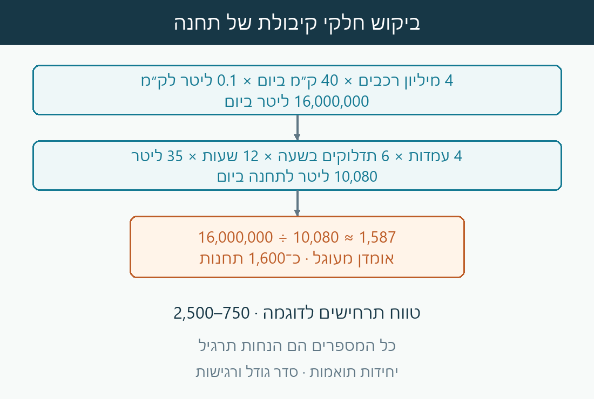
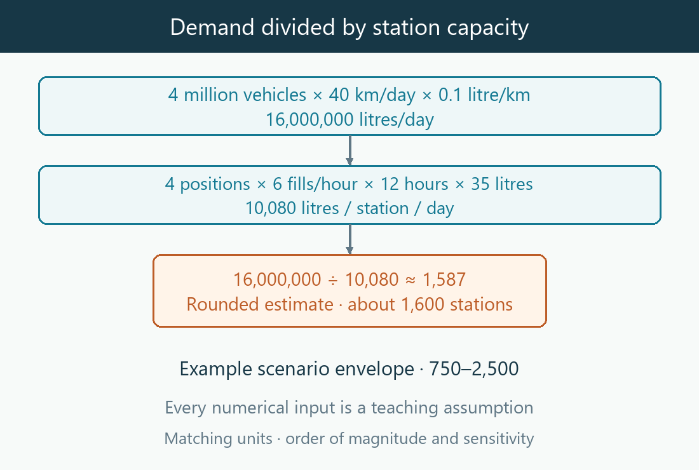

# PREP-358 — אומדן פרמי למספר תחנות הדלק בישראל

פתרון מוצע בסיוע AI. ממתין לביקורת מקצועית אנושית.

[צילום המקור](../sources/2026-11-15-batch10c-03.png)

כמה תחנות דלק יש במדינת ישראל?

## אומדן פרמי למספר תחנות הדלק בישראל

הציעו אומדן לסדר הגודל של מספר תחנות הדלק בישראל. הגדירו מה נחשב תחנה, פרקו את הביקוש ואת הקיבולת לגורמים, כתבו יחידות ובדקו כיצד שינוי ההנחות משנה את התוצאה. תחנה בתרגיל היא אתר קמעונאי ציבורי אחד לתדלוק כלי רכב, בלי קשר למספר המשאבות או למותג. בחרו הנחות עגולות משלכם; אין צורך לשלוף מספר רשמי. בפתרון לדוגמה כל המספרים הם הנחות תרגיל ולא נתוני שטח.

### רמזים

1. אפשר לחשוב על הביקוש היומי לדלק ועל כמות הדלק שתחנה ממוצעת מספקת ביום.
2. העריכו מספר כלי רכב, מרחק יומי וצריכת דלק לקילומטר. עבור תחנה העריכו עמדות, קצב תדלוקים, שעות פעילות אפקטיביות וכמות לתדלוק.
3. מספר התחנות בקירוב הוא ליטרים ליום לכל המשק חלקי ליטרים ליום לתחנה. בדקו גם תדלוקים ליום ובנו טווח בעזרת שינוי ההנחות.

### פתרון מוצע

### מפרידים את הגורמים
נבחר לצורך הדוגמה 4 מיליון כלי רכב המשתמשים בדלק, 40 קילומטר לרכב ביום וצריכה ממוצעת של 0.1 ליטר לקילומטר. אלה הנחות עגולות לצורך החשבון. הביקוש המתקבל הוא 4,000,000×40×0.1=16,000,000 ליטר ביום. יחידות הרכב והקילומטר מצטמצמות ונשאר ליטר ליום.

נניח שבתחנה ממוצעת יש ארבע עמדות פעילות בו־זמנית, שש עסקאות לעמדה בשעה, 12 שעות פעילות אפקטיביות ביום ו־35 ליטר לעסקה. אין הכוונה שכל אתר פתוח רק 12 שעות; זהו מספר שעות שקול לקצב העומס שנבחר. התפוקה היא 4×6×12×35=10,080 ליטר לתחנה ביום. חלוקה נותנת 16,000,000/10,080≈1,587, ולכן האומדן המוצע הוא בערך 1,600 תחנות, בסדר גודל של אלפים. לא מציגים את 1,587 כספירה מדויקת.

### בדיקת עקביות וטווח
אותן הנחות נותנות כ־457,143 עסקאות תדלוק ביום, משום ש־16 מיליון ליטר מחולקים ב־35 ליטר לעסקה. תחנה מבצעת 288 עסקאות ביום, ולכן שוב מתקבל כ־1,587. זו בדיקת יחידות ואריתמטיקה של אותו מודל.

לאומדן חלופי נניח, באופן עצמאי מהנחת המרחק, שכל רכב מתדלק פעם בשמונה ימים. מתקבלות 500,000 עסקאות ביום; חלוקה ב־288 נותנת כ־1,736 תחנות. ההסכמה בסדר הגודל שימושית, אך שני המסלולים חולקים את הנחות מספר הרכבים ותפוקת התחנה ולכן אינם מדידות עצמאיות.

אם הביקוש היומי הוא 12–20 מיליון ליטר והתפוקה הממוצעת לתחנה היא 8–16 אלף ליטר ביום, הקצוות של היחס הם 750 ו־2,500 תחנות. זהו טווח תרחישים שנבחר, ללא טענה לרווח סמך סטטיסטי. מעבר מתפוקה כפולה לחצי תפוקה מכפיל את מספר התחנות הנדרש; הביקוש נמצא במונה והתפוקה במכנה.

### מה עלול לשנות את המודל
נדרש ממוצע אפקטיבי הכולל עומס נמוך, אזורים דלילים, סופי שבוע ושונות בין אתרים. רכבים חשמליים אינם צורכים דלק בתחנות שנכללות בהגדרה; מספר הרכבים שהנחנו כבר מתייחס לקבוצת הצרכנים. אין לספור עמדות במקום אתרים, לערבב ליטרים עם עסקאות, או להוסיף ספירת תחנות פרטיות שהוצאו מההגדרה.

תשובה לראיון מתחילה בהגדרה, ממשיכה בחשבון עם יחידות ומסתיימת בסדר גודל וברגישות. איכות ההנחות והיכולת לבדוק אותן הן חלק מהתרגיל. מספר עדכני ומאומת דורש נתון מתוארך ומקור שסופר אותה הגדרת תחנה.

### הנחות

כל מספר בדוגמה הוא הנחת עבודה. תחנה היא אתר קמעונאי ציבורי אחד, והביקוש והקיבולת נמדדים באותן יחידות זמן וכמות.

### מקרה קצה

אתר עם שש משאבות הוא עדיין תחנה אחת. אם מכלילים מתקני תדלוק פרטיים או רק תחנות ציבוריות, יש לשנות את ההגדרה ואת קיבולת השירות המתאימה.

### טעות נפוצה

הצגת תוצאת חלוקה מדויקת כאילו היא מספר התחנות שנמדד, או חלוקת כלי רכב ביום בליטרים לתחנה ביום בלי להמיר יחידות.

### סיבוכיות או עלות

החשבון כולל מספר קבוע של גורמים. זהו אומדן מבוסס הנחות; אופטימליות אלגוריתמית או דיוק סטטיסטי אינם היעד.

### בדיקות

החשבון נבדק באמצעות שברים מדויקים בשני מסלולי יחידות, במונוטוניות ובקצוות כל תרחישי הטווח. זו בדיקת המודל והאריתמטיקה, ללא ספירת אתרים אמיתיים.

### תשובה קצרה

הגדירו אתר ציבורי אחד, חשבו ביקוש יומי בליטרים וחלקו בתפוקה היומית לתחנה. בהנחות הדוגמה מתקבל כ־1,600 עם טווח תרחישים 750–2,500.

### שאלת המשך

איזו הנחה כדאי לבדוק תחילה כדי לצמצם את הטווח? זהו אילו גורמים נעים בטווח היחסי הגדול ביותר. אספו נתון תואם להגדרה על התפוקה האפקטיבית הממוצעת, ובדקו גם את סך הביקוש.

## A Fermi estimate of the number of fuel stations in Israel

Estimate the order of magnitude of the number of fuel stations in Israel. Define a station, break demand and service capacity into factors, retain units and test sensitivity. A station in this exercise is one public retail road-fuel site regardless of pump count or brand. Choose round assumptions; recalling an official count is unnecessary. Every numerical input in the example solution is an instructional assumption, not a field statistic.

### Hints

1. Consider total daily fuel demand and daily fuel supplied by an average station.
2. Estimate vehicle count, daily distance and litres per kilometre. For one station, estimate simultaneous service positions, fills per hour, effective operating hours and litres per fill.
3. Divide economy-wide litres per day by litres per station per day. Check the same calculation using fills, then form a range by varying the assumptions.

### Proposed solution

### Factor demand and capacity
Assume 4 million fuel-using vehicles, 40 kilometres per vehicle per day and average consumption of 0.1 litre per kilometre. These are round teaching inputs. They imply 4,000,000×40×0.1=16,000,000 litres per day. Vehicle and kilometre units cancel.

Assume four simultaneously active service positions per average station, six fills per position per hour, 12 effective hours per day and 35 litres per fill. Effective hours summarize varying utilization, rather than claiming that sites open for only 12 hours. Capacity becomes 4×6×12×35=10,080 litres per station per day. Dividing gives approximately 1,587 stations, which should be reported as roughly 1,600, an order of thousands. The quotient is not a precise census.

### Consistency and sensitivity
The same fuel assumptions imply approximately 457,143 fills per day after dividing 16 million litres by 35 litres per fill. One station handles 288 fills per day, giving the same approximately 1,587. This checks arithmetic and units within one model.

For another demand assumption, suppose each vehicle fills every eight days independently of the distance assumption. That gives 500,000 fills per day and approximately 1,736 stations at 288 fills per station per day. Agreement in scale helps check plausibility, but the routes share vehicle count and station capacity, so they are not independent measurements.

If demand is 12–20 million litres per day and average station capacity is 8–16 thousand litres per day, the ratio ranges from 750 to 2,500. This is a chosen scenario envelope, not a statistical confidence interval. Doubling demand doubles the required station count. Doubling station throughput halves it.

### Scope of the model
Effective averages must account for light traffic, sparse regions, weekends and site variation. Electric vehicles do not consume the road fuel included here; the assumed vehicle count already denotes the consuming group. Count sites rather than pumps and keep fills distinct from litres. Private fleet installations remain outside the selected scope.

An interview answer defines the target, develops unit-consistent arithmetic and reports a rounded scale with sensitivity. Assumptions and ways to validate them are part of the reasoning. A current verified count would require a dated source using the same station definition.

### Assumptions

Every numerical input is a teaching assumption. One station is one public retail site, and numerator and denominator use matching volume and time units.

### Edge case

A site with six pumps is one station. Including private installations changes the population being estimated and requires matching capacity assumptions.

### Common mistake

Treating the exact quotient as an observed count, or dividing vehicles per day by litres per station per day without a unit conversion.

### Cost

A constant number of factors is evaluated. This is an assumption-based estimate; algorithmic optimality and calibrated statistical accuracy are not the objective.

### Verification

Exact fractions checked both unit routes, monotonicity and every corner of the chosen scenario envelope. These checks validate arithmetic and the selected model, not a real-world station census.

### Interview answer

Define one public site, estimate daily litres demanded and divide by daily litres served per station. The teaching assumptions give roughly 1,600, with a selected scenario range of 750–2,500.

### Follow-up

Which assumption should be checked first to narrow the estimate? Identify factors with the widest relative ranges. Obtain definition-matched average effective throughput and validate total demand.

[checks/check_nov15c_algorithms.py](../checks/check_nov15c_algorithms.py)

[checks/prep-358-1115c-verification.json](../checks/prep-358-1115c-verification.json)
