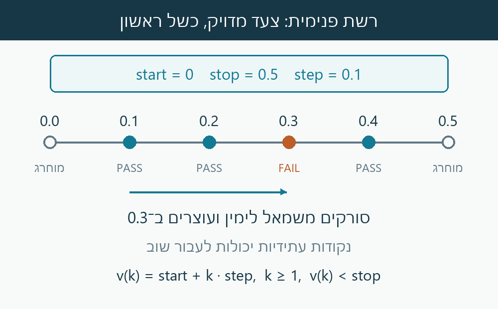
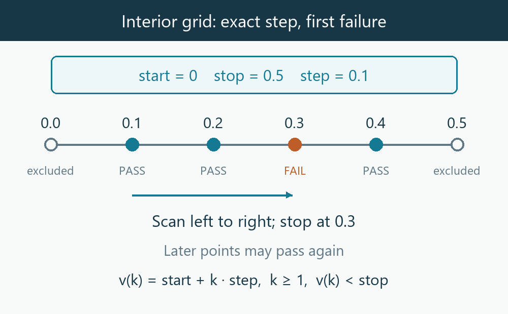

# PREP-359 — הכשל הראשון ברשת מתחים עם צעד שברי מדויק

פתרון מוצע בסיוע AI. ממתין לביקורת מקצועית אנושית.

[צילום המקור](../sources/2026-11-15-batch20d-04.png)

נתונה פונקציה Test(voltage) המחזירה ערך בוליאני. נתון start<voltage<stop וגם step לא בהכרח שלם. ממשו find_failure(start,stop,step) שמחזירה את המתח שבו מופיע הכשל הראשון.

## הכשל הראשון ברשת מתחים עם צעד שברי מדויק

ממשו find_failure(start,stop,step,test). שלושת ערכי המתח הם מחרוזות עשרוניות סופיות, start<stop ו־step>0. בדקו לפי הסדר רק את המתחים vₖ=start+k·step עבור k=1,2,… כל עוד vₖ<stop; שני הגבולות עצמם אינם נבדקים. test(v) מחזירה True למעבר ו־False לכשל, ויכולה לחזור לעבור אחרי כשל. החזירו את מתח הכשל הראשון לפי סדר הרשת, או None אם אין כשל. אין להניח מונוטוניות ואין לשנות את רשת הדגימה עקב שגיאת נקודה צפה. תארו סיבוכיות ומספר קריאות ל־test. בהמשך הסבירו מתי מותר לחפש בינארית.

לתרגול קוד, ממשו first_failure_voltage(start,stop,step,failed_voltages): רק המתחים המנויים ברשימת המחרוזות failed_voltages נכשלים; כל היתר עוברים. החזירו את המתח כשבר מצומצם [מונה,מכנה] או None. כשל מחוץ לרשת אינו תוצאה אפשרית. לדוגמה, בין 0 ל־1 בצעד 0.1, כש־0.3 ו־0.8 נכשלים, התוצאה [3,10].

### רמזים

1. הפרידו בין סדר הדגימה לבין תוצאות הבדיקה. האם ידיעה שמתח אחד עבר מאפשרת להסיק משהו על מתח אחר?
2. השתמשו במונה שלם k כדי להגדיר כל מתח מן ההתחלה. אפשר לפרש מחרוזת עשרונית כשבר מדויק, בלי חיבור חוזר של float.
3. סרקו k=1 והלאה, עצרו לפני stop והחזירו את הכשל הראשון. אם כל התוצאות הקודמות עברו, מהו האינווריאנט שמבטיח שזו התוצאה הראשונה?

### פתרון מוצע

### מגדירים בדיוק מה נבדק
נמיר כל מחרוזת עשרונית סופית לשבר מדויק. בניית Decimal ממחרוזת היא מדויקת; המרה ל־Fraction מאפשרת לבצע את פעולות הרשת באריתמטיקה של מספרים שלמים. אין כאן חישובי Decimal שתלויים בדיוק ההקשר. עבור k=1,2,… מחשבים v=start+k·step. אם v≥stop מסיימים ללא תוצאה. אחרת קוראים ל־test פעם אחת; False מחזירה מיד את v, ו־True מקדמת את k.

למשל start=0, stop=0.3, step=0.1 נותנים רק 0.1 ו־0.2. 0 ו־0.3 מוחרגים. אם step≥stop−start הרשת ריקה. בין 0 ל־1 עם צעד 0.1, כשל ב־0.3 נבחר בדיוק, גם אם מתח 0.4 עובר שוב. בחיבור חוזר של float הערך המיועד 0.3 עלול להיות מיוצג כ־0.30000000000000004 ולהחמיץ השוואה; המימוש אינו משתמש בחיבור כזה.

### נכונות ומספר בדיקות
לפני בדיקת vₖ כל נקודות הרשת בעלות אינדקס קטן מ־k כבר נבדקו ועברו. לכן הכשל המוחזר הוא הראשון. אם הלולאה מסתיימת, כל נקודות הרשת עברו. אם M הוא מספר הנקודות הפנימיות, M=max(0,ceil((stop−start)/step)−1), ובמקרה הגרוע נדרשות M קריאות. זה גם חסם תחתון למבחן שרירותי: בנקודה שלא נבדקה יכול להסתתר הכשל היחיד. הזמן O(M) בהנחת עלות קבועה לבדיקה ולאריתמטיקה, ועוד עלות test; האריתמטיקה המדויקת תלויה באורך הייצוג. לליבה נדרש מספר קבוע של משתנים, שגודלם בביטים עשוי לגדול.

מתאם התרגול בונה קבוצת מתחים נכשלים כדי לספק test דטרמיניסטי, ומחזיר את המונה והמכנה של התוצאה. קבוצה זו היא קלט סימולציה ולא דרך לנחש את תשובת קופסת הבדיקה המקורית; בנייתה מצריכה O(F) זיכרון עבור F ערכי כשל.

### מתי חיפוש בינארי תקף
רק אם מובטח שבסדר הרשת מתקבל רצף True ולאחריו רצף False, אפשר לחפש את האינדקס הקטן ביותר שנכשל ב־O(log M) קריאות, ולטפל גם במקרה שכל הנקודות עוברות. ללא ההבטחה, דילוג על נקודה עלול לדלג על הכשל הראשון. קריאות רועשות או מצב משתנה דורשים חוזה בדיקה אחר; סריקה אחת אינה מבטיחה איתור כשל פיזי לסירוגין.

```python
"""First failing point on an exact, strictly interior decimal-voltage grid."""
from decimal import Decimal, InvalidOperation
from fractions import Fraction


def decimal_fraction(text):
    if not isinstance(text, str):
        raise ValueError("finite decimal strings required")
    try:
        value = Decimal(text)
    except InvalidOperation as exc:
        raise ValueError("finite decimal strings required") from exc
    if not value.is_finite():
        raise ValueError("finite decimal strings required")
    return Fraction(value)


def find_failure(start, stop, step, test):
    """test(Fraction) is True for pass and False for fail; return Fraction/None."""
    first, limit, increment = map(decimal_fraction, (start, stop, step))
    if first >= limit or increment <= 0:
        raise ValueError("start < stop and positive step required")
    index = 1
    while (voltage := first + index * increment) < limit:
        if not test(voltage):
            return voltage
        index += 1
    return None


def first_failure_voltage(start, stop, step, failed_voltages):
    """JSON exercise adapter: only listed voltages fail, without monotonicity."""
    failures = {decimal_fraction(v) for v in failed_voltages}
    result = find_failure(start, stop, step, lambda voltage: voltage not in failures)
    if result is None:
        return None
    return [result.numerator, result.denominator]
```



### הנחות

הטווח פתוח בשני קצותיו, נקודת הרשת הראשונה היא start+step, הקלט הוא מחרוזות עשרוניות סופיות והצעד חיובי. True פירושו מעבר. המתאם מחזיר שבר מצומצם.

### מקרה קצה

רשת ריקה; כשל בנקודה הראשונה או האחרונה; כל הנקודות עוברות; כשל רק בגבול המוחרג; צעד שאינו מחלק את הטווח; מתח שלילי; ייצוגים שקולים כגון 0.30 ו־3e-1; מעבר מחדש אחרי כשל.

### טעות נפוצה

חיפוש בינארי בלי הבטחת מונוטוניות; הכללת start או stop בניגוד לחוזה; חיבור חוזר של float; דיווח על כשל בין נקודות הרשת; לולאה אינסופית בצעד אפס.

### סיבוכיות או עלות

M קריאות במקרה הגרוע הן הכרחיות למבחן שרירותי. חיפוש בינארי O(log M) שייך רק להרחבה המונוטונית; אורך מספרים ועלות הבדיקה אינם נעלמים.

### בדיקות

נבדקו רשתות מדויקות מול אורקל של סרגל מספרים שלמים, כל דפוסי הכשל ברשתות קטנות ומקרי קצה עשרוניים, כולל 0.3 וכשלים לא מונוטוניים. זו בדיקת אלגוריתם ולא ניסוי ציוד.

### תשובה קצרה

אני מגדיר רשת פנימית start+k·step, סורק אינדקסים שלמים עם אריתמטיקה מדויקת ועוצר ב־False הראשון. בלי מונוטוניות צריך עד M בדיקות; עם סף יחיד אפשר לחפש בינארית.

### שאלת המשך

כיצד תשתנה השיטה אם test עוברת בכל הנקודות עד סף ומאותו סף תמיד נכשלת? חשבו את מספר הנקודות ברשת וחפשו את האינדקס הראשון שנכשל, עם גבול וירטואלי M+1 למצב ללא כשל. המשיכו לחשב מתח מתוך אינדקס שלם.

## First failure on an exact fractional-voltage grid

Implement find_failure(start,stop,step,test). The three voltage parameters are finite decimal strings with start<stop and step>0. Test only vₖ=start+k·step for k=1,2,… while vₖ<stop, in that order; neither endpoint is tested. test(v) returns True for pass and False for fail, and may pass again after failing. Return the first failing grid voltage or None if none fails. Do not assume monotonicity or change the sampling grid through floating-point error. Analyze runtime and test calls, then explain when binary search is valid.

For executable practice implement first_failure_voltage(start,stop,step,failed_voltages): only voltages listed as decimal strings in failed_voltages fail; all others pass. Return a reduced [numerator,denominator] pair or None. An off-grid failure is not a candidate. For example, between 0 and 1 with step 0.1 and failures 0.3 and 0.8, return [3,10].

### Hints

1. Separate sampling order from test outcomes. Does a pass at one voltage tell you anything about a different voltage?
2. Use an integer index k to define every voltage from the origin. A decimal string can be parsed into an exact rational without repeatedly adding a float.
3. Scan k=1 onward, stopping before stop, and return the first failure. State what is known about every earlier point when each new point is tested.

### Proposed solution

### Define the tested points exactly
Parse each finite decimal string into an exact rational. Decimal construction from a string is exact; converting it to Fraction gives integer-based grid arithmetic. No Decimal arithmetic depends on the decimal context precision here. For k=1,2,… compute v=start+k·step. Stop with no result if v≥stop. Otherwise call test once, return v on False, and advance k on True.

For start=0, stop=0.3 and step=0.1 the only candidates are 0.1 and 0.2; both 0 and 0.3 are excluded. If step≥stop−start the grid is empty. Between 0 and 1 with step 0.1, a failure at 0.3 is selected exactly even if 0.4 passes again. Repeated float addition can represent the intended 0.3 as 0.30000000000000004 and miss an equality test; the implementation avoids that operation.

### Correctness and query count
Before testing vₖ, every earlier grid point has been tested and passed. Thus any returned failure is the earliest. If the loop finishes, all candidates passed. With M grid points, M=max(0,ceil((stop−start)/step)−1), at most M test calls occur. This worst-case bound is necessary for an arbitrary predicate: an untested candidate could be the only failing point. Runtime is O(M) under unit-cost test/arithmetic assumptions, plus the actual test cost; exact arithmetic also depends on representation length. The core uses a constant number of variables whose bit lengths may grow.

The practice adapter constructs a set of failing voltages to provide a deterministic test and returns the rational numerator and denominator. This set is simulation input, not a shortcut available for the original black-box tester. Building it uses O(F) storage for F supplied failure values.

### When binary search applies
Only a promise that grid outcomes form a prefix of True followed by a suffix of False permits binary search for the first failing index in O(log M) calls, including the all-pass case. Without that promise, skipping a candidate can skip the first failure. Noisy or stateful tests require a different contract; one scan does not guarantee detection of intermittent physical failure.

```python
"""First failing point on an exact, strictly interior decimal-voltage grid."""
from decimal import Decimal, InvalidOperation
from fractions import Fraction


def decimal_fraction(text):
    if not isinstance(text, str):
        raise ValueError("finite decimal strings required")
    try:
        value = Decimal(text)
    except InvalidOperation as exc:
        raise ValueError("finite decimal strings required") from exc
    if not value.is_finite():
        raise ValueError("finite decimal strings required")
    return Fraction(value)


def find_failure(start, stop, step, test):
    """test(Fraction) is True for pass and False for fail; return Fraction/None."""
    first, limit, increment = map(decimal_fraction, (start, stop, step))
    if first >= limit or increment <= 0:
        raise ValueError("start < stop and positive step required")
    index = 1
    while (voltage := first + index * increment) < limit:
        if not test(voltage):
            return voltage
        index += 1
    return None


def first_failure_voltage(start, stop, step, failed_voltages):
    """JSON exercise adapter: only listed voltages fail, without monotonicity."""
    failures = {decimal_fraction(v) for v in failed_voltages}
    result = find_failure(start, stop, step, lambda voltage: voltage not in failures)
    if result is None:
        return None
    return [result.numerator, result.denominator]
```



### Assumptions

Both bounds are strict; the first candidate is start+step. Inputs are finite decimal strings and step is positive. True means pass. The practice adapter returns a reduced fraction.

### Edge case

An empty grid; first/last candidate failure; all passing; failure only at an excluded endpoint; a step not dividing the range; negative voltage; equivalent values such as 0.30 and 3e-1; a pass after a failure.

### Common mistake

Binary search without monotonicity; including start or stop; repeated float addition; returning an off-grid failure; an endless loop from a zero step.

### Cost

M worst-case calls are necessary for arbitrary test outcomes. O(log M) belongs only to the monotonic extension; numeric bit length and test cost still matter.

### Verification

Checks compare against an independent scaled-integer grid oracle, enumerate all failure patterns on small grids and cover decimal endpoints, 0.3 and nonmonotonic failures. This verifies an algorithm, not physical test equipment.

### Interview answer

I define the strict interior grid start+k·step, scan integer indices with exact arithmetic, and stop at the first False. Arbitrary outcomes need up to M calls; one permanent threshold permits binary search.

### Follow-up

How does the method change if all candidates pass until one threshold and fail thereafter? Count the grid points and binary-search the first failing index, allowing a virtual M+1 endpoint for no failure. Continue deriving voltages from integer indices.

[checks/check_nov15d_software.py](../checks/check_nov15d_software.py)

[checks/prep-359-1115d-verification.json](../checks/prep-359-1115d-verification.json)

[solutions/prep_359_first_failure_decimal_grid.py](../solutions/prep_359_first_failure_decimal_grid.py)
