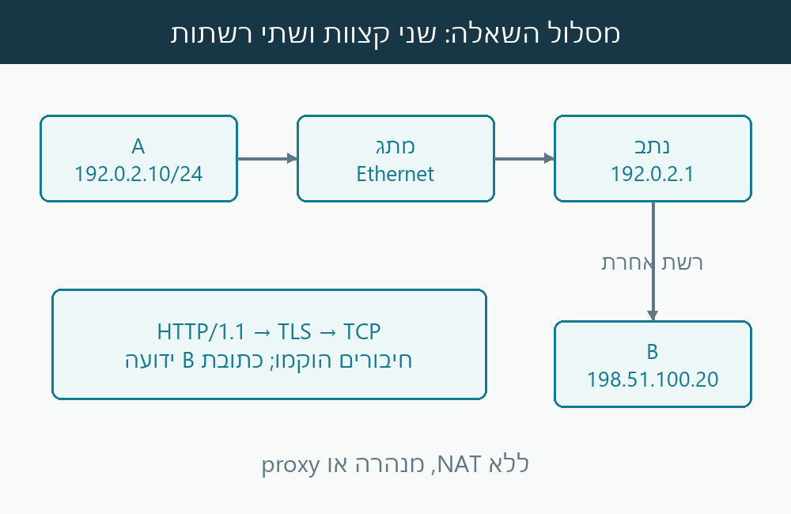
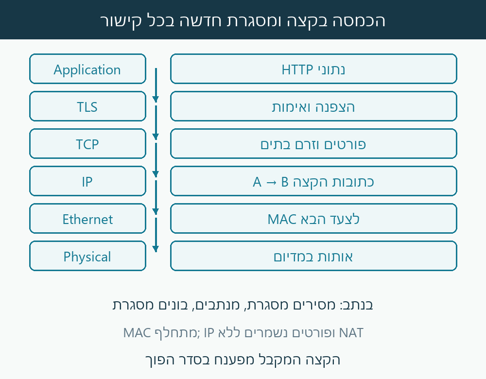
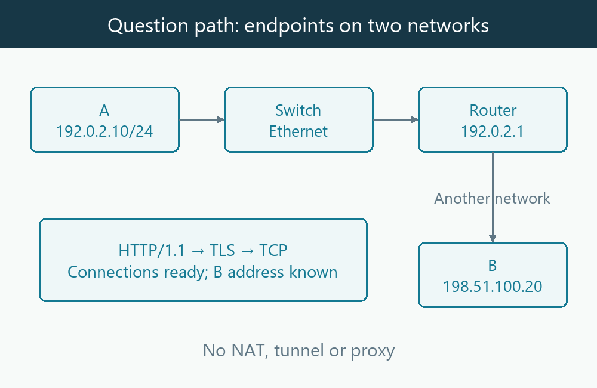
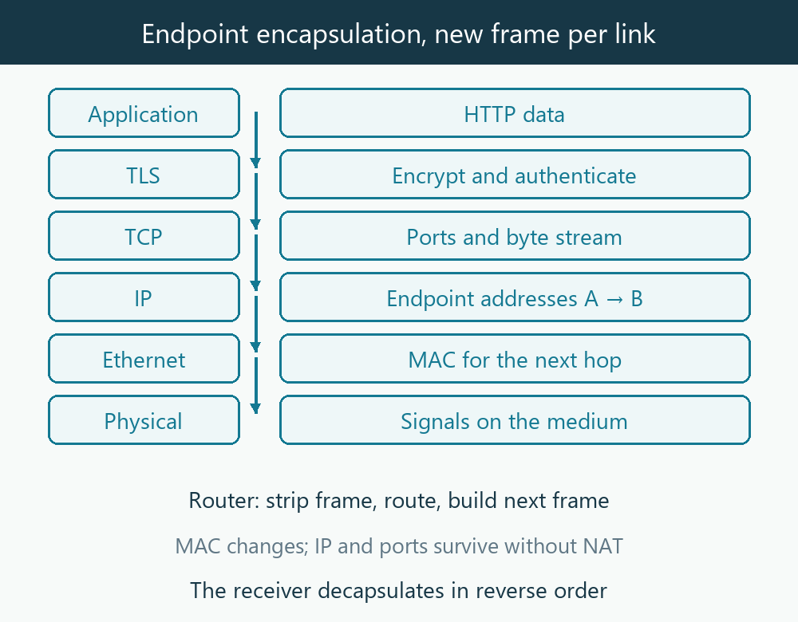

# PREP-360 — שבע שכבות OSI ומסעה של חבילה דרך נתב

פתרון מוצע בסיוע AI. ממתין לביקורת מקצועית אנושית.

[צילום המקור](../sources/2026-11-15-batch20d-06.png)

תאר את מודל ה־OSI מתחילתו ועד סופו. הסבר את התהליך של העברת פקטה ברשת בפירוט.

## שבע שכבות OSI ומסעה של חבילה דרך נתב

תארו את שבע שכבות OSI, את תפקידה של כל שכבה ואת ההכמסה והפענוח בצד המקבל. עקבו אחרי בקשת HTTP/1.1 מעל TLS ו־TCP ממחשב A דרך מתג Ethernet ונתב אל שרת B ברשת אחרת. כתובת השרת כבר ידועה, חיבורי TCP ו־TLS כבר הוקמו, ואין NAT, מנהרות או proxy. הסבירו אילו כתובות מתארות את הקצוות ואילו את הצעד המקומי; כיצד מתג ונתב מחליטים לאן להעביר; מה קורה כאשר כתובת MAC של הצעד הבא אינה שמורה; וכיצד MTU, אובדן והצפנה משפיעים על התהליך. השוו בקצרה ל־IPv6 ול־UDP. אין צורך לשחזר את פורמט כל הביטים בכותרות.

### רמזים

1. חלקו את המסע לשני דברים: שירות בין היישומים מקצה לקצה, והעברה בקישור מקומי אחד בכל פעם.
2. עקבו בנפרד אחרי כתובות IP, מספרי פורטים וכתובות MAC. למי מיועדת מסגרת Ethernet כשהשרת מחוץ לרשת המקומית?
3. רשמו מה מוסיף השולח בכל שכבה, מה מתג בודק ומה נתב מסיר ובונה מחדש. בדקו מי מטפל באובדן ומי יכול לפענח את התוכן.

### פתרון מוצע

### שבע שכבות ותפקידי השירות
|מספר|שכבה|תפקיד מושגי|
|---|---|---|
|7|יישום — Application|פרוטוקול השירות, למשל בקשת HTTP ומשמעות השדות.|
|6|ייצוג — Presentation|ייצוג נתונים, קידוד והמרות; הצפנה ודחיסה הן דוגמאות לפונקציות אפשריות.|
|5|שיחה — Session|ניהול דיאלוג, פתיחה/המשך/סיום וסנכרון שיחה.|
|4|תעבורה — Transport|קישור בין נקודות קצה של יישומים, פורטים ושירות TCP או UDP.|
|3|רשת — Network|כתובות לוגיות והעברה בין רשתות, למשל IP וניתוב.|
|2|קישור נתונים — Data Link|מסגרות בקישור מקומי, כתובות MAC ובדיקת שגיאות מסגרת.|
|1|פיזית — Physical|אותות על המדיום, קידוד ושידור ביטים.|

זהו מודל ייחוס. בחבילת פרוטוקולי האינטרנט, תפקידי 5–7 משולבים לרוב בפרוטוקולים ובספריות יישום; אין דרישה לשלוש כותרות נוספות. TLS בדוגמה פועל מעל TCP ומתחת ל־HTTP ומספק פונקציות אבטחה, ולא שכבת OSI עצמאית וקבועה. [מודל OSI, ITU-T X.200](https://www.itu.int/rec/T-REC-X.200-199407-I/en); [שכבות האינטרנט, RFC 1122](https://www.rfc-editor.org/rfc/rfc1122.html).

### מכינים נתונים להעברה
היישום יוצר בקשת HTTP; TLS מגן על נתוני היישום ברשומות מוצפנות ומאומתות. TCP מספק זרם בתים מסודר ואמין באמצעות מספרי רצף, אישורים, שידור חוזר ובקרת זרימה/גודש. הוא אינו שומר גבולות הודעות HTTP: רשומת TLS, הודעת יישום ומקטע TCP אינם חייבים להתאים אחד לאחד. מקטע TCP כולל פורטים ומשובץ בחבילת IP עם כתובות A ו־B. [TCP, RFC 9293](https://www.rfc-editor.org/rfc/rfc9293.html); [TLS 1.3, RFC 8446](https://www.rfc-editor.org/rfc/rfc8446.html).

למשל A=192.0.2.10/24 ו־B=198.51.100.20, עם שער ברירת מחדל 192.0.2.1. טבלת הניתוב ב־A בוחרת בשער כצעד הבא. מסגרת Ethernet הראשונה מכילה IP יעד של B אבל MAC יעד של ממשק הנתב המקומי. אם המיפוי IPv4→MAC חסר במטמון, A שולח בקשת ARP בקישור המקומי ומקבל תשובה; הוא אינו מנסה לפתור MAC של השרת הרחוק דרך ARP. פרטים נפתרים מתוך טבלת הניתוב, לא רק מתוך דמיון מספרי כתובות. [ARP, RFC 826](https://www.rfc-editor.org/rfc/rfc826.html).

### בקישור ובנתב
הכרטיס יוצר מסגרת ובה MAC מקור/יעד, סוג מטען ו־FCS, ומשדר אותות. מתג שכבה 2 לומד MAC מקור לפי פורט כניסה ומעביר לפי MAC יעד בתחום הרשת המקומית; יעד לא מוכר ובקשות שידור מופצים בהתאם לתחום ה־VLAN. המתג אינו מחליף את כתובות ה־IP או מפחית TTL בהעברת שכבה 2 רגילה.

הנתב מקבל מסגרת המיועדת לממשק שלו, מסיר את מעטפת הקישור, בודק את חבילת IP ומחפש נתיב המתאים לכתובת היעד, בדרך כלל לפי הקידומת המתאימה הארוכה ביותר. בהעברת IPv4 הוא מפחית TTL ומעדכן את checksum של כותרת IPv4; כשתקציב הקפיצות נגמר אין להעביר הלאה. הוא בוחר ממשק וצעד הבא, פותר את כתובת הקישור הנדרשת ויוצר מסגרת חדשה. כתובות MAC משתנות במעבר בין קישורים; כתובות IP הקצה ופורטי TCP נשמרים בתרחיש ללא NAT. הנתב אינו יוצר חיבור TCP חדש לצורך כל קפיצה.

ב־B סדר העבודה מתהפך: קבלת האותות, בדיקת מסגרת וקילופה, זיהוי IP, מסירה ל־TCP לפי הפרוטוקול/פורטים, סידור הבתים ושידורים חוזרים לפי הצורך, אימות ופענוח TLS ואז פירוש HTTP. הנתב והמתג אינם מפענחים את תוכן TLS בדוגמה; כתובות ומידע תעבורה הנדרשים להעברה עדיין גלויים להם.

### גודל, כשל וחלופות
MTU מגביל את גודל חבילת IP הנישאת בקישור. TCP יכול לחלק את הזרם למקטעים מתאימים; זו אינה פעולת fragmentation של IP. ב־IPv4 נתב עשוי לפצל חבילה אם DF=0, או להשליך ולסמן צורך בגודל קטן יותר אם אסור פיצול. ב־IPv6 נתבים אינם מפצלים: חבילה גדולה מדי נזרקת ונשלחת הודעת ICMPv6 Packet Too Big; המקור מתאים גודל או משתמש בפיצול במקור. [IPv6, RFC 8200 §5](https://www.rfc-editor.org/rfc/rfc8200.html#section-5).

ב־IPv6 איתור כתובת קישור של שכן נעשה באמצעות Neighbor Discovery מעל ICMPv6, ולא ARP; Hop Limit ממלא את תפקיד TTL, ואין checksum בכותרת הבסיסית. [Neighbor Discovery, RFC 4861](https://www.rfc-editor.org/rfc/rfc4861.html). ב־UDP נשמרים גבולות datagram אך אין בפרוטוקול עצמו הבטחת סדר, שידור חוזר או הגעה. יישום יכול להוסיף שירותים כאלה. הצפנה אינה תכונה מובנית של TCP או UDP; הדוגמה בחרה TLS מעל TCP.

הסבר טוב עוקב אחרי מטען אחד ומראה מה נשמר ומה נבנה מחדש. תקלות יכולות להתרחש בכל שלב: קישור מנותק, מיפוי שכן חסר, נתיב חסר, MTU קטן, איבוד או דחיית אימות. רשימת השכבות לבדה אינה מסבירה מי מטפל בכל תקלה.

### הנחות

בקשת HTTP/1.1 מעל TLS ו־TCP בחיבורים שהוקמו, על קישורי Ethernet דרך מתג ונתב. השרת ברשת אחרת, כתובתו ידועה, ואין NAT, proxy או מנהרה.

### מקרה קצה

אם B באותה רשת לפי הניתוב, ה־MAC נפתר עבור B עצמו. מטמון שכן תקף חוסך את שלב הבקשה. נתיב חסר, TTL שנגמר או חבילה גדולה מדי יכולים לעצור את המסע לפני השרת.

### טעות נפוצה

שליחת ARP כדי למצוא MAC של שרת ברשת רחוקה; טענה שכל נתב פותח TCP או מפענח TLS; זיהוי מקטע TCP עם הודעת יישום; טענה שכל שכבת תעבורה מבטיחה אמינות או שכל נתב IPv6 מפצל.

### סיבוכיות או עלות

זהו תרגיל הסבר של תפקידים ומסלול. אין טענה לאופטימליות זמן או למספר חבילות קבוע: קיטוע, MTU, אישורים ושידורים חוזרים תלויים בתרחיש.

### בדיקות

נבדקה עקביות התרשים, כתובות הצעד הבא ושדות הקצה מול תרחיש המסלול, עם עיון במקורות התקן הראשוניים המקושרים. לא בוצעה לכידת רשת או בדיקת ציוד חי.

### תשובה קצרה

השולח עוטף נתוני יישום ב־TLS, ב־TCP, ב־IP ובמסגרת קישור. המתג מעביר לפי MAC, הנתב לפי IP ובונה מסגרת לצעד הבא. הקצה המקבל מסיר מעטפות ומשחזר את זרם היישום.

### שאלת המשך

מה ישתנה אם נוסף NAT עם תרגום פורטים? הנתב המתרגם משנה גם כתובות IP ולעיתים פורטים ומעדכן סכומי ביקורת קשורים. נדרש מצב מיפוי לתשובות; MAC עדיין מתאר כל קישור. TLS יכול להישאר מקצה לקצה אם אין סיום TLS באמצע.

## Seven OSI layers and a packet journey through a router

Describe all seven OSI layers, their roles, encapsulation and receiver-side decapsulation. Follow an HTTP/1.1 request over TLS and TCP from host A through an Ethernet switch and a router to server B on another network. The server address is known, TCP and TLS connections already exist, and there is no NAT, tunnel or proxy. Distinguish endpoint addresses from next-hop addresses; explain switch/router forwarding, missing next-hop MAC information, and the effects of MTU, loss and encryption. Briefly compare IPv6 and UDP. You need not reproduce every header bit.

### Hints

1. Separate an end-to-end application service from transfer over one local link at a time.
2. Track IP addresses, transport ports and MAC addresses separately. Who receives the Ethernet frame when the server is outside the local network?
3. List the sender-added wrappers, what a switch examines, and what a router removes and rebuilds. Identify who handles loss and who can decrypt the payload.

### Proposed solution

### Seven layers and service roles
|Number|Layer|Conceptual role|
|---|---|---|
|7|Application|Service protocol, such as an HTTP request and its field semantics.|
|6|Presentation|Data representation and conversion; encoding, compression and encryption are possible functions.|
|5|Session|Managing a dialogue, establishment, continuation, termination and synchronization.|
|4|Transport|Communication between application endpoints, ports, and TCP or UDP service.|
|3|Network|Logical addressing and forwarding between networks, such as IP and routing.|
|2|Data Link|Local-link frames, MAC addresses and frame error detection.|
|1|Physical|Signals, physical-medium encoding and bit transmission.|

This is a reference model. In the Internet suite, roles 5–7 are commonly combined in application protocols and libraries; three additional headers are not mandatory. Here TLS runs above TCP and below HTTP and provides security functions, rather than occupying a universal separate OSI module. [OSI model, ITU-T X.200](https://www.itu.int/rec/T-REC-X.200-199407-I/en); [Internet layers, RFC 1122](https://www.rfc-editor.org/rfc/rfc1122.html).

### Prepare the data
The application creates HTTP bytes; TLS protects application data in encrypted, authenticated records. TCP provides an ordered, reliable byte stream using sequence numbers, acknowledgments, retransmission, and flow/congestion control. It does not preserve HTTP message boundaries: an application message, TLS record and TCP segment need not correspond one-to-one. A TCP segment carries ports and sits inside an IP packet addressed from A to B. [TCP, RFC 9293](https://www.rfc-editor.org/rfc/rfc9293.html); [TLS 1.3, RFC 8446](https://www.rfc-editor.org/rfc/rfc8446.html).

For example, let A=192.0.2.10/24, B=198.51.100.20 and the default gateway=192.0.2.1. A route lookup selects the gateway as next hop. The first Ethernet frame has B as the IP destination but the local router interface as the MAC destination. If the IPv4-to-MAC mapping is absent, A broadcasts an ARP request on the local link and receives a response. It does not ARP for the distant server. Route selection uses routing state, not merely numeric resemblance between addresses. [ARP, RFC 826](https://www.rfc-editor.org/rfc/rfc826.html).

### Across the link and router
The interface builds a frame with source/destination MAC, payload type and FCS and transmits signals. A layer-2 switch learns source MAC locations from ingress ports and forwards by destination MAC within the local network; unknown destinations and broadcasts are flooded according to the VLAN domain. Ordinary layer-2 forwarding does not rewrite IP addresses or decrement TTL.

The router receives a frame addressed to its interface, removes link encapsulation, checks the IP packet and looks up its destination, ordinarily using longest-prefix match. IPv4 forwarding decrements TTL and updates the IPv4-header checksum; an exhausted hop budget prevents forwarding. The router selects an egress interface and next hop, resolves the required link address and constructs a new frame. MAC addresses change between links; endpoint IP addresses and TCP ports remain in this no-NAT scenario. A router does not create a new TCP connection for each hop.

B reverses the process: receive signals, validate/remove the frame, process IP, dispatch to TCP by protocol/ports, reconstruct the ordered bytes with retransmission as needed, authenticate/decrypt TLS, then interpret HTTP. The switch/router do not decrypt the TLS payload in this example; the addressing and forwarding information needed by intermediaries remains visible.

### Size, failure and alternatives
A link MTU limits the carried IP packet size. TCP can segment its byte stream appropriately; this differs from IP fragmentation. An IPv4 router may fragment when DF=0, or discard and report that a smaller packet is needed when fragmentation is forbidden. IPv6 routers do not fragment: they discard an oversized packet and send ICMPv6 Packet Too Big; the source adapts size or fragments at the source. [IPv6, RFC 8200 §5](https://www.rfc-editor.org/rfc/rfc8200.html#section-5).

IPv6 uses ICMPv6 Neighbor Discovery rather than ARP for neighbor link addresses; Hop Limit takes the TTL role, and its base header has no checksum. [Neighbor Discovery, RFC 4861](https://www.rfc-editor.org/rfc/rfc4861.html). UDP preserves datagram boundaries but does not itself promise order, retransmission or delivery. An application may add those services. Neither TCP nor UDP inherently encrypts data; this example chooses TLS over TCP.

A good explanation tracks one payload and identifies what survives and what is rebuilt. Disconnected links, missing neighbor entries/routes, small MTUs, loss and failed authentication can interrupt different stages. Merely naming the layers does not explain who handles a failure.

### Assumptions

HTTP/1.1 over established TLS/TCP connections, Ethernet links, a switch and a router. The server is on another network and its address is known. No NAT, proxy or tunnel.

### Edge case

If B is on-link according to routing, resolve B itself rather than the gateway. A valid neighbor-cache entry avoids another query. A missing route, exhausted TTL or oversized packet can stop delivery before the server.

### Common mistake

ARP for a remote server; claiming every router opens TCP or decrypts TLS; equating TCP segments with application messages; claiming all transports guarantee reliability or IPv6 routers fragment packets.

### Cost

This is a role-and-path explanation, without a runtime optimum or fixed packet count. Segmentation, MTU, acknowledgments and retransmission depend on the scenario.

### Verification

The diagram, next-hop addresses and endpoint fields were checked for scenario consistency against the linked primary standards. No live packet capture or physical equipment test was performed.

### Interview answer

The sender wraps application data with TLS, TCP, IP and link framing. A switch forwards by MAC, while a router forwards by IP and creates the next-hop frame. The receiver removes wrappers and reconstructs the application byte stream.

### Follow-up

What changes if port-translating NAT is inserted? The translator also rewrites IP addresses and sometimes ports and updates related checksums. Replies require mapping state; MAC addresses still describe each link. TLS may remain end-to-end unless an intermediary terminates it.

[checks/check_nov15d_software.py](../checks/check_nov15d_software.py)

[checks/prep-360-1115d-verification.json](../checks/prep-360-1115d-verification.json)
