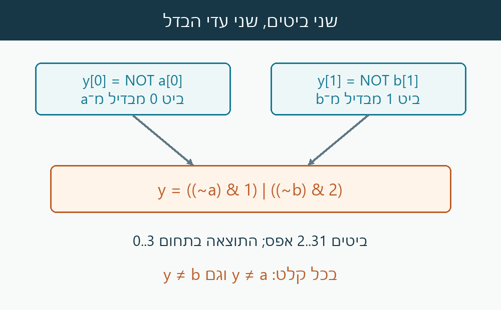
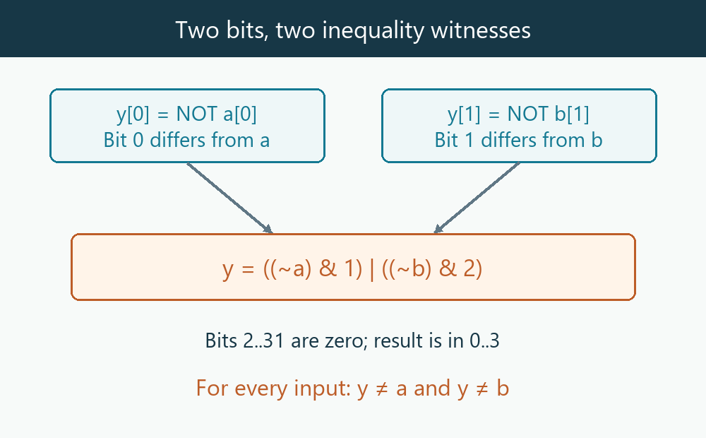

# PREP-361 — מספר שונה משני קלטי uint32 ללא תנאים

פתרון מוצע בסיוע AI. ממתין לביקורת מקצועית אנושית.

[צילום המקור](../sources/2026-11-15-batch20d-14.png)

כתבו קוד שמקבל שני מספרים בינריים ומחזיר מספר השונה בוודאות משניהם. אסור להשתמש בתנאים if.

## מספר שונה משני קלטי uint32 ללא תנאים

ממשו different_uint32(a,b), המקבלת שני מספרים שלמים לא מסומנים ברוחב 32 ביט ומחזירה מספר לא מסומן באותו רוחב השונה גם מ־a וגם מ־b. הקלטים יכולים להיות שווים. אסור להשתמש ב־if, switch, אופרטור תנאי, השוואות, לולאות או טבלאות. אפשר להשתמש בקבועים ובפעולות ביטים בסיסיות. הוכיחו את התוצאה לכל זוג קלטים ופרטו אם נדרשת אריתמטיקה. בתרגול Python הקלטים הם int מדויקים בתחום 0..2³²−1. הסבירו גם מדוע לא ניתן להבטיח זאת עבור קלט ופלט ברוחב ביט אחד.

לתרגול ההרצה בלבד נדרש פלט קנוני בתחום 0..3: ביט 0 שלו הוא ההיפוך של ביט 0 ב־a, וביט 1 שלו הוא ההיפוך של ביט 1 ב־b. פתרונות אחרים שמחזירים ערך השונה משני הקלטים תקפים לשאלת הראיון הכללית, אך חוזה ההרצה בודק את הבנייה הקנונית הזו.

### רמזים

1. כדי להוכיח ששני מספרים שונים, מספיק להצביע על מיקום ביט אחד שבו הם נבדלים.
2. האם אפשר להקדיש ביט אחד בפלט כדי להיות שונה מ־a, וביט אחר כדי להיות שונה מ־b?
3. בחרו את ביט 0 כהיפוך של ביט 0 ב־a, ואת ביט 1 כהיפוך של ביט 1 ב־b. אפסו את שאר הביטים בעזרת מסכות וחברו ב־OR.

### פתרון מוצע

### לכל קלט ביט שמוכיח הבדל
נבנה y=((~a)&1)|((~b)&2). המסכה 1 שומרת רק את ביט 0 של ~a, והמסכה 2 שומרת רק את ביט 1 של ~b. לכן y₀=NOT a₀, y₁=NOT b₁ וכל הביטים הגבוהים אפס. ביט 0 מוכיח y≠a לכל ערך של b; ביט 1 מוכיח y≠b לכל ערך של a. אלה שני עדי הבדל בלתי תלויים. התוצאה תמיד בתחום 0..3 ולכן היא uint32 תקינה. לא נדרש ששני הקלטים עצמם יהיו שונים.

לדוגמה a=0 ו־b=3 נותנים y=1. עבור a=b=0 מתקבל 3. עבור a=2³²−1 ו־b=0 מתקבל 2. הנכונות אינה תלויה בביטים הגבוהים של הקלטים. אין חיבור, חיסור או גלישה, ואין השוואה או בחירת מסלול. ב־Python ~ של int אינו מוגבל ל־32 ביט, אבל המסכות 1 ו־2 שומרות בדיוק את שני הביטים הרצויים ולכן אותו ביטוי תקף בתחום הקלט המוגדר.

```c
#include <stdint.h>
uint32_t different_uint32(uint32_t a, uint32_t b) {
    return ((~a) & UINT32_C(1)) | ((~b) & UINT32_C(2));
}
```

### מה משמעות ההגבלה
המימוש מכיל מספר קבוע של פעולות ביטים, O(1) בזמן ובמקום במודל מילה של 32 ביט. הוא ללא תנאים ברמת קוד המקור; לא נובעת מכך הבטחה כללית על תזמון חומרה או על הקוד שמפיק כל מהדר. הוכחת הביטים היא לכל הזוגות, ובדיקה ממוחשבת היא ראיה נוספת בלבד.

בכל רוחב W≥2 אפשר להשתמש באותה בנייה. אם W=1 ו־a=0,b=1, כל פלט אפשרי כבר שווה לאחד הקלטים, ולכן הבעיה אינה אפשרית בתחום הזה, גם עם תנאים. בפלט של מספרים טבעיים ללא חסם אפשר למשל להחזיר (a|b)+1, שגדול משניהם, אך ברוחב קבוע זה עלול לגלוש ולכן אינו פתרון לחוזה uint32 שלנו.

```python
"""Bit witnesses make an unsigned result different from both unsigned inputs.

Precondition: exact integers 0 <= a,b < 2**32. No validation branch is part
of this branch-free reference. Python's AND masks restrict output to 0..3.
"""


def different_uint32(a, b):
    return ((~a) & 1) | ((~b) & 2)
```



### הנחות

קלטים ופלט הם uint32 ללא סימן; הקלט כבר תקין. פעולות ביטים בלבד. Python משתמש ב־int והמסכות מצמצמות את הפלט ל־0..3.

### מקרה קצה

קלטים שווים, אפסים, שני מספרים הכוללים את כל הביטים 1, קלטי 0 ו־1 וקצוות uint32. הבנייה מחזירה תמיד אחד הערכים 0..3, והביטים שבחרנו מוכיחים שאינו קלט.

### טעות נפוצה

החזרת ~a בלבד, שעשויה להיות b; שימוש ב־(a|b)+1 ב־uint32 בלי לטפל בגלישה; הסתרת if באופרטור תנאי; דרישה בלתי אפשרית ברוחב ביט אחד.

### סיבוכיות או עלות

מספר קבוע של פעולות, O(1) במודל uint32. הנוסחה נשארת תקפה לכל W≥2; אין צורך לטעון למספר פעולות מינימלי.

### בדיקות

נבדקו כל זוגות הערכים ברוחבים 2..8, דגימות וקצוות uint32, מבנה הקוד ללא תנאים, וגם קימפול והרצת מימוש C מול בדיקת אי־שוויון עצמאית. זהו אימות לוגי ותוכנתי, לא הוכחת זמן קבוע של מהדר.

### תשובה קצרה

אני הופך את ביט 0 של a ואת ביט 1 של b ומאפס את היתר. הביט הראשון מבדיל מ־a והשני מ־b. לכן ((~a)&1)|((~b)&2) עובד ללא תנאים וללא אריתמטיקה.

### שאלת המשך

כיצד תכלילו ל־k קלטים כאשר יש לפחות k ביטים בפלט? הקדישו ביט שונה לכל קלט, וקבעו אותו להיפוך הביט המתאים באותו קלט. איסוף הביטים ב־OR יוצר עד הבדל לכל אחד. ההנחה W≥k מספיקה לבנייה, אך אינה תנאי הכרחי לעצם קיום פלט.

## A uint32 result different from both inputs without conditions

Implement different_uint32(a,b) for two unsigned 32-bit integers, returning an unsigned value of the same width different from both a and b. Inputs may be equal. Do not use if, switch, conditional expressions, comparisons, loops or table lookups. Constants and basic bitwise operations are allowed. Prove the result for every input pair and state whether arithmetic is required. For Python practice, inputs are exact ints in 0..2³²−1. Also explain why the requirement is impossible for one-bit inputs and output.

For executable practice only, return the canonical value in 0..3 whose bit 0 is opposite a bit 0 and whose bit 1 is opposite b bit 1. Other results different from both inputs remain valid for the general interview question; the runtime exercise checks this canonical construction.

### Hints

1. To prove two numbers unequal, one differing bit is sufficient.
2. Can one output bit witness a difference from a, while a different bit witnesses a difference from b?
3. Set bit 0 opposite a bit 0 and bit 1 opposite b bit 1. Mask off other bits and combine with OR.

### Proposed solution

### One bit witnesses each difference
Construct y=((~a)&1)|((~b)&2). Mask 1 keeps only bit 0 of ~a; mask 2 keeps only bit 1 of ~b. Thus y₀=NOT a₀, y₁=NOT b₁, and all higher bits are zero. Bit 0 proves y≠a regardless of b; bit 1 proves y≠b regardless of a. These independent witnesses establish both inequalities. The result is always in 0..3, a valid uint32 value, even when a=b.

For example a=0,b=3 gives y=1; a=b=0 gives 3; a=2³²−1,b=0 gives 2. Higher input bits cannot affect the proof. No addition, subtraction, overflow, comparison or path selection occurs. Python complement is not limited to 32 bits, but masks 1 and 2 retain precisely the intended low bits, making the same expression valid for the specified input domain.

```c
#include <stdint.h>
uint32_t different_uint32(uint32_t a, uint32_t b) {
    return ((~a) & UINT32_C(1)) | ((~b) & UINT32_C(2));
}
```

### Scope of the restriction
The code uses a constant number of bitwise operations, O(1) time and storage in a 32-bit word model. Branch-free source does not establish a universal hardware-timing or compiler-output guarantee. The bit proof covers all inputs; finite testing supplies additional evidence.

The construction works for every width W≥2. At W=1, a=0 and b=1 exhaust all possible outputs, so no solution exists in that domain even with conditions. For unbounded nonnegative integers, (a|b)+1 is another result larger than both, but fixed-width overflow invalidates it for this uint32 contract.

```python
"""Bit witnesses make an unsigned result different from both unsigned inputs.

Precondition: exact integers 0 <= a,b < 2**32. No validation branch is part
of this branch-free reference. Python's AND masks restrict output to 0..3.
"""


def different_uint32(a, b):
    return ((~a) & 1) | ((~b) & 2)
```



### Assumptions

Inputs/output are unsigned uint32 values, and inputs already satisfy the domain. Only bitwise operations are used. Python ints are masked down to a result in 0..3.

### Edge case

Equal inputs, zeroes, all-one inputs, 0 and 1, and uint32 extremes. The result is always in 0..3; the chosen witness bits prove it is neither input.

### Common mistake

Returning ~a alone, which may equal b; adding one to (a|b) with uint32 wraparound; hiding a condition in a ternary expression; requiring an impossible one-bit result.

### Cost

A constant operation count gives O(1) in the uint32 model. The construction works for every W≥2; no minimum gate/operation count is claimed.

### Verification

Checks exhaust all input pairs for widths 2..8, sample uint32 extremes/random values, inspect branch-free source, and compile/run C against independent inequality properties. This is software/logical verification, not a compiler constant-time proof.

### Interview answer

I complement a bit 0 and b bit 1 and clear the rest. The first bit differs from a and the second from b, so ((~a)&1)|((~b)&2) needs no conditions or arithmetic.

### Follow-up

How can this be generalized to k inputs if the result has at least k bits? Reserve a different output bit for each input and complement that input at its assigned bit. OR the witnesses together. W≥k is sufficient for this construction, but not necessary for the existence of a different result.

[checks/check_nov15d_software.py](../checks/check_nov15d_software.py)

[checks/prep-361-1115d-verification.json](../checks/prep-361-1115d-verification.json)

[solutions/prep_361_distinct_from_two_uint32.py](../solutions/prep_361_distinct_from_two_uint32.py)

[C implementation](../solutions/prep_361_distinct_from_two_uint32.c)
