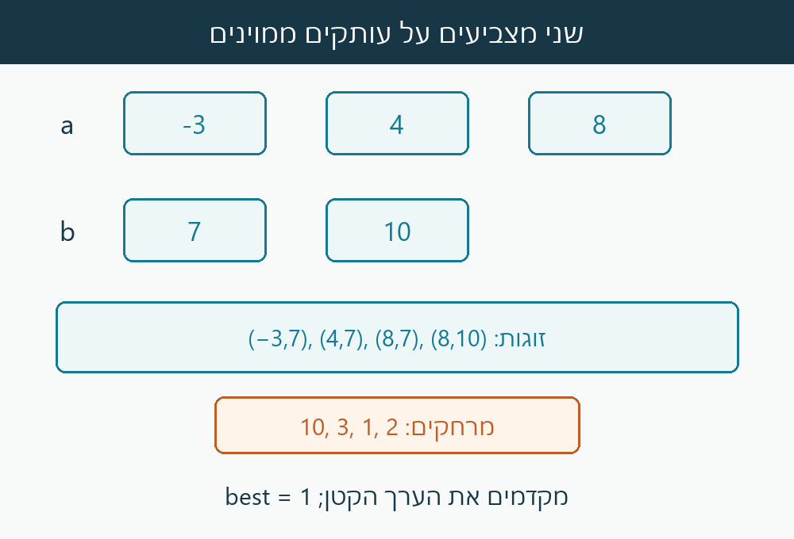
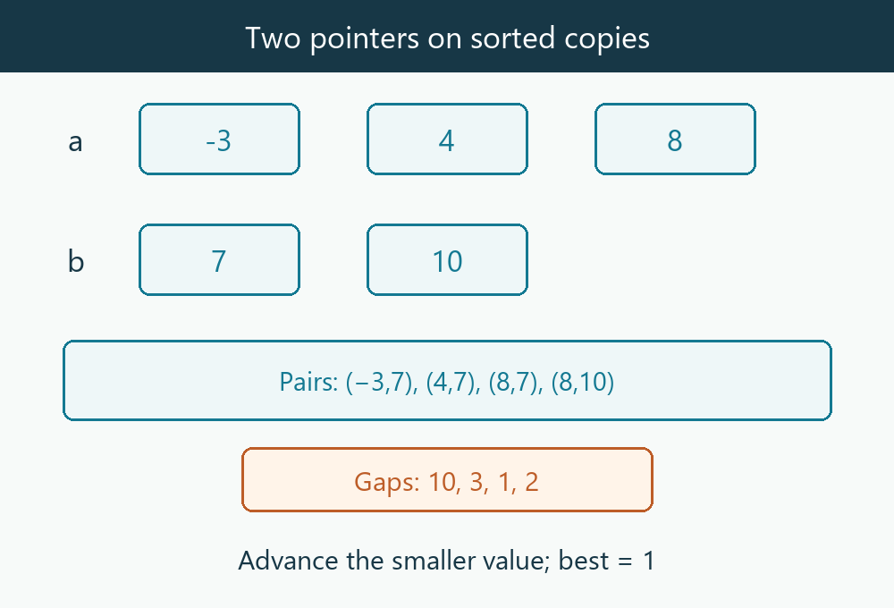

# PREP-362 — המרחק המוחלט הקטן ביותר בין שני מערכים

פתרון מוצע בסיוע AI. ממתין לביקורת מקצועית אנושית.

[צילום המקור](../sources/2026-11-15-batch20d-18.png)

כתוב פונקציה המקבלת שני מערכים אקראיים ומחזירה את ההפרש המינימלי בין שני איברים, אחד מכל מערך. אם 5 קיים בשניהם התוצאה 0. תנו brute force ואחר כך שפרו זמן ריצה.

## המרחק המוחלט הקטן ביותר בין שני מערכים

ממשו minimum_cross_distance(left,right), המחזירה min|left[i]−right[j]| על פני כל i,j. כל מערך מכיל int מדויקים ויכול לכלול שליליים וכפילויות. יש לבחור איבר אחד מכל מערך, בלי לשנות את המערכים. אם אחד מהם ריק החזירו None. נדרש רק המרחק, לא האינדקסים. לדוגמה [8,−3,4] ו־[10,7] נותנים 1; אם ערך כלשהו מופיע בשני הצדדים התוצאה 0. הציגו תחילה פתרון ישיר, שפרו את זמן הריצה, הוכיחו את צעד ההתקדמות ונתחו זיכרון וזמן. דונו גם במקרה שהקלטים כבר ממוינים ובמימוש בטיפוסים חסומים.

### רמזים

1. הפתרון הישיר בודק כל זוג בין שני הצדדים. איזה מידע נוסף מתקבל אם ממיינים כל צד?
2. עמדו בתחילת שני המערכים הממוינים. אם a[i]<b[j], האם a[i] יכול להתקרב יותר לאיבר עתידי וגדול יותר ב־b?
3. עדכנו את המרחק הטוב ביותר והקדמו רק את המצביע שמחזיק בערך הקטן יותר. נמקו מדוע אפשר לשכוח אותו; במרחק אפס אפשר לסיים מיד.

### פתרון מוצע

### מתחילים מבדיקת כל הזוגות
לולאה על כל m·n זוגות מחשבת |left[i]−right[j]| ושומרת מינימום: O(mn) זמן ו־O(1) מילים מעבר לקלט, בהנחת אריתמטיקה בגודל קבוע. אם צד ריק אין זוג חוקי.

### מסדרים כדי לשלול מועמדים
נמיין עותקים a ו־b, נציב i=j=0 ונאתחל את best למרחק הזוג הראשון. בכל צעד מעדכנים best. אם המרחק אפס מסיימים, כי מרחק מוחלט לא יכול להיות שלילי. אם a[i]<b[j] מקדמים i; אחרת, כשאין שוויון, מקדמים j. מסיימים כשאחד הצדדים מוצה. עבור a=[−3,4,8], b=[7,10], המרחקים הנבחנים הם 10,3,1,2 ולכן התוצאה 1.

### מדוע לא מפספסים את הזוג הטוב
אם a[i]<b[j], לכל k≥j מתקיים b[k]≥b[j], ולכן |a[i]−b[k]|≥|a[i]−b[j]|. כבר בדקנו את האפשרות הטובה ביותר של a[i] מול החלק שטרם טופל ב־b. זיווגים מול אינדקסים שכבר נשללו טופלו או נשללו באותו נימוק. לכן אפשר להסיר את a[i] בלי לאבד שיפור עתידי. הטיעון סימטרי כאשר b[j]<a[i]. האינווריאנט הוא שה־best מתעד את הטוב ביותר שנצפה, ושכל זוג טוב יותר, אם קיים, נשאר בתוך הסיומות הפעילות. כאשר אחת הסיומות מתרוקנת אין עוד זוג שעשוי לשפר אותו.

מיון העותקים עולה O(m log m+n log n), והסריקה O(m+n), כי בכל צעד מתקדם מצביע אחד בלבד. העותקים מצריכים O(m+n) מקום; מיון Python עשוי להשתמש בזיכרון עבודה נוסף מאותו סדר גודל. אם שני הקלטים כבר ממוינים ואפשר לקרוא אותם ישירות, מספיקות O(m+n) פעולות ו־O(1) מילים נוספות. אין כאן טענה שזה הפתרון האופטימלי לכל יחס גדלים: אם צד אחד זעיר והשני עצום, מיון הצד הקטן וחיפוש בינארי עבור כל איבר בצד הגדול נותנים פשרה אחרת.

ב־Python ההפרש ו־abs מחושבים בדיוק גם עבור מספרים גדולים. בשפה עם טיפוס מוגבל יש להרחיב לפני החיסור: שני int32 עשויים להיות במרחק 2³²−1, שאינו נכנס ב־int32. חישוב abs לאחר גלישה לא מתקן את הטעות. מורכבות בביטים כוללת גם את עלות ההשוואות והחיסור.

```python
"""Return minimum cross-array absolute distance without changing the inputs."""


def minimum_cross_distance(left, right):
    if not left or not right:
        return None
    a, b = sorted(left), sorted(right)
    i = j = 0
    best = abs(a[0] - b[0])
    while i < len(a) and j < len(b):
        gap = abs(a[i] - b[j])
        best = min(best, gap)
        if gap == 0:
            return 0
        if a[i] < b[j]:
            i += 1
        else:
            j += 1
    return best
```



### הנחות

מרחק מוחלט בין שני מספרים שלמים מדויקים, אחד מכל מערך. כפילויות ושליליים מותרים; None אם חסר צד. הקלטים אינם משתנים והפלט הוא מרחק בלבד.

### מקרה קצה

אחד הצדדים ריק; צד יחיד באורך אחד; כפילויות רבות; ערך משותף; כל ערכי צד אחד קטנים מהאחר; שליליים; קצוות טיפוס חסום. [5] ו־[5] נותנים 0 למרות שמותר לבחור רק איבר אחד מכל צד.

### טעות נפוצה

בחירת שני איברים מאותו מערך; הפרש חתום במקום מוחלט; קידום הערך הגדול יותר בלי נימוק; מיון במקום המשנה את הקלט; גלישת חיסור לפני abs.

### סיבוכיות או עלות

הפתרון המוצע O(m log m+n log n) זמן ו־O(m+n) מקום לשמירת הקלט. לקלטים ממוינים O(m+n) זמן ו־O(1) מילים נוספות. אין טענה לחסם מיון הכרחי לכל חלופה.

### בדיקות

המימוש הושווה לאורקל ממצה של כל הזוגות על כל זוגות הרשימות הקצרות בתחום קטן, ועל דגימות ומקרי קצה גדולים. נבדקו שמירת הקלט, סימטריה והוספת הזזה אחידה.

### תשובה קצרה

אני ממיין עותק מכל צד וסורק בשני מצביעים. אחרי עדכון המינימום אפשר לשכוח את הקטן, כי כל ערך עתידי בצד השני רחוק ממנו לפחות כמו הנוכחי. המיון שולט בזמן והקלט נשמר.

### שאלת המשך

כיצד תחזירו גם את שני האינדקסים המקוריים? מיינו זוגות (ערך,אינדקס מקורי) ושמרו את הזוג כאשר המינימום משתפר. הגדירו במפורש שובר שוויון אם נדרש זוג ייחודי; מרחק בלבד אינו דורש כלל כזה.

## Minimum absolute distance between two arrays

Implement minimum_cross_distance(left,right), returning min|left[i]−right[j]| over all i,j. Arrays contain exact ints and may include negatives and duplicates. Choose one element from each array without changing either input. Return None if either is empty. Return only the distance, not indices. For example [8,−3,4] and [10,7] give 1; a value present in both sides gives 0. Start with brute force, improve runtime, prove the pointer advance and analyze time/storage. Discuss already sorted inputs and bounded-integer implementations.

### Hints

1. The direct method checks every cross-array pair. What information does sorting each side add?
2. Start at the two sorted heads. If a[i]<b[j], can a later, larger b value be closer to a[i]?
3. Update the best distance and advance only the pointer holding the smaller value. Explain why discarding it is safe; distance zero permits immediate termination.

### Proposed solution

### Start with every pair
Two loops inspect all m·n cross-array pairs and keep the minimum absolute difference: O(mn) time and O(1) extra words under a fixed-size arithmetic model. An empty side has no legal pair.

### Sort to eliminate candidates
Sort copies a and b, set i=j=0 and initialize best from the first pair. At each step update best. Return immediately at zero, since an absolute distance cannot be negative. If a[i]<b[j], advance i; otherwise, excluding equality, advance j. Stop when either side is exhausted. For a=[−3,4,8], b=[7,10], examined gaps are 10,3,1,2, so the answer is 1.

### Why the best pair is not skipped
When a[i]<b[j], every k≥j satisfies b[k]≥b[j], so |a[i]−b[k]|≥|a[i]−b[j]|. We have already checked the best partner for a[i] in the remaining b suffix. Pairs with previously discarded positions have been examined or eliminated by the same argument. Thus a[i] can be discarded without losing a future improvement. The argument is symmetric when b[j]<a[i]. The invariant is that best records the best observed distance and any pair that could improve it remains within the active suffixes. Once a suffix is empty no improving pair remains.

Sorting costs O(m log m+n log n); scanning costs O(m+n), since each step advances one pointer. Copies need O(m+n) storage; Python sorting may need additional workspace of the same order. If inputs are already sorted and read directly, the scan needs O(m+n) time and O(1) extra words. This is not an optimality claim for every size ratio: sorting a tiny side and binary-searching it for each item of a huge side offers another tradeoff.

Python subtraction and abs remain exact for large ints. In a bounded language, widen before subtraction: two int32 values can differ by 2³²−1, outside int32. Taking abs after an overflow does not repair it. A bit-complexity analysis also accounts for comparison and subtraction costs.

```python
"""Return minimum cross-array absolute distance without changing the inputs."""


def minimum_cross_distance(left, right):
    if not left or not right:
        return None
    a, b = sorted(left), sorted(right)
    i = j = 0
    best = abs(a[0] - b[0])
    while i < len(a) and j < len(b):
        gap = abs(a[i] - b[j])
        best = min(best, gap)
        if gap == 0:
            return 0
        if a[i] < b[j]:
            i += 1
        else:
            j += 1
    return best
```



### Assumptions

Absolute distance between exact integers, one per array. Negatives/duplicates are allowed; an empty side gives None. Inputs remain unchanged; only the distance is returned.

### Edge case

An empty side; a singleton side; repeated values; a common value; disjoint ordered ranges; negatives; bounded-type extremes. [5] and [5] yield zero while still choosing one occurrence from each side.

### Common mistake

Choosing both values from one array; signed rather than absolute difference; advancing the larger value without justification; sorting in place despite input preservation; overflowing before abs.

### Cost

The proposed method uses O(m log m+n log n) time and O(m+n) space to preserve inputs. Sorted inputs need O(m+n) time and O(1) extra words. No universal sorting lower bound is claimed.

### Verification

The implementation was compared with an independent all-pairs oracle for every pair of short lists over a small domain, then sampled large/extreme cases. Checks include input preservation, symmetry and uniform-translation invariance.

### Interview answer

I sort copies and scan with two pointers. After updating the minimum I discard the smaller value, because every future value on the other side is at least as far away. Sorting dominates runtime and preserves the original arrays.

### Follow-up

How would you return the original two indices as well? Sort (value,original_index) pairs and retain the pair on an improvement. Specify a tie rule if a unique pair is required; returning a distance alone needs none.

[checks/check_nov15d_software.py](../checks/check_nov15d_software.py)

[checks/prep-362-1115d-verification.json](../checks/prep-362-1115d-verification.json)

[solutions/prep_362_minimum_cross_array_distance.py](../solutions/prep_362_minimum_cross_array_distance.py)
