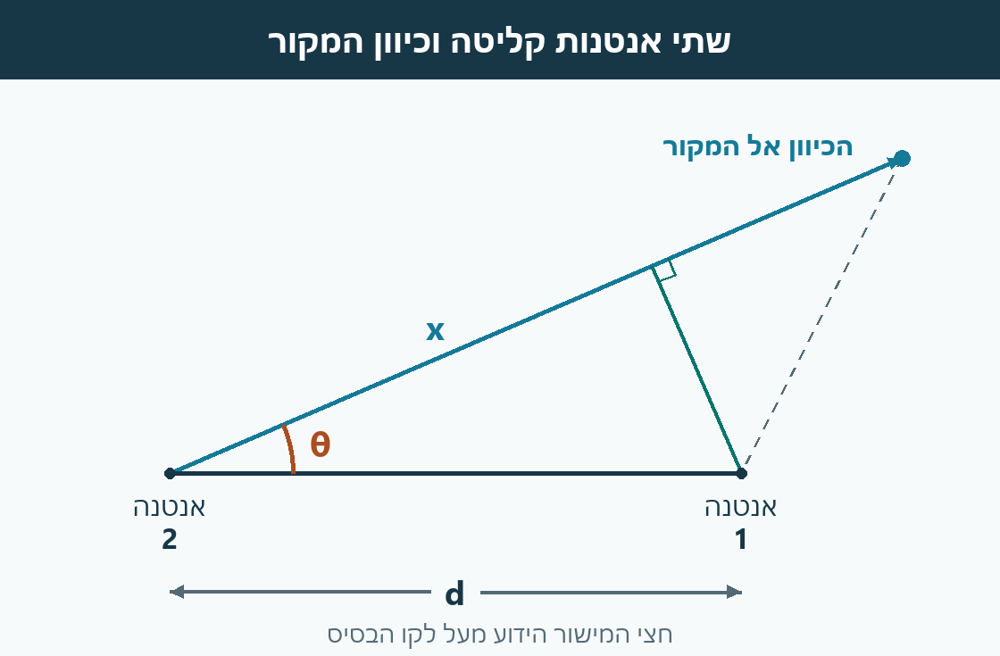
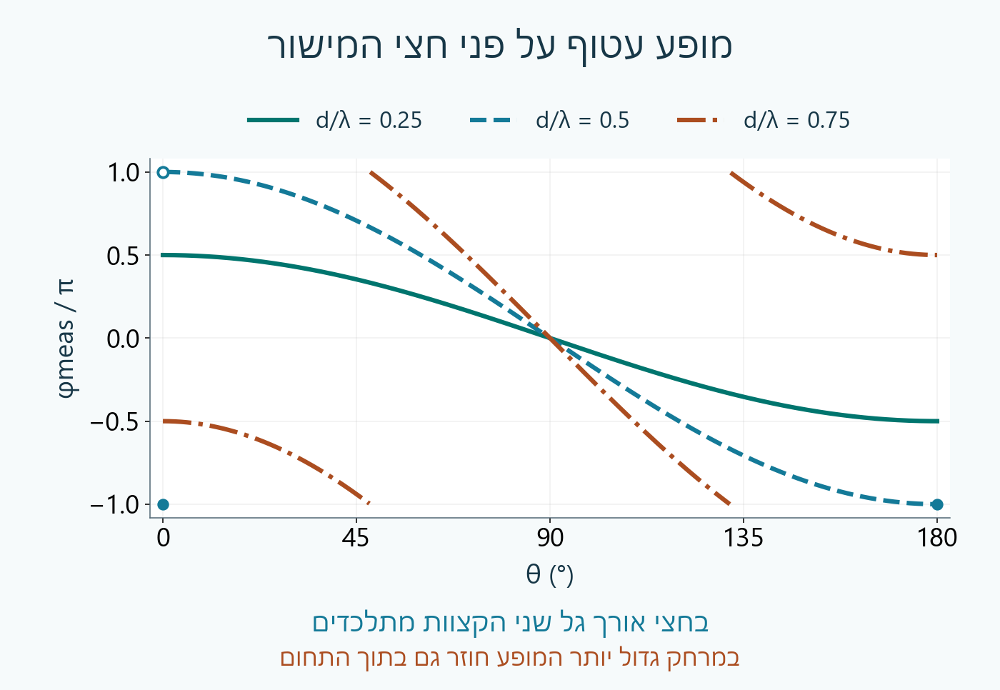
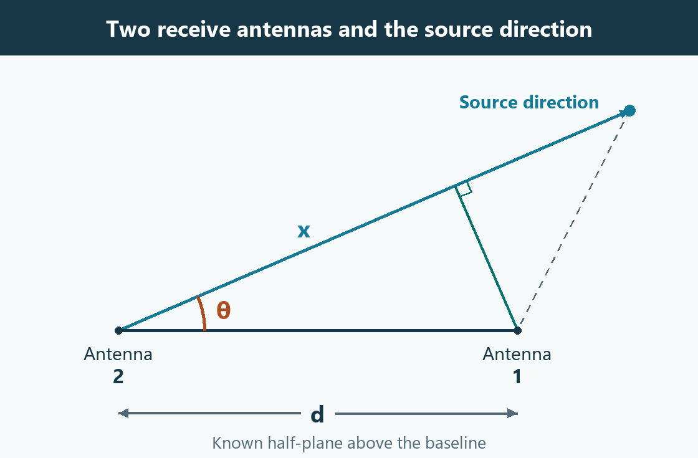
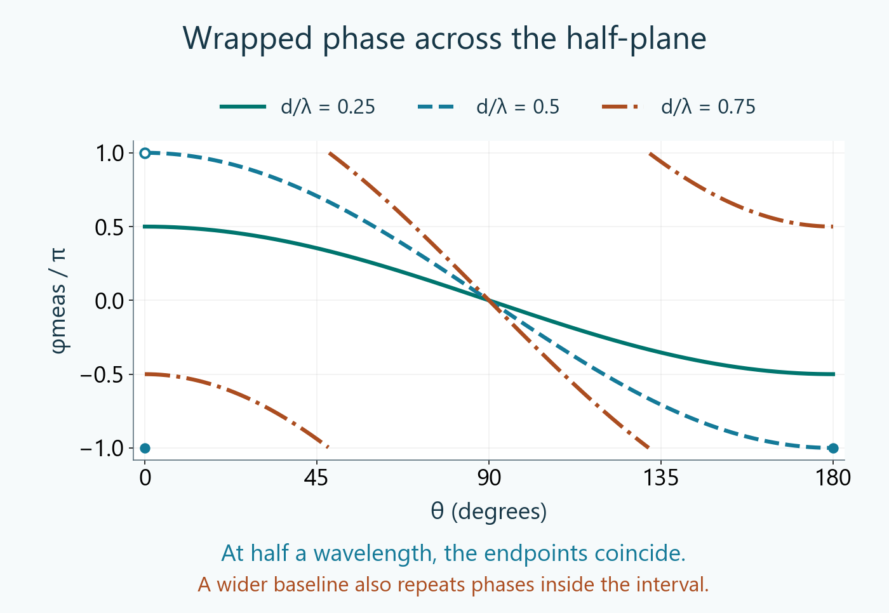

# PREP-366 — Arrival angle from the phase difference of two antennas

Proposed solution. Model verification recorded below. Professional human review pending.

## זווית קליטה מהפרש המופע בין שתי אנטנות

שתי אנטנות קליטה נמצאות במרחק `d` זו מזו. הגדירו את `θ` כזווית בין קו הבסיס מאנטנה 2 לאנטנה 1 לבין הכיוון אל המקור, כפי שמוצג בשרטוט. גזרו את הקשר בין `θ` לבין הפרש המופע `φ = φ₁ − φ₂`, וקבעו באיזה מרחק `d` אפשר לזהות זווית יחידה מהפרש המופע הנמדד. התייחסו גם לבחירה של חצי אורך גל ולשני קצות תחום הזוויות.

הניחו גל מישורי חד־תדרי באורך גל `λ`, מקור אחד, שני ערוצי קליטה שעברו כיול, ומופע נמדד מודולו `2π`. השתמשו במוסכמת פאזורים `e^(jωt)` והגבילו את המקור לחצי המישור המצויר עם `0 ≤ θ ≤ π`.



1. איזה חלק מקו הבסיס משלים את מרחק ההתקדמות בין חזיתות הגל דרך שתי האנטנות?
2. הטילו את קו הבסיס על הכיוון אל המקור. בדקו איזו אנטנה קרובה יותר כאשר הזווית קטנה מ־90°.
3. המירו את הפרש הדרך למופע בעזרת `2π/λ`. השוו את רוחב תחום המופעים לפני העטיפה למחזור אחד של `2π`.

### הפרש דרך, זמן ומופע

נסמן `r₁` ו־`r₂` את המרחקים מהמקור לאנטנות 1 ו־2. בגל מישורי חזיתות הגל מקבילות וניצבות לכיוון המקור. אורך ההיטל המסומן `x` בשרטוט הוא הפרש הדרך בתחום הזוויות החדות. כאשר משתמשים בהיטל מסומן, הוא תקף גם לזווית קהה. עבור כיוון יחידה `s` למקור, ואורך גל `λ = v/f` במהירות התפשטות `v`, מתקבל:

```text
b = position(antenna 1) − position(antenna 2)
r₂ − r₁ ≈ b · s = d cos(θ)
t₂ − t₁ ≈ d cos(θ) / v
phase₁ − phase₂ = 2π(r₂ − r₁)/λ ≈ (2πd/λ) cos(θ)
φmeas = principal_angle(exp(j · (2πd/λ) cos(θ)))
```

במוסכמה `e^(jωt)` השהיה `r/v` מופיעה כמופע `−2πr/λ`. לכן אנטנה 1 מובילה במופע כאשר היא הקרובה יותר. החלפת סדר הערוצים הופכת סימן. מדידה מרוכבת, למשל הזווית של `V₁ · conj(V₂)`, שומרת את הסימן. כאשר הזווית נמדדת מהניצב לקו הבסיס ובכיוון המתאים, אותה הטלה נכתבת באמצעות סינוס.

### מתי אפשר להפוך את המדידה לזווית

המופע הבלתי עטוף נע בטווח `[-2πd/λ, +2πd/λ]`, וקוסינוס חד־חד־ערכי ב־`[0, π]`. כדי שהעטיפה לא תזהה שתי נקודות מהתחום הסגור, דרוש שרוחב הטווח יהיה קטן ממש ממחזור אחד, ומרחק חיובי כדי שתהיה תלות בזווית:

```text
0 < d < λ/2
θ = arccos(λ φmeas / (2πd))
```

כאן `φmeas` הוא הנציג ב־`[-π, π)`, והמדידה האידאלית נמצאת בתחום הפיזיקלי של הנוסחה. ב־`d = λ/2` שני הכיוונים לאורך הבסיס, `θ=0` ו־`θ=π`, נותנים בהתאמה `+π` ו־`−π`, שהם אותו מופע. אם שני הקצוות מחוץ לתחום, כל זווית פנימית עדיין מזוהה באופן יחיד במרחק זה. בכל `d > λ/2` קיימים בטווח הפנימי שני היטלי כיוון שונים, לדוגמה `cos(θ)=±λ/(2d)`, בעלי אותו מופע מודולו `2π`. ב־`d=0` הפרש המופע זהה בכל כיוון.

בדוגמה, `λ = 0.30 m`, `d = 0.12 m` ו־`θ = 60°`. הפרש הדרך הוא `0.06 m`, וממנו מתקבלים `0.4π rad = 72°`. הצבה בנוסחת ההופכי מחזירה `60°`.

### גבולות התוצאה

מדידה אחת מוצאת היטל חתום על ציר הבסיס. בלי הגבלת חצי־המישור, שתי זוויות משני צדי הבסיס יכולות לתת אותו היטל. במרחב תלת־ממדי אוסף הכיוונים בעלי היטל קבוע נמצא בדרך כלל על חרוט. הפרש מופע קבוע בין כבלים או ערוצי מקלט מתווסף למופע הגאומטרי ולכן צריך כיול. למקור קרוב משתמשים במרחקים `r₁,r₂` עצמם, ולא מחליפים אותם אוטומטית בהיטל. מציאת זווית ליד כיוון הבסיס גם רגישה לרעש, כי השינוי בקוסינוס שם קטן.



## Arrival angle from the phase difference of two antennas

Two receive antennas are separated by a distance `d`. Define `θ` as the angle from the baseline pointing from antenna 2 to antenna 1 to the direction toward the source, as shown in the diagram. Derive the relation between `θ` and the phase difference `φ = φ₁ − φ₂`, and find which spacing `d` lets you identify a unique angle from the measured phase difference. Address half-wavelength spacing and both endpoints of the angular range.

Assume a single source, a monochromatic plane wave of wavelength `λ`, two calibrated receive channels, and phase measured modulo `2π`. Use the `e^(jωt)` phasor convention and restrict the source to the depicted half-plane with `0 ≤ θ ≤ π`.



1. Which component of the baseline gives the wavefront travel distance between the antennas?
2. Project the baseline onto the direction toward the source. Check which antenna is closer when the angle is below 90°.
3. Convert path difference to phase with `2π/λ`. Compare the width of the unwrapped phase range with one full `2π` turn.

### Path, time and phase differences

Let `r₁` and `r₂` be the source distances to antennas 1 and 2. In a plane wave, the wavefronts are parallel and perpendicular to the source direction. The projected length `x` in the drawing gives the path difference for acute angles. Treating it as a signed projection also covers obtuse angles. For a source unit direction `s` and wavelength `λ = v/f` at propagation speed `v`, we obtain:

```text
b = position(antenna 1) − position(antenna 2)
r₂ − r₁ ≈ b · s = d cos(θ)
t₂ − t₁ ≈ d cos(θ) / v
phase₁ − phase₂ = 2π(r₂ − r₁)/λ ≈ (2πd/λ) cos(θ)
φmeas = principal_angle(exp(j · (2πd/λ) cos(θ)))
```

Under the `e^(jωt)` convention, travel time `r/v` contributes phase `−2πr/λ`. Thus antenna 1 leads when it is nearer. Swapping channel order reverses the sign. A complex measurement such as the angle of `V₁ · conj(V₂)` retains that sign. With an angle measured from a suitably oriented normal instead of the baseline, the same projection uses sine.

### When phase gives a unique angle

The unwrapped phase runs from `−2πd/λ` to `+2πd/λ`, and cosine is one-to-one on `[0, π]`. To keep wrapping from identifying two points in this closed range, its width must be strictly less than one full turn. Spacing must also be positive for phase to depend on angle:

```text
0 < d < λ/2
θ = arccos(λ φmeas / (2πd))
```

Here `φmeas` is represented in `[-π, π)`, and the ideal measurement is within the physical range of the inverse formula. At `d = λ/2`, the two baseline directions `θ=0` and `θ=π` give `+π` and `−π`, the same measured phase. If both endpoints are excluded, all interior angles remain unique at this spacing. For every `d > λ/2`, two distinct projections inside the range, for example `cos(θ)=±λ/(2d)`, give the same phase modulo `2π`. At `d=0`, all directions give the same phase.

For example, take `λ = 0.30 m`, `d = 0.12 m`, and `θ = 60°`. The path difference is `0.06 m`, giving `0.4π rad = 72°`. The inverse formula then gives `60°`.

### Limits of the result

One measurement gives a signed projection along the baseline. Without the half-plane restriction, directions on opposite sides can have the same projection. In three dimensions a fixed projection generally describes a cone of directions. A fixed phase offset between cables or receive channels adds to the geometric phase, so calibration matters. For a nearby source, use the actual distances `r₁,r₂` instead of substituting the plane-wave projection. Angle estimates near either baseline direction are also sensitive to noise because cosine changes slowly there.



[Teaching model](../solutions/prep_366_receive_phase.py)
[Verification script](../checks/check_analog1118.py)
[Verification report](../checks/analog1118-verification.json)
[Private source 6](../sources/2026-11-18-batch31-06.png)
[Private source 7](../sources/2026-11-18-batch31-07.png)
