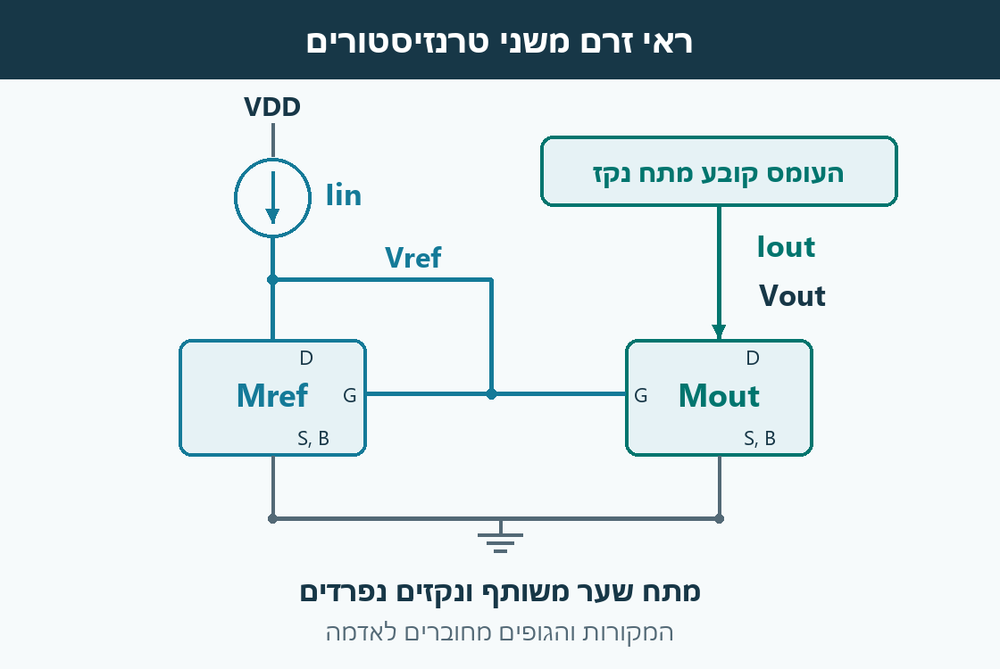
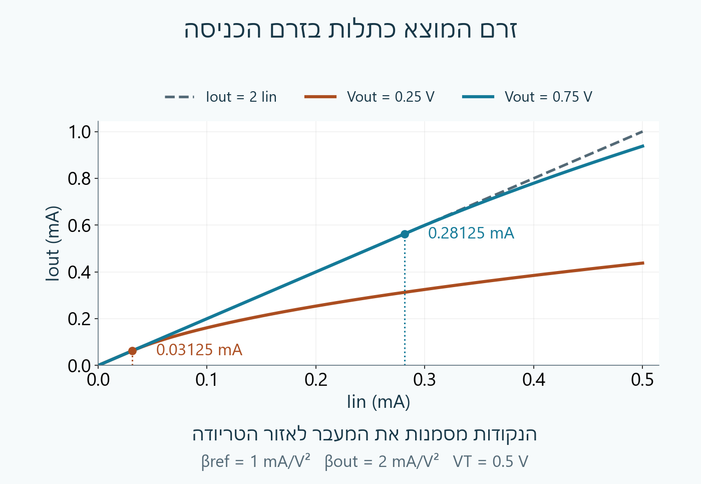
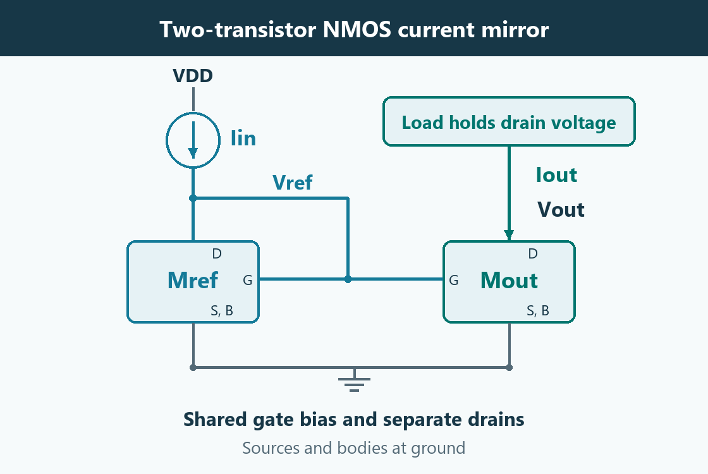
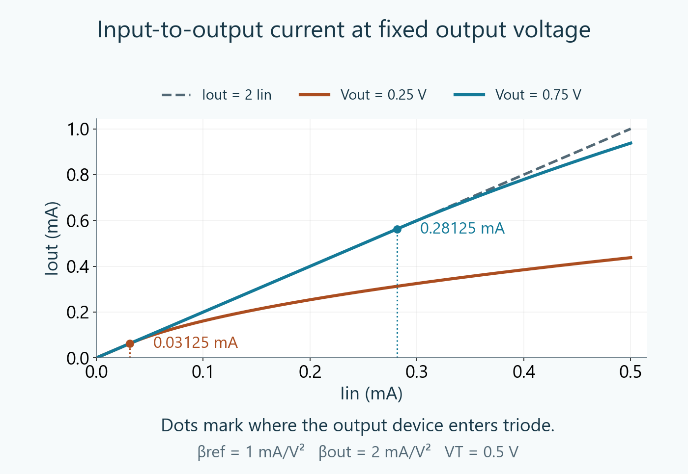

# PREP-367 — NMOS current mirror and output-current transfer

Proposed solution. Model verification recorded below. Professional human review pending.

## ראי זרם NMOS ועקומת זרם המוצא

ממשו ראי זרם בעזרת שני טרנזיסטורי NMOS מסוג העשרה. ציירו את המעגל, גזרו את `Iout` כתלות ב־`Iin` והסבירו איך היחס בין ממדי ההתקנים ותנאי הרוויה משפיעים על ההעתקה. שרטטו עקומות `Iout(Iin)` עבור שני ערכי המתח המפורטים כאן וסמנו מתי טרנזיסטור המוצא יוצא מרוויה.

הניחו מעגל DC עם מקורות וגופים באדמה, מתחי סף זהים `VT = 0.5 V` ומודל תעלה ארוכה ללא מודולציית אורך תעלה. השתמשו ב־`βref = 1 mA/V²`, `βout = 2 mA/V²`, וזרם ייחוס בטווח `0 ≤ Iin ≤ 0.5 mA`. ענף הייחוס מוזן ממקור זרם בעל מרווח מתח מספיק. מתח הנקז של טרנזיסטור המוצא מוחזק בערך קבוע בנפרד בכל שרטוט, `Vout = 0.25 V` או `0.75 V`. הגדירו `Iout` כזרם שהמעגל שוקע מענף העומס.

1. בענף הייחוס הפכו את זרם הכניסה למתח שער על ידי חיבור נקז ושער של אותו התקן.
2. חברו לשער הזה את טרנזיסטור המוצא. בדקו מתי מתח הנקז שלו מספיק כדי ששני ההתקנים ישתמשו במשוואת הרוויה.
3. מצאו `VOV = sqrt(2Iin/βref)` והשוו אותו ל־`Vout`. אם `Vout < VOV`, הציבו את `Vout` במשוואת אזור הטריודה.

### חיבור ראי הזרם

מקור הזרם מזריק `Iin` לצומת הייחוס `Vref`, שבה מחוברים השער והנקז של `Mref`. חברו לאותה צומת את שער `Mout`. שני המקורות והגופים באדמה. נקז `Mout` מחובר לעומס החיצוני, ששומר על `Vout` ומספק את הזרם שהטרנזיסטור שוקע. שני הנקזים הם צמתים נפרדים. במודל DC אין זרם שער, ולכן זרם ענף הייחוס עובר ב־`Mref`. צימוד השערים מעתיק מתח שער־מקור, ויחס החוזקים קובע את הזרם שמתקבל מאותו מתח.

### הרוויה קובעת מתי העקומה ישרה

לכל `Iin > 0`, התקן הייחוס מוליך ורווי כי `VDSref = VGSref ≥ VGSref − VT`. נגדיר את מתח היתר `VOV = VGS − VT` ואת `β = μn Cox (W/L)`. לפי המודל:

```text
Iin = (βref/2) VOV²
VOV = sqrt(2 Iin / βref)
Vref = VT + VOV

Iout = (βout/βref) Iin                  when Vout ≥ VOV
Iout = βout (VOV Vout − Vout²/2)         when 0 ≤ Vout < VOV
Iknee = (βref/2) Vout²
```

בקטע הרוויה השיפוע `βout/βref` שווה ליחס `W/L` של ההתקנים באותה טכנולוגיה. כאן היחס הוא 2. כאשר מעלים את `Iin` במתח מוצא קבוע, גם `VOV` עולה ולבסוף חוצה את `Vout`. מעבר זה מעביר את `Mout` לאזור הטריודה. העקומה ממשיכה לעלות אך מתעקמת מתחת לקו `Iout=2 Iin`. הצבת `Vout=VOV` מראה ששני הביטויים נותנים `βout Vout²/2` בנקודת החיבור. ב־`Iin=0` שני הזרמים אפס במודל. צומת ייחוס ללא זרם אינה חייבת לקבל מתח יחיד במודל ללא דליפה.

### קריאת הגרף

| `Vout` | `Iin` בנקודת המעבר | `Iout` במעבר | `Iout` כאשר `Iin=0.50 mA` |
| --- | --- | --- | --- |
| `0.25 V` | `0.03125 mA` | `0.0625 mA` | `0.4375 mA` |
| `0.75 V` | `0.28125 mA` | `0.5625 mA` | `0.9375 mA` |

ב־`Iin=0.50 mA` מתקבל `VOV=1 V`. בשני המקרים טרנזיסטור המוצא בטריודה, ולכן הזרם נמוך מהערך האידאלי `1 mA`. כדי להישאר ברוויה לאורך כל טווח הזרם הנתון צריך עומס שמספק `Vout ≥ 1 V`, ומקור הייחוס צריך לאפשר `Vref` עד `1.5 V` ואת מרווח המתח הפנימי שלו. ללא מתח מוצא או נתוני עומס, אי אפשר לקבוע עקומת העתקה יחידה מחוץ לרוויה.

### השפעות אי־אידאליות

גם ברוויה, מודולציית אורך תעלה יכולה לגרום לזרמים שונים כאשר מתחי הנקז שונים. בקירוב רוויה עם ספים תואמים מתקבל `Iout/Iin ≈ (βout/βref) · (1 + λout Vout)/(1 + λref Vref)`, כאשר `λref` ו־`λout` הם מקדמי מודולציית אורך התעלה. השוואת מתחי הנקז מפחיתה את השגיאה הזאת אם גם המקדמים תואמים. הפרשי סף, טמפרטורה והתאמת התקנים משפיעים על הדיוק. הגרף משתמש במודל האידאלי בלבד.





## NMOS current mirror and output-current transfer

Build a current mirror from two enhancement NMOS transistors. Draw the circuit, derive `Iout` as a function of `Iin`, and explain how device sizing and saturation affect the transfer. Plot `Iout(Iin)` for the two output voltages specified here and mark where the output transistor leaves saturation.

Assume DC operation with sources and bodies at ground, matched thresholds `VT = 0.5 V`, and a long-channel model without channel-length modulation. Use `βref = 1 mA/V²`, `βout = 2 mA/V²`, and reference current `0 ≤ Iin ≤ 0.5 mA`. An input current source with sufficient voltage headroom feeds the reference branch. A separate bias holds the output transistor drain at a fixed voltage on each curve, `Vout = 0.25 V` or `0.75 V`. Define `Iout` as the current the circuit sinks from the load branch.

1. Convert input current into a gate voltage by tying the gate and drain of the reference device together.
2. Share that gate voltage with the output transistor. Check how large its drain voltage must be for both devices to use the saturation equation.
3. Find `VOV = sqrt(2Iin/βref)` and compare it with `Vout`. If `Vout < VOV`, use the triode equation for the output device.

### Wire the mirror

The current source feeds `Iin` into the reference node `Vref`, which ties the gate and drain of `Mref` together. Connect the `Mout` gate to that same node. Both sources and bodies are grounded. The external load connects to the `Mout` drain, where it holds `Vout` and supplies the current the transistor sinks. The drains are separate nodes. In the DC model the gate draws no current, so the reference current flows through `Mref`. Sharing the gates copies gate-to-source voltage, and the strength ratio determines the resulting current at that voltage.

### Saturation determines when the transfer is linear

For every `Iin > 0`, the reference device conducts in saturation because `VDSref = VGSref ≥ VGSref − VT`. Define overdrive `VOV = VGS − VT` and `β = μn Cox (W/L)`. The model gives:

```text
Iin = (βref/2) VOV²
VOV = sqrt(2 Iin / βref)
Vref = VT + VOV

Iout = (βout/βref) Iin                  when Vout ≥ VOV
Iout = βout (VOV Vout − Vout²/2)         when 0 ≤ Vout < VOV
Iknee = (βref/2) Vout²
```

In the saturation segment, the slope `βout/βref` is the device `W/L` ratio for the same process. It equals 2 here. Raising `Iin` at fixed output voltage raises `VOV` until it exceeds `Vout`, putting `Mout` in triode. The transfer keeps increasing but bends below the line `Iout=2 Iin`. Substituting `Vout=VOV` gives `βout Vout²/2` from either expression at the join. At `Iin=0` both currents vanish in the model. A reference node carrying no current need not have a unique voltage in a leakage-free model.

### Read the curves

| `Vout` | `Iin` at the knee | `Iout` at the knee | `Iout` at `Iin=0.50 mA` |
| --- | --- | --- | --- |
| `0.25 V` | `0.03125 mA` | `0.0625 mA` | `0.4375 mA` |
| `0.75 V` | `0.28125 mA` | `0.5625 mA` | `0.9375 mA` |

At `Iin=0.50 mA`, `VOV=1 V`. Both cases put the output transistor in triode, so each sinks less than the ideal `1 mA`. Staying in saturation throughout the specified input range requires a load that maintains `Vout ≥ 1 V`, and the reference current source must support `Vref` up to `1.5 V` plus its own headroom. Without an output voltage or load contract, the transfer outside saturation is not a single known curve.

### Nonideal effects

Even in saturation, channel-length modulation can make the currents differ when the drain voltages differ. With matched thresholds and the saturation approximation, `Iout/Iin ≈ (βout/βref) · (1 + λout Vout)/(1 + λref Vref)`, where `λref` and `λout` are the channel-length modulation coefficients. Equal drain voltages reduce this error when the coefficients also match. Threshold mismatch, temperature, and device matching affect accuracy. The plotted curves use the ideal model.





[Teaching model](../solutions/prep_367_nmos_mirror.py)
[Verification script](../checks/check_analog1118.py)
[Verification report](../checks/analog1118-verification.json)
[Private source 24](../sources/2026-11-18-batch31-24.png)
