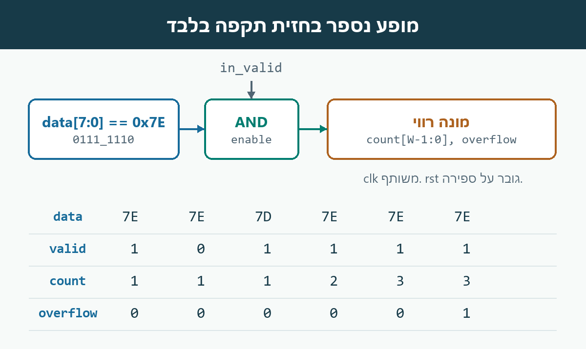
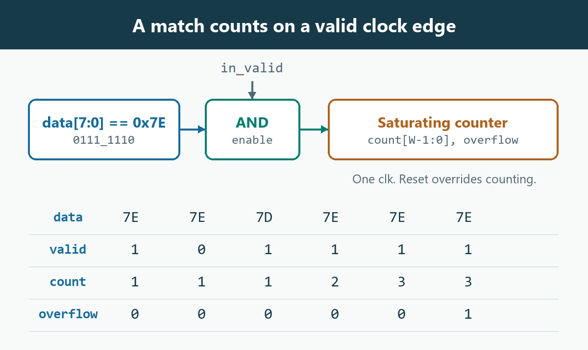

# PREP-368 — ספירת מופעי הבית 0x7E

הצעה לפתרון. ביקורת מקצועית אנושית ממתינה.

## עברית

תכננו רכיב סינכרוני המקבל בית `data[7:0]` ואות `in_valid`. בכל חזית עולה שבה `in_valid=1`, מתקבל בית אחד. ספרו כמה מהבתים שהתקבלו מאז האיפוס שווים `0x7E`, והציגו את הספירה על `W` סיביות, `W≥1`. הספירה נעצרת בערך הייצוג המרבי. אם מתקבל מופע נוסף לאחר שהגיעה לערך זה, העלו `overflow` והשאירו אותו גבוה עד לאיפוס. הגדירו איפוס סינכרוני פעיל בגבוה, הציגו את הלוגיקה ובדקו פערים ב־`in_valid` והגעה לגבול.

1. כתבו את ערך היעד באמצעות שמונה ביטים.
2. שלבו את השוואת הבית עם אות התקפות כדי ליצור אפשור למונה.
3. הבחינו בין חזית שמביאה את המונה למקסימום לבין מופע נוסף כאשר המונה כבר רווי.

### השוואת הבית ואפשור הספירה

`0x7E` הוא `0111_1110` בבינארי. בהשוואה משווים את כל שמונה הביטים. אפשר לממש את האות `match` כשער AND של `¬data[7]`, הביטים `data[6]` עד `data[1]` ו־`¬data[0]`. המונה והדגל מתעדכנים רק על חזית עולה אחת של `clk`.

```text
if rst: count = 0, overflow = 0
else if in_valid and data == 0x7E:
    if count == MAX: overflow = 1
    else: count = count + 1
# All other register values hold.
```

`MAX=2^W−1`, וניתן לזהות אותו באמצעות AND על כל סיביות המונה. האינווריאנט אחרי כל חזית הוא `count=min(matches,MAX)` ו־`overflow=(matches>MAX)`. איפוס מאתחל אותו. בית תקף שאינו שווה ליעד וחזית ללא תקפות משמרים אותו. מופע תקף מוסיף אחד למספר המופעים הלוגי ומתאים בדיוק לאחד משני ענפי העדכון. בהנחת קלט מסונכרן, גם בית `0x7E` תקף בשתי חזיתות רצופות נספר פעמיים.

למשל `W=2`. סדרת קלטים של זוגות `(valid,data)` לאחר איפוס היא `(1,7E),(0,7E),(1,7D),(1,7E),(1,7E),(1,7E)`, כאשר הנתונים כתובים בהקסדצימלי. זוגות הפלט `(count,overflow)` הם `(1,0),(1,0),(1,0),(2,0),(3,0),(3,1)`. איפוס גובר גם על מופע שמגיע באותה חזית. אם צריך להציג ספירה מדויקת עד `K` מופעים, בוחרים `W≥max(1,ceil(log2(K+1)))`. משאבי האחסון הם `W+1` סיביות, והמעגל מקבל בית בכל מחזור תקף.

בדיקת הקוד מכסה את כל 256 ערכי הבית ואת פעולת האפשור, האיפוס והרוויה. כאשר המקור טורי ומספק גבולות בתים, אפשר לאסוף שמונה ביטים ברגיסטר הזזה ולהשוות רק בסיום בית. בזרם בלי גבולות, ספירת מופעים בכל היסט ביט היא תרגיל אחר. שם משווים חלון נע של שמונה ביטים, ובאופן מפורש קובעים אם מותרים מופעים חופפים. לדוגמה שני מופעים של `01111110` יכולים לחלוק את ה־0 האחרון של הראשון עם ה־0 הראשון של השני.



## English

Design a synchronous component with byte input `data[7:0]` and `in_valid`. Each rising edge with `in_valid=1` accepts one byte. Count the accepted bytes equal to `0x7E` since reset and expose the count in `W` bits, with `W≥1`. Saturate the count at its maximum representable value. An additional match beyond that limit sets `overflow`, which stays high until reset. Use synchronous active-high reset, show the logic, and check gaps in `in_valid` and behavior at the count limit.

1. Write the target using eight bits.
2. Combine byte equality with validity to make a count enable.
3. Distinguish reaching the maximum from seeing another match while already saturated.

### Compare the byte and enable the counter

`0x7E` is `0111_1110` in binary. Equality tests all eight bits. An AND of `¬data[7]`, bits `data[6]` through `data[1]` and `¬data[0]` implements `match`. The counter and flag update together on a rising edge of `clk`.

```text
if rst: count = 0, overflow = 0
else if in_valid and data == 0x7E:
    if count == MAX: overflow = 1
    else: count = count + 1
# All other register values hold.
```

`MAX=2^W−1`, detectable as the AND of all count bits. After each edge the invariant is `count=min(matches,MAX)` and `overflow=(matches>MAX)`. Reset establishes it. A valid nonmatching byte or an invalid cycle preserves it. A valid match adds one to the logical match total and falls into exactly one of the two update branches. For synchronized input, `0x7E` valid on two consecutive edges counts twice.

For `W=2`, take the post-reset `(valid,data)` pairs `(1,7E),(0,7E),(1,7D),(1,7E),(1,7E),(1,7E)`, with hexadecimal data values. The `(count,overflow)` results are `(1,0),(1,0),(1,0),(2,0),(3,0),(3,1)`. Reset also overrides a match at the same edge. An exact count up to `K` matches requires `W≥max(1,ceil(log2(K+1)))`. Storage is `W+1` bits and the component accepts one byte per valid cycle.

The code checks all 256 byte values as well as enable, reset and saturation. An aligned serial source can assemble eight bits in a shift register and compare only at byte completion. Counting matches at any bit offset instead calls for an eight-bit sliding window and an explicit overlap policy. For example, two `01111110` matches can share the last zero of the first and the initial zero of the second.



[צילום מקור פנימי 15](../sources/2026-11-18-batch31-15.png)
[קובץ המימוש](../solutions/digital1118.sv)
[קובץ המימוש](../solutions/digital1118_models.py)
[תוצאות בדיקות](../checks/digital1118-verification.json)
