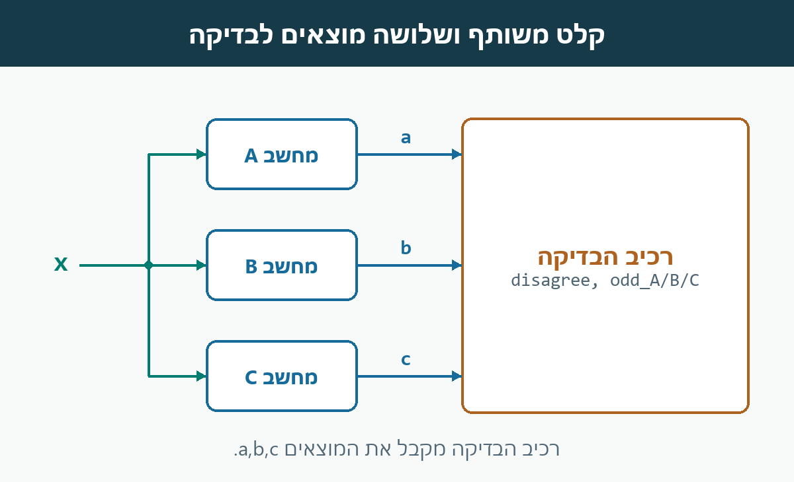
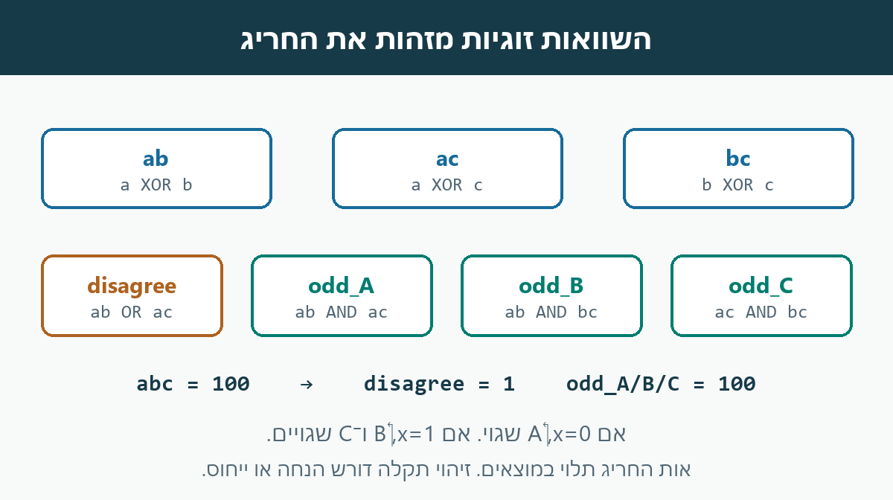
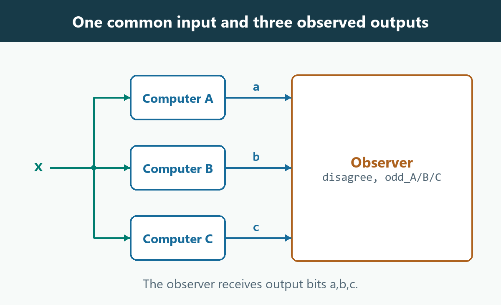
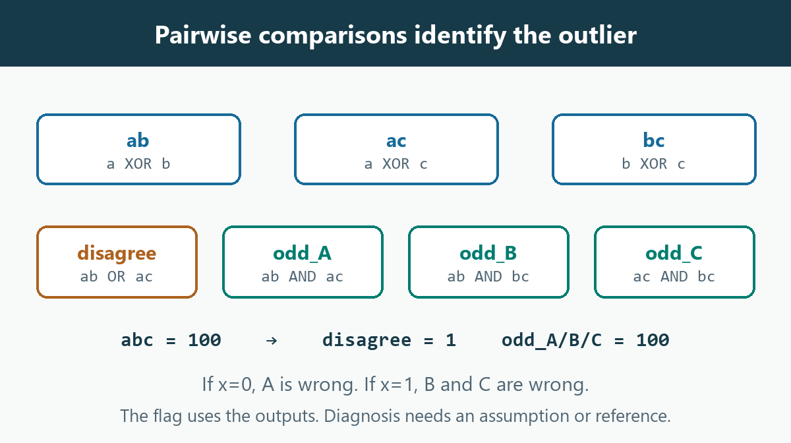

# PREP-369 — איתור אי־הסכמה בין שלושה מחשבים

הצעה לפתרון. ביקורת מקצועית אנושית ממתינה.

## עברית

שלושה מחשבים A,‏ B ו־C מקבלים את אותו ביט. כל אחד אמור להחזיר אותו, אך המוצא שלו יכול להשתבש. רכיב הבדיקה בתרשים קורא את שלושת המוצאים `a,b,c` ומקבל מהם ביטים מוגדרים. ממשו `disagree=1` כאשר המוצאים אינם כולם זהים. הפיקו `odd_A,odd_B,odd_C` בקידוד one-hot, כך שהביט היחיד שערכו 1 מציין את המחשב שמוצאו שונה משני האחרים. כאשר כל המוצאים זהים מותר כל מזהה, ובמימוש שלכם קבעו שלושה אפסים. הסבירו מה אפשר להסיק על תקלה כאשר אחד, שניים או שלושה מחשבים מחזירים תשובה שגויה, וכאשר ערך הקלט המקורי זמין למבדק.

1. בצעו השוואות בין זוגות מוצאים. כמה השוואות מספיקות כדי לזהות שהמוצאים אינם זהים?
2. מחשב חריג שונה מכל אחד משני האחרים. נסחו תנאי לכל אחד מהמחשבים.
3. בדקו את דפוס 100 עבור קלט מקורי 0 ועבור קלט מקורי 1. מה משתנה במסקנה?

### אי־הסכמה וזיהוי החריג

חשבו `ab=a XOR b`, `ac=a XOR c`. אז `disagree=ab OR ac` כי שלושתם שווים בדיוק כאשר גם `b` וגם `c` שווים ל־`a`. אפשר לחשב `bc=b XOR c` ישירות או מ־`ab XOR ac`. הביטים `odd_A=ab AND ac`, `odd_B=ab AND bc`, `odd_C=ac AND bc` מזהים כל חריג בשתי השוואות המתאימות לו. שיתוף `bc=ab XOR ac` הוא אפשרות לוגית. לשער עצמאי `b XOR c` עשוי להיות עומק קצר יותר.

| abc | disagree | odd_A odd_B odd_C |
| --- | --- | --- |
| 000 | 0 | 000 |
| 001 | 1 | 001 |
| 010 | 1 | 010 |
| 011 | 1 | 100 |
| 100 | 1 | 100 |
| 101 | 1 | 010 |
| 110 | 1 | 001 |
| 111 | 0 | 000 |

בשלישיית ביטים שאינה אחידה בדיוק שניים שווים. האות של המחשב היחיד ששונה משניהם הוא 1, וכל אות אחר כולל השוואה שווה ולכן הוא 0. אפשר להגדיר את מזהה החריג כלא בשימוש כאשר `disagree=0`. המימוש בוחר 000 מוגדר גם בשתי השורות האלה, כדי להימנע משימוש לא מבוקר ב־X בסימולציה.

כשיש לכל היותר מחשב אחד שמחזיר ביט שגוי, התשובה של הרוב נכונה, ובמקרה שיש אי־הסכמה אות החריג מזהה את המחשב שטעה. עם שתי טעויות ייתכן שהחריג הוא דווקא המחשב התקין. למשל בפלט `100`, אם הקלט היה 0 אז A שגוי, ואם הקלט היה 1 אז B ו־C שגויים. ללא ערך הייחוס, אותה תצפית תואמת את שני ההסברים. גם `000` או `111` מתאימים להסכמה נכונה או לשגיאה משותפת של שלושתם. הסתברות נמוכה לשגיאה משותפת אינה מוציאה אותה ממודל הנכונות.

אם לבודק זמין הקלט האמין `x` וההתנהגות הרצויה היא העברת הביט, אפשר להפיק מסכת שגיאה `a XOR x, b XOR x, c XOR x`. איתור אי־הסכמה נשאר הגדרה נפרדת. במימוש סינכרוני יש להשוות מוצאים מאותה עסקה, ולדגום לאחר שהתייצבו. סימולציית RTL והמבחן העצמאי בודקים את כל שמונה השורות ואת מסקנת המודל מול כל ערך קלט.

## English

Computers A, B and C are given the same bit. Each should return it, but its output may be incorrect. The observer in the figure sees their three resolved Boolean outputs `a,b,c`. Assert `disagree=1` whenever the outputs differ. Produce one-hot outputs `odd_A,odd_B,odd_C`, with the sole asserted bit naming the computer whose output differs from both others. The identifier is a don’t-care on unanimous outputs. Set all three identifier bits to zero for your implementation. Explain what can be inferred about faults if one, two or three computers return an incorrect answer, and when the original input is available to the observer.

1. Compare output pairs. How many comparisons suffice to detect disagreement?
2. The odd computer differs from each of the other two. Give each computer its own condition.
3. Test output 100 with original input 0 and with original input 1. What changes about the diagnosis?

### Disagreement and the odd output

Compute `ab=a XOR b` and `ac=a XOR c`. Then `disagree=ab OR ac` because all three agree exactly when both `b` and `c` equal `a`. Compute `bc=b XOR c` directly or use `ab XOR ac`. The flags `odd_A=ab AND ac`, `odd_B=ab AND bc`, `odd_C=ac AND bc` each check the two comparisons involving that computer. Sharing `bc=ab XOR ac` is a valid logical choice. A separate `b XOR c` may have lower depth.

| abc | disagree | odd_A odd_B odd_C |
| --- | --- | --- |
| 000 | 0 | 000 |
| 001 | 1 | 001 |
| 010 | 1 | 010 |
| 011 | 1 | 100 |
| 100 | 1 | 100 |
| 101 | 1 | 010 |
| 110 | 1 | 001 |
| 111 | 0 | 000 |

In a nonunanimous binary triple exactly two bits agree. The computer differing from both drives its flag high, and each other flag includes an equal comparison so it stays low. The identifier can be unused when `disagree=0`. Driving 000 on those two rows keeps the output defined and avoids an uncontrolled simulation X.

With at most one wrong computer, the majority is correct and a disagreement identifies the faulty computer for that result. With two wrong answers, the outlier can be the correct computer. For output `100`, A is wrong if the input was 0, while B and C are wrong if the input was 1. The same observation supports both diagnoses when the reference value is hidden. `000` or `111` can likewise mean correct agreement or an error shared by all three. A low probability of unanimous error does not remove it from the correctness model.

If the observer can see reliable input `x` and the intended function returns it unchanged, the three error flags are `a XOR x, b XOR x, c XOR x`. Disagreement remains a separate condition. A synchronous implementation should align outputs from the same transaction and sample settled signals. RTL simulation and an independent oracle check all eight rows and the interpretation for both possible original bit values.

[צילום מקור פנימי 16](../sources/2026-11-18-batch31-16.png)
[צילום מקור פנימי 17](../sources/2026-11-18-batch31-17.png)
[קובץ המימוש](../solutions/digital1118.sv)
[קובץ המימוש](../solutions/digital1118_models.py)
[תוצאות בדיקות](../checks/digital1118-verification.json)
