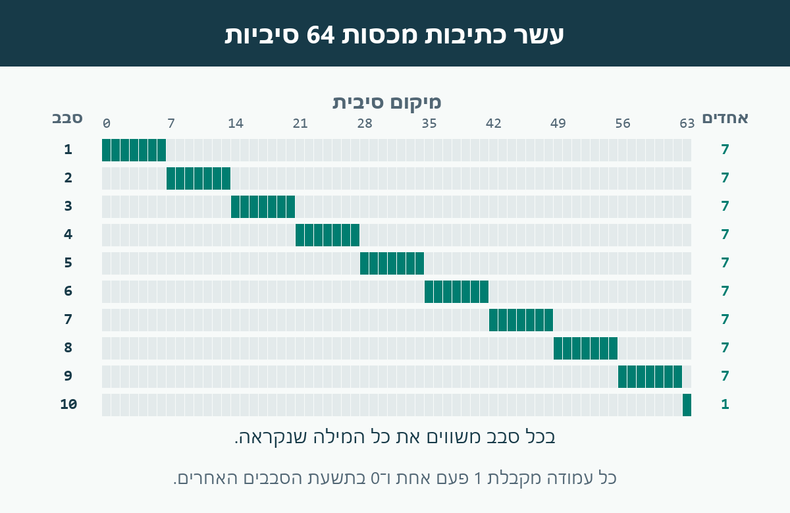
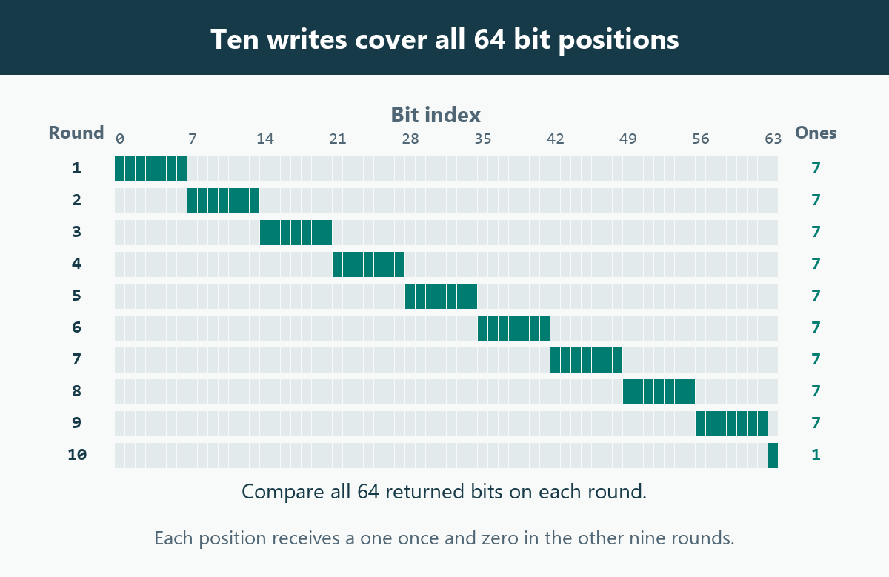

# PREP-370 — בדיקת מערך בן 64 סיביות עם עד שבעה אחדים

הצעה לפתרון. ביקורת מקצועית אנושית ממתינה.

## עברית

יש מערך אחסון בן 64 סיביות. מותר לכתוב מילה מלאה ולקרוא אותה אחרי שהכתיבה הושלמה. מגבלת ההספק בתרגיל קובעת שבכל מילת כתיבה מותר לבקש לכל היותר שבע סיביות בערך 1. מותר לשנות את המידע שבמערך. נניח שכתובות וממשק הקריאה תקינים, ושהתקלה האפשרית היא סיבית שתקועה ב־0 או ב־1 ללא תלות בערך שנכתב אליה. תכננו קוד המגלה אי־התאמה אם קיימת סיבית תקועה אחת או יותר, והוכיחו כמה סבבי כתיבה־וקריאה נחוצים במקרה הגרוע. הסבירו כיצד הדיון משתנה אם בדיוק שבעה אחדים נדרשים בפקודה, או אם המגבלה היא על מספר האחדים שקיימים בפועל במערך.

1. איזה ערך צריך להיכתב לכל סיבית כדי לחשוף תקיעה ב־0? ומה חושף תקיעה ב־1?
2. חלקו את האינדקסים לקבוצות של עד שבעה. בכל סבב קראו גם את האפסים.
3. כדי לגלות תקיעה ב־0 יש לבקש 1 בכל אחת מ־64 הסיביות לפחות פעם אחת. כמה כותבים אפשר לכסות בסבב יחיד?

### עשרה סבבים מכסים שני ערכים בכל סיבית

כתבו תשע מסכות זרות של שבעה אחדים רצופים המכסות את הסיביות 0 עד 62. במסכה העשירית בקשו 1 רק בסיבית 63. אחרי כל כתיבה קראו את כל 64 הסיביות והשוו למסכה שנכתבה. הפסיקו באי־התאמה הראשונה אם נדרשת תשובת עבר או נכשל, או אספו אי־התאמות אם צריך דוח.

```text
for start in 0, 7, 14, 21, 28, 35, 42, 49, 56, 63:
    span = min(7, 64 - start)
    expected = ((1 << span) - 1) << start
    write(expected)
    actual = read()
    if actual != expected:
        return failure(expected, actual)
return pass
```

כל סיבית נדרשת להיות 1 בסבב אחד ו־0 בכל האחרים. תקיעה ב־0 נחשפת בסבב שבו נדרש 1, ותקיעה ב־1 נחשפת בסבב שבו נדרש 0. לכן לכל סיבית תקועה קיים סבב עם אי־התאמה במוצאה. השוואת כל המילה מגלה אותה גם אם יש כמה תקלות, כי אי־התאמות במיקומים שונים אינן מתבטלות. זיכרון תקין משיב בדיוק את המילה שנכתבה בכל סבב. בכתיבה האחרונה כדאי לייצר את המסכה בחישוב ברוחב 64 סיביות ללא סימן או בדיוק שלם, כדי לא לאבד את הביט 63.

גם בבדיקה המחליטה על הכתיבה הבאה לפי קריאות קודמות, עקבו אחרי המסלול של זיכרון בריא. אם סיבית כלשהי מעולם לא נדרשה להחזיק 1, אותה סדרת תצפיות אפשרית גם כשהיא תקועה ב־0. לכן במסלול שעובר מבחן יש לכסות 64 בקשות 1 שונות. מגבלת שבע מחייבת לפחות `ceil(64/7)=10` סבבים, והמבנה משיג את החסם. מציאת תקלה עשויה להסתיים קודם. במודל של כתיבה וקריאה למילה מלאה, המסלול הארוך מבצע עשר כתיבות ועשר קריאות.

אם נדרשים בדיוק שבעה אחדים בכל כתיבה, מרחיבים את המסכה האחרונה בסיביות 0 עד 5. כל סיבית עדיין רואה גם 0 וגם 1, ולכן עדיין יש עשרה סבבים. אם המגבלה היא על מספר האחדים שקיימים בפועל לאחר התייצבות, שבעה אחדים מבוקשים וסיבית תקועה ב־1 מחוץ להם עלולים לתת שמונה. תחת הנחה נפרדת של מצב התחלתי בטוח ולכל היותר תקיעה אחת ב־1, מבקשים עד שישה אחדים במילה, ו־`ceil(64/6)=11` מסכות זרות מכסות בקשות 1. זהו חסם בטיחות לערך לאחר התייצבות בלבד. ריבוי תקיעות ב־1 בזמן שהמצב אינו ידוע, או זרם בזמן ההחלפה בין מילים, מחייבים חוזה חומרה נוסף כדי להבטיח מגבלת הספק.

בדיקות התוכנה מכסות את הזיכרון התקין ואת כל 128 מקרי התקיעה היחידה תחת המודל. זיהוי צימוד, בעיות פענוח כתובות ותקלות תזמון דורש גירויים והנחות אחרות. מסלול קריאה שגוי עלול ליצור אי־התאמה שתיראה כמו תקיעת תא, ולכן הניתוח מניח אותו תקין.



## English

You have a 64-bit storage array. You can write a complete word and read it after the write has finished. The exercise power constraint allows each requested write word to contain at most seven ones. The test may overwrite data. Assume correct addressing and readout and a fault model in which any faulty bit is permanently stuck at 0 or 1 regardless of the requested value. Design code to report any mismatch when there are one or more stuck bits, and prove the worst-case number of write/read rounds required. Explain how the problem changes if the command must contain exactly seven ones, or if the limit applies to the actual stored ones.

1. What must be written to a bit to expose stuck-at-0? What exposes stuck-at-1?
2. Partition the indices into groups of at most seven, and read the entire word, including the zero positions.
3. To expose stuck-at-0 every one of the 64 positions needs to be requested as 1 at least once. How many can one round cover?

### Ten rounds expose both requested values at every bit

Write nine disjoint seven-one masks covering positions 0 through 62. The tenth mask sets only bit 63. After each write read the full 64-bit word and compare it with the requested mask. Stop at the first mismatch if the outcome is pass/fail, or collect mismatches for a diagnostic report.

```text
for start in 0, 7, 14, 21, 28, 35, 42, 49, 56, 63:
    span = min(7, 64 - start)
    expected = ((1 << span) - 1) << start
    write(expected)
    actual = read()
    if actual != expected:
        return failure(expected, actual)
return pass
```

Each bit is requested as 1 in one round and 0 in all other rounds. Stuck-at-0 appears during its one round, and stuck-at-1 appears when zero is requested. Every stuck bit therefore has a round with an output mismatch. A full-word comparison detects it even with several faults because mismatches at different positions cannot cancel. A healthy array returns the corresponding mask every time. Build the final mask in an unsigned 64-bit type or exact integer arithmetic to retain bit 63.

Even with adaptive stimulus, follow the path on a healthy array. If any position never receives a one, a stuck-at-0 fault there produces identical observations along that path. Thus a passing test must cover 64 distinct one requests. The cap of seven requires at least `ceil(64/7)=10` rounds, and this construction reaches the bound. A failure can stop earlier. Under complete-word writes and reads, the longest path uses ten writes and ten reads.

If each command must contain exactly seven ones, add positions 0 through 5 to the last mask. Each position still sees both values, so there are still ten rounds. If the limit instead applies to the actual settled state, requesting seven ones with another bit stuck high can store eight. With a separately assumed safe starting state and at most one stuck-high bit, requesting six ones per word caps the settled state at seven, and `ceil(64/6)=11` disjoint masks cover the one requests. That bound only concerns settled values. Several unknown stuck-high bits or switching current between words require a further hardware contract to guarantee a power limit.

The software checks the healthy case and all 128 single stuck-bit faults in the model. Coupling, address decoding and timing defects need additional stimuli and assumptions. A faulty read path can mimic a cell fault, so the argument assumes reliable readout.



[צילום מקור פנימי 30](../sources/2026-11-18-batch31-30.png)
[קובץ המימוש](../solutions/digital1118_models.py)
[תוצאות בדיקות](../checks/digital1118-verification.json)
