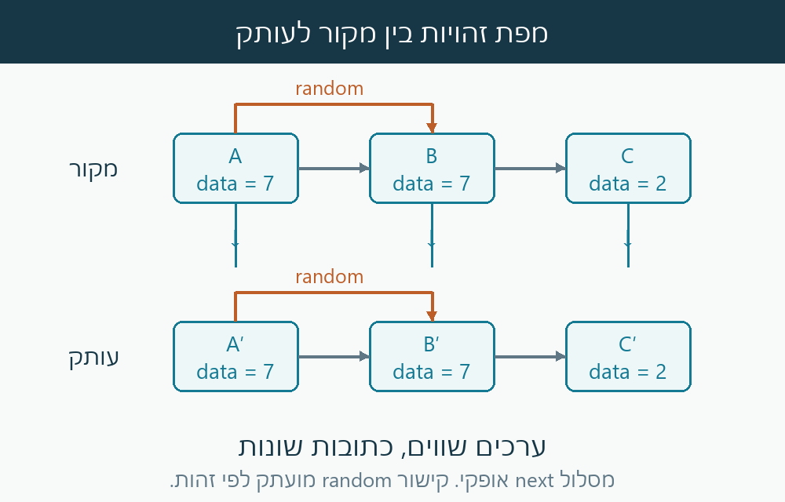
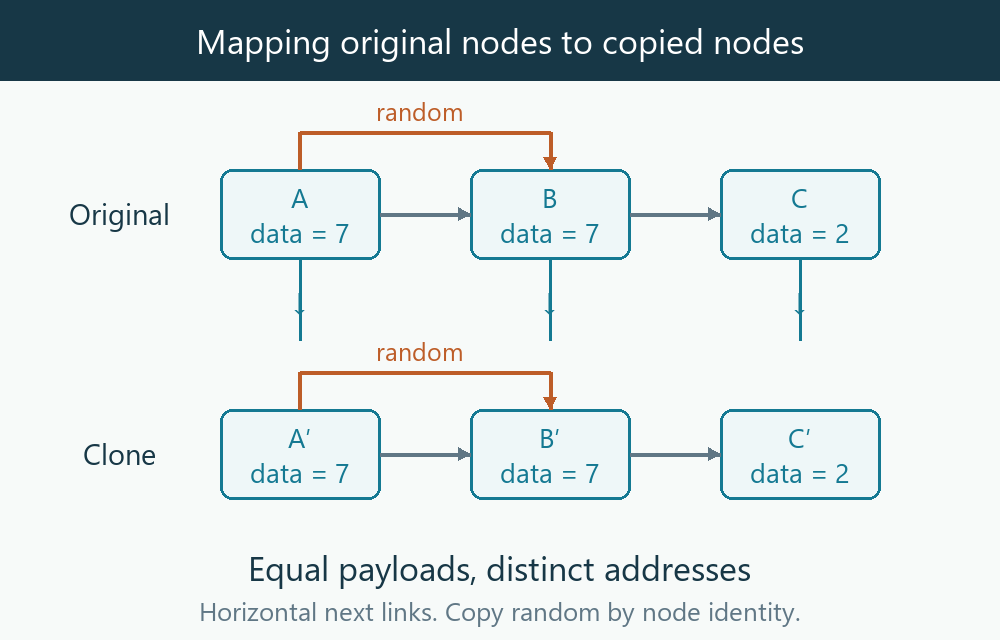

# PREP-371 — שכפול עמוק של רשימה עם מצביע אקראי

פתרון מוצע בסיוע AI. ממתין לביקורת מקצועית אנושית.

[צילום המקור](../sources/2026-11-18-batch31-04.png)

משרת סטודנט אמבדד, תוכנה low-level ב־cpp. יש רשימה מקושרת רגילה עם שדה נוסף בכל node שמצביע לאיבר שרירותי ברשימה. כל node מכיל next, data ו־random pointer. בצעו clone לרשימה כמו שצריך.

## שכפול עמוק של רשימה עם מצביע אקראי

נתונה רשימה מקושרת חד־כיוונית ב־C++. לכל צומת יש data מסוג int, מצביע next ומצביע random. שרשרת next סופית וללא מעגל. random יכול להיות null או להצביע לצומת כלשהו באותה רשימה, לרבות הצומת עצמו. כתבו פונקציה שיוצרת עותק עמוק בעל בעלות ברורה. העתקו את הערכים ואת שני סוגי הקישורים, בלי לשנות את המקור ובלי להשאיר מצביעים מן העותק לצמתים המקוריים. הסבירו את הסיבוכיות וטפלו בראש ריק.

### רמזים

1. מה צריך לקרות לקישור random אם שני צמתים מכילים אותו ערך?
2. תנו לכל כתובת מקור כתובת עותק משלה לפני שתמלאו את הקישורים.
3. עברו פעמיים על next. בפעם השנייה החליפו כל יעד במיפוי source → copy ושמרו על null.

### פתרון מוצע

צרו צומת חדש לכל צומת שנגיש דרך next. השתמשו בכתובת המקור כמפתח במפת גיבוב. אל תמפו לפי data, מפני שערכים שווים אינם מזהים אותו צומת. השאירו את הקישורים ריקים עד להשלמת המפה. לכל יעד ריק אפשר להגדיר מראש העתק ריק במפה.

במעבר השני חברו את העותק של u אל העותקים של u.next ושל u.random. לדוגמה אם A ו־B מכילים שניהם 7, ו־A.random מצביע אל B, מצביע random של העותק של A יגיע דווקא לעותק של B. מצביע לעצמו נשאר מצביע לעצמו בתוך הרשימה החדשה. גם מעגלים בשדות random אינם בעייתיים מפני שהסריקה עוקבת רק אחרי next.

אחרי המעבר הראשון יש התאמה חד־חד־ערכית בין הצמתים המקוריים לצמתים חדשים בעלי אותו ערך. המעבר השני משמר כל קשת לפי ההתאמה. מכאן שה־next וה־random של כל עותק משחזרים את היעדים בלי קישורים למקור. הקוד ב־C++ שומר בעלות ב־vector של unique_ptr. הזזת האיברים בו אינה מזיזה את הצמתים המוקצים, ומצביעי next ו־random משמשים לקישור בלבד. החזרת מבנה הבעלות שומרת את הצמתים בחיים. אם הקצאה נכשלת, הצמתים שכבר נוצרו משתחררים בעת פריקת המחסנית והמקור נשאר כפי שהיה.

הזמן צפוי O(N) תחת פעולות גיבוב בזמן צפוי קבוע. הצמתים החדשים תופסים O(N) מקום לתוצאה, והמפה תופסת O(N) מקום נוסף. אם דרושה הבטחת זמן גרועה של O(N log N), אפשר להשתמש במפה מסודרת של כתובות עם סדר חוקי למצביעים. אם מותר לשנות את המקור זמנית, שזירת כל עותק אחרי המקור מאפשרת מיפוי דרך next, אך אז צריך לשחזר את המקור ולתכנן טיפול בכשלי הקצאה.

```cpp
#include <memory>
#include <unordered_map>
#include <vector>

struct Node {
    int data;
    Node* next = nullptr;
    Node* random = nullptr;
};

struct ClonedList {
    std::vector<std::unique_ptr<Node>> storage;
    Node* head = nullptr;
};

// The next chain is finite and acyclic. All non-null random targets lie in it.
ClonedList clone_list(const Node* head) {
    ClonedList result;
    std::unordered_map<const Node*, Node*> copies;
    copies.emplace(nullptr, nullptr);
    for (const Node* node = head; node; node = node->next) {
        result.storage.push_back(std::make_unique<Node>(Node{node->data}));
        copies.emplace(node, result.storage.back().get());
    }
    for (const Node* node = head; node; node = node->next) {
        Node* copy = copies.at(node);
        copy->next = copies.at(node->next);
        copy->random = copies.at(node->random);
    }
    result.head = copies.at(head);
    return result;
}
```



### הנחות

בכל צומת נתון שלם. רק שרשרת next חייבת להיות ללא מעגל והמקור אינו משתנה.

### מקרה קצה

רשימה ריקה, נתונים שווים, random ריק, קישור קדימה או אחורה, מצביע עצמי ומעגלי random.

### טעות נפוצה

העתקה ישירה של random משאירה קישור למקור. מיפוי לפי נתון מערבב צמתים בעלי אותו ערך.

### סיבוכיות או עלות

זמן צפוי O(N), מפה O(N) בנוסף לפלט. יש לקרוא כל צומת ולהקצות לו עותק.

### בדיקות

בדיקות ממצות של יעדי random עד חמישה צמתים, בדיקות זהות ומוטציה בשתי שפות והרצת C++ מקומית.

### תשובה קצרה

עוברים פעמיים. קודם מקצים עותק לכל כתובת, ואז מתרגמים את next ואת random דרך המפה. הבעלות על העותקים נשמרת בנפרד מהקישורים.

### שאלת המשך

איך מצמצמים זיכרון עזר כשהמקור ניתן לשינוי זמני? שזרו עותק מיד אחרי כל מקור, חברו random דרך target.next ואז הפרידו בזהירות ושחזרו. הגדירו טיפול בכשל הקצאה ובקוראים מקבילים.

## Deep clone of a linked list with random pointers

A singly linked list in C++ has int data, a next pointer and a random pointer in every node. Its next chain is finite and acyclic. A random pointer can be null or point to any node in the list, including its own node. Implement a deep clone with clear ownership of the new nodes. Preserve the data and both link types, leave the original unchanged and ensure no copied link points into the original. Explain the cost and handle an empty head.

### Hints

1. What happens to a random link when two nodes have equal data?
2. Give each original address its own copy address before assigning links.
3. Walk next twice. On the second pass translate both targets through an original-to-copy map and preserve null.

### Proposed solution

Allocate a fresh node for each node reachable through next. Use the original address as the key in a hash map. Equal data do not identify equal nodes. Leave links unset until the map is complete. A null-to-null entry handles either null link uniformly.

In the second pass connect the copy of u to the copies of u.next and u.random. If A and B both hold 7 and A.random points to B, the random link of the copy of A must point specifically to the copy of B. A self-link remains a self-link within the clone. Random cycles are harmless because traversal follows only next.

After pass one, there is a bijection from original nodes to fresh nodes with the same data. Pass two preserves each edge under this bijection. This proves both link types are preserved while no copied edge enters the original. The C++ implementation owns the nodes in a vector of unique_ptr. Moving the handles does not move the allocated nodes; next and random are observer pointers. Keep the returned owner alive while using the head. If allocation throws, stack unwinding releases the copies already created and the original remains unchanged.

Expected time is O(N) under expected constant-time hash operations. The copied nodes use O(N) output storage and the map uses O(N) auxiliary storage. An ordered map with a valid pointer ordering gives a worst-case O(N log N) alternative. If temporary mutation is explicitly allowed, interleaving a copy after each source makes the mapping accessible through next, with extra care for restoring the source if allocation fails.

```cpp
#include <memory>
#include <unordered_map>
#include <vector>

struct Node {
    int data;
    Node* next = nullptr;
    Node* random = nullptr;
};

struct ClonedList {
    std::vector<std::unique_ptr<Node>> storage;
    Node* head = nullptr;
};

// The next chain is finite and acyclic. All non-null random targets lie in it.
ClonedList clone_list(const Node* head) {
    ClonedList result;
    std::unordered_map<const Node*, Node*> copies;
    copies.emplace(nullptr, nullptr);
    for (const Node* node = head; node; node = node->next) {
        result.storage.push_back(std::make_unique<Node>(Node{node->data}));
        copies.emplace(node, result.storage.back().get());
    }
    for (const Node* node = head; node; node = node->next) {
        Node* copy = copies.at(node);
        copy->next = copies.at(node->next);
        copy->random = copies.at(node->random);
    }
    result.head = copies.at(head);
    return result;
}
```



### Assumptions

Integer payloads. Only the next chain must be acyclic, and the original stays unchanged.

### Edge case

Empty head, equal data, null random, forward and backward links, self-links and random cycles.

### Common mistake

Assigning copied random directly from the original leaves an alias. Mapping by data conflates distinct nodes.

### Cost

Expected O(N) time and O(N) auxiliary map storage in addition to the output. Every original node must be read and individually copied.

### Verification

Exhaustive random-target choices through five nodes, link identity and mutation checks in both languages, and a local native C++ run.

### Interview answer

Allocate a copy per address, translate both next and random through the map, and return ownership along with the copied head.

### Follow-up

How can auxiliary space shrink when the original may be temporarily mutated? Interleave each copy immediately after its source, wire random through target.next and detach while restoring the original. Define allocation-failure handling and interference with concurrent readers.

[checks/check_nov18_software.py](../checks/check_nov18_software.py)

[checks/prep-371-1118-verification.json](../checks/prep-371-1118-verification.json)

[solutions/prep_371_clone_random_list.cpp](../solutions/prep_371_clone_random_list.cpp)

[solutions/prep_371_clone_random_list.py](../solutions/prep_371_clone_random_list.py)
