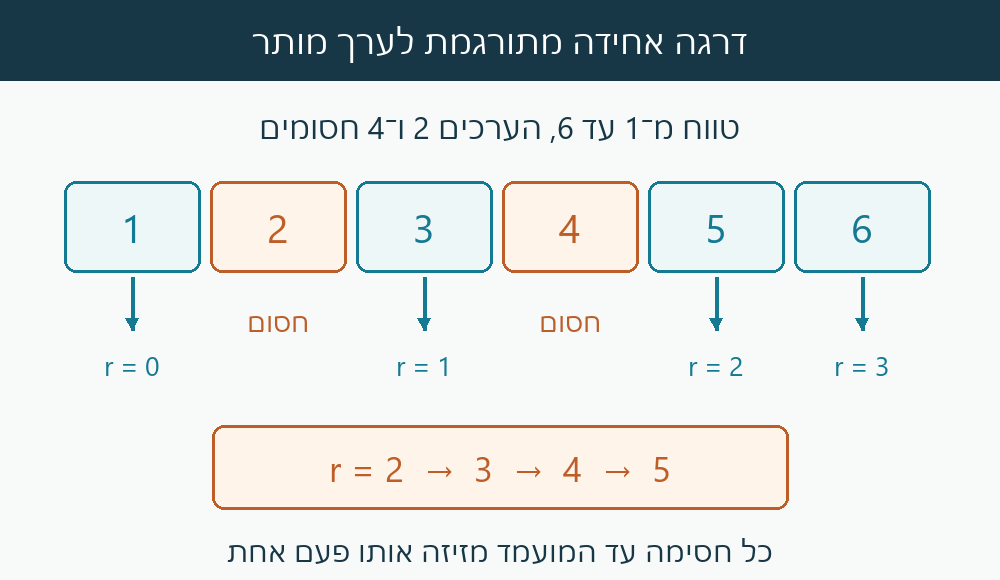
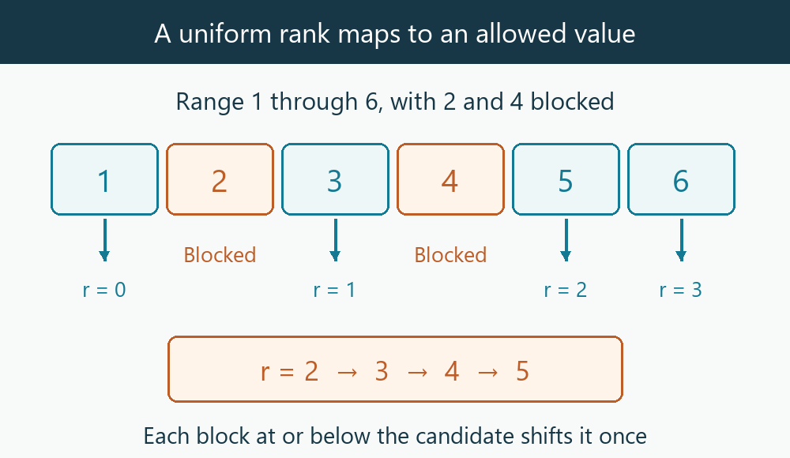

# PREP-372 — הגרלה אחידה בלי לחזור על אף אחד מחמשת הערכים האחרונים

פתרון מוצע בסיוע AI. ממתין לביקורת מקצועית אנושית.

[צילום המקור](../sources/2026-11-18-batch31-18.png)

נתונה rand(x,y) שמגרילה מספר אקראי בין x ל־y. ממש rand5(x,y) שמגרילה מספר באותו תחום שלא הוגרל בחמש הפעמים האחרונות.

## הגרלה אחידה בלי לחזור על אף אחד מחמשת הערכים האחרונים

נתונה פונקציה `rand(lo, hi)` שמחזירה מספר שלם אחיד בטווח הסגור המבוקש, גם בהינתן ההגרלות הקודמות. ממשו מחולל עבור טווח קבוע [x,y] שמחזיר בכל קריאה ערך אחיד מבין הערכים שלא הופיעו בחמש התוצאות הקודמות שלו. ההיסטוריה ריקה בהתחלה ונפרדת לכל מופע. המחולל צריך לתמוך במספר קריאות בלתי מוגבל. קבעו מה עושים כאשר יש פחות משישה ערכים והשתמשו בקריאה אקראית אחת לכל תוצאה.

### רמזים

1. כמה ערכים חסומים אחרי שלוש קריאות ואחרי חמש?
2. הגרילו אינדקס בין המועמדים החוקיים, בלי לייצר רשימה באורך הטווח.
3. מיינו עד חמישה ערכים חסומים ודלגו מעל כל חסימה שנמצאת לפני המועמד הנוכחי או עליו.

### פתרון מוצע

שמרו תור של עד חמש תוצאות. הערכים בתור שונים תמיד, מפני שכל קריאה חדשה נמנעת מכל הערכים שנמצאים בו. אם גודל הטווח הוא M וגודל התור k, מספר הערכים שמותר להחזיר הוא M−k. הגרילו דרגה r בין 0 ל־M−k−1.

התחילו במועמד x+r. עברו על חסימות בסדר עולה. כשהחסימה קטנה מהמועמד או שווה לו, הגדילו את המועמד באחד. אחרי תיקון כזה ממשיכים לבדוק גם את החסימה הבאה. כאשר החסימה הבאה גדולה מהמועמד, גם כל אלה שאחריה גדולות ממנו וניתן לעצור. הוסיפו את התוצאה לתור והוציאו את הוותיקה אם חרגנו מחמש.

כל תוספת מתקנת בדיוק ערך חסום אחד שהיה צריך לדלג עליו. בסוף, מספר הערכים החוקיים שמקדימים את המועמד הוא (value−x) פחות מספר החסימות הקטנות ממנו, כלומר r. המועמד עצמו פנוי, ולכן ההעתקה היא חד־חד־ערכית ועל. אילו החסימות הן 2 ו־4 בטווח [1,6], דרגה 2 נשלחת ל־5 כי הרשימה המותרת היא [1,3,5,6].

כל תוצאה אחידה מותנית בהיסטוריה. התוצאות תלויות זו בזו מכיוון שחלק מהתוצאות אסורות. בדיוק שישה ערכים מאפשרים להמשיך, אך אחרי חמש תוצאות נותר בכל פעם מועמד יחיד והסדר נכנס למחזור באורך שש. אם יש לכל היותר חמישה ערכים, אי־אפשר להבטיח רצף בלתי מוגבל ולכן האתחול נכשל. המימוש ממיין לכל היותר חמישה מספרים וזמן העבודה והזיכרון קבועים ביחס לגודל הטווח באומדן פעולות על מילים. למספרים ארוכים יש עלות חישוב שתלויה באורך הייצוג.

```python
from collections import deque


class RandomLastFive:
    """Keep a separate history for each fixed inclusive range and instance."""

    def __init__(self, low, high, rand):
        if high - low + 1 < 6:
            raise ValueError('at least six values are required')
        self.low = low
        self.high = high
        self.rand = rand
        self.history = deque(maxlen=5)

    def next(self):
        high_rank = self.high - self.low - len(self.history)
        rank = self.rand(0, high_rank)
        if not 0 <= rank <= high_rank:
            raise ValueError('rand returned a rank outside the requested range')
        value = self.low + rank
        for excluded in sorted(self.history):
            if excluded > value:
                break
            value += 1
        self.history.append(value)
        return value


def random_from_ranks(low, high, ranks):
    """Deterministic adapter with zero-based ranks supplied for successive draws."""
    draws = iter(ranks)
    generator = RandomLastFive(low, high, lambda _lo, _hi: next(draws))
    return [generator.next() for _ in ranks]
```



### הנחות

טווח שלמים סגור וקבוע לכל מופע. הדרגות מתקבלות מן המחולל האחיד שסופק. לפחות שישה ערכים.

### מקרה קצה

טווח של שישה, התחלה ללא היסטוריה, קצוות שליליים, פינוי הערך הוותיק, והפרדה בין מופעים.

### טעות נפוצה

שמירת כל הערכים שהופיעו אי פעם משנה את התרגיל. דילוג על חסימה רק פעם אחת מפספס חסימות סמוכות.

### סיבוכיות או עלות

עד חמש חסימות בזיכרון ודגימה אחת; מיון של עד חמישה ערכים וקפיצה מעליהם.

### בדיקות

נבדקו כל דרגות הבחירה בכל תת־קבוצת חסימות בתחום סופי מסומן, המחזור הקטן ביותר, היסטוריה תקפה וניסיון טווח קטן.

### תשובה קצרה

שומרים את חמש התוצאות האחרונות, מגרילים אינדקס אחיד ברשימת הערכים הזמינים ומתקנים אותו על ידי דילוג על חסימות ממוינות.

### שאלת המשך

מהן עלויות דגימה חוזרת עד הצלחה? יש הסתברות הצלחה (M−k)/M בכל ניסיון, לכן מספר הניסיונות הצפוי הוא M/(M−k). הם אינם חסומים בזמן גרוע אם יש ערך אסור.

## Uniform random values excluding the previous five results

An inclusive integer generator `rand(lo, hi)` is uniform on every requested range conditional on previous draws. Implement a generator for a fixed inclusive range [x,y]. Each call must be uniform over the values absent from its previous five results. Start with an empty history and keep history per instance. Support arbitrarily many calls. Define behavior for ranges with fewer than six values, and make only one random draw per output.

### Hints

1. How many values are excluded after three calls and after five?
2. Draw a uniform index among the allowed values without allocating a list the size of the range.
3. Process up to five blocked values in ascending order, shifting the candidate once for each block at or below it.

### Proposed solution

Keep a queue of up to five results. Its values are distinct because each call excludes everything currently in the queue. If the range has M values and the queue holds k, draw a rank r from 0 through M−k−1.

Start at candidate x+r. Visit exclusions in ascending order. Whenever the next exclusion is at or below the current candidate, increase the candidate by one. Continue checking because the shift can hit another exclusion. When the next exclusion is greater than the candidate, every remaining exclusion is greater too. Append the result and expire the oldest after five.

Each increment compensates for precisely one excluded value. When the scan ends the candidate is allowed. The number of allowed values preceding it equals (value−x) minus the number of exclusions below it, which is r. The map is therefore bijective and preserves uniformity. For exclusions 2 and 4 on [1,6], rank 2 selects 5 from [1,3,5,6].

Each result is uniform conditional on the history. Outcomes depend on earlier results through the exclusion rule. A range of exactly six continues with only one available value after the fifth call, so the order then cycles with period six. A range of at most five cannot support the indefinite contract, so initialization fails. The implementation sorts at most five numbers; work and scratch storage are bounded independently of the range size in the word-operation model. With arbitrary-precision arithmetic, integer operation costs depend on the bit lengths.

```python
from collections import deque


class RandomLastFive:
    """Keep a separate history for each fixed inclusive range and instance."""

    def __init__(self, low, high, rand):
        if high - low + 1 < 6:
            raise ValueError('at least six values are required')
        self.low = low
        self.high = high
        self.rand = rand
        self.history = deque(maxlen=5)

    def next(self):
        high_rank = self.high - self.low - len(self.history)
        rank = self.rand(0, high_rank)
        if not 0 <= rank <= high_rank:
            raise ValueError('rand returned a rank outside the requested range')
        value = self.low + rank
        for excluded in sorted(self.history):
            if excluded > value:
                break
            value += 1
        self.history.append(value)
        return value


def random_from_ranks(low, high, ranks):
    """Deterministic adapter with zero-based ranks supplied for successive draws."""
    draws = iter(ranks)
    generator = RandomLastFive(low, high, lambda _lo, _hi: next(draws))
    return [generator.next() for _ in ranks]
```



### Assumptions

Inclusive integer range fixed per instance and valid uniform draws. At least six values.

### Edge case

Six allowed values, empty history, negative endpoints, oldest-result eviction and independent instances.

### Common mistake

Remembering every earlier result changes the problem. Skipping only once fails when exclusions are adjacent.

### Cost

One random draw, sorting and scanning at most five exclusions, and at most five retained results.

### Verification

Exhaustive ranks for every exclusion subset in a finite signed domain, the minimum-range cycle, valid history and rejection of undersized ranges.

### Interview answer

Store the previous five results. Draw one uniform rank among the allowed candidates and map it to a value by stepping past sorted exclusions.

### Follow-up

How much does rejection sampling cost? Each attempt succeeds with probability (M−k)/M, so M/(M−k) draws are expected. The worst-case number of draws is unbounded whenever some value is blocked.

[checks/check_nov18_software.py](../checks/check_nov18_software.py)

[checks/prep-372-1118-verification.json](../checks/prep-372-1118-verification.json)

[solutions/prep_372_random_last_five.py](../solutions/prep_372_random_last_five.py)
