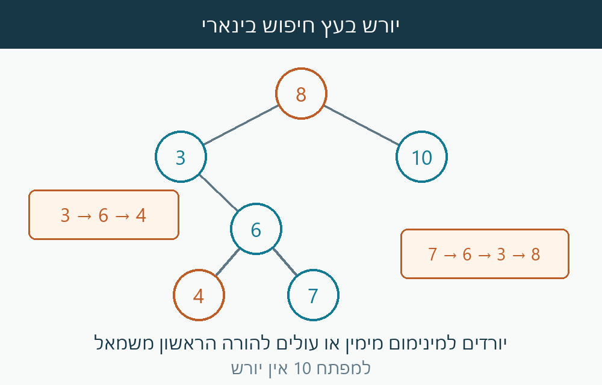
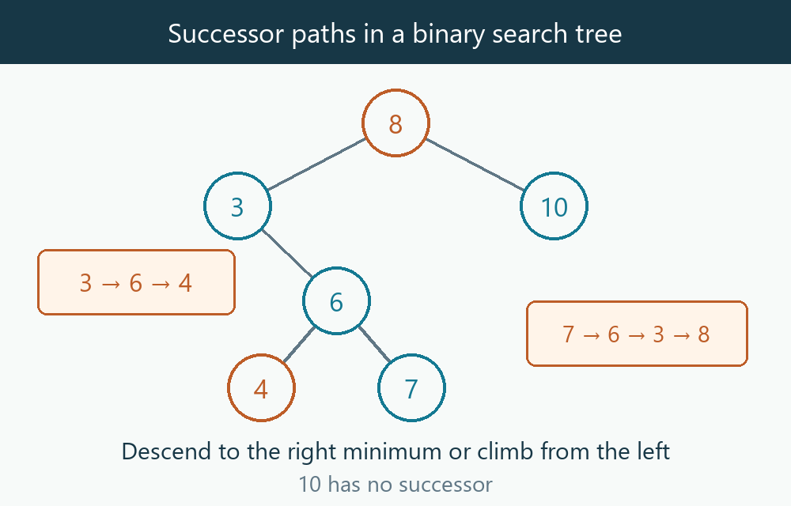

# PREP-373 — הצומת הבא בעץ חיפוש בינארי בעזרת מצביעי הורה

פתרון מוצע בסיוע AI. ממתין לביקורת מקצועית אנושית.

[צילום המקור](../sources/2026-11-18-batch31-21.png)

עץ חיפוש בינארי, בן ימני גדול מהאב ובן שמאלי קטן. Node=(left,parent,right). תאר אלגוריתם וכתוב פסאודו קוד לפונקציה המקבלת צומת ומחזירה את הצומת הקרוב ביותר שגדול ממנו.

## הצומת הבא בעץ חיפוש בינארי בעזרת מצביעי הורה

נתון צומת בעץ חיפוש בינארי סופי בעל מפתחות שונים. לכל צומת יש left, right ו־parent תקינים, וההורה של השורש ריק. כתבו פסאודו־קוד שמחזיר את הצומת שמפתחו הקטן ביותר מבין המפתחות הגדולים ממפתח הצומת הנתון. אם אין כזה החזירו null. אפשר להשתמש רק בצומת הנתון ובקישורים שלו. הסבירו מדוע הפתרון נכון ומה עלותו.

### רמזים

1. איזה חלק בעץ מכיל רק ערכים גדולים משל הצומת?
2. אם אין ילד ימני, בדקו באיזה צד של כל הורה הגעתם אליו.
3. רדו לשמאלי ביותר בתת־העץ הימני, או עלו עד שהגעתם להורה מהבן השמאלי.

### פתרון מוצע

אם לצומת u יש ילד ימני, הכנסו אליו ואז עקבו אחרי left עד הסוף. לפי סדר עץ החיפוש, כל ערך בתת־העץ הימני של u גדול ממנו, והערך השמאלי ביותר הוא המינימום בתת־העץ. כל אב קדמון גדול מ־u גדול גם מן המינימום הזה, משום שגם u וגם תת־העץ הימני שלו נמצאים בתת־העץ השמאלי של אותו אב.

אם אין ילד ימני, עלו כל עוד הגעתם אל ההורה מהבן הימני. הורה כזה קטן ממפתח u וכל תת־העץ השמאלי שלו קטן ממנו גם כן. ההורה הראשון שאליו מגיעים משמאל הוא הערך הגדול הקרוב ביותר. בסריקה בסדר עולה, סיימנו לעבור על החלק השמאלי של אותו הורה, ולכן ההורה עצמו מופיע מיד אחרי u. אם עלינו מעבר לשורש, u היה המרבי ואין תשובה.

בעץ שהמפתחות שלו הוכנסו בסדר 8,3,10,6,4,7, היורש של 3 הוא 4 דרך הירידה בתת־העץ הימני. היורש של 7 הוא 8 אחרי דילוג על 6 ו־3. עבור 10 חוזר null. המסלול אינו ארוך מגובה h של העץ, ולכן הזמן O(h+1) והזיכרון O(1). בעץ מאוזן זה O(log N), ובעץ שרשרת ייתכן O(N).

```python
class Node:
    def __init__(self, key):
        self.key = key
        self.left = None
        self.right = None
        self.parent = None


def successor(node):
    """Return the next node in ascending key order, or None."""
    if node is None:
        return None
    if node.right is not None:
        node = node.right
        while node.left is not None:
            node = node.left
        return node

    parent = node.parent
    while parent is not None and node is parent.right:
        node, parent = parent, parent.parent
    return parent


def successors_of_insertion_order(keys):
    """JSON adapter: build the BST, then return successors in input-key order."""
    root = None
    nodes = []
    for key in keys:
        item = Node(key)
        nodes.append(item)
        if root is None:
            root = item
            continue
        cursor = root
        while True:
            branch = 'left' if key < cursor.key else 'right'
            child = getattr(cursor, branch)
            if child is None:
                setattr(cursor, branch, item)
                item.parent = cursor
                break
            cursor = child
    return [found.key if (found := successor(node)) is not None else None
            for node in nodes]
```



### הנחות

עץ סופי בעל סדר BST קשיח, מפתחות שונים וקישורי הורה עקביים.

### מקרה קצה

צומת מקסימלי, צומת יחיד, קפיצה דרך כמה הורים וילד ימני שהמינימום שלו נמצא עמוק משמאל.

### טעות נפוצה

להחזיר את הילד הימני בלי לבדוק את צאצאיו השמאליים, או להחזיר הורה שהגעתם אליו מהילד הימני.

### סיבוכיות או עלות

O(h+1) זמן ו־O(1) זיכרון עזר במילים, מהצומת הנתון.

### בדיקות

כל סדרי ההכנסה עד שבעה מפתחות נבדקו באמצעות מיפוי עצמאי למפתח הבא, כולל זהות הצומת ושמירת הקישורים.

### תשובה קצרה

אם יש תת־עץ ימני, לוקחים את הקטן בו. אחרת עולים עד לקישור ראשון מהילד השמאלי ומחזירים את ההורה שלו.

### שאלת המשך

מה עושים אם אין מצביעי parent אבל יש גישה לשורש? מחפשים את המפתח מהשורש ושומרים מועמד בכל פעם שיורדים שמאלה. במעבר הסופי אפשר לבדוק גם את תת־העץ הימני של הצומת.

## In-order successor in a BST using parent pointers

You are given a node in a finite binary search tree with distinct keys. Each node has valid left, right and parent links, and the root has a null parent. Write pseudocode returning the node with the smallest key strictly greater than the given key, or null when none exists. You may use the supplied node and its links. Prove correctness and analyze the cost.

### Hints

1. Which part of the tree contains only keys greater than the supplied node?
2. Without a right child, consider whether you arrived at each ancestor from the left or the right.
3. Descend to the leftmost node of the right subtree, or climb until the first parent reached from its left child.

### Proposed solution

If u has a right child, enter that subtree and follow left until there is no left child. All keys in u's right subtree are larger than u, and its leftmost node is the minimum there. Every ancestor greater than u is also greater than this minimum, since u and its right subtree are within that ancestor's left subtree.

If u has no right child, climb while arriving at a parent from its right child. Such a parent is smaller than u, and its left subtree is smaller too. The first parent reached from the left is the next larger key. In ascending traversal we have just finished visiting that parent's left subtree, so the parent is visited immediately after u. If the climb passes the root, u is the largest and there is no successor.

For insertion order 8,3,10,6,4,7, the successor of 3 is 4 by descent into the right subtree. The successor of 7 is 8 after skipping 6 and 3. The successor of 10 is null. This costs O(h+1) time for height h and O(1) auxiliary words. A balanced tree gives O(log N) time while a chain-shaped tree can require O(N).

```python
class Node:
    def __init__(self, key):
        self.key = key
        self.left = None
        self.right = None
        self.parent = None


def successor(node):
    """Return the next node in ascending key order, or None."""
    if node is None:
        return None
    if node.right is not None:
        node = node.right
        while node.left is not None:
            node = node.left
        return node

    parent = node.parent
    while parent is not None and node is parent.right:
        node, parent = parent, parent.parent
    return parent


def successors_of_insertion_order(keys):
    """JSON adapter: build the BST, then return successors in input-key order."""
    root = None
    nodes = []
    for key in keys:
        item = Node(key)
        nodes.append(item)
        if root is None:
            root = item
            continue
        cursor = root
        while True:
            branch = 'left' if key < cursor.key else 'right'
            child = getattr(cursor, branch)
            if child is None:
                setattr(cursor, branch, item)
                item.parent = cursor
                break
            cursor = child
    return [found.key if (found := successor(node)) is not None else None
            for node in nodes]
```



### Assumptions

Finite, strict BST ordering, distinct keys, and consistent parent links.

### Edge case

Maximum node, a singleton tree, a multi-ancestor climb and a right subtree with a deep leftmost node.

### Common mistake

Returning the immediate right child without checking its left descendants, or returning an ancestor reached from its right child.

### Cost

O(h+1) time and O(1) auxiliary words starting at the given node.

### Verification

All insertion orders through seven keys are checked against independently mapped next keys, including node identity and unchanged links.

### Interview answer

Take the minimum in the right subtree when present. Otherwise climb to the first parent reached from its left child.

### Follow-up

What if parent pointers are unavailable but the root is known? Search from the root and remember the best larger ancestor each time you take a left branch. Also examine the given node’s right subtree when present.

[checks/check_nov18_software.py](../checks/check_nov18_software.py)

[checks/prep-373-1118-verification.json](../checks/prep-373-1118-verification.json)

[solutions/prep_373_bst_successor.py](../solutions/prep_373_bst_successor.py)
