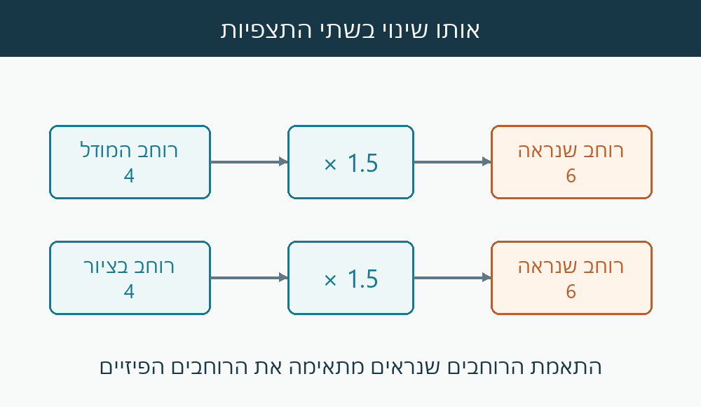
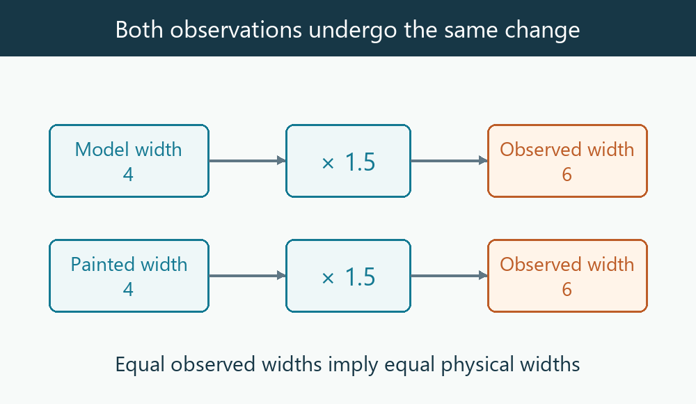

# PREP-374 — הצייר שרואה דמויות רחבות

פתרון מוצע בסיוע AI. ממתין לביקורת מקצועית אנושית.

[צילום המקור](../sources/2026-11-18-batch31-01.png)

חוקרי אמנות בחנו ציורים של צייר שחי לפני שנים רבות. בכל הציורים הדמויות והאובייקטים מרוחים לרוחב ונראים רחבים מהמציאות. אופטומטריסט טען שככל הנראה בעיית ראייה גרמה לצייר לראות הכל בצורה רחבה. מהנדס עיבוד תמונה טען שהאופטומטריסט בהכרח טועה, אף שאין לו ידע רפואי. מדוע הוא צודק?

## הצייר שרואה דמויות רחבות

כל הדמויות בציוריו של צייר נראות רחבות מן המציאות. נניח שראייתו מגדילה פי k>1 כל רוחב אופקי, באותו קנה מידה הן כשהוא מתבונן במודל והן כשהוא מתבונן בציור. הצייר משווה רוחב זה לרוחב המתאים בציור ומתאים ביניהם כפי שהוא רואה אותם. האם ההגדלה כשלעצמה גורמת לעיוות בציור הפיזי? נמקו ודונו במה שניתן להסיק כשמסירים את הנחת העיוות הזהה.

### רמזים

1. מה הצייר רואה כשהוא מביט בציור שנמצא מולו?
2. סמנו בנפרד את רוחב המודל ואת רוחב הדמות הפיזית בציור, והפעילו את אותו מקדם על שניהם.
3. אם k·w_model = k·w_canvas ו־k אינו אפס, איזה יחס מתקבל בין שני הרוחבים הפיזיים?

### פתרון מוצע

### משווים שתי תצפיות שעברו אותו שינוי
רוחב המודל הוא `w_model` ורוחב הדמות בציור הוא `w_canvas`. תנאי ההתאמה הוא `k*w_model = k*w_canvas`. מחלקים ב־`k` ומקבלים `w_model = w_canvas`. לדוגמה, אם `k=1.5` ורוחב המודל 4 יחידות לאחר התאמת קנה המידה בין המודל לציור, הצייר יראה 6. ציור ברוחב 4 ייראה לו ברוחב 6, וציור פיזי ברוחב 6 ייראה לו ברוחב 9. לכן הרוחב הפיזי המוגדל ייראה שונה גם לצייר.

אותו נימוק חל על כל העתקה חד־חד־ערכית משותפת: מתוך `T(model)=T(canvas)` נובע שוויון בצורת המקור. ההנחות החשובות הן שהשינוי זהה בשתי התצפיות ושהצייר מנסה להתאים ביניהן. אם המודל מוגדל פי `k_m` והציור פי `k_c`, הרוחב הפיזי שנוצר הוא `(k_m/k_c)*w_model`. היחס יכול להיות שונה מ־1. מן הציורים בלבד אי אפשר לאבחן את ראיית הצייר או לשלול כל השפעה אפשרית שלה.

### הנחות

מדובר במודל תפיסה אחיד, רוחבים בקנה מידה משותף, והשוואה נאמנה של רוחבים מתאימים.

### מקרה קצה

כאשר שני מקדמי ההגדלה שונים, למשל 1.5 ו־1, אותו תהליך התאמה יפיק רוחב פיזי גדול פי 1.5.

### טעות נפוצה

להחיל את ההגדלה רק על המודל אף שהצייר רואה גם את הקנבס דרך אותה מערכת.

### סיבוכיות או עלות

השוויון נובע אלגברית ואינו תלוי בגודל k כל עוד k חיובי ומשותף.

### בדיקות

נבדקו דוגמאות רציונליות של הגדלה משותפת ומקדמים שונים באמצעות חשבון מדויק.

### תשובה קצרה

הצייר משווה שני רוחבים שעברו אותה הגדלה. אותה הכפלה מתבטלת במשוואת ההתאמה, ולכן העיוות לבדו אינו מסביר את הציורים במודל הזה.

### שאלת המשך

מתי עיוות זהה כן עלול להסתיר אי־התאמה? אם ההעתקה אינה חד־חד־ערכית, שני רוחבים שונים יכולים להיראות שווים. דוגמה היא תצוגה שקוטמת את כל הרוחבים מעל סף.

## The painter who sees wide figures

Every figure in a painter’s work looks wider than its model. Assume the painter’s vision scales every horizontal width by the same factor k>1 when looking at the model and when looking at the canvas. The painter adjusts each width on the canvas until the observed widths match, using a common scale for model and canvas. Does this visual stretch alone produce a physically wider painting? Justify your answer and discuss what follows if the shared-transform assumption is removed.

### Hints

1. What does the painter see when looking at the canvas?
2. Name the model width and the physical width on the canvas separately. Apply the same scale factor to each.
3. If k·w_model = k·w_canvas and k is nonzero, what does that imply about the two physical widths?

### Proposed solution

### Both observations undergo the same transformation
The model has width `w_model` and the figure on the canvas has width `w_canvas`. Matching their observed widths means `k*w_model = k*w_canvas`. Divide by `k` to obtain `w_model = w_canvas`. For example, with `k=1.5` and model width 4 in common units, the model appears to have width 6. A painting of physical width 4 also appears to have width 6, while a painting of physical width 6 appears to have width 9. The physically widened figure would still look wider to the painter.

The same argument works for any shared injective map: `T(model)=T(canvas)` implies equality before applying `T`. It assumes the same transform on both observations and faithful visual matching. If the model scales by `k_m` and the canvas by `k_c`, the physical painted width is `(k_m/k_c)*w_model`, potentially yielding a different width. The paintings alone cannot diagnose the painter’s eyesight or rule out every possible influence of vision.

### Assumptions

Uniform abstract perception, model and canvas measured on a common scale, and faithful matching of corresponding widths.

### Edge case

If the scale factors are 1.5 and 1, the same matching procedure produces a physical width 1.5 times the model width.

### Common mistake

Applying the stretch only to the model even though the painter also observes the canvas through the same system.

### Cost

Algebra forces equality for any positive shared k.

### Verification

Shared and different scale factors were checked with exact rational arithmetic.

### Interview answer

Both observed widths are multiplied by the same factor. It cancels in the matching equation, so the stretch alone cannot explain the physical result in that model.

### Follow-up

When could an identical distortion hide a mismatch? If the map is not injective, two different widths can look the same. A display that clips all widths above a threshold is one example.

[checks/check_nov18_reasoning.py](../checks/check_nov18_reasoning.py)

[checks/prep-374-1118-verification.json](../checks/prep-374-1118-verification.json)
