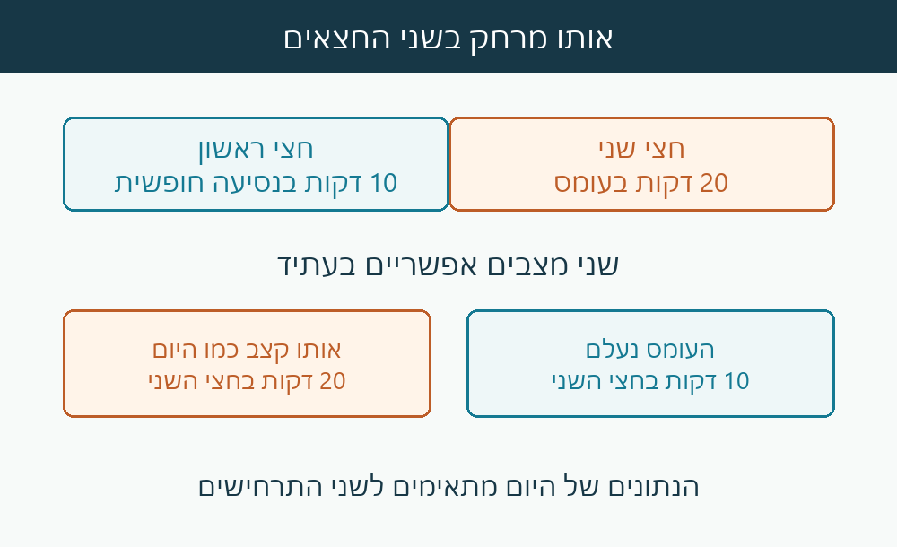
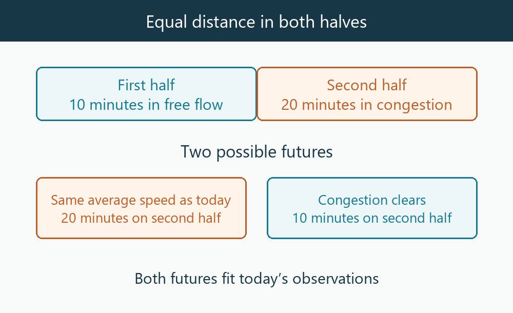

# PREP-375 — מה אפשר לדעת על הפקק בעוד עשר שנים?

פתרון מוצע בסיוע AI. ממתין לביקורת מקצועית אנושית.

[צילום המקור](../sources/2026-11-18-batch31-13.png)

אני נוסע כל יום בקו ישר מהבית לעבודה במשך חצי שעה. ב־10 הדקות הראשונות אני עובר חצי דרך באופן חופשי וב־20 דקות עובר את שארית הדרך בפקק. כמה דקות אעמוד בפקק בעוד 10 שנים?

## מה אפשר לדעת על הפקק בעוד עשר שנים?

נסיעה לעבודה נמשכת כיום 30 דקות. את חצי המרחק הראשון עוברים ב־10 דקות בנסיעה חופשית. את החצי השני עוברים ב־20 דקות בפקק. כמה זמן יימשך הקטע העמוס בעוד עשר שנים? הסבירו אילו גדלים אפשר לחשב כבר עכשיו, ומה דרוש לניבוי עתידי. האם זמן הנסיעה בקטע מספיק כדי לדעת כמה דקות הרכב עמד ללא תנועה?

### רמזים

1. איזה נתון מתאר את היום ואיזה מתאר את העתיד?
2. השוו זמני נסיעה לשני מרחקים שווים, ואז הציעו שני תרחישים עתידיים המתיישבים עם המדידה הנוכחית.
3. אם מהירות הנסיעה החופשית הייתה נשמרת גם בחצי השני, הוא היה נמשך 10 דקות. איזו מסקנה נובעת מזה על העיכוב היום?

### פתרון מוצע

### הנתון הנוכחי מאפשר לחשב מהירות יחסית ועיכוב
נסמן את המרחק הכולל `D`. מהירות ממוצעת בחצי הראשון היא `D/20` יחידות מרחק לדקה, ובחצי השני `D/40`. היחס הוא 2. תחת ההנחה שנסיעה חופשית באותה מהירות אפשרית גם בחצי השני, זמן הנסיעה שם ללא עומס הוא 10 דקות, ולכן העיכוב ביחס לקו הבסיס הוא 10 דקות. הזמן הכולל בקטע העמוס ביום שנמדד הוא 20 דקות.

בעוד עשר שנים אותם 20 דקות יתקבלו אם המסלול והמהירות הממוצעת בקטע יישארו זהים. אם העומס ייעלם והמהירות החופשית תישאר זהה, חציית הקטע תיקח 10 דקות ולא יהיה עיכוב מהעומס. שני התרחישים מתיישבים עם כל הנתונים הנוכחיים, ולכן אין תחזית מספרית יחידה.

אפשר לעבור את החצי השני במהירות אטית וקבועה במשך 20 דקות, או לעמוד 10 דקות ואז לנסוע 10 דקות במהירות החופשית. המרחק והזמן הכולל שווים בשני המקרים, אך זמן העמידה שונה.

### הנחות

משווים מהירות ממוצעת במרחקים שווים. חישוב העיכוב משתמש באותה מהירות חופשית בשני החצאים כקו בסיס.

### מקרה קצה

זמן עמידה בפועל יכול להיות אפס, גם כאשר הקטע העמוס מכפיל את זמן הנסיעה.

### טעות נפוצה

לבלבל בין 20 הדקות שנמדדו בקטע העמוס לבין 10 דקות העיכוב ביחס לקו הבסיס.

### סיבוכיות או עלות

שני תרחישים התואמים לאותו עבר ומניבים עתיד שונה מוכיחים שהתשובה אינה נקבעת מהנתונים.

### בדיקות

דוגמאות זמני הנסיעה, המהירויות וזמן העמידה נבדקו חשבונית.

### תשובה קצרה

מהנתונים אפשר למצוא יחס מהירויות של 2 ועיכוב נוכחי של 10 דקות ביחס למהירות החופשית. תחזית עתידית דורשת הנחות על המסלול והעומס.

### שאלת המשך

מה יקרה אם המהירות הממוצעת בקטע השני תשתפר ב־25% והמרחק יישאר קבוע? הזמן משתנה ביחס הפוך למהירות, כך ש־20 חלקי 1.25 הם 16 דקות.

## How much traffic will the commute have in ten years?

Today a commute takes 30 minutes. The first half of its distance takes 10 minutes in free-flowing traffic. The second half takes 20 minutes in congestion. How long will the congested segment take ten years from now? Explain what you can calculate now and what a future prediction requires. Does the current travel time tell you how long the vehicle was fully stopped?

### Hints

1. Which observations describe the present, and which describe the future?
2. Compare travel times over two equal distances. Then think of two futures consistent with the present observation.
3. If the free-flow speed also applied to the second half, that half would take 10 minutes. What does that imply about the delay today?

### Proposed solution

### Current travel times give relative speed and delay
Let the full distance be `D`. The average speed on the first half is `D/20` distance units per minute, and on the second half it is `D/40`. Their ratio is 2. If both halves can be traveled at the first-half free-flow speed, the second half would take 10 minutes without congestion. The delay relative to that baseline is 10 minutes. The observed travel time on the congested segment is 20 minutes.

Twenty minutes would still be the answer in ten years if the route and the average speed on that segment stayed the same. If congestion disappeared and free-flow speed stayed the same, traversing the segment would take 10 minutes with zero congestion delay. Both futures fit the present observations, so there is no unique numeric prediction.

The vehicle could cover the second half at a constant slow speed for 20 minutes, or stop for 10 minutes and then drive for 10 minutes at free-flow speed. Distance and elapsed time are identical in both examples, with different stopped time.

### Assumptions

The halves have equal distance. The delay calculation uses the first-half free-flow speed as a baseline for both halves.

### Edge case

Actual stopped time may be zero even when congestion doubles the time to travel the segment.

### Common mistake

Using 20 minutes for both excess delay and total segment time confuses different measurements.

### Cost

Two scenarios that fit the same past and imply different futures establish underdetermination.

### Verification

The travel, speed and stopped-time examples were checked arithmetically.

### Interview answer

The data give a speed ratio of 2 and a present delay of 10 minutes relative to free flow. A future estimate needs assumptions about the route and congestion.

### Follow-up

If average speed on the second half increases by 25% at the same distance, how long does it take? Time is inversely proportional to speed, so divide 20 by 1.25 to get 16 minutes.

[checks/check_nov18_reasoning.py](../checks/check_nov18_reasoning.py)

[checks/prep-375-1118-verification.json](../checks/prep-375-1118-verification.json)
